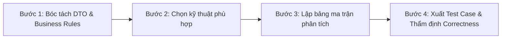

# Black-Box Test Design Techniques Skill

Kỹ năng này cung cấp phương pháp luận và quy trình chuẩn mực để AI Agent (đặc biệt là `@tester`) thiết kế bộ test case chất lượng cao, đúng đắn, không bỏ sót lỗi và loại trừ hoàn toàn việc viết test sơ sài hoặc ngụy tạo kết quả.

---

## 1. Khi nào kích hoạt Skill này?
Kích hoạt skill này bất cứ khi nào bạn được yêu cầu:
1. Phân tích yêu cầu (SRS, User Story, API Contract/DTO) để thiết kế Test Case.
2. Kiểm tra tính bao phủ và tính đúng đắn của một bộ Test Case hiện có.
3. Tạo kịch bản kiểm thử cho các luồng nghiệp vụ phức tạp:
   - Dữ liệu đầu vào có miền giá trị/độ dài/khoảng số $\rightarrow$ Kỹ thuật 1, 2, 3.
   - Logic nghiệp vụ kết hợp nhiều điều kiện $\rightarrow$ Kỹ thuật 4.
   - Thực thể có vòng đời và trạng thái $\rightarrow$ Kỹ thuật 5.
   - Các điều kiện đầu vào có mối quan hệ ràng buộc nhân quả $\rightarrow$ Kỹ thuật 6.

---

## 2. Quy trình 4 bước thiết kế Test Case chuẩn hóa



### Bước 1: Khảo sát & Bóc tách DTO / Business Rules
- Đọc kỹ tài liệu nguồn theo thứ tự ưu tiên quy định tại [testing_rules.md](file:///D:/ki7/prj1/BTL_PRJ1/EnglishHub/.agents/private/testing_rules.md): Controller, DTO, Entity schema, Business Rules trong SRS.
- Liệt kê toàn bộ các trường dữ liệu đầu vào: Kiểu dữ liệu, miền giá trị (`min`, `max`), tính bắt buộc (`nullable`), định dạng (regex, format).
- Liệt kê các trạng thái (`status`), các quyền hạn (`role`), và các ràng buộc logic.

### Bước 2: Định tuyến Kỹ thuật Kiểm thử (Technique Selection)

| Đặc tính của Nghiệp vụ / Trường dữ liệu | Kỹ thuật phù hợp | Tài liệu tham chiếu |
|---|---|---|
| Miền giá trị rời rạc hoặc phân nhóm (Enum, Type, Role) | **1. Phân lớp tương đương (EP)** | [01-equivalence-partitioning.md](file:///D:/ki7/prj1/BTL_PRJ1/EnglishHub/.agents/skills/blackbox-test-design/references/01-equivalence-partitioning.md) |
| Dải số liên tục, độ dài ký tự, ngày tháng, file size | **2. Phân tích giá trị biên (BVA)** | [02-boundary-value-analysis.md](file:///D:/ki7/prj1/BTL_PRJ1/EnglishHub/.agents/skills/blackbox-test-design/references/02-boundary-value-analysis.md) |
| Form nhiều trường (DTO Create/Update), cần test âm bản | **3. Kết hợp EP + BVA (Anti-Masking)** | [03-ep-bva-combination.md](file:///D:/ki7/prj1/BTL_PRJ1/EnglishHub/.agents/skills/blackbox-test-design/references/03-ep-bva-combination.md) |
| Quyết định phân nhánh theo tổ hợp nhiều điều kiện if/else | **4. Bảng quyết định (Decision Table)** | [04-decision-table.md](file:///D:/ki7/prj1/BTL_PRJ1/EnglishHub/.agents/skills/blackbox-test-design/references/04-decision-table.md) |
| Thực thể có vòng đời (`DRAFT` $\to$ `PUBLISHED` $\to$ `CLOSED`) | **5. Bảng chuyển trạng thái (State Transition)** | [05-state-transition.md](file:///D:/ki7/prj1/BTL_PRJ1/EnglishHub/.agents/skills/blackbox-test-design/references/05-state-transition.md) |
| Điều kiện đầu vào có ràng buộc loại trừ, bắt buộc, che giấu | **6. Lược đồ nhân quả (Cause-Effect Graph)** | [06-cause-effect-graph.md](file:///D:/ki7/prj1/BTL_PRJ1/EnglishHub/.agents/skills/blackbox-test-design/references/06-cause-effect-graph.md) |

### Bước 3: Lập Bảng Ma trận Phân tích
Trước khi viết mã test hoặc import vào Qase, Agent bắt buộc phải lập bảng phân tích trung gian:
- Ma trận phân lớp tương đương và giá trị biên.
- Bảng chân lý quyết định (Decision Table với các cột Rule R1, R2...).
- Ma trận chuyển trạng thái (State Table với các chuyển đổi hợp lệ và chuyển đổi cấm).
- Bảng chân lý có ràng buộc từ lược đồ nhân quả.

### Bước 4: Xuất Test Case & Thẩm định Tính Đúng đắn
1. Đặt tên test case theo chuẩn bắt buộc:
   ```text
   [TC_<SUITE>_<NN>] <Động từ/Chủ thể> — <Điều kiện hoặc dữ liệu cụ thể> — <Kết quả mong đợi>
   ```
2. Đảm bảo cấu trúc: **1 Step = 1 Action**, **Expected Result tương ứng 1:1**.
3. Rà soát qua [correctness-checklist.md](file:///D:/ki7/prj1/BTL_PRJ1/EnglishHub/.agents/skills/blackbox-test-design/references/correctness-checklist.md) trước khi bàn giao.

---

## 3. Nguyên tắc Vàng Đảm bảo Tính Đúng đắn (Correctness)

1. **Triệt tiêu Fault Masking (Nguyên tắc One-Invalid-at-a-Time)**:
   - Khi kiểm thử một giá trị không hợp lệ hoặc vượt biên của trường $X$, **tất cả các trường còn lại phải mang giá trị hợp lệ**. Tuyệt đối không gửi 2 dữ liệu lỗi cùng lúc trong một ca kiểm thử.
2. **Kiểm thử để tìm bug, không làm xanh báo cáo**:
   - Mong đợi phản hồi lỗi chính xác từ backend (400, 401, 403, 404, 422), không nới lỏng assertion để test pass giả tạo.
3. **Độc lập kịch bản (Execution Mode: `isolated`)**:
   - Mỗi test case phải tự túc dữ liệu, tự xác thực token và dọn dẹp (cleanup) dữ liệu rác nó tạo ra.
4. **Không suy diễn hợp đồng (No Assumptions)**:
   - Nếu contract chưa quy định rõ mã lỗi hoặc hành vi tại biên, đánh dấu trạng thái `needs-spec-confirm` hoặc `Blocked/Scope Gap`.
