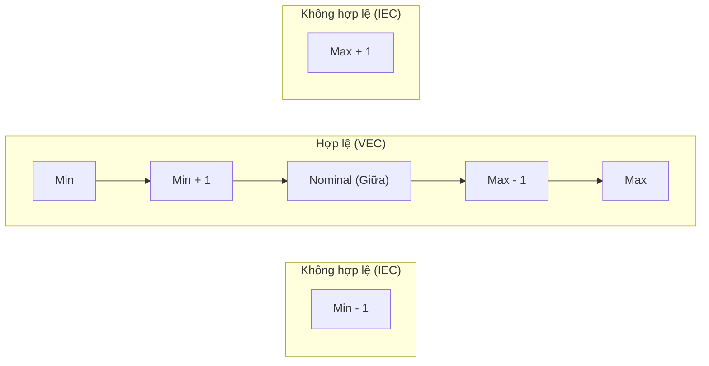

# Kỹ thuật 2: Phân tích giá trị biên (Boundary Value Analysis - BVA)

## 1. Bản chất Kỹ thuật
Phân tích giá trị biên (BVA) là kỹ thuật kiểm thử hộp đen dựa trên nguyên lý: **Lỗi lập trình có xu hướng tập trung với mật độ cao nhất tại các ranh giới/biên của miền dữ liệu** thay vì ở khu vực trung tâm.
- **Nguyên nhân cốt lõi**:
  - Lập trình viên hay nhầm lẫn toán tử quan hệ: dùng `<` thay vì `<=`, `>` thay vì `>=`.
  - Lỗi "Off-by-one" (lệch 1 đơn vị) trong vòng lặp hoặc điều kiện chặn mảng.
  - Tràn số (overflow/underflow) hoặc sai lệch đơn vị đo lường (byte vs KB, giây vs mili-giây).

---

## 2. Các Phương Pháp Xác Định Giá Trị Biên

### 2.1. Phương pháp 2 điểm (Standard 2-Point Boundary)
Áp dụng cho kiểm thử biên tiêu chuẩn, tập trung vào giá trị ngay tại biên và giá trị ngay bên ngoài biên:
Với miền giá trị hợp lệ $[Min, Max]$:
- **Biên dưới (Lower boundary)**:
  - $Min$ (Biên hợp lệ)
  - $Min - 1$ (Ngoài biên không hợp lệ)
- **Biên trên (Upper boundary)**:
  - $Max$ (Biên hợp lệ)
  - $Max + 1$ (Ngoài biên không hợp lệ)

### 2.2. Phương pháp 3 điểm (Robustness 3-Point Boundary)
Áp dụng cho các tính năng trọng yếu (tính điểm số, tài chính, phân quyền, dữ liệu nhạy cảm):
Với miền giá trị hợp lệ $[Min, Max]$:
- **Biên dưới**: $\{Min - 1, Min, Min + 1\}$
- **Giá trị danh định (Nominal / Midpoint)**: $(Min + Max) / 2$
- **Biên trên**: $\{Max - 1, Max, Max + 1\}$

---

## 3. Quy tắc Ứng Dụng BVA trong Dự Án EnglishHub

### 3.1. Biên Độ Dài Chuỗi (String Length)
*Quy định: Tiêu đề bài tập `title` từ 3 đến 200 ký tự*
- $Min = 3$, $Max = 200$, đơn vị bước nhảy $\Delta = 1$ ký tự:
  - $Min - 1 = 2$ ký tự $\rightarrow$ Mong đợi: `HTTP 400`
  - $Min = 3$ ký tự $\rightarrow$ Mong đợi: `HTTP 201 Created`
  - $Min + 1 = 4$ ký tự $\rightarrow$ Mong đợi: `HTTP 201 Created`
  - $Max - 1 = 199$ ký tự $\rightarrow$ Mong đợi: `HTTP 201 Created`
  - $Max = 200$ ký tự $\rightarrow$ Mong đợi: `HTTP 201 Created`
  - $Max + 1 = 201$ ký tự $\rightarrow$ Mong đợi: `HTTP 400`

### 3.2. Biên Dung Lượng File Upload (File Size Boundaries)
*Quy định: Audio upload tối đa 25 MB ($25 \times 1024 \times 1024 = 26,214,400$ bytes)*
- $Min = 1$ byte: File âm thanh có dung lượng nhỏ nhất hợp lệ $\rightarrow$ `HTTP 200`
- $Min - 1 = 0$ bytes: File hoàn toàn rỗng $\rightarrow$ `HTTP 400 (File cannot be empty)`
- $Max = 26,214,400$ bytes (Đúng 25.0 MB) $\rightarrow$ `HTTP 200`
- $Max + 1 = 26,214,401$ bytes (25 MB + 1 byte) $\rightarrow$ `HTTP 400/413 (File size exceeds limit)`

### 3.3. Biên Thời Gian và Hạn Nộp (Date & Time Deadlines)
*Quy định: Nộp bài trước hạn `closeAt`*
- $T_{deadline} - 1$ giây: Nộp bài sát giờ $\rightarrow$ Chấp nhận bài nộp, trạng thái `SUBMITTED`.
- $T_{deadline}$: Nộp bài đúng thời điểm hết hạn $\rightarrow$ Chấp nhận bài nộp (nếu quy ước $\le$).
- $T_{deadline} + 1$ giây: Nộp bài trễ 1 giây $\rightarrow$ Từ chối bài nộp, báo lỗi `Assignment is closed` (`HTTP 400`).

### 3.4. Biên Phân Trang (Pagination Boundaries)
*Quy định: `limit` từ 1 đến 100, `offset` $\ge 0$*
- `limit = 0` $\rightarrow$ Lỗi `HTTP 400` (giới hạn dưới không hợp lệ).
- `limit = 1` $\rightarrow$ Hợp lệ, trả về đúng 1 bản ghi.
- `limit = 100` $\rightarrow$ Hợp lệ, trả về tối đa 100 bản ghi.
- `limit = 101` $\rightarrow$ Lỗi `HTTP 400` hoặc tự động clamp về 100 (tùy contract API).
- `offset = 0` $\rightarrow$ Trang đầu tiên.
- `offset = Total - 1` $\rightarrow$ Bản ghi cuối cùng.
- `offset = Total` $\rightarrow$ Trả về mảng rỗng `[]`, `total` giữ nguyên.

---

## 4. Mẫu Bảng Phân Tích Giá Trị Biên (BVA Matrix)

| Thuộc tính | Miền hợp lệ | Điểm biên | Giá trị kiểm thử | Kỳ vọng | Phân loại |
|---|---|---|---|---|---|
| `score` | $[0.0, 10.0]$ | $Min - 0.1$ | `-0.1` | `HTTP 400` | Invalid Boundary |
| `score` | $[0.0, 10.0]$ | $Min$ | `0.0` | `HTTP 200` | Valid Boundary |
| `score` | $[0.0, 10.0]$ | $Nominal$ | `8.5` | `HTTP 200` | Nominal Value |
| `score` | $[0.0, 10.0]$ | $Max$ | `10.0` | `HTTP 200` | Valid Boundary |
| `score` | $[0.0, 10.0]$ | $Max + 0.1$ | `10.1` | `HTTP 400` | Invalid Boundary |
| `file` | $(0, 25\text{MB}]$ | $0\text{ byte}$ | File rỗng | `HTTP 400` | Invalid Boundary |
| `file` | $(0, 25\text{MB}]$ | $25\text{MB}$ | File đúng 25 MB | `HTTP 200` | Valid Boundary |
| `file` | $(0, 25\text{MB}]$ | $25\text{MB} + 1\text{B}$ | File 25MB + 1 byte | `HTTP 400` | Invalid Boundary |
