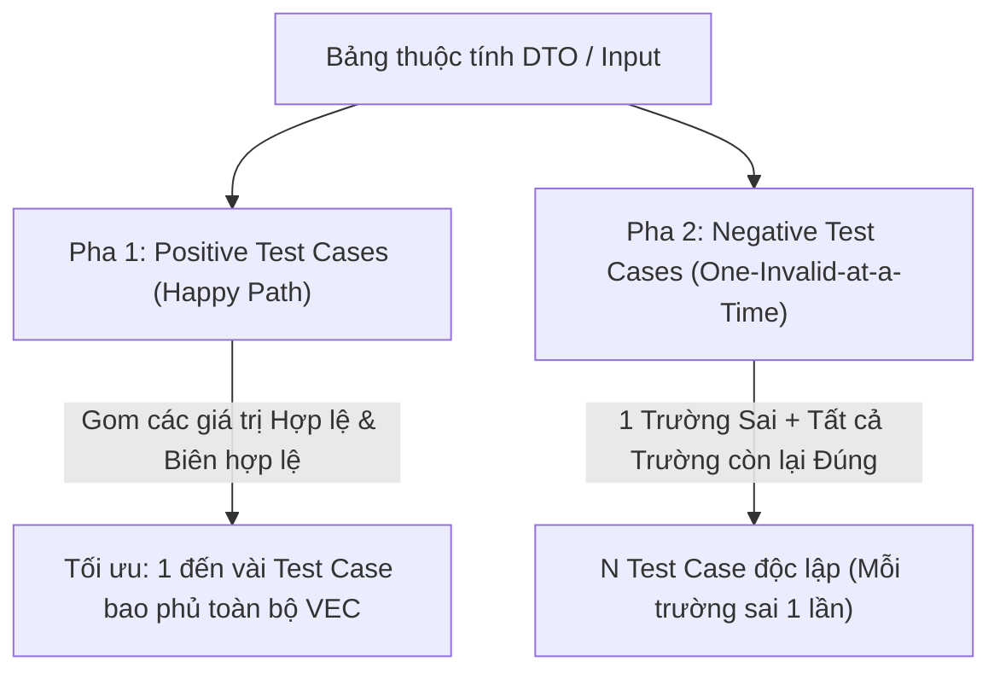

# Kỹ thuật 3: Kết hợp Phân lớp tương đương & Phân tích giá trị biên (Anti-Masking Strategy)

## 1. Tại sao phải Kết hợp EP và BVA?
Trong thực tế phát triển phần mềm, hai kỹ thuật này luôn đi đôi với nhau:
- **Phân lớp tương đương (EP)** giúp xác định cấu trúc toàn cảnh của các tập dữ liệu hợp lệ và không hợp lệ.
- **Phân tích giá trị biên (BVA)** đi sâu vào việc chọn ra các giá trị kiểm thử cụ thể và nguy cơ lỗi cao nhất nằm ngay tại ranh giới của các phân lớp đó.

Sự kết hợp này giúp kiểm thử viên tạo ra bộ ca kiểm thử vừa có **độ bao phủ rộng** (theo phân lớp), vừa có **độ sâu chính xác** (tại các điểm biên nguy hiểm).

---

## 2. Nguyên Tắc Cốt Lõi: Chống Lỗi Che Khuất Lỗi (Anti-Fault Masking)

> [!CAUTION]
> **Hiện tượng Lỗi che khuất lỗi (Fault Masking)** xảy ra khi một ca kiểm thử chứa từ 2 lỗi trở lên cùng lúc. Khi đó, bộ tiền xử lý validation của hệ thống sẽ bắt lỗi đầu tiên và ngắt xử lý (`early return 400`), khiến cho lỗi thứ hai không bao giờ được chạm tới.

### Ví dụ Thực Tế về Fault Masking
Xét request tạo người dùng với 2 trường:
- `email`: Sai định dạng (lỗi)
- `password`: Dài 500 ký tự gây tràn bộ đệm (lỗi bảo mật nghiêm trọng)

Nếu gộp chung vào 1 test case:
- Server phản hồi ngay: `400 Bad Request: "Email is invalid"`.
- Test case được đánh dấu là `Pass` vì server đã trả về lỗi 400.
- **Hệ quả**: Bug tràn bộ đệm tại trường `password` bị che giấu hoàn toàn và trôi qua Production!

---

## 3. Chiến Lược Thiết Kế Test Case Kết Hợp (Combination Strategy)

Để tránh Fault Masking và tối ưu số lượng test case, áp dụng nghiêm ngặt chiến lược 2 pha:

### Pha 1: Kiểm thử Tích cực (Positive Testing)
- **Mục tiêu**: Xác nhận hệ thống hoạt động đúng khi người dùng nhập dữ liệu chuẩn.
- **Cách làm**: Gom tối đa các giá trị đại diện hợp lệ ($VEC$) và các giá trị biên hợp lệ ($Min, Max$) vào một số lượng test case tối thiểu.
- Mỗi giá trị biên hợp lệ của một trường cần xuất hiện ít nhất trong một Positive Test Case.

### Pha 2: Kiểm thử Tiêu cực (Negative Testing — Quy tắc One-Invalid-at-a-Time)
- **Mục tiêu**: Đảm bảo hệ thống phát hiện chính xác từng lỗi riêng biệt và trả về mã lỗi thích hợp.
- **Quy tắc bắt buộc**:
  - Với mỗi phân lớp không hợp lệ ($IEC$) hoặc giá trị biên ngoài ($Min - 1, Max + 1$):
    - Đặt trường đang kiểm tra mang **giá trị lỗi duy nhất**.
    - **Tất cả các trường khác bắt buộc phải mang giá trị HỢP LỆ (Nominal Valid)**.

---

## 4. Minh Họa Ma Trận Kết Hợp: API Tạo Bài Tập (Create Assignment)

Xét DTO tạo bài tập gồm 3 trường:
1. `title`: Chuỗi $[3, 200]$ ký tự.
2. `durationMinutes`: Số nguyên $[5, 180]$ phút.
3. `maxSubmissions`: Số nguyên $[1, 10]$ lần.

### Bảng Ma Trận Test Case Kết Hợp:

| Mã Test Case | `title` | `durationMinutes` | `maxSubmissions` | Loại kịch bản | Kết quả mong đợi |
|---|---|---|---|---|---|
| **TC_ASG_01** | `"Reading Test"` *(VEC danh định)* | `60` *(VEC danh định)* | `3` *(VEC danh định)* | Happy Path (Danh định) | `201 Created` |
| **TC_ASG_02** | `"Mid"` *(Biên Min = 3)* | `5` *(Biên Min = 5)* | `1` *(Biên Min = 1)* | Happy Path (Biên Min hợp lệ) | `201 Created` |
| **TC_ASG_03** | Chuỗi 200 ký tự *(Biên Max)* | `180` *(Biên Max = 180)* | `10` *(Biên Max = 10)* | Happy Path (Biên Max hợp lệ) | `201 Created` |
| **TC_ASG_04** | **`"AB"` *(Biên Min - 1 = 2)*** | `60` *(Hợp lệ)* | `3` *(Hợp lệ)* | Negative (Lỗi title quá ngắn) | `400 Bad Request` |
| **TC_ASG_05** | **Chuỗi 201 ký tự *(Max + 1)*** | `60` *(Hợp lệ)* | `3` *(Hợp lệ)* | Negative (Lỗi title quá dài) | `400 Bad Request` |
| **TC_ASG_06** | **`""` *(Rỗng / IEC)*** | `60` *(Hợp lệ)* | `3` *(Hợp lệ)* | Negative (Lỗi title rỗng) | `400 Bad Request` |
| **TC_ASG_07** | `"Reading Test"` *(Hợp lệ)* | **`4` *(Biên Min - 1)*** | `3` *(Hợp lệ)* | Negative (Lỗi duration < 5) | `400 Bad Request` |
| **TC_ASG_08** | `"Reading Test"` *(Hợp lệ)* | **`181` *(Biên Max + 1)*** | `3` *(Hợp lệ)* | Negative (Lỗi duration > 180) | `400 Bad Request` |
| **TC_ASG_09** | `"Reading Test"` *(Hợp lệ)* | `60` *(Hợp lệ)* | **`0` *(Biên Min - 1)*** | Negative (Lỗi maxSubmissions < 1) | `400 Bad Request` |
| **TC_ASG_10** | `"Reading Test"` *(Hợp lệ)* | `60` *(Hợp lệ)* | **`11` *(Biên Max + 1)*** | Negative (Lỗi maxSubmissions > 10) | `400 Bad Request` |

> [!NOTE]
> Nhìn vào ma trận trên, từ `TC_ASG_04` đến `TC_ASG_10`, mỗi ca kiểm thử chỉ chứa đúng **1 giá trị in đậm** (lỗi duy nhất), đảm bảo không bao giờ xảy ra lỗi che khuất lỗi.
