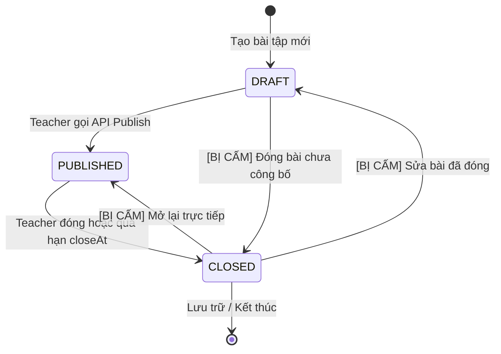
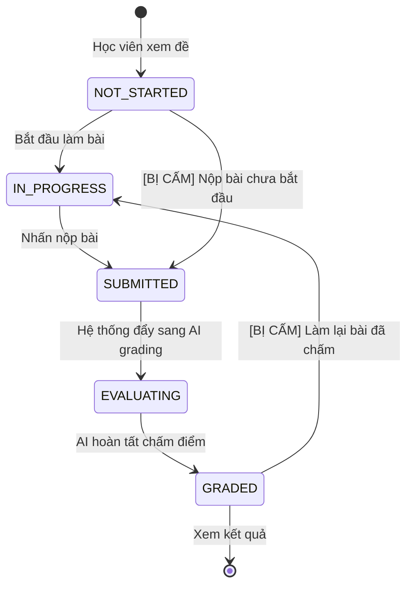

# Kỹ thuật 5: Kỹ thuật Bảng chuyển trạng thái (State Transition Testing)

## 1. Bản chất Kỹ thuật
Bảng chuyển trạng thái (State Transition Testing) là kỹ thuật kiểm thử dựa trên mô hình **Máy trạng thái hữu hạn (Finite State Machine - FSM)**. Kỹ thuật này được áp dụng cho các thực thể hoặc màn hình có hành vi thay đổi theo thời gian và phụ thuộc vào **trạng thái hiện tại** cùng **sự kiện kích hoạt (Event/Trigger)**.

- **Khi nào áp dụng**:
  - Thực thể có vòng đời nghiệp vụ (ví dụ: Bài tập, Bài nộp, Tài khoản người dùng).
  - Giao diện có quy trình wizard nhiều bước hoặc giỏ hàng/thanh toán.
  - Các hệ thống yêu cầu kiểm soát thứ tự thực thi nghiêm ngặt.

---

## 2. Các Khái Niệm Trọng Tâm

1. **Trạng thái (State)**: Tình trạng hoặc giai đoạn mà thực thể đang lưu giữ (ví dụ: `DRAFT`, `PUBLISHED`, `CLOSED`).
2. **Sự kiện (Event / Trigger)**: Tác động từ bên ngoài kích hoạt sự thay đổi (ví dụ: Gọi API `POST /publish`, Học viên nhấn `Submit`).
3. **Điều kiện bảo vệ (Guard / Condition)**: Điều kiện phụ trợ bắt buộc phải đúng thì sự kiện mới làm thay đổi trạng thái.
4. **Hành động (Action)**: Kết quả hoặc phản hồi do việc chuyển đổi sinh ra (ví dụ: Gửi thông báo email, trả về `HTTP 200`).
5. **Chuyển đổi hợp lệ (Valid Transition)**: Tuyến đường trạng thái được cho phép theo thiết kế.
6. **Chuyển đổi bất hợp pháp (Invalid / Sneak Transition)**: Cố gắng chuyển trạng thái trái phép, vi phạm quy trình (ví dụ: nhảy cóc hoặc đi lùi trạng thái).

---

## 3. Các Mô Hình Trạng Thái Cốt Lõi trong EnglishHub

### 3.1. Vòng Đời Bài Tập (Assignment Lifecycle)

### 3.2. Vòng Đời Bài Nộp (Submission Lifecycle)

---

## 4. Ma Trận Chuyển Trạng Thái (State Transition Matrix)

Lập ma trận 2 chiều: **Trạng thái hiện tại** $\times$ **Sự kiện**:

| Trạng thái hiện tại | Sự kiện: `Publish` | Sự kiện: `Close` | Sự kiện: `Update Title` | Sự kiện: `Submit Student Attempt` |
|---|---|---|---|---|
| **`DRAFT`** | $\to$ `PUBLISHED` (Hợp lệ) | Bị từ chối (`400`) *(Cấm)* | Vẫn là `DRAFT` (Hợp lệ) | Bị từ chối (`400`) *(Cấm)* |
| **`PUBLISHED`** | Bị từ chối (`400`) *(Cấm)* | $\to$ `CLOSED` (Hợp lệ) | Vẫn là `PUBLISHED` (Hợp lệ) | $\to$ `SUBMITTED` (Hợp lệ) |
| **`CLOSED`** | Bị từ chối (`400`) *(Cấm)* | Bị từ chối (`400`) *(Cấm)* | Bị từ chối (`400`) *(Cấm)* | Bị từ chối (`400`) *(Cấm)* |

---

## 5. Chiến Lược Sinh Test Case từ Máy Trạng Thái

### 5.1. Kiểm thử Tuyến Hợp Lệ (Valid Transitions — 0-switch Coverage)
Tạo các ca kiểm thử đi qua từng mũi tên chuyển trạng thái hợp lệ ít nhất 1 lần:
- **TC_STATE_01**: Tạo bài `DRAFT` $\to$ Gọi `Publish` $\to$ Trạng thái chuyển thành `PUBLISHED` (`HTTP 200`).
- **TC_STATE_02**: Bài `PUBLISHED` $\to$ Gọi `Close` $\to$ Trạng thái chuyển thành `CLOSED` (`HTTP 200`).
- **TC_STATE_03**: Bài `DRAFT` $\to$ Sửa tiêu đề $\to$ Cập nhật thành công, trạng thái vẫn là `DRAFT`.

### 5.2. Kiểm thử Tuyến Bất Hợp Pháp (Invalid Transitions — Chống Nhảy Cóc & Đi Lùi)
Mỗi ô đánh dấu *(Cấm)* trong ma trận phải được kiểm thử để chứng minh hệ thống không bị lỗi state:
- **TC_STATE_04**: Cố gắng chuyển bài `CLOSED` ngược lại thành `DRAFT` $\to$ Mong đợi: `HTTP 400 Bad Request` ("Cannot modify closed assignment").
- **TC_STATE_05**: Cố gắng đóng bài đang ở trạng thái `DRAFT` mà chưa công bố $\to$ Mong đợi: `HTTP 400`.
- **TC_STATE_06**: Cố gắng nộp bài cho một Assignment đang ở trạng thái `DRAFT` $\to$ Mong đợi: `HTTP 400` ("Assignment is not available").

---

## 6. Tiêu chí Bao Phủ (Coverage Criteria)
- **All States Coverage (100%)**: Mọi trạng thái hợp lệ phải được ghé thăm ít nhất một lần.
- **0-switch Transition Coverage (100%)**: Mọi bước chuyển trạng thái hợp lệ đơn lẻ phải được kích hoạt và kiểm tra tính bền vững dữ liệu (persistence) trong Database.
- **Negative Transition Coverage**: Tối thiểu 100% các hành động cấm nguy cơ cao (sửa thực thể đã đóng, nộp bài sai trạng thái) phải có test case chặn thành công.
