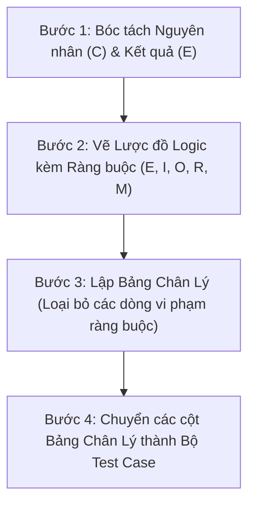

# Kỹ thuật 6: Kỹ thuật Lược đồ nhân quả (Cause-Effect Graphing)

## 1. Bản chất Kỹ thuật
Lược đồ nhân quả (Cause-Effect Graphing) là kỹ thuật kiểm thử hộp đen hình thức, sử dụng **đồ thị logic Boole** để biểu diễn mối liên hệ phức tạp giữa các điều kiện đầu vào (**Nguyên nhân - Causes**) và các hành động đầu ra (**Kết quả - Effects**).

- **Khi nào áp dụng**:
  - Khi văn bản đặc tả nghiệp vụ chứa quá nhiều từ khóa liên kết: `VÀ (AND)`, `HOẶC (OR)`, `NẾU... THÌ...`, `KHÔNG ĐƯỢC ĐỒNG THỜI`.
  - Khi giữa các điều kiện đầu vào có sự phụ thuộc và ràng buộc lẫn nhau (ví dụ: phương thức nộp bài chỉ chọn 1 trong 2, đã chọn nộp audio thì bắt buộc phải có microphone).
  - Khi cần tránh việc sinh ra số lượng test case tổ hợp khổng lồ bằng cách loại trừ các tổ hợp vô lý ngay từ đầu.

---

## 2. Các Ký Hiệu Logic Cơ Bản

```mermaid
flowchart LR
    subgraph Identity ["Quan hệ Đồng nhất (Identity)"]
        C1["C1"] -->|1:1| E1["E1 = C1"]
    end
    subgraph NotRel ["Quan hệ Phủ định (NOT)"]
        C2["C2"] -->|~ (NOT)| E2["E2 = ~C2"]
    end
    subgraph AndRel ["Quan hệ Hội (AND)"]
        C3["C3"] & C4["C4"] -->|& (AND)| E3["E3 = C3 & C4"]
    end
    subgraph OrRel ["Quan hệ Tuyển (OR)"]
        C5["C5"] & C6["C6"] -->|v (OR)| E4["E4 = C5 v C6"]
    end
```

---

## 3. Các Ràng Buộc Kỹ Thuật (Constraints)

Trong thực tế, các nguyên nhân hoặc kết quả không hoàn toàn độc lập mà bị giới hạn bởi các ràng buộc vật lý hoặc nghiệp vụ:

### 3.1. Ràng buộc giữa các Nguyên nhân (Constraints on Causes)
1. **Ràng buộc E (Exclusive - Loại trừ lẫn nhau)**:
   - Tối đa chỉ có 1 nguyên nhân mang giá trị 1. Không thể cả hai cùng là 1 ($C_1 + C_2 \le 1$).
   - *Ví dụ*: Định dạng file nộp là `.pdf` hoặc `.wav`; không thể một file vừa là pdf vừa là wav.
2. **Ràng buộc I (Inclusive - Bao hàm)**:
   - Ít nhất 1 nguyên nhân phải mang giá trị 1. Không thể cả hai cùng là 0 ($C_1 + C_2 \ge 1$).
   - *Ví dụ*: Đăng ký nhận thông báo qua `Email` hoặc `SMS` (phải chọn ít nhất 1 phương thức).
3. **Ràng buộc O (One and Only One - Đúng một)**:
   - Bắt buộc phải có đúng 1 nguyên nhân mang giá trị 1 ($C_1 + C_2 = 1$).
   - *Ví dụ*: Vai trò người dùng khi tạo chỉ có thể là `TEACHER` hoặc `STUDENT`.
4. **Ràng buộc R (Requires - Yêu cầu)**:
   - Nếu nguyên nhân $C_1 = 1$ thì bắt buộc nguyên nhân $C_2$ cũng phải bằng 1 ($C_1 \implies C_2$).
   - *Ví dụ*: Muốn nộp bài Speaking ($C_1$) thì thiết bị bắt buộc phải cấp quyền Micro ($C_2$).

### 3.2. Ràng buộc giữa các Kết quả (Constraints on Effects)
- **Ràng buộc M (Masks - Che giấu)**:
  - Nếu kết quả $E_1$ xảy ra thì kết quả $E_2$ sẽ bị che giấu/vô hiệu hóa.
  - *Ví dụ*: Nếu hệ thống báo lỗi xác thực `401 Unauthorized` ($E_1$), thì thông báo lưu nháp thành công ($E_2$) sẽ bị hủy bỏ.

---

## 4. Quy Trình 4 Bước Thiết Kế từ Lược Đồ Nhân Quả



### Ví dụ Thực Tế: Quy Tắc Tính Điểm Bài Thi Trắc Nghiệm (Reading Quiz)
- **Nguyên nhân**:
  - $C_1$: Nộp bài trước hạn `closeAt`.
  - $C_2$: Trả lời đúng từ 80% câu hỏi trở lên.
  - $C_3$: Giáo viên kích hoạt chế độ "Điểm danh dự" (Honors Mode).
  - Ràng buộc: $C_2$ đòi hỏi $C_1$ ($C_2 \implies C_1$, vì nộp quá hạn thì bài thi không được tính điểm).
- **Kết quả**:
  - $E_1$: Kết quả bài thi: `PASSED`.
  - $E_2$: Được cấp chứng chỉ hoàn thành xuất sắc (`CERTIFIED`).
  - $E_3$: Kết quả bài thi: `FAILED`.

### Đồ thị logic:
- $E_1 = C_1 \wedge C_2$
- $E_2 = E_1 \wedge C_3$
- $E_3 = \neg E_1$ (với ràng buộc $E_1$ Masks $E_3$)

### Bảng chân lý rút gọn (loại bỏ trường hợp $C_2 = 1$ nhưng $C_1 = 0$ do vi phạm ràng buộc Requires):

| Nguyên nhân / Kết quả | Test Case 1 | Test Case 2 | Test Case 3 | Test Case 4 |
|---|:---:|:---:|:---:|:---:|
| $C_1$: Nộp đúng hạn | 1 | 1 | 1 | 0 |
| $C_2$: Đúng $\ge 80\%$ | 1 | 1 | 0 | 0 |
| $C_3$: Bật Honors Mode | 1 | 0 | 1 | 0 |
| **$E_1$: Trạng thái `PASSED`** | **1** | **1** | **0** | **0** |
| **$E_2$: Cấp chứng chỉ `CERTIFIED`** | **1** | **0** | **0** | **0** |
| **$E_3$: Trạng thái `FAILED`** | **0** | **0** | **1** | **1** |

---

## 5. Tiêu chí Bao Phủ (Coverage Criteria)
- **Cause-Effect Completeness**: 100% các nguyên nhân và kết quả đều xuất hiện trong ít nhất một trạng thái kích hoạt (1) và vô hiệu hóa (0).
- **Constraint Compliance**: Không sinh ra bất kỳ test case nào vi phạm các ràng buộc $E, I, O, R$.
- **Tối ưu hóa**: Bảng chân lý đã được loại bỏ các hàng/cột dư thừa, chuyển thành tập test case tối thiểu có thể thực thi được ngay.
