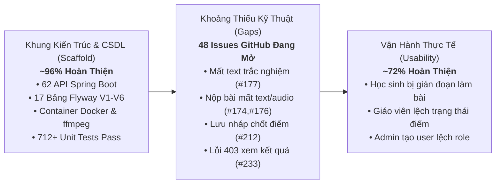
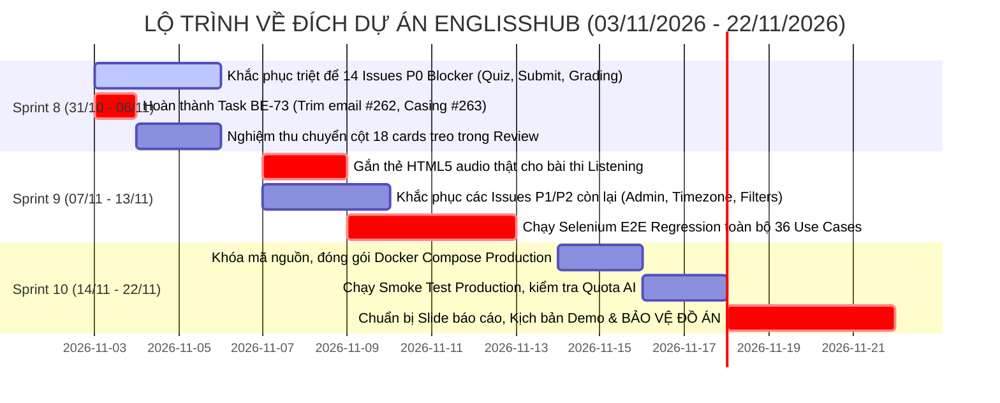

# BÁO CÁO PHÂN TÍCH KHOẢNG THIẾU KỸ THUẬT (CORE GAP), CÁC TÍNH NĂNG DƯ THỪA & LỘ TRÌNH VỀ ĐÍCH
## ĐỐI SOÁT TRUNG THỰC VỚI 3 NGUỒN SỰ THẬT (01.SRS, 02.PP, 03.TP) & 48 DEFECTS GITHUB ĐANG TỒN ĐỌNG

> **Dự án**: EnglishHub — Hệ thống Quản lý & Chấm chữa bài tập Tiếng Anh Thông minh  
> **Ngày cập nhật**: **03/11/2026 (Phiên bản 4.0 - Đánh giá Thực tế Theo Mô hình Hai Tầng & Danh mục 48 Defects)**  
> **Người thực hiện**: Antigravity Technical Assistant (Đóng vai trò Cố vấn Kỹ thuật Độc lập)  
> **Căn cứ đối chiếu**: Toàn bộ tài liệu kỹ thuật cốt lõi (`docs/core/`: 00.PI, 01.SRS, 02.PP, 03.TP), 48 Open GitHub Issues, Trello Board `Project1`, đối chiếu với Mã nguồn thực tế hiện hữu (Spring Boot Backend 712+ tests, FastAPI AI Service ffmpeg, React 19 Frontend 46 screens, Flyway Migrations V1-V6).  
> **Tài liệu kiểm định chuyên sâu kế thừa**:
> - [**`docs/PROJECT_COMPLETE_AUDIT_AND_BUGS.md`**](file:///D:/Codin/utc-code/HK4_1/Project1/EnglishHub/docs/PROJECT_COMPLETE_AUDIT_AND_BUGS.md): Toàn bộ danh mục 48 lỗi chi tiết kèm file, dòng code và nguyên nhân gốc.
> - [**`docs/CORE_REQUIREMENTS_COMPLIANCE_AUDIT.md`**](file:///D:/Codin/utc-code/HK4_1/Project1/EnglishHub/docs/CORE_REQUIREMENTS_COMPLIANCE_AUDIT.md): Ma trận tuân thủ 36 Use Cases và phân tích mô hình 2 tầng.
> - [**`docs/TRELLO_PP_TP_SRS_ALIGNMENT_AUDIT.md`**](file:///D:/Codin/utc-code/HK4_1/Project1/EnglishHub/docs/TRELLO_PP_TP_SRS_ALIGNMENT_AUDIT.md): Đối soát 10 Sprints độc lập và độ lệch trạng thái quản lý.

---

## 1. TÓM TẮT TRẠNG THÁI DỰ ÁN (EXECUTIVE SUMMARY - PHIÊN BẢN 4.0)

Trải qua chuỗi hơn 110 Pull Requests, hệ thống EnglishHub đã hoàn thiện một khung kiến trúc phân tầng rất bài bản (Clean Architecture, DDD, Event-driven, Docker đa dịch vụ, AI Service tích hợp Gemini Multimodal). Tuy nhiên, khi đối chiếu nghiêm ngặt với 48 GitHub Issues đang mở, **dự án tồn tại khoảng cách rất lớn giữa "Khung mã nguồn" và "Trải nghiệm vận hành thực tế"**:

### Bảng Đánh Giá Hiện Trạng 2 Tầng Từng Khối Hệ Thống:

| Khối thành phần | Hoàn thiện Khung Kiến trúc (Tầng 1) | Vận hành Thực tế Đầu-Cuối (Tầng 2) | Đánh giá hiện trạng & Điểm nghẽn then chốt |
| :--- | :---: | :---: | :--- |
| **Cơ sở dữ liệu (Database)** | **99%** | **95%** | Lược đồ V6 hoàn chỉnh với 17 bảng nghiệp vụ, migrations Flyway (V1 - V6) hoạt động ổn định trên PostgreSQL 16. Chỉ cần tối ưu hóa một số index và xóa các trường ngoài phạm vi. |
| **Backend API (Spring Boot)** | **96%** | **85%** | 62 endpoints đầy đủ, event-driven auto-grading (`BE-66`), bảo toàn instruction snapshot (`BE-67`), thu hồi token khi soft-delete (`BE-64`). **Khoảng thiếu**: DTO `QuestionResponse` chưa tách mảng options sạch cho học sinh (#177), `ApiRoutePolicy` chặn nhầm role STUDENT xem kết quả gợi ý AI (#233), và task `BE-73` (trim email #262, casing camelCase #263). |
| **Trí tuệ nhân tạo (AI Engine)** | **96%** | **90%** | Microservice độc lập FastAPI, tích hợp Gemini Flash Multimodal, container đóng gói `ffmpeg` transcode audio 16kHz WAV (`OPS-39`), bảo mật `X-Internal-Secret` (`OPS-36`). **Khoảng thiếu**: Phụ thuộc vào dữ liệu đầu vào; khi học sinh bị mất text/audio lúc submit, AI không có dữ liệu để chấm. |
| **Giao diện người dùng (Frontend)** | **95%** | **65%** | 46 màn hình React 19, `ExamStepper` tích hợp đồng bộ. **Khoảng thiếu nghiêm trọng nhất**: Chứa 35/48 issues GitHub: mất text trắc nghiệm (#177), short answer biến thành radio (#182), submit mất text/PDF/audio (#174, #175, #176), false positive toast khi HTTP 400 (#184, #207), nút Lưu nháp gọi nhầm chốt điểm (#212), trình phát Listening chưa có thẻ `<audio>` thật. |
| **Hạ tầng & Vận hành (DevOps)** | **96%** | **90%** | 8 GitHub Actions pipelines, Docker Compose môi trường dev/staging/prod. **Khoảng thiếu**: Cấu hình Nginx fallback cho React Router khi refresh đường dẫn con (#159), kiểm soát hạn mức Quota Gemini Production. |
| **Đảm bảo chất lượng (QA & Test)** | **88%** | **60%** | Backend đạt 712+ tests. Đã có 3 bộ test Selenium thực tế. **Khoảng thiếu**: 18 thẻ Trello trong cột `Review` treo nhiều ngày chưa được Tester xác nhận; chưa chạy bộ kiểm thử hồi quy tự động liên hoàn 36 UCs. |

---

## 2. CÁC TÍNH NĂNG & THÀNH PHẦN DƯ THỪA SO VỚI ĐẶC TẢ CỐT LÕI (OUT-OF-SCOPE ANALYSIS)

Để dự án tập trung 100% nguồn lực giải quyết 48 issues tồn đọng trong **Sprint 8 và Sprint 9**, dưới đây là danh sách phân tích các thành phần **bị thừa, vượt quá phạm vi đặc tả Core SRS (`01.SRS.md`)** cần được loại bỏ hoặc đóng băng:

### 2.1. Thành Phần Dư Thừa Phía Cơ Sở Dữ Liệu & Backend
1. **Module Phát hiện Đạo văn (Plagiarism Detection Module)**:
   - *Hiện trạng*: Trong bảng CSDL `gradings` có các cột `is_plagiarism_flagged` (BOOLEAN) và `plagiarism_score` (NUMERIC).
   - *Đánh giá*: **VƯỢT PHẠM VI CORE SRS**. Đề tài Project 1 xác định rõ trọng tâm là quản lý bài tập 4 kỹ năng và chấm chữa thông minh bằng AI cho Speaking/Writing. Dự án không có yêu cầu hay cam kết thuật toán phát hiện đạo văn (Turnitin clone).
   - *Quyết định kỹ thuật*: Giữ trường ở trạng thái mặc định `false`/`null`, **tuyệt đối không tốn công sức phát triển thêm UI hay logic kiểm tra đạo văn**.
2. **Quản lý Phiên Đăng nhập Đa Thiết bị (Multi-Device Active Sessions Management)**:
   - *Hiện trạng*: Bảng `refresh_tokens` lưu chi tiết `ip_address`, `user_agent`, `revoked_at` phục vụ thu hồi token theo từng thiết bị riêng lẻ.
   - *Đánh giá*: **VƯỢT PHẠM VI CORE SRS**. SRS chỉ yêu cầu đăng nhập, đăng xuất và phân quyền cơ bản.
   - *Quyết định kỹ thuật*: Giữ logic thu hồi token nội bộ khi logout, **không phát triển màn hình giao diện quản lý thiết bị người dùng**.
3. **Phân loại Task độc lập "Viết lại câu" (Sentence Rewrite as Standalone Task)**:
   - *Hiện trạng*: Trong Enum CSDL có `module_task_type.REWRITE`.
   - *Đánh giá*: Trong Core SRS, kỹ năng Đọc và Nghe làm việc với câu hỏi trắc nghiệm/điền từ ngắn, còn Viết là bài luận. Tách REWRITE thành loại task độc lập với giao diện riêng làm phức tạp hóa hệ thống một cách không cần thiết.
   - *Quyết định kỹ thuật*: Quy về dạng câu hỏi SHORT_ANSWER trong module Reading/Writing.

### 2.2. Thành Phần Dư Thừa Phía Giao Diện Người Dùng (Frontend UI)
1. **Ngân Hàng Đề Thi / Bài Tập Mẫu (`TeacherExamBank.tsx` - `/teacher/exam-bank`)**:
   - Đánh giá: Thẻ Trello `[FE-46]` (Issue #158) đang nằm trong cột `Blocked` do nút bấm không điều hướng. **Quyết định: Đóng thẻ này (Close/Archive)**, gỡ liên kết khỏi Sidebar của giáo viên để không làm nhiễu danh sách công việc.
2. **Lưu Trữ Lớp Học Độc Lập (`AdminClassArchive.tsx` - `/admin/classes/archive`)**:
   - Đánh giá: Dư thừa route riêng. Đã tích hợp bộ lọc trạng thái lớp học trong `Classes.tsx`.
3. **Không Gian Làm Việc Tự Học Cá Nhân (`StudentWorkspace.tsx` - `/student/workspace`)**:
   - Đánh giá: Vượt phạm vi đồ án. Ẩn khỏi Sidebar của học viên.
4. **Hòm Thư Phản Hồi Riêng Biệt (`StudentFeedback.tsx` - `/student/feedback`)**:
   - Đánh giá: Giao diện chứa nhiều lỗi (#179, #180). Nhận xét và điểm số nên tập trung hiển thị trực tiếp tại trang kết quả bài làm (`StudentSubmissionResult.tsx`).
5. **Giao Diện Phân Quyền Động (`Roles.tsx` - `/admin/roles`)**:
   - Đánh giá: Hệ thống chỉ có 3 vai trò cố định (`ADMIN`, `TEACHER`, `STUDENT`) được định nghĩa trong enum mã nguồn. Không cần phát triển bảng phân quyền động.

---

## 3. BẢNG ĐỐI CHIẾU HIỆN TRẠNG 4 KỸ NĂNG & AI SERVICE (ĐÁNH GIÁ THỰC TẾ)

| Kỹ năng / Module | Tiến độ Khung Mã | Đánh giá Vận hành Thực tế | Tình trạng Hoạt động | Điểm nghẽn kỹ thuật còn thiếu (Gaps) | Tệp nguồn then chốt |
| :--- | :---: | :---: | :---: | :--- | :--- |
| **Writing** | 98% | **75%** | 🟡 Gãy luồng nộp bài | Giao diện đã có form nhập từ và tải tệp DOCX/PDF lên S3. Nhưng khi submit, nội dung text bị gửi sai trường (#174), file PDF không được đính kèm (#175), nộp DOCX trả 500 (#205), và nuốt lỗi HTTP 400 rồi tự ý xóa bản nháp của học sinh (#184, #207). | [`StudentAssignmentWriting.tsx`](file:///D:/Codin/utc-code/HK4_1/Project1/EnglishHub/frontend/src/pages/StudentAssignmentWriting.tsx), [`SubmissionService.java`](file:///D:/Codin/utc-code/HK4_1/Project1/EnglishHub/backend/src/main/java/com/english_hub/core/modules/submission/application/service/SubmissionService.java) |
| **Speaking** | 96% | **75%** | 🟡 Gãy luồng nộp audio | Đã có hook `MediaRecorder` và upload S3 presigned URL. Nhưng khi submit, audio storage key bị thất lạc khiến bài nộp không có audio (#176), nút nộp bài bật sáng khi chưa thu âm (#183). | [`StudentAssignmentSpeaking.tsx`](file:///D:/Codin/utc-code/HK4_1/Project1/EnglishHub/frontend/src/pages/StudentAssignmentSpeaking.tsx), [`audio_processor.py`](file:///D:/Codin/utc-code/HK4_1/Project1/EnglishHub/ai-service/app/services/audio_processor.py) |
| **Reading** | 98% | **70%** | 🔴 Mất nội dung câu hỏi | Câu trắc nghiệm bị mất chữ, hiển thị fallback rỗng A/B/C/D do Backend gán `correctAnswer: null` (#177). Câu SHORT_ANSWER bị biến thành radio (#182). Bấm nộp trắng vẫn báo thành công (#232). | [`StudentAssignmentReading.tsx`](file:///D:/Codin/utc-code/HK4_1/Project1/EnglishHub/frontend/src/pages/StudentAssignmentReading.tsx), [`QuestionResponse.java`](file:///D:/Codin/utc-code/HK4_1/Project1/EnglishHub/backend/src/main/java/com/english_hub/core/modules/question/presentation/rest/dto/QuestionResponse.java) |
| **Listening** | 92% | **60%** | 🔴 Thiếu audio & mất text | Bị dính lỗi mất chữ trắc nghiệm (#177) tương tự Reading. Đồng thời, trình phát audio phía học sinh vẫn là thanh giả lập (`01:24 / 04:30`), chưa gắn thẻ HTML5 `<audio>` thật kết nối tới `GET /api/v1/modules/{id}/audio`. | [`StudentAssignmentListening.tsx`](file:///D:/Codin/utc-code/HK4_1/Project1/EnglishHub/frontend/src/pages/StudentAssignmentListening.tsx), [`ModuleController.java:118`](file:///D:/Codin/utc-code/HK4_1/Project1/EnglishHub/backend/src/main/java/com/english_hub/core/modules/module/presentation/rest/ModuleController.java) |
| **Teacher Studio** | 98% | **70%** | 🟡 Lưu nháp thành chốt điểm | Đã có bảng duyệt Annotations AI. Nhưng nút "Lưu bản nháp" lại gọi nhầm API chốt điểm chính thức làm khóa bài học sinh (#212). Backend chặn quyền học sinh xem lại annotations AI khiến trang kết quả dính 403 (#233). Nhầm `submissionId` với `assignmentId` ở bảng điểm (#178). | [`TeacherSubmissionDetails.tsx`](file:///D:/Codin/utc-code/HK4_1/Project1/EnglishHub/frontend/src/pages/TeacherSubmissionDetails.tsx), [`StudentSubmissionResult.tsx`](file:///D:/Codin/utc-code/HK4_1/Project1/EnglishHub/frontend/src/pages/StudentSubmissionResult.tsx) |
| **AI Service** | 96% | **90%** | 🟢 Hoạt động ổn định | Độc lập, FastAPI, Gemini Flash Multimodal, Docker `ffmpeg`, bảo mật `X-Internal-Secret`. Hoạt động tốt khi nhận được payload chuẩn từ Backend. | `ai-service/app/`, [`AiServiceClientImpl.java`](file:///D:/Codin/utc-code/HK4_1/Project1/EnglishHub/backend/src/main/java/com/english_hub/core/modules/grading/infrastructure/client/AiServiceClientImpl.java) |

---

## 4. BẢNG PHÂN RÃ KHOẢNG THIẾU KỸ THUẬT THEO 4 CỤM THẤT BẠI (48 ISSUES GITHUB)

### Cụm 1: Gãy luồng Quiz (Reading & Listening)
- **Khoảng thiếu**: Frontend bóc tách phương án trắc nghiệm sai cấu trúc DTO Backend; không phân biệt kiểu câu hỏi; nuốt validation khi nộp bài trắng.
- **Danh sách Issues**: #177 (P0), #182 (P0), #232 (P0), #223 (P1), #226 (P1).
- **Giải pháp**: Tách trường `options: [{id, content}]` độc lập với `correctAnswer` ở Backend DTO; Frontend sửa nhánh render `SHORT_ANSWER` sang `<input />` và bắt buộc chọn đáp án mới cho submit.

### Cụm 2: Gãy luồng Nộp bài & Lưu trữ Đa phương tiện (Writing & Speaking)
- **Khoảng thiếu**: Dữ liệu bài làm (text bài luận, key file PDF, key file Audio) bị thất lạc giữa các bước gọi API; xóa bản nháp cục bộ khi API trả lỗi.
- **Danh sách Issues**: #174 (P0), #175 (P0), #176 (P0), #183 (P1), #184 (P0), #205 (P1), #207 (P0), #208 (P1), #213 (P2).
- **Giải pháp**: Chuẩn hóa tên trường trong `submitModule` payload (`textContent`, `docStorageKey`, `audioStorageKey`); chỉ xóa draft trong `localStorage` khi và chỉ khi nhận HTTP 200/201; kiểm tra file/audio trước khi bật nút Nộp.

### Cụm 3: Lỗi Phòng Chấm Điểm Giáo Viên & Xem Kết Quả Học Sinh
- **Khoảng thiếu**: Nút chức năng gọi sai API; bất đồng bộ quyền hạn giữa Spring Security và màn hình hiển thị; nhầm lẫn ID trong bảng điểm.
- **Danh sách Issues**: #212 (P0), #233 (P0), #178 (P1), #185 (P1), #186 (P1), #179 (P1), #180 (P2), #214 (P1), #215 (P1).
- **Giải pháp**: Trong `TeacherSubmissionDetails.tsx`, tách rõ hàm `saveDraft()` (gọi PATCH draft) và `publishGrade()` (gọi POST submit-grade); trong `ApiRoutePolicy.java`, cho phép Role `STUDENT` gọi endpoint xem annotations của bài nộp do chính mình sở hữu; sửa ánh xạ ID bài tập trong `StudentGrades.tsx`.

### Cụm 4: Lỗi Phân Quyền, Quản Trị Hệ Thống & Ràng Buộc Thời Gian
- **Khoảng thiếu**: Form tạo người dùng không gửi role; datetime-local dùng sai múi giờ UTC; thiếu kiểm tra ngày đóng sau ngày mở; bộ lọc client không gọi Backend.
- **Danh sách Issues**: #195 (P0), #210 (P1), #211 (P1), #209 (P1), #189 (P1), #190 (P1), #191 (P1), #192 (P1), #193 (P1), #194 (P1), #197 (P2), #262 (P2), #263 (P2).
- **Giải pháp**: Đưa `role` vào body tạo user; validate `closeAt > openAt`; định dạng datetime local theo múi giờ client; truyền query parameter tìm kiếm xuống Backend.

---

## 5. LỘ TRÌNH VỀ ĐÍCH CHI TIẾT (10 SPRINTS ĐỘC LẬP - KHÔNG GỘP)

Để tuân thủ triệt để kế hoạch [02.PP.md](file:///D:/Codin/utc-code/HK4_1/Project1/EnglishHub/docs/core/02.PP.md) và [03.TP.md](file:///D:/Codin/utc-code/HK4_1/Project1/EnglishHub/docs/core/03.TP.md), dưới đây là lộ trình hành động dồn lực trong các tuần cuối:

### Các cột mốc hành động then chốt:

1. **Sprint 8 (Hiện tại: Kết thúc 06/11/2026)**:
   - **Mục tiêu tối thượng**: Xóa sạch toàn bộ các lỗi P0 (Blocker) đang ngăn cản học sinh nộp bài và giáo viên chấm bài.
   - `@fe-primary` & `@be-primary`: Sửa dứt điểm #177, #182, #232 (Cụm Quiz); #174, #175, #176, #184, #207 (Cụm Submit); #212, #233 (Cụm Grading & Kết quả).
   - `@tester`: Kiểm định và chuyển 18 thẻ đang treo trong cột `Review` sang `Done (Sprint 7)`.
2. **Sprint 9 (07/11/2026 – 13/11/2026)**:
   - **Mục tiêu**: Hoàn thiện bài nghe Listening bằng thẻ `<audio>` thật; chạy kiểm thử hồi quy toàn trình.
   - `@fe-primary`: Gắn thẻ `<audio src="/api/v1/modules/{id}/audio" controls />` vào `StudentAssignmentListening.tsx`.
   - `@fe-secondary`: Sửa các lỗi giao diện quản trị (#189, #190, #191, #193, #210, #211).
   - `@tester`: Kích hoạt bộ kiểm thử tự động Selenium qua 3 bộ test kịch bản thực tế, xác nhận toàn bộ 36 Use Cases đạt chuẩn.
3. **Sprint 10 (14/11/2026 – 22/11/2026)**:
   - **Mục tiêu**: Đóng gói sản phẩm, diễn tập demo và bảo vệ đồ án tốt nghiệp.
   - `@devops-primary`: Hoàn tất cấu hình `docker-compose.prod.yml`, biến môi trường, backup DB `pg_dump`.
   - Toàn đội ngũ: Khóa nhánh `develop` merge vào `main`, chuẩn bị tài liệu báo cáo và sẵn sàng bảo vệ thành công trước ngày **22/11/2026**.
