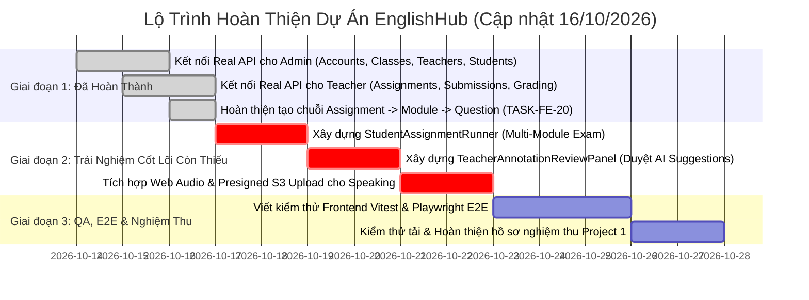

# Báo Cáo Phân Tích Khoảng Thiếu Kỹ Thuật So Với Core SRS, Các Tính Năng Dư Thừa & Lộ Trình Hoàn Thiện (Core Gap & Redundancy Analysis)

> **Dự án**: EnglishHub — Hệ thống Quản lý & Chấm chữa bài tập Tiếng Anh Thông minh  
> **Ngày cập nhật**: 16/10/2026 (Phiên bản 2.0 - Cập nhật sau khi đối soát toàn bộ mã nguồn thực tế)  
> **Người thực hiện**: Hệ thống Phân tích Antigravity Agent  
> **Cơ sở đối chiếu**: Toàn bộ tài liệu kỹ thuật cốt lõi (`docs/core/`: 00.PI, 01.SRS, 02.PP, 03.TP) đối chiếu với Mã nguồn thực tế hiện hữu (Spring Boot Backend, FastAPI AI Service, React 19 Frontend, Flyway Migrations).

---

## 1. Tóm Tắt Trạng Thái Dự Án (Executive Summary)

Trải qua các chu kỳ phát triển liên tục (`BE-TASK-10` đến `BE-TASK-16`, `TASK-FE-AXIOS-INTEGRATION`, `TASK-FE-TEACHER-DASHBOARD`, `TASK-FE-20`, v.v.), hệ thống **EnglishHub** đã đạt bước nhảy vọt về mức độ hoàn thiện ở cả 3 phân hệ (Admin, Teacher, Student):

| Khối thành phần | Tỷ lệ hoàn thiện ước tính | Đánh giá hiện trạng | Điểm nghẽn chính cần giải quyết |
| :--- | :---: | :--- | :--- |
| **Cơ sở dữ liệu (Database)** | **98%** | Lược đồ V6 hoàn chỉnh với 17 bảng nghiệp vụ, migrations Flyway (V1 - V6) hoạt động ổn định trên PostgreSQL 16. | Cần rà soát các cột thừa không nằm trong Core SRS (Plagiarism, Sessions). |
| **Backend API (Spring Boot)** | **98%** | **Hoàn thành 100% các cụm API nghiệp vụ (62/62 endpoints)**. Đã xong Cụm 7 (Student Evaluations #58-#62 trong `BE-TASK-10`), Auto-grading Engine (`BE-TASK-13`), và Unified AI Grading API (`BE-TASK-16`). Hơn 666+ automated tests chạy pass 100%. | Đang hoạt động hoàn chỉnh; cần kiểm tra tải và bảo đảm bảo mật token khi chạy môi trường thực tế. |
| **Trí tuệ nhân tạo (AI Engine)** | **85%** | **Microservice độc lập hoàn chỉnh**: Xây dựng AI Microservice độc lập (`ai-service` FastAPI) với Google Gemini Flash multimodal, pipeline chấm Speaking (Whisper STT, Fluency metrics trong `BE-TASK-14`) và Writing (Text metrics, CEFR/IELTS rubrics, annotations trong `BE-TASK-15`). Backend Spring Boot đã kết nối qua `AiServiceClient`. | Cần kiểm tra hạn mức quota Gemini API Key thật trên môi trường Production và tối ưu thời gian phản hồi (caching). |
| **Giao diện người dùng (Frontend)** | **90%** | Đã xây dựng 46 màn hình bằng React 19, Vite, TypeScript. AuthContext đã kết nối JWT login thật. **Toàn bộ phân hệ Quản trị (Admin) và Giáo viên (Teacher) đã kết nối API thật** (`Accounts`, `Classes`, `Teachers`, `Students`, `TeacherAssignments`, `TeacherSubmissionDetails`, `AdminReports`, `AdminGradingAuditLogs`). | Thiếu Multi-module Exam Runner (`StudentAssignmentRunner.tsx`); Thiếu Bảng duyệt AI Annotation (`TeacherAnnotationReviewPanel.tsx`); Luồng ghi âm Speaking cần Web Audio API thật; Trình phát audio bài Nghe. |
| **Hạ tầng & Vận hành (DevOps)** | **92%** | Đã cấu hình 8 GitHub Actions pipelines, Docker Compose đa dịch vụ (backend, ai-service, postgres, minio), mạng Tailscale Mesh VPN và bảo mật TruffleHog. | Cần kích hoạt pipeline build cho `ai-service` và cấu hình SSH Secrets deploy tự động lên VPS Production. |
| **Đảm bảo chất lượng (QA & Test)** | **75%** | Backend đạt 666+ tests (Unit + Integration Testcontainers). AI service có test suite riêng. Frontend có test suites cho API service qua Node test runner. | **Frontend hoàn toàn thiếu kiểm thử tự động giao diện (Component Tests & E2E Tests)**. Chưa có kiểm thử tải tích hợp (Load Testing). |

---

## 2. 🚨 CÁC TÍNH NĂNG & THÀNH PHẦN DƯ THỪA SO VỚI ĐẶC TẢ CỐT LÕI (Redundant & Out-of-Scope Analysis)

Để dự án tập trung tối đa nguồn lực vào việc nghiệm thu đúng các mục tiêu của **Project 1** và không bị phân tán, dưới đây là danh sách phân tích toàn diện các thành phần **bị thừa, vượt quá phạm vi đặc tả Core SRS (`01.SRS.md`)**:

### 2.1. Thành Phần Dư Thừa Phía Cơ Sở Dữ Liệu & Backend

1. **Module Phát hiện Đạo văn (Plagiarism Detection Module)**:
   - *Hiện trạng*: Trong bảng CSDL `gradings` có các cột `is_plagiarism_flagged` (BOOLEAN) và `plagiarism_score` (NUMERIC).
   - *Đánh giá*: **VƯỢT PHẠM VI CORE SRS**. Đề tài Project 1 xác định rõ trọng tâm là quản lý bài tập 4 kỹ năng và chấm chữa thông minh bằng AI cho Speaking/Writing. Dự án không có yêu cầu hay cam kết thuật toán phát hiện đạo văn (Turnitin clone).
   - *Khuyến nghị*: Bỏ qua logic này, để trường giá trị mặc định `false`/`null`, không tốn công sức phát triển thêm UI hay AI service phát hiện đạo văn.
2. **Quản lý Phiên Đăng nhập Đa Thiết bị (Multi-Device Active Sessions Management)**:
   - *Hiện trạng*: Bảng `refresh_tokens` lưu chi tiết `ip_address`, `user_agent`, `revoked_at` phục vụ thu hồi token theo từng thiết bị.
   - *Đánh giá*: **VƯỢT PHẠM VI CORE SRS**. SRS chỉ yêu cầu đăng nhập, đăng xuất và phân quyền người dùng cơ bản. Quản lý danh sách thiết bị đang online là tính năng bảo mật nâng cao ngoài phạm vi.
   - *Khuyến nghị*: Giữ logic thu hồi token nội bộ khi logout, không phát triển màn hình giao diện quản lý thiết bị người dùng.
3. **Phân loại Task độc lập "Viết lại câu" (Sentence Rewrite as Standalone Task)**:
   - *Hiện trạng*: Trong Enum CSDL có `module_task_type.REWRITE`.
   - *Đánh giá*: Trong Core SRS, kỹ năng Đọc và Nghe làm việc với câu hỏi trắc nghiệm/điền từ ngắn, còn Viết là bài luận. Tách REWRITE thành loại task độc lập với giao diện riêng làm phức tạp hóa hệ thống một cách không cần thiết.

### 2.2. Thành Phần Dư Thừa Phía Giao Diện Người Dùng (Frontend UI)

1. **Ngân Hàng Đề Thi / Bài Tập Mẫu (`TeacherExamBank.tsx` - `/teacher/exam-bank`)**:
   - *Đánh giá*: **VƯỢT PHẠM VI (Out of Scope)**. Core SRS quy định giáo viên tạo bài tập trực tiếp cho lớp (UC11, UC12). Không có use case về kho đề thi trung tâm dùng chung.
   - *Xử lý*: Giữ trang ở dạng tham khảo phụ, ẩn liên kết khỏi Sidebar chính của giáo viên để tránh phân tán tài nguyên.
2. **Lưu Trữ Lớp Học Độc Lập (`AdminClassArchive.tsx` - `/admin/classes/archive`)**:
   - *Đánh giá*: **DƯ THỪA (Redundant)**. SRS chỉ yêu cầu quản lý trạng thái lớp học (Mở/Đóng). Việc tách riêng trang lưu trữ làm rối luồng quản trị.
   - *Xử lý*: Chuyển thành bộ lọc trạng thái lớp học trong `Classes.tsx`, gỡ bỏ route riêng.
3. **Không Gian Làm Việc Tự Học Cá Nhân (`StudentWorkspace.tsx` - `/student/workspace`)**:
   - *Đánh giá*: **VƯỢT PHẠM VI (Out of Scope)**. Học viên chỉ có nghiệp vụ làm bài tập được giao và xem bài chữa. Workspace chứa ghi chú tự do không nằm trong SRS.
   - *Xử lý*: Ẩn khỏi Sidebar của học viên.
4. **Hòm Thư Phản Hồi Riêng Biệt (`StudentFeedback.tsx` - `/student/feedback`)**:
   - *Đánh giá*: **DƯ THỪA (Redundant)**. Lời phê bài nộp đã có ở trang kết quả từng bài, còn đánh giá của giáo viên đã có trong trang chi tiết lớp học.
   - *Xử lý*: Ẩn khỏi Sidebar, tập trung hiển thị nhận xét tại trang kết quả bài tập.
5. **Giao Diện Phân Quyền Động (`Roles.tsx` - `/admin/roles`)**:
   - *Đánh giá*: **VƯỢT PHẠM VI (Out of Scope)**. Hệ thống chỉ có 3 vai trò cố định (`ADMIN`, `TEACHER`, `STUDENT`) được mã hóa trong hệ thống. Việc quản lý ma trận phân quyền là dư thừa.
6. **Điều Hướng Tắt Bị Hardcode Trong `App.tsx`**:
   - Route `/progress` redirect cứng về `/teacher/classes/ENG-IELTS-6.5A/progress` (hardcode mã lớp `ENG-IELTS-6.5A`).
   - Route `/reports` redirect cứng về `/admin/reports` mà không kiểm tra vai trò người dùng.
   - Nhiều alias URL trùng lặp (`/teacher/assignments/:id/edit` vs `/teacher/assignments/edit/:id`, `/student/assignments/:id/result` vs `/student/submissions/:id`).

---

## 3. Bảng Đối Chiếu Toàn Diện 35+ Ca Sử Dụng (Core SRS vs. Hiện Trạng)

Dưới đây là bảng đối chiếu cập nhật chi tiết toàn bộ các Ca sử dụng theo Mục 2 của [`docs/core/01.SRS.md`](file:///d:/Codin/utc-code/HK4_1/Project1/EnglishHub/docs/core/01.SRS.md):

| STT | Tên Ca Sử Dụng (SRS) | Tác nhân | Backend API | Frontend UI | Trạng thái tích hợp | Hiện trạng & Cần làm |
| :---: | :--- | :---: | :---: | :---: | :---: | :--- |
| 1 | Đăng nhập | Admin, Teacher, Student | Hoàn thành | Hoàn thành | **ĐÃ TÍCH HỢP** | Đã kết nối `POST /api/v1/auth/login`, nhận JWT và lưu vào `tokenStorage`. |
| 2 | Đăng xuất | Admin, Teacher, Student | Hoàn thành | Hoàn thành | **ĐÃ TÍCH HỢP** | Đã gọi `POST /api/v1/auth/logout`, xóa token trên client và database. |
| 3 | Quản lý tài khoản cá nhân | Mọi người dùng | Hoàn thành | Hoàn thành | **ĐÃ TÍCH HỢP** | Trang Profile đã kết nối `userService.getProfile` và `userService.changePassword`. |
| 4 | Quản lý tài khoản người dùng | Admin | Hoàn thành | Hoàn thành | **ĐÃ TÍCH HỢP** | `Accounts.tsx` đã kết nối `useUsers` và `userService.listUsers`, `userService.updateUser`. |
| 5 | Phân quyền người dùng | Admin | Hoàn thành | Giao diện tĩnh | **Thừa một phần** | Role là cố định (`ADMIN`, `TEACHER`, `STUDENT`). Gán quyền trực tiếp qua form sửa người dùng. |
| 6 | Quản lý giáo viên | Admin | Hoàn thành | Hoàn thành | **ĐÃ TÍCH HỢP** | `Teachers.tsx`, `AddTeacher.tsx`, `TeacherDetails.tsx` đã kết nối `userService` và `classService`. |
| 7 | Quản lý học viên | Admin | Hoàn thành | Hoàn thành | **ĐÃ TÍCH HỢP** | `Students.tsx`, `AddStudent.tsx`, `StudentDetails.tsx` đã kết nối `userService` và `reportService`. |
| 8 | Quản lý lớp học | Admin, Teacher | Hoàn thành | Hoàn thành | **ĐÃ TÍCH HỢP** | `Classes.tsx`, `AddClass.tsx`, `ClassDetails.tsx` đã kết nối `classService`. |
| 9 | Quản lý thành viên lớp học | Admin, Teacher | Hoàn thành | Hoàn thành | **ĐÃ TÍCH HỢP** | `ClassDetails.tsx` đã kết nối `classService.listMembers`, `addMember`, `removeMember`. |
| 10 | Xem danh sách lớp học | Teacher, Student | Hoàn thành | Hoàn thành | **ĐÃ TÍCH HỢP** | Cả Teacher (`TeacherClasses.tsx`) và Student (`StudentClasses.tsx`) đều gọi `classService.list`. |
| 11 | Quản lý bài tập (CRUD) | Teacher | Hoàn thành | Hoàn thành | **ĐÃ TÍCH HỢP** | `TeacherAssignments.tsx` đã gọi `assignmentService.listAssignments`, `classService.list`. |
| 12 | Tạo bài tập đa kỹ năng | Teacher | Hoàn thành | Hoàn thành | **ĐÃ TÍCH HỢP** | `TeacherCreateAssignment.tsx` đã hiện thực tạo tuần tự Assignment -> Module -> Questions (`TASK-FE-20`). |
| 13 | Mở bài tập (Publish) | Teacher | Hoàn thành | Hoàn thành | **ĐÃ TÍCH HỢP** | Nút bấm Mở bài đã kết nối `assignmentService.publishAssignment`. |
| 14 | Khóa bài tập (Close) | Teacher | Hoàn thành | Hoàn thành | **ĐÃ TÍCH HỢP** | Nút Khóa bài đã kết nối `assignmentService.closeAssignment`. |
| 15 | Xem danh sách bài tập | Student | Hoàn thành | Hoàn thành | **ĐÃ TÍCH HỢP** | Trang `StudentAssignments.tsx` đã gọi `assignmentService` và `submissionService`. |
| 16 | Bắt đầu làm bài (Start Attempt) | Student | Hoàn thành | Hoàn thành | **ĐÃ TÍCH HỢP** | Đã gọi `submissionService.startAttempt` và lấy danh sách `submission_modules`. |
| 17 | Làm bài tập Viết (Writing) | Student | Hoàn thành | Hoàn thành | **ĐÃ TÍCH HỢP** | Đã nộp nội dung bài viết qua `submitModule`. |
| 18 | Làm bài tập Nói (Speaking) | Student | Hoàn thành | Hoàn thành UI | **Thiếu tải S3 thật** | Nộp submit thành công nhưng luồng ghi âm microphone và tải file S3 Presigned URL cần Web Audio thật. |
| 19 | Làm bài tập Đọc (Reading) | Student | Hoàn thành | Hoàn thành | **ĐÃ TÍCH HỢP** | Đã gửi mảng đáp án trắc nghiệm qua `submitModule`. |
| 20 | Làm bài tập Nghe (Listening) | Student | Hoàn thành | Hoàn thành | **ĐÃ TÍCH HỢP** | Đã phát âm thanh và gửi đáp án qua `submitModule` (cần thêm trình phát HTML5 chuẩn). |
| 21 | Xem lại bài làm trước khi nộp | Student | Hoàn thành | Hoàn thành | **ĐÃ TÍCH HỢP** | Đã hiển thị câu hỏi và đáp án trước khi bấm xác nhận nộp. |
| 22 | Nộp bài tập chính thức | Student | Hoàn thành | Hoàn thành | **ĐÃ TÍCH HỢP** | Đã gọi `POST /submissions/{id}/submit` chốt trạng thái `SUBMITTED`. |
| 23 | Quản lý lượt làm bài | Student | Hoàn thành | Hoàn thành | **ĐÃ TÍCH HỢP** | Màn hình `StudentAssignmentOverview` đã hiển thị số lượt đã làm và số lượt cho phép. |
| 24 | Xem trạng thái bài làm | Student | Hoàn thành | Hoàn thành | **ĐÃ TÍCH HỢP** | Đã hiển thị các badge: `Chưa làm`, `Đang làm`, `Đang chấm`, `Đã có điểm`. |
| 25 | Chấm bài thủ công | Teacher | Hoàn thành | Hoàn thành | **ĐÃ TÍCH HỢP** | `TeacherSubmissionDetails.tsx` đã kết nối `gradingService.updateFinalGrade`. |
| 26 | Hỗ trợ chấm chữa bằng AI | Teacher | **Hoàn thành** | **Thiếu UI Duyệt** | **Thiếu Frontend** | Backend có `GET /submission-modules/{id}/grading/ai-suggestion`. Cần bảng duyệt annotation chuyên biệt (`TeacherAnnotationReviewPanel.tsx`). |
| 27 | Tự động chấm bài Đọc/Nghe | Hệ thống | **Hoàn thành** | Hoàn thành | **ĐÃ TÍCH HỢP** | Auto-grading engine so khớp đáp án `MULTIPLE_CHOICE` và `SHORT_ANSWER`, chấm điểm ngay khi nộp. |
| 28 | Xem điểm số & Bài chữa | Student | Hoàn thành | Hoàn thành | **ĐÃ TÍCH HỢP (Một phần)** | `StudentSubmissionResult.tsx` đã lấy dữ liệu grading. Cần hoàn thiện highlight đè lên text theo ký tự. |
| 29 | Quản lý nhật ký điểm số | Teacher, Admin | Hoàn thành | Hoàn thành | **ĐÃ TÍCH HỢP** | `AdminGradingAuditLogs.tsx` đã kết nối `gradingService.listGradings` và `gradingChangeLogService`. |
| 30 | Ghi chú chấm bài (Annotations) | Teacher | Hoàn thành | Hoàn thành | **ĐÃ TÍCH HỢP** | Đã có API CRUD Annotation. Cần giao diện review trực quan hơn. |
| 31 | Đánh giá học viên (Evaluations) | Teacher, Student | **Hoàn thành** | Hoàn thành | **ĐÃ TÍCH HỢP** | Đã kết nối `studentEvaluationService` ở cả Teacher Class Progress và Student Class Details. |
| 32 | Xem báo cáo & Thống kê | Admin, Teacher | Hoàn thành | Hoàn thành | **ĐÃ TÍCH HỢP** | `AdminReports.tsx`, `StudentAnalytics.tsx`, `TeacherClassProgress.tsx` đã kết nối `reportService`. |

---

## 4. Chi Tiết Các Phần Còn Thiếu Cần Hoàn Thiện (Actual Missing Gaps Breakdown)

Sau đợt tích hợp API thành công ngày 16/10/2026, các điểm nghẽn về Mock Data đã được giải tỏa. Những khoảng trống cốt lõi còn lại tập trung vào trải nghiệm người dùng chuyên sâu và kiểm thử tự động:

### 4.1. Phân hệ Giao diện Người dùng (Frontend)
1. **Bộ Chạy Bài Thi Đa Kỹ Năng (`StudentAssignmentRunner.tsx` - P0)**:
   - Một đề thi (Assignment) có thể gồm nhiều module kỹ năng tuần tự (Nghe -> Đọc -> Viết -> Nói). Cần một component khung điều hướng đa module trong cùng một phiên làm bài.
2. **Bảng Duyệt Gợi Ý Sửa Lỗi AI Cho Giáo Viên (`TeacherAnnotationReviewPanel.tsx` - P0)**:
   - Giáo viên cần giao diện trực quan chuyên biệt để duyệt (`ACCEPTED`) hoặc bác bỏ (`REJECTED`) từng đoạn gạch chân lỗi ngữ pháp/từ vựng do AI tạo ra.
3. **Ghi Âm Web Audio Thật & Tải Lên S3 Trực Tiếp (`StudentAssignmentSpeaking.tsx` - P1)**:
   - Tích hợp `MediaRecorder` ghi âm microphone thành blob âm thanh thực tế, gọi Presigned PUT URL và upload thẳng lên S3/R2 trước khi nộp bài.
4. **Trình Phát Audio Thật Cho Bài Nghe (`StudentAssignmentListening.tsx` - P1)**:
   - Tích hợp HTML5 audio player cho phép phát trực tiếp file nghe từ URL của module bài tập.

### 4.2. Đảm Bảo Chất Lượng & Kiểm Thử (QA & Testing)
1. **Kiểm Thử Tự Động Phía Frontend (Frontend Automated Testing - P1)**:
   - Đã có test suites cho service layer bằng Node test runner.
   - Cần bổ sung bộ kiểm thử Component với **Vitest** và **React Testing Library**.
2. **Kiểm Thử Tích Hợp Toàn Trình (End-to-End Testing - P2)**:
   - Cần kịch bản kiểm thử tự động E2E (Playwright) chạy qua luồng:
     *Admin tạo giáo viên và lớp học → Giáo viên giao bài tập → Học viên vào làm bài và nộp bài → AI phân tích và sinh gợi ý → Giáo viên duyệt điểm → Học viên xem kết quả*.

---

## 5. Lộ Trình Hành Động Tiếp Theo (Action Roadmap)

