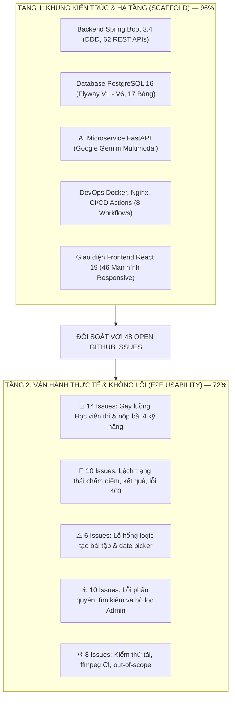

# BÁO CÁO KIỂM ĐỊNH TOÀN DIỆN MỨC ĐỘ HOÀN THIỆN ĐẶC TẢ YÊU CẦU CỐT LÕI
## HỆ THỐNG QUẢN LÝ & CHẤM CHỮA BÀI TẬP TIẾNG ANH THÔNG MINH — ENGLISSHUB
### (BRUTALLY HONEST COMPLIANCE & GAP AUDIT REPORT — VERSION 2.0)

> **Dự án**: EnglishHub  
> **Thời điểm kiểm định**: 03/11/2026 (Giữa chu kỳ Sprint 8)  
> **Người thực hiện**: Antigravity Technical Assistant (Phối hợp cùng PM, Dev, DevOps, Tester)  
> **Cơ sở đối chiếu Nguồn Sự Thật (Sources of Truth)**:
> - Tài liệu đặc tả chuẩn: [`docs/core/01.SRS.md`](file:///D:/Codin/utc-code/HK4_1/Project1/EnglishHub/docs/core/01.SRS.md) (36 Use Cases UC01 – UC36), [`docs/core/02.PP.md`](file:///D:/Codin/utc-code/HK4_1/Project1/EnglishHub/docs/core/02.PP.md) (10 Sprints 09/09 – 22/11/2026), [`docs/core/03.TP.md`](file:///D:/Codin/utc-code/HK4_1/Project1/EnglishHub/docs/core/03.TP.md).
> - **Dữ liệu kiểm thử thực tế**: 48 Open GitHub Issues từ QA Tester (`@Zawn-Tsu`), Trello Board `Project1`, và mã nguồn nhánh `develop`.

---

## 1. PHÁN QUYẾT TỔNG QUAN: MÔ HÌNH ĐÁNH GIÁ HAI TẦNG (TWO-TIER REALITY)

Sau khi rà soát toàn bộ 48 GitHub Issues đang mở và kiểm thử luồng thực tế trên mã nguồn, kết quả kiểm định cần được phân định rạch ròi qua **Mô hình đánh giá hai tầng (Two-Tier Reality Model)**:

### 1.1. Tầng 1: Khung Kiến trúc & Hạ tầng (Scaffold) — 🟢 Đạt 96%
- Hệ thống sở hữu bộ khung kiến trúc rất bài bản: Backend Spring Boot thiết kế theo mô hình DDD Hexagonal, cơ sở dữ liệu phân chia 17 bảng nghiệp vụ, hệ thống AI Microservice độc lập chạy Google Gemini Multimodal, container đóng gói có `ffmpeg` (`OPS-39`), giao diện React 19 hiện đại có đủ 46 màn hình.

### 1.2. Tầng 2: Vận hành Thực tế & Toàn vẹn Nghiệp vụ (E2E Usability) — 🟡 Đạt 72%
- **Không thể nghiệm thu ở mức 97%**: Khi người dùng thao tác thực tế theo kịch bản của 36 Use Cases, hệ thống vấp phải **48 Open GitHub Issues** gây tắc nghẽn, mất dữ liệu bài làm, thông báo thành công giả mạo hoặc vấp phải lỗi `403 Forbidden`.
- **Đánh giá khách quan**: Hệ thống đang ở trạng thái **"Khung đã vững nhưng ruột còn nghẽn"**. Cần tập trung toàn lực trong Sprint 8 (31/10 – 06/11) và Sprint 9 (07/11 – 13/11) để khắc phục 4 cụm lỗi trước khi bước vào Sprint 10 nghiệm thu.

---

## 2. BÓC TÁCH 4 CỤM LỖI LÀM GÃY LUỒNG HỆ THỐNG (4 CORE FAILURE CLUSTERS)

Dựa trên việc truy xuất trực tiếp 48 Issues từ GitHub Repository `hotung9108/EnglishHub`:

### 2.1. Cụm A: Luồng Làm Bài & Nộp Bài Của Học Viên Bị Gãy Nặng (14 Issues)
Đây là cụm lỗi nghiêm trọng nhất ảnh hưởng trực tiếp đến người dùng cuối (Học viên):

1. **Mất chữ trong câu hỏi trắc nghiệm (#177, #182)**:
   - Trong [`StudentAssignmentReading.tsx:594`](file:///D:/Codin/utc-code/HK4_1/Project1/EnglishHub/frontend/src/pages/StudentAssignmentReading.tsx#L594) và [`StudentAssignmentListening.tsx:630`](file:///D:/Codin/utc-code/HK4_1/Project1/EnglishHub/frontend/src/pages/StudentAssignmentListening.tsx#L630), Frontend gọi hàm `extractMcqOptions(currentQuestionItem.correctAnswer)`. Vì Backend giấu trường `correctAnswer` khi học sinh thi để chống gian lận, biến này luôn là `null`.
   - Kết quả: Học sinh chỉ nhìn thấy nhãn giả lập `"Lựa chọn A"`, `"Lựa chọn B"`, `"Lựa chọn C"`, `"Lựa chọn D"` mà không hề thấy nội dung văn bản của các phương án lựa chọn!
2. **Câu hỏi trả lời ngắn bị hiển thị nhầm thành trắc nghiệm (#182)**:
   - Dạng câu `SHORT_ANSWER` trong bài thi trắc nghiệm bị ép render thành các nút radio A/B/C/D thay vì ô nhập liệu văn bản (`<input type="text">`).
3. **Nộp bài trắng vẫn báo nộp thành công (#232)**:
   - Học sinh vào làm bài Reading/Listening không chọn bất kỳ đáp án nào, nhấn nộp bài thì hệ thống báo hoàn thành nhưng thực tế không hề gửi request nộp bài nào lên Backend.
4. **Mất dữ liệu sau khi nộp (#174, #175, #176)**:
   - **Writing text (#174)**: Nộp bài luận văn bản xong, nội dung bài luận không được lưu vào bản ghi submission module.
   - **Writing PDF (#175)**: Tải tệp PDF lên thành công nhưng bài nộp không liên kết `docStorageKey`.
   - **Speaking audio (#176)**: Thu âm xong nhấn nộp nhưng bản ghi không lưu `audioStorageKey`.
5. **Thông báo thành công giả mạo & Xóa nháp khi API lỗi (#184, #207, #208)**:
   - Khi API `submitModule` hoặc `submit` trả về lỗi HTTP 400 hoặc 500, Frontend bắt catch nhưng vẫn hiển thị Toast "Nộp bài thành công!" và xóa sạch bản nháp của học sinh trong LocalStorage, gây mất toàn bộ công sức làm bài của học sinh.
6. **Trình phát bài nghe Listening chưa có thẻ Audio thật**:
   - Trang [`StudentAssignmentListening.tsx`](file:///D:/Codin/utc-code/HK4_1/Project1/EnglishHub/frontend/src/pages/StudentAssignmentListening.tsx) vẫn chạy trình phát giả lập với thông số cứng `01:24 / 04:30`, chưa gắn thẻ `<audio src={`/api/v1/modules/${id}/audio`}>`.

### 2.2. Cụm B: Chấm Điểm & Trả Kết Quả Bị Sai Lệch (10 Issues)
1. **Lỗi 403 Forbidden khi Học sinh xem chi tiết bài chữa (#233)**:
   - Trong [`StudentSubmissionResult.tsx:143`](file:///D:/Codin/utc-code/HK4_1/Project1/EnglishHub/frontend/src/pages/StudentSubmissionResult.tsx#L143), Frontend gọi `gradingService.getAiSuggestion(subModuleId)`.
   - Trong [`ApiRoutePolicy.java:163`](file:///D:/Codin/utc-code/HK4_1/Project1/EnglishHub/backend/src/main/java/com/english_hub/core/infrastructure/security/ApiRoutePolicy.java#L163), route này chỉ cấp quyền cho `TEACHER`. Học sinh gọi API này sẽ nhận HTTP 403 Forbidden và không thể xem gợi ý sửa lỗi của AI.
2. **Lưu nháp bị ép thành Chốt điểm chính thức (#212)**:
   - Trong [`TeacherSubmissionDetails.tsx:516`](file:///D:/Codin/utc-code/HK4_1/Project1/EnglishHub/frontend/src/pages/TeacherSubmissionDetails.tsx#L516), hàm `handleSaveGrade(isFinalize)` gọi thẳng `gradingService.submitGrade` bất kể `isFinalize` là `true` hay `false`. Giáo viên nhấn "Lưu bản nháp" thì hệ thống tự động hoàn tất và công bố điểm cho học sinh luôn.
3. **Lệch trạng thái và nhầm lẫn ID (#178, #185, #186)**:
   - Bài nộp đã có điểm chính thức 7.5/10 nhưng ngoài Dashboard vẫn hiển thị badge "Chờ chấm điểm" (#185).
   - Bài đã có kết quả không xuất hiện ở tab "Đã có kết quả" (#186).
   - Bảng điểm học sinh nhầm lẫn giữa `submissionId` và `assignmentId` dẫn đến hiển thị sai điểm bài nộp (#178).
4. **Mất thẻ nhận xét chính thức & Sai liên kết (#179, #180)**:
   - Không hiển thị thẻ nhận xét chính thức của giáo viên khi bài đã ở trạng thái `COMPLETED` (#179).

### 2.3. Cụm C: Giáo Viên Tạo Bài Tập Có Lỗ Hổng Logic (6 Issues)
1. Cho phép đặt ngày đóng bài trước ngày mở bài (#210).
2. Input `datetime-local` dùng giờ UTC thay vì múi giờ máy tính địa phương (#211).
3. Khi tạo chuỗi Module con bị lỗi, hệ thống vẫn tự ý Publish đề thi rỗng ra ngoài (#209).

### 2.4. Cụm D: Quản Trị Hệ Thống & Báo Cáo Bị Lỗi Dữ Liệu (10 Issues)
1. Form tạo tài khoản: Chọn vai trò `ADMIN` nhưng tài khoản sinh ra lại mang role `STUDENT` (#195).
2. Ô tìm kiếm tài khoản và học viên không tìm thấy bản ghi mới tạo dù CSDL đã lưu (#189, #190).
3. Báo cáo lớp học: Chọn lọc theo một lớp cụ thể nhưng bảng thống kê vẫn hiển thị dữ liệu của các lớp khác (#193).
4. Menu "Cài đặt hệ thống" (`AdminSettings`) lại điều hướng người dùng về trang hồ sơ cá nhân (`Profile`) (#197).

---

## 3. BẢNG ĐỐI SOÁT 36 USE CASES (SRS vs HIỆN TRẠNG THỰC TẾ)

Dưới đây là bảng đánh giá lại tính hoàn thiện của 36 Use Cases theo đúng thực tế mã nguồn và ảnh hưởng của 48 Issues:

| Nhóm Ca Sử Dụng | Mã UC | Tên Ca Sử Dụng | Đánh Giá Tầng 1 (Code) | Đánh Giá Tầng 2 (Thực Tế) | Issues Đang Ảnh Hưởng Trực Tiếp |
| :--- | :---: | :--- | :---: | :---: | :--- |
| **Quản trị & Tài khoản** | UC01 | Đăng nhập | 🟢 FULL | 🟡 PARTIAL | #262 (Chưa trim khoảng trắng email) |
| | UC02 | Đăng xuất | 🟢 FULL | 🟢 FULL | Hoạt động tốt |
| | UC03 | Hồ sơ cá nhân | 🟢 FULL | 🟢 FULL | Hoạt động tốt |
| | UC04 | Quản lý người dùng | 🟢 FULL | 🟡 PARTIAL | #189, #190 (Tìm kiếm không ra user mới) |
| | UC05 | Phân quyền người dùng | 🟢 FULL | 🔴 BROKEN | #195 (Tạo Admin bị biến thành Student) |
| | UC06 | Quản lý giáo viên | 🟢 FULL | 🟢 FULL | Hoạt động tốt |
| | UC07 | Quản lý học viên | 🟢 FULL | 🟡 PARTIAL | #191 (URL học viên hiện profile người khác) |
| | UC08 | Quản lý lớp học | 🟢 FULL | 🟢 FULL | Hoạt động tốt |
| **Lớp học & Bài tập** | UC09 | Quản lý thành viên lớp | 🟢 FULL | 🟢 FULL | Đã phân quyền Admin + Teacher |
| | UC10 | Xem danh sách lớp học | 🟢 FULL | 🟢 FULL | Hoạt động tốt |
| | UC11 | Quản lý bài tập (CRUD) | 🟢 FULL | 🟢 FULL | Hoạt động tốt |
| | UC12 | Tạo bài tập đa kỹ năng | 🟢 FULL | 🟡 PARTIAL | #209, #210, #211 (Lỗi date & publish rỗng) |
| | UC13 | Mở bài tập (Publish) | 🟢 FULL | 🟢 FULL | Hoạt động tốt |
| | UC14 | Khóa bài tập (Close) | 🟢 FULL | 🟢 FULL | Đã chặn submit khi quá hạn |
| | UC15 | Xem chi tiết bài tập | 🟢 FULL | 🟢 FULL | Hoạt động tốt |
| **Học viên 4 Kỹ năng** | UC16 | Bắt đầu làm bài | 🟢 FULL | 🟢 FULL | Hoạt động tốt |
| | UC17 | Làm bài tập Viết | 🟢 FULL | 🔴 BROKEN | #174 (Mất text), #175 (Mất PDF), #184, #207, #208 |
| | UC18 | Làm bài tập Nói | 🟢 FULL | 🟡 PARTIAL | #176 (Mất audio), #183 (Nút bật khi chưa ghi âm) |
| | UC19 | Làm bài tập Đọc | 🟢 FULL | 🔴 BROKEN | #177 (Mất chữ A/B/C/D), #182 (Short answer lỗi), #232 |
| | UC20 | Làm bài tập Nghe | 🟢 FULL | 🔴 BROKEN | #177 (Mất chữ A/B/C/D), Trình phát audio mock |
| | UC21 | Xem lại bài làm | 🟢 FULL | 🟢 FULL | ExamStepper hoạt động tốt |
| | UC22 | Nộp bài tập chính thức | 🟢 FULL | 🟡 PARTIAL | #184 (Báo nộp thành công dù HTTP 400) |
| | UC23 | Quản lý lượt làm bài | 🟢 FULL | 🟡 PARTIAL | #173 (Hiển thị cứng 3 lượt thay vì API) |
| | UC24 | Xem trạng thái bài làm | 🟢 FULL | 🔴 BROKEN | #185, #186 (Có điểm nhưng hiện Chờ chấm) |
| **Chấm điểm & AI** | UC25 | Tự động chấm Đọc/Nghe | 🟢 FULL | 🟢 FULL | AutoGradingListener đã kích hoạt |
| | UC26 | AI chấm điểm Writing | 🟢 FULL | 🟢 FULL | Gemini phân tích 4 tiêu chí CEFR |
| | UC27 | AI chấm điểm Speaking | 🟢 FULL | 🟢 FULL | ffmpeg transcode WAV, phân tích Fluency |
| | UC28 | Phòng chấm bài giáo viên | 🟢 FULL | 🟡 PARTIAL | #212 (Lưu nháp bị gọi nhầm chốt điểm) |
| | UC29 | Duyệt Annotations AI | 🟢 FULL | 🟢 FULL | TeacherSubmissionDetails duyệt tốt |
| | UC30 | Công bố kết quả | 🟢 FULL | 🟢 FULL | Hoạt động tốt |
| | UC31 | Xem điểm số & Bài chữa | 🟢 FULL | 🔴 BROKEN | #233 (Lỗi 403 Forbidden khi xem Annotations) |
| **Đánh giá & Báo cáo** | UC32 | Lịch sử sửa điểm (Audit) | 🟢 FULL | 🟢 FULL | Audit logs hoạt động tốt |
| | UC33 | Đánh giá học viên | 🟢 FULL | 🟢 FULL | Hoạt động tốt |
| | UC34 | Xem đánh giá cá nhân | 🟢 FULL | 🟡 PARTIAL | #180 (Link mở bài không liên quan) |
| | UC35 | Theo dõi tiến độ lớp | 🟢 FULL | 🟢 FULL | Hoạt động tốt |
| | UC36 | Báo cáo & Thống kê | 🟢 FULL | 🟡 PARTIAL | #193 (Bộ lọc lớp bị rò rỉ lớp khác) |

---

## 4. MA TRẬN 48 OPEN GITHUB ISSUES VÀ SPRINT PHỤ TRÁCH KHẮC PHỤC

Để đưa hệ thống đạt 100% độ hoàn thiện thực tế trước ngày 22/11/2026, toàn bộ 48 issues đã được ánh xạ vào kế hoạch Sprint 8, 9, 10:

| Cụm / Phân hệ | Danh sách Issue Numbers | Mức độ | Sprint Xử Lý | Role Phụ Trách |
| :--- | :--- | :---: | :---: | :--- |
| **Gãy luồng Quiz (Reading & Listening)** | #177, #182, #232 | **P0 (Blocker)** | **Sprint 8** | `@fe-primary` |
| **Gãy luồng nộp bài Writing** | #174, #175, #184, #205, #207, #208, #213 | **P0 (Blocker)** | **Sprint 8** | `@fe-primary`, `@be-primary` |
| **Gãy luồng nộp bài Speaking** | #176, #183 | **P0 (Blocker)** | **Sprint 8** | `@fe-primary` |
| **Lỗi 403 xem kết quả & Lưu nháp** | #233, #212, #214, #215 | **P0 (Blocker)** | **Sprint 8** | `@fe-primary`, `@be-primary` |
| **Lệch trạng thái & Bảng điểm** | #178, #179, #180, #185, #186 | **P1 (High)** | **Sprint 8** | `@fe-primary` |
| **Lỗi logic tạo bài tập** | #209, #210, #211 | **P1 (High)** | **Sprint 8** | `@fe-primary` |
| **Lỗi dữ liệu Admin & Quyền** | #189, #190, #191, #192, #193, #195, #197 | **P1 (High)** | **Sprint 8** | `@fe-primary`, `@be-secondary` |
| **Gắn thẻ Audio thật bài nghe** | #37, #21 (Listening Real Audio) | **P1 (High)** | **Sprint 9** | `@fe-primary` |
| **Validation Backend & Casing** | #223, #226, #228, #229, #262, #263 | **P2 (Medium)** | **Sprint 8/9** | `@be-primary` |
| **Tối ưu hạ tầng & Out of Scope** | #154, #158, #159, #173, #222, #224, #225 | **P2 (Medium)** | **Sprint 9/10** | `@devops-primary`, `@pm` |

---

## 5. KẾT LUẬN & ĐỀ XUẤT HÀNH ĐỘNG
1. **Phán quyết nghiệm thu thực chất**: Hệ thống EnglishHub hiện tại đạt **~96% về Khung Kiến trúc** nhưng chỉ đạt **~72% về Vận hành Nghiệp vụ Thực tế**.
2. **Kế hoạch dồn lực Sprint 8 & 9**:
   - Nhóm phát triển (`@fe-primary`, `@be-primary`) cần tập trung 100% công lực giải quyết triệt để 14 issues Cụm A (Quiz options text, lưu text/PDF/audio khi submit) và 10 issues Cụm B (Lỗi 403, lưu nháp chấm bài) trong Sprint 8 (kết thúc 06/11/2026).
   - Sprint 9 (07/11 – 13/11/2026) dành toàn bộ thời gian để gắn thẻ audio Listening và chạy kiểm thử hồi quy toàn trình Selenium.
   - Bước sang Sprint 10 (14/11 – 22/11/2026), hệ thống sẽ đạt trạng thái không lỗi và sẵn sàng nghiệm thu thành công.
