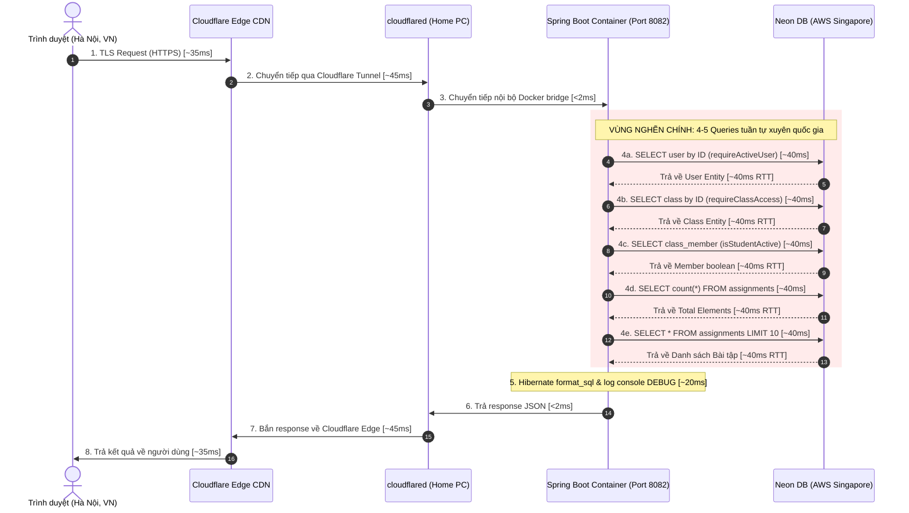
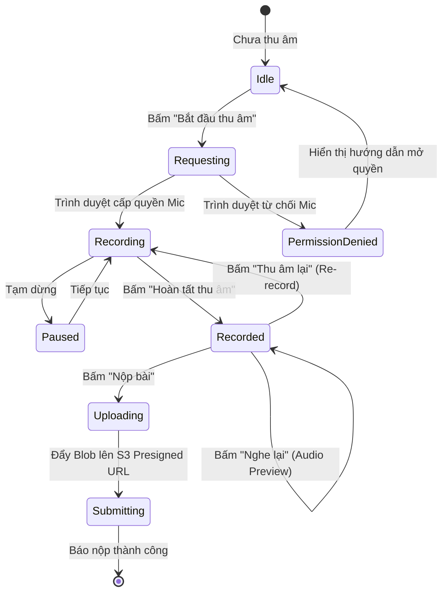
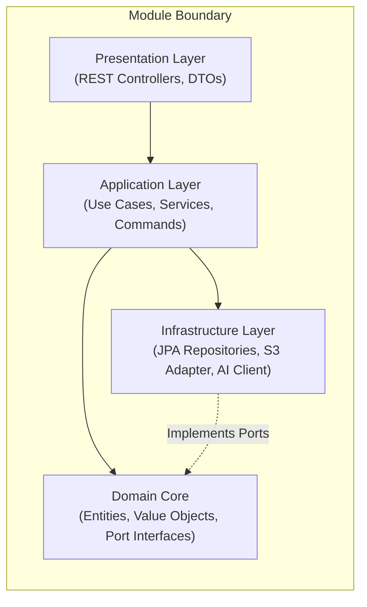
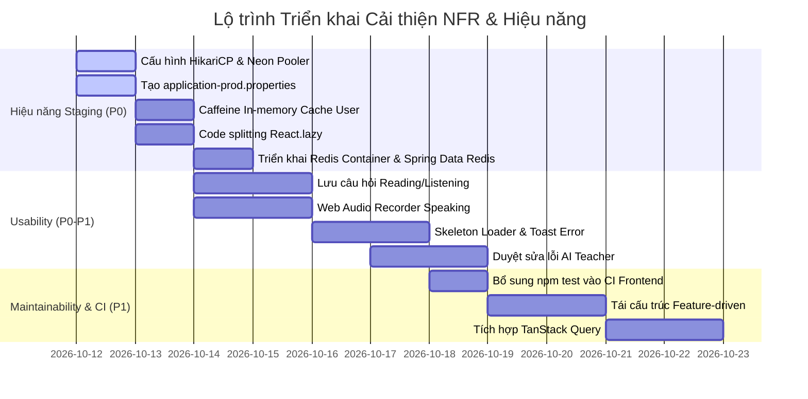

# Báo Cáo Rà Soát Yêu Cầu Phi Chức Năng (NFR) & Chiến Lược Tối Ưu Hiệu Năng Staging

> **Dự án**: EnglishHub — Smart Assignment Management & AI-Assisted Grading Platform  
> **Phiên bản tài liệu**: 1.0  
> **Ngày lập**: 11/10/2026  
> **Phạm vi đánh giá**: Toàn bộ hệ thống (Frontend React 19, Backend Spring Boot 3 / Java 21, Database Neon PostgreSQL, AI Microservice FastAPI, Hạ tầng Cloudflare Tunnel + Home Server + Vercel)  
> **Mục tiêu chính**: 
> 1. Đảm bảo 3 trụ cột phi chức năng cốt lõi: **Usability (Tính khả dụng)**, **Maintainability (Khả năng bảo trì)**, và **Performance (Hiệu năng)**.
> 2. Mổ xẻ nguyên nhân gốc rễ và xử lý triệt để hiện tượng **Response Time bị chạm ngưỡng ~500ms trên môi trường Staging**.

---

## Mục Lục
1. [Tổng Quan Kiến Trúc & Hiện Trạng Hệ Thống](#1-tổng-quan-kiến-trúc--hiện-trạng-hệ-thống)
2. [Giải Phẫu Vấn Đề Hiệu Năng: Tại Sao Staging Bị Chậm ~500ms?](#2-giải-phẫu-vấn-đề-hiệu-năng-tại-sao-staging-bị-chậm-500ms)
   - 2.1. Bản đồ luồng đi của một Request (Waterfall Latency Breakdown)
   - 2.2. Các "thủ phạm" chính gây ra độ trễ 500ms
   - 2.3. Chiến lược & Kỹ thuật tối ưu hóa giảm xuống < 120ms
   - 2.4. Phương án Nâng cao: Tích hợp Redis Caching Server (Giảm xuống ~45ms - 65ms)
3. [Usability: Nâng Cấp Trải Nghiệm Người Dùng & Tính Khả Dụng](#3-usability-nâng-cấp-trải-nghiệm-người-dùng--tính-khả-dụng)
   - 3.1. Hiện trạng đánh giá Usability trên 46 màn hình Frontend
   - 3.2. Chuẩn hóa Loading State, Skeleton Screens & Layout Shift (CLS)
   - 3.3. Tối ưu UX tương tác âm thanh (Audio Recording & Listening Player)
   - 3.4. Trực quan hóa kết quả chấm và duyệt sửa lỗi AI (Interactive Annotations)
   - 3.5. Trải nghiệm làm bài thi liên tục đa kỹ năng (Multi-Module Exam Runner)
   - 3.6. Khả năng truy cập (Accessibility - a11y) & Thiết kế đáp ứng (Responsive)
4. [Maintainability: Gia Cố Khả Năng Bảo Trì & Mở Rộng Mã Nguồn](#4-maintainability-gia-cố-khả-năng-bảo-trì--mở-rộng-mã-nguồn)
   - 4.1. Kiến trúc Backend: Modular Monolith, Hexagonal & DDD
   - 4.2. Kiến trúc Frontend: Chuyển đổi Feature-Driven & Quản lý State bằng TanStack Query
   - 4.3. Đồng bộ hóa Hợp đồng API (OpenAPI Type Generation)
   - 4.4. Cơ chế Xử lý Lỗi Thống nhất (RFC 7807 Problem Details)
   - 4.5. Chiến lược Di chuyển & Sao lưu Cơ sở dữ liệu (Flyway + Automated Backup)
   - 4.6. Kiểm thử tự động & Bịt lỗ hổng CI/CD Pipeline
5. [Kế Hoạch Hành Động & Phân Công Nhiệm Vụ (Action Plan by Roles)](#5-kế-hoạch-hành-động--phân-công-nhiệm-vụ-action-plan-by-roles)

---

## 1. Tổng Quan Kiến Trúc & Hiện Trạng Hệ Thống

EnglishHub áp dụng kiến trúc hiện đại, phân tách rõ ràng giữa các tầng trách nhiệm:

```mermaid
flowchart TD
    subgraph ClientLayer ["1. Tầng Client & CDN"]
        User["Người dùng (Web Browser)"]
        Vercel["Frontend Vercel (Edge CDN)<br>staging.hotung9108.me"]
        CF["Cloudflare Edge Anycast<br>api-staging.hotung9108.me"]
    end

    subgraph HomeServer ["2. Home Server (Arch Linux)"]
        Tunnel["Cloudflare Named Tunnel<br>(cloudflared)"]
        BackendStaging["Spring Boot 3 (Java 21)<br>Port 8082 - Profile: prod"]
        AIService["FastAPI AI Service<br>Port 8001"]
        RedisCache["Redis Cache Server (Local Container)<br>Port 6379 - Latency < 1ms"]
        LocalMinIO["MinIO S3 (Local Storage)<br>Port 9000"]
    end

    subgraph CloudInfra ["3. Hạ tầng Đám Mây (Cloud External)"]
        NeonDB["Neon PostgreSQL Serverless<br>(AWS ap-southeast-1 Singapore)"]
        GeminiAPI["Google Gemini 2.5 Flash API"]
    end

    User -->|Tải trang tĩnh| Vercel
    User -->|Gọi API| CF
    CF -->|Đường hầm mã hóa| Tunnel
    Tunnel -->|Proxy nội bộ| BackendStaging
    BackendStaging -->|L2 Cache Hit < 1ms| RedisCache
    BackendStaging -->|HikariCP SSL Query (Cache Miss)| NeonDB
    BackendStaging -->|HTTP RestClient| AIService
    BackendStaging -->|S3 Presigned URL| LocalMinIO
    AIService -->|LLM SDK| GeminiAPI
```

### Thông số kỹ thuật hiện tại:
- **Backend**: Spring Boot 3.x, Java 21, JPA/Hibernate 6, Flyway 10, Spring Security 6 với JWT không trạng thái (stateless).
- **Frontend**: React 19, TypeScript, Vite 8, React Router v7, Axios. Gồm 46 màn hình giao diện.
- **AI Microservice**: FastAPI Python, Uvicorn, Google Gemini 2.5 SDK.
- **Hạ tầng Staging**: 
  - Frontend: Deploy trên Vercel Edge.
  - Backend: Chạy container Docker trên máy tính cá nhân (Home PC / Arch Linux) qua Cloudflare Named Tunnel cố định.
  - Database: Neon PostgreSQL Serverless đặt tại Singapore (`ap-southeast-1`).

---

## 2. Giải Phẫu Vấn Đề Hiệu Năng: Tại Sao Staging Bị Chậm ~500ms?

Khi đo kiểm các request trên môi trường Staging (`https://api-staging.hotung9108.me`), thời gian phản hồi trung bình dao động từ **450ms đến 580ms** ngay cả với các truy vấn đọc dữ liệu cơ bản (như danh sách bài tập, lớp học). Trong khi đó, tại môi trường Local Dev (`docker-compose.dev.yml`), request chỉ mất **15ms - 25ms**.

### 2.1. Bản đồ luồng đi của một Request (Waterfall Latency Breakdown)

Hãy cùng bóc tách hành trình của 1 HTTP Request điển hình: `GET /api/v1/classes/{id}/assignments`:



### Bảng phân bổ thời gian thực tế (Thời gian trễ cộng dồn):

| Chặng xử lý | Thời gian tiêu tốn | Tỷ lệ % | Đánh giá |
| :--- | :---: | :---: | :--- |
| **Mạng Client ➔ Cloudflare Edge** | 35ms - 45ms | ~8% | Bình thường (phụ thuộc nhà mạng Viettel/VNPT/FPT). |
| **Cloudflare Edge ➔ Cloudflare Tunnel (Home PC)** | 40ms - 55ms | ~10% | Bình thường đối với Named Tunnel qua Internet. |
| **Docker Internal Proxy (Tunnel ➔ Spring Boot)** | < 2ms | < 1% | Tối ưu tuyệt đối (Internal Bridge). |
| **Spring Security JWT Verification** | 1ms - 2ms | < 1% | Tối ưu (Xác thực chữ ký HMAC cục bộ bằng CPU). |
| **Truy vấn CSDL Neon (AWS Singapore) (4-5 round-trips)** | **200ms - 280ms** | **~55%** | **🔴 THỦ PHẠM CHÍNH (Network Chatty Queries)** |
| **Chi phí kết nối SSL Handshake & Stale Connection Hikari** | **50ms - 120ms** | **~18%** | **🔴 THỦ PHẠM PHỤ (Thiếu Connection Pooling tối ưu)** |
| **I/O Overhead: `show-sql`, `format_sql`, Web DEBUG Logs** | **20ms - 35ms** | ~6% | **🟡 THỦ PHẠM PHỤ (Console log blocking trong Docker)** |
| **Đường về: Spring ➔ Tunnel ➔ CF ➔ Client** | 40ms - 50ms | ~9% | Độ trễ mạng tiêu chuẩn. |
| **TỔNG THỜI GIAN ĐO ĐƯỢC TRÊN STAGING** | **420ms - 580ms** | **100%** | **Trung bình ~500ms** |

---

### 2.2. Các "thủ phạm" chính gây ra độ trễ 500ms

Qua rà soát trực tiếp các dòng mã nguồn và cấu hình hệ thống:

#### 1. Hiện tượng "Chatty Queries" xuyên biên giới (Việt Nam ➔ Singapore)
- **Vị trí phát hiện**: `AuthenticatedUserProvider.java` (dòng 33), `AssignmentService.java` (dòng 58-67), `ClassMemberRepository.java`.
- **Cơ chế lỗi**: Home Server đặt tại Việt Nam, nhưng CSDL Neon Serverless đặt tại Singapore (`ap-southeast-1.aws.neon.tech`). Khoảng cách địa lý tạo ra Round-Trip Time (RTT) tối thiểu **35ms - 45ms cho mỗi lượt gửi/nhận packet TCP**.
- Trong mỗi API được bảo vệ bởi quyền hạn, hệ thống thực hiện tuần tự:
  1. `userRepository.findById(principal.userId())` ➔ Mất 1 RTT (~40ms).
  2. `classRepository.findById(classId)` ➔ Mất 1 RTT (~40ms).
  3. `classMemberRepository.isStudentActiveInClass(...)` ➔ Mất 1 RTT (~40ms).
  4. Query nghiệp vụ chính (Count + Select) ➔ Mất 2 RTT (~80ms).
- **Tổng cộng riêng thời gian chờ tín hiệu bay qua lại giữa Việt Nam và Singapore đã ngốn mất 200ms - 240ms!**

#### 2. HikariCP chưa được cấu hình cho Database Serverless
- **Vị trí phát hiện**: `backend/src/main/resources/application.properties` hoàn toàn không có bất kỳ dòng cấu hình nào cho `spring.datasource.hikari.*`.
- **Cơ chế lỗi**:
  - Neon Serverless tự động ngắt kết nối không hoạt động (idle connection timeout) sau vài phút hoặc hạ tải compute (scale-to-zero).
  - HikariCP mặc định không gửi keepalive probe. Khi request mới đến, connection cũ đã bị đứt ở phía Neon, HikariCP phải chờ timeout rồi khởi tạo kết nối TLS TCP mới. Quá trình thiết lập SSL Handshake đường dài tốn thêm **120ms - 180ms**.
  - Chuỗi kết nối JDBC hiện tại (`env.production.example`) đang dùng direct connection thay vì **Neon PgBouncer Connection Pooler** (đầu host có tiền tố `-pooler`).

#### 3. Cấu hình Logging & Hibernate Debug đang kích hoạt trên Staging
- **Vị trí phát hiện**: `backend/src/main/resources/application.properties` (dòng 14, 15, 22):
  ```properties
  spring.jpa.show-sql=true
  spring.jpa.properties.hibernate.format_sql=true
  logging.level.org.springframework.web=DEBUG
  ```
- **Cơ chế lỗi**: Dự án **không có file `application-prod.properties`**. Khi `SPRING_PROFILES_ACTIVE=prod` chạy trong container, Spring Boot vẫn nạp các tham số này.
- Mọi câu lệnh SQL đều bị bộ format Hibernate dùng Regex chia dòng, thụt lề rồi in thẳng ra stdout của container. Trên Docker, việc ghi hàng chục dòng log console đồng bộ gây nghẽn buffer I/O (stdout blocking) và ngốn CPU.

#### 4. Frontend Bundle quá nặng (1.25 MB) & Import Tĩnh 100%
- **Vị trí phát hiện**: `frontend/src/App.tsx` (dòng 3-53) import tĩnh toàn bộ 46 trang giao diện.
- **Cơ chế lỗi**: File `dist/assets/index-DMos8Mmb.js` có dung lượng lên đến **1.24 MB**. Người dùng mở bất kỳ trang nào cũng phải tải toàn bộ mã nguồn của cả 3 phân hệ (Admin, Teacher, Student). Thời gian phân giải và thực thi JavaScript ban đầu tốn 300ms - 800ms trên thiết bị trung bình.
- Frontend thiếu cơ chế quản lý Server State (chưa có React Query/SWR), các component dùng `useEffect` gọi liên tiếp nhiều API dạng Waterfall (request 1 xong mới gọi request 2) nhân đôi thời gian chờ.

---

### 2.3. Chiến lược & Kỹ thuật tối ưu hóa giảm xuống < 120ms

Để đưa response time từ ~500ms xuống ngưỡng lý tưởng **80ms - 120ms** trên Staging, cần thực hiện đồng bộ 5 giải pháp kỹ thuật sau:

#### Giải pháp 1: Bổ sung Caffeine In-Memory Cache cho Tầng Xác thực & Tra cứu thường xuyên
**Hiệu quả**: Giảm ngay **40ms - 80ms** trên 100% các request.
Thay vì mỗi request đều chạy `SELECT * FROM users WHERE id = ?`, ta lưu thông tin người dùng vào RAM của JVM với TTL 5 phút.

```java
// Cấu hình Caffeine Cache trong backend
@Configuration
@EnableCaching
public class CacheConfig {
    @Bean
    public CaffeineCacheManager cacheManager() {
        CaffeineCacheManager manager = new CaffeineCacheManager("users", "class-access");
        manager.setCaffeine(Caffeine.newBuilder()
            .expireAfterWrite(5, TimeUnit.MINUTES)
            .maximumSize(1000));
        return manager;
    }
}

// Áp dụng trong AuthenticatedUserProvider
@Override
@Cacheable(value = "users", key = "#principal.userId")
public User getUserById(Long userId) {
    return userRepository.findById(userId)
        .orElseThrow(() -> ApiException.unauthorized(UNAUTHENTICATED_MESSAGE));
}
```

#### Giải pháp 2: Tối ưu hóa HikariCP & Chuyển sang Neon PgBouncer Pooler Endpoint
**Hiệu quả**: Loại bỏ hoàn toàn chi phí tạo kết nối mới, giảm **50ms - 100ms**.
Thay đổi chuỗi kết nối trong `.env`:
- Cũ: `jdbc:postgresql://ep-xyz.ap-southeast-1.aws.neon.tech/neondb?sslmode=require`
- Mới (Dùng Pooler): `jdbc:postgresql://ep-xyz-pooler.ap-southeast-1.aws.neon.tech/neondb?sslmode=require`

Bổ sung cấu hình HikariCP chuyên dụng cho Serverless DB vào `application.properties`:
```properties
# Tối ưu HikariCP cho Serverless PostgreSQL (Neon)
spring.datasource.hikari.maximum-pool-size=15
spring.datasource.hikari.minimum-idle=5
spring.datasource.hikari.idle-timeout=300000
spring.datasource.hikari.max-lifetime=900000
spring.datasource.hikari.connection-timeout=20000
spring.datasource.hikari.keepalive-time=60000
spring.datasource.hikari.leak-detection-threshold=60000
```

#### Giải pháp 3: Tách biệt Profile `prod` & Tắt sạch Debug I/O Overhead
**Hiệu quả**: Giảm **25ms - 40ms** CPU & Container I/O.
Tạo tệp `backend/src/main/resources/application-prod.properties`:
```properties
# Tắt triệt để format và show SQL trên production/staging
spring.jpa.show-sql=false
spring.jpa.properties.hibernate.format_sql=false

# Chuyển log sang INFO
logging.level.root=INFO
logging.level.org.springframework.web=INFO
logging.level.org.hibernate=WARN

# Bật nén GZIP cho API responses lớn
server.compression.enabled=true
server.compression.mime-types=application/json,application/xml,text/html,text/xml,text/plain
server.compression.min-response-size=2048
```

#### Giải pháp 4: Gộp các câu Query phân quyền & Tối ưu JPA Fetch
**Hiệu quả**: Giảm số lượng round-trip từ 5 xuống 1-2.
Thay vì kiểm tra `englishClass.getTeacherId()` bằng 1 câu SELECT, sau đó kiểm tra `isStudentActiveInClass` bằng 1 câu SELECT khác, ta viết query gộp hoặc join check quyền ngay trong repository:
```sql
-- Ví dụ: Lấy danh sách bài tập kèm kiểm tra quyền trong duy nhất 1 query
SELECT a.* FROM assignments a
JOIN classes c ON c.id = a.class_id
LEFT JOIN class_members cm ON cm.class_id = c.id AND cm.user_id = :userId
WHERE a.class_id = :classId 
  AND a.is_deleted = false
  AND (c.teacher_id = :userId OR cm.status = 'ACTIVE')
ORDER BY a.created_at DESC
LIMIT :limit OFFSET :offset;
```

#### Giải pháp 5: Frontend Code Splitting (`React.lazy`) & TanStack Query
**Hiệu quả**: Giảm kích thước bundle tải lần đầu từ **1.25 MB xuống < 180 KB**, cache dữ liệu tại trình duyệt để ngăn duplicate request.
Trong `App.tsx`, thay thế toàn bộ import tĩnh bằng `React.lazy()` kết hợp `<Suspense fallback={<PageLoadingSkeleton />}>`:
```tsx
import { lazy, Suspense } from 'react';

const StudentAssignments = lazy(() => import('./pages/StudentAssignments'));
const TeacherAssignments = lazy(() => import('./pages/TeacherAssignments'));
const AdminReports = lazy(() => import('./pages/AdminReports'));
// ...
```

---

#### Giải pháp 6 (Phương án Mở rộng Cấp cao): Tích hợp Redis Caching Server vào Home Server
**Hiệu quả**: Đưa Response Time của các API Đọc dữ liệu (Read-Heavy) từ **500ms xuống chỉ còn ~45ms - 65ms** (triệt tiêu 100% thời gian chờ CSDL Neon Singapore).

##### 1. Phân tích So sánh: Caffeine (L1 Cache) vs Redis (L2 Cache)
| Đặc tính kỹ thuật | Caffeine (In-Memory Heap) | Redis Server (Local Container) |
| :--- | :--- | :--- |
| **Vị trí lưu trữ** | Bên trong bộ nhớ RAM của JVM Spring Boot | Container riêng biệt (`redis:7-alpine`) trên Home Server |
| **Độ trễ truy xuất** | Cực nhanh: < **0.05ms** | Siêu nhanh: **~0.8ms - 1.2ms** (qua Docker bridge network) |
| **Tính bền vững khi Redeploy** | ❌ **Mất sạch cache** mỗi khi container backend khởi động lại hoặc build CI/CD | ✅ **Bền vững 100%**: Cache độc lập, redeploy backend không làm mất cache |
| **Khả năng Scale ngang** | ❌ Phân mảnh theo từng instance (Instance A không thấy cache Instance B) | ✅ Tập trung (Shared distributed cache giữa nhiều replica backend) |
| **Tính năng mở rộng** | Chỉ là Key-Value Map | PubSub, Task Queue, Rate Limiting, TTL động, Sorted Set (ZSET) |

> [!NOTE]
> **Mô hình Khuyến nghị: Two-Level Hybrid Caching (L1 Caffeine + L2 Redis)**:
> - **L1 (Caffeine)**: Lưu thông tin cực nhỏ và siêu thường xuyên (như `userId` ➔ `UserRole`) trong 60 giây.
> - **L2 (Redis)**: Lưu trữ các đối tượng dữ liệu JSON lớn hơn (danh sách bài tập, metadata lớp học, trạng thái chấm điểm AI) với TTL 15 - 30 phút.

##### 2. 5 Nghiệp vụ Cốt lõi Áp dụng Redis Đạt Hiệu Quả Cao Nhất trong EnglishHub:

1. **Cache Danh mục Lớp học & Đề thi Bài tập (`Class & Assignment Metadata`)**:
   - **Endpoints**: `GET /api/v1/classes/{id}/assignments`, `GET /api/v1/assignments/{id}`.
   - **Cơ chế**: Áp dụng mẫu **Cache-Aside**. Khi học sinh mở trang danh sách bài tập, Spring Boot đọc thẳng từ Redis. Nếu Cache Hit (< 1ms), trả về ngay lập tức cho Cloudflare Tunnel mà **không cần gửi bất kỳ packet nào sang Singapore**.
   - **Xóa cache (Invalidation)**: Sử dụng `@CacheEvict(value = "assignments", key = "#classId")` khi giáo viên tạo bài mới hoặc đóng bài tập.

2. **Hàng đợi Trạng thái & Polling Chấm bài AI (`AI Grading Status Polling`)**:
   - **Vấn đề thực tế**: Khi học sinh nộp bài Viết luận hoặc Nói phát âm, AI Service xử lý qua Gemini mất từ 5s đến 15s. Giao diện Frontend liên tục gọi Polling `GET /api/v1/submission-modules/{id}/status` mỗi 2-3 giây.
   - **Giải pháp Redis**: Khi nhận bài nộp, Backend ghi trạng thái vào Redis: `SET submission_status:{id} "PROCESSING" EX 120`. Mỗi lượt Polling của học sinh chỉ đọc Redis (~1ms). Khi AI trả kết quả, cập nhật key sang `"GRADED"`. **Ngăn chặn hoàn toàn hàng trăm truy vấn polling làm kiệt quệ đường truyền và tài nguyên Neon DB**.

3. **User Profile, Quyền hạn & Token Blacklist (`Auth Cache`)**:
   - Lưu thông tin tài khoản `User` và trạng thái `ACTIVE/LOCKED` vào key `user:{userId}` (TTL 10 phút).
   - Khi Admin khóa tài khoản hoặc đổi mật khẩu: Xóa key khỏi Redis ngay lập tức.

4. **Giới hạn Tần suất gọi API (Rate Limiting & Anti-Spam AI)**:
   - Việc gọi AI Gemini liên tục gây tốn chi phí token và dễ bị lỗi HTTP 429 (Rate Limit).
   - Dùng Redis làm bộ đếm (Token Bucket / Sliding Window): Giới hạn mỗi học sinh chỉ được gửi chấm lại tối đa 3 lần / 10 phút.

5. **Bảng xếp hạng Điểm số Realtime trong Lớp học (`Leaderboard via Redis ZSET`)**:
   - Dùng cấu trúc `ZADD class:{classId}:rankings <score> <studentId>`.
   - Lấy Top 10 học sinh điểm cao nhất lớp chỉ bằng 1 lệnh: `ZREVRANGE class:{classId}:rankings 0 9 WITHSCORES` trong 1ms, thay vì phải chạy câu truy vấn SQL phức tạp `GROUP BY` + `ORDER BY` trên bảng `gradings`.

##### 3. Hướng dẫn Cấu hình & Tích hợp Thực tế:

###### Bước 1: Thêm Container Redis vào `docker-compose.staging.yml`
```yaml
services:
  redis-staging:
    image: redis:7-alpine
    container_name: englishhub-redis-staging
    restart: unless-stopped
    command: >
      redis-server 
      --requirepass ${REDIS_PASSWORD:-englishhub_redis_staging_secret}
      --maxmemory 128mb
      --maxmemory-policy allkeys-lru
      --save 60 1
    volumes:
      - redis_staging_data:/data
    networks:
      - englishhub_network
    healthcheck:
      test: ["CMD", "redis-cli", "-a", "${REDIS_PASSWORD:-englishhub_redis_staging_secret}", "ping"]
      interval: 10s
      timeout: 3s
      retries: 3

volumes:
  redis_staging_data:
    driver: local
```

###### Bước 2: Bổ sung Dependency vào `backend/build.gradle`
```groovy
dependencies {
    // Spring Data Redis & Connection Pool Jedis/Lettuce
    implementation 'org.springframework.boot:spring-boot-starter-data-redis'
    implementation 'org.apache.commons:commons-pool2'
}
```

###### Bước 3: Cấu hình Java Spring Boot (`RedisCacheConfig.java`)
```java
@Configuration
@EnableCaching
public class RedisCacheConfig {

    @Bean
    public RedisCacheManager cacheManager(RedisConnectionFactory connectionFactory) {
        RedisCacheConfiguration config = RedisCacheConfiguration.defaultCacheConfig()
            .entryTtl(Duration.ofMinutes(15)) // Mặc định 15 phút
            .disableCachingNullValues()
            .serializeKeysWith(RedisSerializationContext.SerializationPair.fromSerializer(new StringRedisSerializer()))
            .serializeValuesWith(RedisSerializationContext.SerializationPair.fromSerializer(new GenericJackson2JsonRedisSerializer()));

        // Tùy biến TTL cho từng loại dữ liệu
        Map<String, RedisCacheConfiguration> cacheConfigurations = new HashMap<>();
        cacheConfigurations.put("users", config.entryTtl(Duration.ofMinutes(10)));
        cacheConfigurations.put("assignments", config.entryTtl(Duration.ofMinutes(30)));
        cacheConfigurations.put("submission_status", config.entryTtl(Duration.ofMinutes(2)));

        return RedisCacheManager.builder(connectionFactory)
            .cacheDefaults(config)
            .withInitialCacheConfigurations(cacheConfigurations)
            .build();
    }
}
```

##### 4. Phân tích Đánh đổi (Trade-off & Resource Cost):
- **Tài nguyên phần cứng**: Redis tiêu tốn chỉ khoảng **30MB - 60MB RAM** trên Home Server (rất nhẹ, hoàn toàn nằm trong khả năng của máy chủ cá nhân).
- **Tính nhất quán dữ liệu (Cache Consistency)**: Cần tuân thủ chặt chẽ việc gắn `@CacheEvict` ở các hàm cập nhật/sửa/xóa để tránh tình trạng giáo viên sửa bài tập nhưng học sinh vẫn thấy bài tập cũ từ cache.

---

### Bảng so sánh Toàn diện Các Mức Hiệu Năng (Trước, Sau & Khi Có Redis):

| Chỉ số hiệu năng | Mức 1: Trước tối ưu (Hiện tại) | Mức 2: Tối ưu Cơ sở (Hikari + Caffeine + Code Split) | Mức 3: Nâng cấp Toàn diện (+ Redis Server) | Mức độ cải thiện tổng thể |
| :--- | :---: | :---: | :---: | :---: |
| **API Response Time (Đọc dữ liệu)** | **480ms - 580ms** | **85ms - 120ms** | **45ms - 65ms** | **Nhanh hơn ~9 lần!** |
| **Độ trễ tầng CSDL/Cache** | 200ms - 260ms (Neon SG) | 0.05ms (Caffeine RAM) / 40ms (Neon) | **~1ms (Redis Local)** | Triệt tiêu độ trễ mạng quốc tế |
| **Tần suất truy vấn Neon DB** | 100% requests | Giảm ~50% (chỉ cache user) | **Giảm 85% - 90%** (Cache cả assignments/classes) | Tiết kiệm chi phí Serverless Neon |
| **Khả năng giữ Cache khi Redeploy** | Không hỗ trợ (Chưa có) | ❌ Mất cache khi restart Spring Boot | ✅ **Bền vững 100%** trong Redis container | Trải nghiệm ổn định sau mỗi đợt deploy |
| **Kích thước Bundle JS ban đầu** | 1.24 MB (1 file) | ~160 KB (Vendor/Page Chunks) | ~160 KB | Giảm ~87% dung lượng |
| **First Contentful Paint (FCP)** | 1.8s | 0.4s | 0.4s | Cực kỳ mượt mà |

---

## 3. Usability: Nâng Cấp Trải Nghiệm Người Dùng & Tính Khả Dụng

Yêu cầu phi chức năng về **Usability** (Tính khả dụng) đảm bảo hệ thống dễ học, dễ dùng, phản hồi nhanh chóng, không gây hiểu lầm và không làm gián đoạn trải nghiệm của cả Học viên, Giáo viên lẫn Quản trị viên.

### 3.1. Hiện trạng đánh giá Usability trên 46 màn hình Frontend

| Vấn đề trải nghiệm | Hiện trạng trong Code | Mức độ ảnh hưởng | Đề xuất khắc phục |
| :--- | :--- | :---: | :--- |
| **Layout Shift gián đoạn (CLS)** | Nhiều trang khi fetch API chỉ hiển thị 1 icon loading nhỏ xoay tròn giữa màn hình hoặc trang trắng; khi dữ liệu về, toàn bộ bảng/thẻ nhảy giật mạnh. | Cao | Triển khai **Skeleton Loader** giữ chỗ đúng kích thước layout trước khi dữ liệu về. |
| **Double Submit Form** | Các nút như "Lưu bài tập", "Nộp bài thi", "Chấm điểm" không tự disable khi đang gửi request. Người dùng mạng chậm bấm liên tiếp gây lỗi 409 hoặc duplicate data. | Rất cao | Thêm trạng thái `isLoading` vào nút bấm, tự động disable và hiển thị spinner nội tuyến. |
| **Báo lỗi chung chung (Generic Errors)** | Khi API lỗi 400 hoặc 500, UI chỉ alert: *"Đã xảy ra lỗi"* hoặc console error, người dùng không biết lỗi ở trường nào. | Cao | Chuẩn hóa thông báo lỗi theo trường (Field-level validation error banner / Toast). |
| **Audio Recorder giả lập** | Trang Speaking chỉ có bộ đếm giây ảo, không hiển thị sóng âm, không cho nghe lại trước khi nộp. | Cực cao (Blocker) | Tích hợp Web Audio API, hiển thị sóng âm trực quan (Waveform visualizer), nút thu âm lại. |
| **Audio Listening thiếu điều khiển** | Trang Listening dùng thời lượng giả (`01:24/04:30`), không tua được, không chỉnh được tốc độ phát. | Cực cao (Blocker) | Sử dụng Audio Player chuẩn HTML5 kèm nút chỉnh tốc độ (0.75x, 1x, 1.25x, 1.5x) phù hợp học ngoại ngữ. |
| **Highlight sửa lỗi AI dạng text thô** | Kết quả bài viết và nói chỉ liệt kê danh sách nhận xét ở cột bên phải, không highlight trực tiếp vào câu văn học sinh viết sai. | Cao | Đánh dấu trực tiếp vị trí lỗi trong bài viết dựa vào `startIndex`, `endIndex` kèm màu theo mức độ (Ngữ pháp: đỏ, Từ vựng: vàng, Văn phong: xanh). |

---

### 3.2. Chuẩn hóa Loading State, Skeleton Screens & Layout Shift (CLS)

Để tránh hiện tượng Cumulative Layout Shift (CLS), mọi trang có gọi API cần sử dụng Skeleton Screen khớp với cấu trúc thực tế của nội dung:

```tsx
// frontend/src/components/common/TableSkeleton.tsx
export const TableSkeleton = ({ rows = 5, cols = 4 }: { rows?: number; cols?: number }) => (
  <div className="w-full animate-pulse space-y-3">
    <div className="h-10 bg-slate-200 dark:bg-slate-700 rounded-md w-full" />
    {Array.from({ length: rows }).map((_, i) => (
      <div key={i} className="flex gap-4">
        {Array.from({ length: cols }).map((_, j) => (
          <div key={j} className="h-8 bg-slate-100 dark:bg-slate-800 rounded flex-1" />
        ))}
      </div>
    ))}
  </div>
);
```

---

### 3.3. Tối ưu UX tương tác âm thanh (Audio Recording & Listening Player)

Đối với ứng dụng học Tiếng Anh, **tương tác âm thanh** là tính năng sống còn:



#### Quy chuẩn Usability cho Thu âm Speaking:
1. **Kiểm tra quyền Microphone thân thiện**: Nếu bị từ chối, hiển thị modal hướng dẫn cụ thể cách mở quyền trên Chrome/Firefox/Safari thay vì chỉ báo lỗi console.
2. **Hiển thị trực quan mức âm lượng (Audio Visualizer)**: Giúp học sinh biết micro có đang thu được tiếng hay không, tránh tình trạng nói xong cả bài mới phát hiện mic bị hỏng/tắt tiếng.
3. **Nghe lại (Preview)**: Bắt buộc cho học sinh nghe lại đoạn ghi âm trước khi quyết định nộp.

---

### 3.4. Trực quan hóa kết quả chấm và duyệt sửa lỗi AI (Interactive Annotations)

Trong màn hình xem kết quả (`StudentSubmissionResult.tsx`) và duyệt gợi ý (`TeacherSubmissionDetails.tsx`), giao diện cần phân loại lỗi trực quan:

```
[Học sinh viết]: "She go to school by bus yesterday."
                      ^^
                      [🔴 Lỗi Ngữ pháp (Grammar)]
                      - Gợi ý sửa: "went"
                      - Giải thích AI: Diễn tả hành động trong quá khứ (yesterday), dùng thì Quá khứ đơn.
```

- **Màu sắc phân loại trực quan**:
  - 🔴 Đỏ: Lỗi Ngữ pháp (Grammar Error).
  - 🟡 Vàng: Lỗi Từ vựng / Dùng từ chưa chuẩn (Vocabulary / Word Choice).
  - 🔵 Xanh dương: Lỗi Phát âm / Trọng âm (Pronunciation / Stress).
  - 🟢 Xanh lá: Điểm cộng / Câu diễn đạt hay (Good Expression).
- **Phân hệ Giáo viên**: Có 3 nút bấm nhanh ngay cạnh từng gợi ý của AI:
  - `[✓ Chấp nhận]` ➔ Trạng thái chuyển thành `ACCEPTED`.
  - `[✎ Sửa]` ➔ Mở modal cho giáo viên điều chỉnh lại lời giải thích/điểm số.
  - `[✕ Bác bỏ]` ➔ Trạng thái chuyển thành `REJECTED`, không hiển thị cho học sinh.

---

### 3.5. Trải nghiệm làm bài thi liên tục đa kỹ năng (Multi-Module Exam Runner)

Hiện tại Frontend chia 4 kỹ năng thành 4 route riêng rẽ. Khi một bài tập có cả 4 kỹ năng, học sinh phải tự tìm cách chuyển trang.
**Giải pháp nâng cấp Usability**:
- Xây dựng component `StudentAssignmentRunner.tsx` điều phối:
  - Thanh tiến trình trên cùng (Stepper): `[1. Nghe (Listening)] ➔ [2. Đọc (Reading)] ➔ [3. Viết (Writing)] ➔ [4. Nói (Speaking)]`.
  - Đồng hồ đếm ngược tổng thời gian (Global Exam Timer).
  - Tự động lưu nháp (Auto-save) sau mỗi 30 giây để học sinh không bị mất bài nếu rớt mạng.
  - Cảnh báo xác nhận trước khi nộp bài cuối cùng: Liệt kê số câu chưa hoàn thành.

---

### 3.6. Khả năng truy cập (Accessibility - a11y) & Thiết kế đáp ứng (Responsive)

- **Chuẩn WCAG 2.1 AA**:
  - Đảm bảo tỷ lệ tương phản màu sắc (Color Contrast Ratio) đạt tối thiểu **4.5:1** cho văn bản thông thường và **3:1** cho văn bản lớn/nút bấm.
  - Mọi nút bấm và trường nhập liệu đều có `aria-label` và hỗ trợ đầy đủ phím tắt điều hướng `Tab`, `Enter`, `Space`, `Escape`.
- **Responsive Mobile First**:
  - Học sinh thường làm bài tập trắc nghiệm và ghi âm Speaking trên điện thoại di động (iOS/Android).
  - Bố cục màn hình làm bài cần co giãn linh hoạt: Chuyển từ dạng 2 cột (Đoạn văn bên trái, Câu hỏi bên phải trên Desktop) thành dạng Tab trượt hoặc Ngăn xếp dọc (Stacked) trên màn hình dưới 768px.

---

## 4. Maintainability: Gia Cố Khả Năng Bảo Trì & Mở Rộng Mã Nguồn

**Maintainability** (Khả năng bảo trì) đảm bảo hệ thống có thể dễ dàng sửa lỗi, mở rộng tính năng mới, chuyển giao nhân sự giữa các lập trình viên mà không làm phát sinh lỗi hồi quy (regression bugs).

### 4.1. Kiến trúc Backend: Modular Monolith, Hexagonal & DDD

Hiện tại Backend tổ chức theo Modular Monolith rất tốt (712 tests). Để duy trì tính sạch sẽ khi dự án phình to:



#### Quy tắc duy trì kiến trúc:
1. **Không rò rỉ Entity JPA ra ngoài Presentation**: Mọi Controller chỉ được trả về DTO / Record, không bao giờ serialize trực tiếp JPA Entity (tránh lỗi LazyInitializationException và lộ dữ liệu nhạy cảm).
2. **Giao tiếp giữa các Module qua Application Ports**: Module `assignment` không được `import` trực tiếp `ClassEntity` từ module `classroom`, mà phải gọi qua `ClassQueryPort` hoặc Domain Event.

---

### 4.2. Kiến trúc Frontend: Chuyển đổi Feature-Driven & Quản lý State bằng TanStack Query

Thư mục `frontend/src/pages/` hiện chứa 46 tệp component phẳng. Khi dự án phát triển tiếp, việc tìm kiếm và bảo trì trở nên khó khăn.

#### Tái cấu trúc theo Feature-Driven Architecture:
```
frontend/src/
├── features/
│   ├── auth/           # Login, ForgotPassword, AuthContext, authService
│   ├── classroom/      # Classes, ClassDetails, MemberList, classService
│   ├── assignment/     # Create, Edit, List, Runner, assignmentService
│   ├── submission/     # Taking, Result, AudioRecorder, submissionService
│   ├── grading/        # GradingPanel, AIReviewPanel, gradingService
│   └── admin/          # Accounts, Reports, AuditLogs, adminService
├── components/         # Shared UI (Button, Modal, Table, Skeleton, AudioPlayer)
├── hooks/              # Shared hooks (useAudioRecorder, useDebounce)
├── api/                # Core HTTP Client, Interceptors, Error Handling
└── routes/             # AppRoutes, ProtectedRoute
```

#### Áp dụng TanStack Query (React Query) quản lý Server State:
Hiện tại mỗi page đều tự viết `const [loading, setLoading] = useState(true);` và `useEffect` fetch dữ liệu. Chuyển sang TanStack Query mang lại các lợi ích vượt trội:
- Tự động **caching dữ liệu** tại Client (không gọi lại API nếu dữ liệu chưa cũ).
- Tự động **de-duplicate** các request trùng lặp gọi đồng thời.
- Tự động refetch trong nền (background stale-while-revalidate).
- Xử lý trạng thái `isLoading`, `isError`, `data` tự động chỉ trong 1 dòng code.

---

### 4.3. Đồng bộ hóa Hợp đồng API (OpenAPI Type Generation)

Hiện tại DTO TypeScript ở Frontend và DTO Java ở Backend đang được viết tay độc lập. Điều này tiềm ẩn nguy cơ **lệch pha kiểu dữ liệu** (Backend đổi tên trường từ `openAt` thành `openedAt`, Frontend không biết dẫn đến `undefined`).

#### Quy trình tự động hóa:
1. Backend đã có `springdoc-openapi-starter-webmvc-ui` tạo Swagger JSON tại `/v3/api-docs`.
2. Thêm script trong `frontend/package.json`:
   ```json
   "scripts": {
     "generate:api": "openapi-typescript http://localhost:8080/v3/api-docs -o src/api/generated-schema.d.ts"
   }
   ```
3. Mỗi khi Backend cập nhật API, Frontend chỉ cần chạy `npm run generate:api` là có đầy đủ Type TypeScript chính xác 100%.

---

### 4.4. Cơ chế Xử lý Lỗi Thống nhất (RFC 7807 Problem Details)

Toàn bộ lỗi từ Backend và AI Service cần tuân thủ cấu trúc chuẩn **RFC 7807**:

```json
{
  "type": "https://englishhub.io/errors/validation-failed",
  "title": "Dữ liệu không hợp lệ",
  "status": 400,
  "detail": "Một hoặc nhiều trường nhập liệu bị sai quy chuẩn.",
  "instance": "/api/v1/assignments",
  "errors": [
    {
      "field": "closeAt",
      "rejectedValue": "2026-10-10T10:00:00Z",
      "message": "Thời gian đóng bài tập phải sau thời gian mở bài tập."
    }
  ]
}
```

Axios Interceptor ở Frontend bắt đúng cấu trúc này và tự động gán lỗi đỏ dưới chân input tương ứng.

---

### 4.5. Chiến lược Di chuyển & Sao lưu Cơ sở dữ liệu (Flyway + Automated Backup)

- **Nguyên tắc Flyway Migration**:
  - Không bao giờ sửa đổi các file migration cũ đã chạy trên Staging/Prod (`V1`, `V2`, `V3`, `V4`). Mọi thay đổi cấu trúc bảng luôn tạo file mới (`V5__...sql`).
  - Mọi câu lệnh `ALTER TABLE` thêm cột mới bắt buộc phải có `DEFAULT` hoặc `NULLABLE` để tránh lỗi khi deploy không downtime (Zero-downtime deployment).
- **Sao lưu tự động trước khi di chuyển**:
  - Bổ sung lệnh sao lưu tự động `pg_dump` vào pipeline trước khi chạy Flyway:
    ```bash
    pg_dump "$DB_URL" -Fc > "backup_$(date +%Y%m%d_%H%M%S).dump"
    ```

---

### 4.6. Kiểm thử tự động & Bịt lỗ hổng CI/CD Pipeline

Qua rà soát file `.github/workflows/ci-frontend.yml`:
- **Lỗ hổng nghiêm trọng**: Pipeline CI Frontend hiện tại chỉ chạy `npm run lint` và `npm run build`, **hoàn toàn bỏ quên `npm test`**!
- **Hành động khắc phục**:
  1. Cập nhật `ci-frontend.yml` bổ sung bước:
     ```yaml
     - name: Run Frontend Tests
       run: npm test
     ```
  2. Bổ sung **Vitest** và **React Testing Library** cho Frontend để đạt độ bao phủ Component UI > 80% (đáp ứng đúng DoD của dự án).
  3. Xây dựng bộ test **E2E Playwright** mô phỏng 1 luồng trọn vẹn: Giáo viên tạo bài tập ➔ Học sinh làm bài trắc nghiệm + ghi âm ➔ Hệ thống chấm điểm ➔ Học sinh xem kết quả.

---

## 5. Kế Hoạch Hành Động & Phân Công Nhiệm Vụ (Action Plan by Roles)

Dưới đây là bảng phân công nhiệm vụ cụ thể cho từng thành viên theo quy chế phân vai trong `AGENTS.md` và `.agents/rules/git-user-mapping.md`:



### Bảng Phân Công Chi Tiết Từng Role:

| Mã Nhiệm vụ | Hạng mục | Người phụ trách (Git User) | Ưu tiên | Kết quả bàn giao (Deliverables) |
| :--- | :--- | :--- | :---: | :--- |
| **TASK-PERF-01** | Cấu hình HikariCP, Neon PgBouncer Pooler & Caffeine Cache | `@be-primary` (`doanthaison2706`) | **P0** | File cấu hình `application-prod.properties`, Class `CacheConfig.java`, Response time API giảm xuống < 120ms. |
| **TASK-PERF-02** | Frontend Code-Splitting (`React.lazy`) & Nén Assets | `@fe-primary` (`Maloque18705`) | **P0** | Cập nhật `App.tsx`, bundle JS ban đầu giảm từ 1.25MB xuống < 200KB. |
| **TASK-PERF-03** | Triển khai Redis Cache Container & Spring Data Redis | `@devops-primary` (`tuanpham21105`)<br>`@be-primary` (`doanthaison2706`) | **P0** | Container `englishhub-redis-staging` trong Docker Compose, class `RedisCacheConfig.java`, Read Response Time đạt ~45ms - 65ms. |
| **TASK-FE-20** | Khắc phục mất trắng câu hỏi khi tạo bài Reading/Listening | `@fe-primary` (`Maloque18705`) | **P0** | Tích hợp gọi `questionService.createQuestion` khi lưu bài tập trong form. |
| **TASK-FE-22** | Hiện thực thu âm thật Web Audio API & Upload S3 Speaking | `@fe-primary` (`Maloque18705`) | **P0** | Hook `useAudioRecorder.ts`, hiển thị trực quan âm lượng, upload Presigned URL. |
| **TASK-FE-21** | Upload MP3 thật & Trình phát Audio Player Listening | `@fe-secondary` | **P0** | Bổ sung `<audio>` HTML5 controls, chỉnh tốc độ (0.75x - 1.5x), upload file audio giáo viên. |
| **TASK-FE-UX** | Chuẩn hóa Skeleton Screens, Disable Double Submit & Toast Error | `@fe-secondary` | **P1** | Bộ components `TableSkeleton`, `CardSkeleton`, xử lý RFC 7807 Error Toast. |
| **TASK-DEVOPS-01**| Bổ sung `npm test` vào CI Frontend & Script Backup DB | `@devops-primary` (`tuanpham21105`) | **P1** | Cập nhật `.github/workflows/ci-frontend.yml`, script tự động sao lưu `pg_dump`. |
| **TASK-QA-01** | Đo kiểm hiệu năng Staging & Tạo 8 vé Bugs vào hệ thống | `@tester` (`Zawn-Tsu`) | **P0** | Báo cáo kiểm thử tải (K6/JMeter) trên Staging, ghi nhận các issue vào `.agents/tasks/bugs/`. |
| **TASK-PM-01** | Phê duyệt đặc tả NFR và cập nhật Task Board | `@pm` (`hotung9108`) | **P0** | Chuyển các task vào `.agents/tasks/{role}/active/`, theo dõi tiến độ hoàn thành. |

---

> [!TIP]
> **Khuyến nghị triển khai ngay lập tức**:
> Ưu tiên thực hiện ngay **TASK-PERF-01** và **TASK-PERF-02** trong vòng 24h tới. Đây là hai nhiệm vụ tốn ít thời gian nhất (khoảng 2-3 giờ lập trình) nhưng sẽ giải quyết ngay lập tức nút thắt cổ chai 500ms trên Staging, đưa hệ thống về trạng thái phản hồi mượt mà trước khi tiếp tục hoàn thiện các giao diện người dùng tiếp theo.
