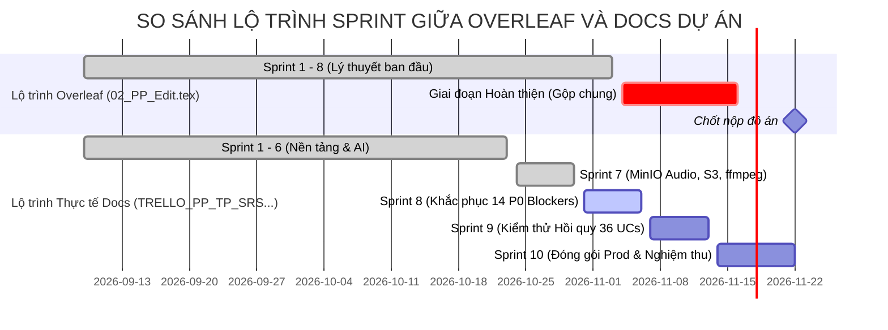

# BÁO CÁO ĐỐI SOÁT TOÀN DIỆN: OVERLEAF REPORT (PROJECT_1) VS TÀI LIỆU DỰ ÁN (DOCS/)
## PHÂN TÍCH ĐỘ TƯƠNG ĐỒNG, ĐỘ LỆCH DỮ LIỆU, LỖI CẤU TRÚC VÀ KHOẢNG TRỐNG BÁO CÁO TỔNG KẾT

> **Thời điểm đối soát**: Tháng 11/2026 (Giữa chu kỳ Sprint 8)  
> **Phạm vi tài liệu Overleaf (`overleaf_reports/Project_1/`)**: `00_PI_Edit.tex`, `01_SRS_Edit.tex` (+ `Chapter/*.tex`), `02_PP_Edit.tex` (+ `02_Chapters/*.tex`), `03_TP_Edit.tex` (+ `tmp/*.tex`), `04_FR.tex` (+ `04_Final Report/*.tex`), `BTL_Test.tex` (+ `BTL_Test_Chapters_1/`), `etc/main.tex`.  
> **Phạm vi tài liệu Dự án (`docs/`)**: `docs/core/` (`00.PI.md`, `01.SRS.md`, `02.PP.md`, `03.TP.md`), `docs/architecture/`, `docs/database/`, `docs/api/`, `docs/features/`, `docs/TRELLO_PP_TP_SRS_ALIGNMENT_AUDIT.md`, `docs/CORE_REQUIREMENTS_COMPLIANCE_AUDIT.md`, `docs/CORE_GAP_ANALYSIS.md`, `docs/NON_FUNCTIONAL_REQUIREMENTS_AND_STAGING_PERFORMANCE.md`.  
> **Nguyên tắc thực thi**: **READ-ONLY đối với toàn bộ thư mục `overleaf_reports/Project_1/`**, tuyệt đối không can thiệp hay sửa đổi tài liệu nguồn của người dùng trên Overleaf.

---

## 1. TỔNG QUAN KẾT QUẢ ĐỐI SOÁT (EXECUTIVE SUMMARY)

| Nhóm Tài liệu | Nguồn Overleaf (`Project_1`) | Nguồn Docs Dự án (`docs/`) | Tỷ lệ Tương đồng | Đánh giá Hiện trạng & Điểm khác biệt Cốt lõi |
| :--- | :--- | :--- | :---: | :--- |
| **00. PI** *(Project Initiation)* | `reports/00_PI_Edit.tex` | `docs/core/00.PI.md` | **95%** | Cùng cấu trúc thành viên, giảng viên. **Phát hiện lỗi sai sót chung**: Đoạn văn mở đầu còn sót thông tin đề tài môn OOAD (TS. Nguyễn Hiếu Cường). Công cụ kiểm thử ghi Selenium/TestNG/Excel thay vì Vitest/JUnit/GitHub Issues. |
| **01. SRS** *(Yêu cầu Phần mềm)* | `01_SRS_Edit.tex` & `reports/Chapter/*.tex` | `docs/core/01.SRS.md` & `docs/features/*` | **98%** | Bao phủ 36/36 Use Cases. **Lỗi format trên Overleaf**: `UC20` bị ghi nhầm mã thành `ma = {UC20}` thay vì `UC020`. `UC24` trên Overleaf ghi "Chấm bài", docs ghi "Chấm bài thủ công". Overleaf thiếu NFR chuyên sâu về tải & hiệu năng. |
| **02. PP** *(Kế hoạch Dự án)* | `02_PP_Edit.tex` & `reports/02_Chapters/*.tex` | `docs/core/02.PP.md` & `TRELLO_PP_TP_SRS_...` | **70%** | **Lệch cấu trúc Sprint**: Overleaf chỉ liệt kê Sprint 1 – 8, gộp 2 tuần cuối thành 1 khối chung. Docs dự án phân rã chuẩn Scrum **10 Sprints độc lập**. Nội dung thực tế Sprint 7 & 8 bị lệch do phát sinh fix 14 P0 blocker và MinIO Audio. |
| **03. TP** *(Kế hoạch Kiểm thử)* | `03_TP_Edit.tex` & `reports/tmp/*.tex` | `docs/core/03.TP.md` & `FRONTEND_UI_TESTING.md` | **85%** | Lịch kiểm thử trên Overleaf chia 11 tuần (Sprint 1-8 + 3 tuần hoàn thiện). Docs bám 10 Sprints. Overleaf có thêm tài liệu `BTL_Test.tex` phân tích sâu ca kiểm thử UI `SCR-01` đến `SCR-05`. |
| **04. FR** *(Báo cáo Tổng kết)* | `04_FR.tex` & `reports/04_Final Report/*.tex` | `CORE_REQUIREMENTS_...` & `CORE_GAP_ANALYSIS.md` | **5%** | **KHOẢNG TRỐNG LỚN NHẤT**: Trên Overleaf toàn bộ 4 chương của `04_Final Report/` mới chỉ là tiêu đề khung trống (140 – 350 bytes/file). Trong khi `docs/` đã có đầy đủ số liệu nghiệm thu 36 UCs, kiến trúc, và kết quả kiểm thử. |
| **OOAD BTL** *(Tài liệu gốc)* | `etc/main.tex` | *Không có file md tương đương* | **Tham chiếu** | File báo cáo bài tập lớn môn OOAD (4.219 dòng, Nhóm 8, TS. Nguyễn Hiếu Cường). Đây là bản mẫu gốc mà từ đó nhóm sinh viên đã fork/chuyển thể sang báo cáo Project 1. |

---

## 2. ĐỐI CHIẾU CHI TIẾT TỪNG TÀI LIỆU

### 2.1. Tài liệu Khởi tạo Đề tài: `00_PI_Edit.tex` $\leftrightarrow$ `docs/core/00.PI.md`

#### Điểm thống nhất:
- **Thông tin trang bìa & xác nhận đề tài**:
  - Đề tài: *"Xây dựng website quản lý bài tập và chấm chữa bài tiếng Anh thông minh"*
  - Học phần: *Project 1*
  - Giảng viên hướng dẫn: *TS. Nguyễn Trọng Phúc*
  - Nhóm thực hiện: *Nhóm 4*
  - Danh sách 5 thành viên và mã sinh viên khớp 100%:
    1. Hồ Việt Tùng -- 231230949 (Project Manager, DevOps)
    2. Đoàn Thái Sơn -- 231220886 (Backend Developer Lead)
    3. Trần Tiến Sơn -- 231210892 (Frontend Developer Lead)
    4. Nguyễn Văn Tú -- 231230941 (Tester / QA Lead)
    5. Phạm Minh Tuấn -- 231230946 (Backend & DevOps)

#### Điểm khác biệt & Bất cập phát hiện:
1. **Lỗi tồn dư nội dung môn OOAD (TS. Nguyễn Hiếu Cường)**:
   - Tại dòng 267 của file `00_PI_Edit.tex` và dòng 105 của file `docs/core/00.PI.md`, cả hai đều chứa đoạn văn:
     > *"Xuất phát từ thực tiễn đó, nhóm chúng em thực hiện bài tập lớn môn Phân tích thiết kế hướng đối tượng dưới sự hướng dẫn của Tiến sĩ Nguyễn Hiếu Cường, với đề tài: 'Quản lý học viên trung tâm tiếng Anh'..."*
   - **Tác động**: Đoạn văn này mâu thuẫn trực tiếp với trang bìa (TS. Nguyễn Trọng Phúc, đề tài Project 1). Đây là kết quả của việc copy nội dung từ báo cáo cũ `etc/main.tex` mà chưa biên tập lại phần lời mở đầu bối cảnh.
2. **Độ lệch công cụ quản lý chất lượng (Tooling Drift)**:
   - Trong bảng công cụ của cả hai tài liệu ghi:
     - Quản lý bug: `Excel`
     - Kiểm thử tự động: `Selenium, TestNG`
     - Database deploy: `Neon`
   - Trong thực tế dự án (`AGENTS.md`, `git-user-mapping.md`, `docs/devops/`):
     - Quản lý bug: Sử dụng **GitHub Issues** (48 open issues) và **Trello board `Project1`**.
     - Kiểm thử: Dùng **JUnit 5, Mockito** (Backend Spring Boot) và **Vitest, React Testing Library** (Frontend React 19).
     - Database: Tự host PostgreSQL 16 qua **Docker Compose** và quản lý migration bằng **Flyway**, không sử dụng cloud database Neon.

---

### 2.2. Đặc tả Yêu cầu Phần mềm: `01_SRS_Edit.tex` $\leftrightarrow$ `docs/core/01.SRS.md`

#### Điểm thống nhất:
- Cả hai tài liệu đều phân tích đầy đủ **36 Use Cases (UC01 – UC36)** chia thành 4 nhóm nghiệp vụ:
  - Phân hệ Quản trị & Xác thực: `UC01` – `UC10`
  - Phân hệ Quản lý Bài tập Giáo viên: `UC11` – `UC15`
  - Phân hệ Học viên Làm bài & Nộp bài 4 Kỹ năng: `UC16` – `UC23`
  - Phân hệ Chấm điểm, AI Grading & Đánh giá kết quả: `UC24` – `UC36`

#### Bảng đối chiếu 36 Use Cases và phát hiện sai lệch format:

| Mã Docs | Tên trên Docs (`01.SRS.md`) | Mã Overleaf | Tên trên Overleaf (`YeuCauChucNang.tex`) | Điểm khác biệt / Lỗi định dạng |
| :--- | :--- | :--- | :--- | :--- |
| **UC01** | Đăng nhập (Login) | `UC001` | Đăng nhập | Đồng nhất nội dung |
| **UC02** | Đăng xuất (Logout) | `UC002` | Đăng xuất | Đồng nhất nội dung |
| **UC03** | Quản lý tài khoản cá nhân | `UC003` | Quản lý tài khoản cá nhân | Đồng nhất nội dung |
| **UC04** | Quản lý tài khoản người dùng | `UC004` | Quản lý tài khoản người dùng | Đồng nhất nội dung |
| **UC05** | Phân quyền người dùng | `UC005` | Phân quyền người dùng | Đồng nhất nội dung |
| **UC06** | Quản lý giáo viên | `UC006` | Quản lý giáo viên | Đồng nhất nội dung |
| **UC07** | Quản lý học viên | `UC007` | Quản lý học viên | Đồng nhất nội dung |
| **UC08** | Quản lý lớp học | `UC008` | Quản lý lớp học | Đồng nhất nội dung |
| **UC09** | Quản lý thành viên lớp học | `UC009` | Quản lý thành viên lớp học | Đồng nhất nội dung |
| **UC10** | Xem danh sách lớp học | `UC010` | Xem danh sách lớp học | Đồng nhất nội dung |
| **UC11** | Quản lý bài tập | `UC011` | Quản lý bài tập | Đồng nhất nội dung |
| **UC12** | Tạo bài tập đa kỹ năng | `UC012` | Tạo bài tập | Docs mô tả rõ bài tập đa kỹ năng |
| **UC13** | Mở bài tập (Publish) | `UC013` | Mở bài tập | Đồng nhất nội dung |
| **UC14** | Khóa bài tập (Close) | `UC014` | Khóa bài tập | Đồng nhất nội dung |
| **UC15** | Xem bài tập | `UC015` | Xem bài tập | Đồng nhất nội dung |
| **UC16** | Làm bài tập viết | `UC016` | Làm bài tập viết | Đồng nhất nội dung |
| **UC17** | Làm bài tập nói | `UC017` | Làm bài tập nói | Đồng nhất nội dung |
| **UC18** | Làm bài tập đọc | `UC018` | Làm bài tập đọc | Đồng nhất nội dung |
| **UC19** | Làm bài tập nghe | `UC019` | Làm bài tập nghe | Đồng nhất nội dung |
| **UC20** | Kiểm tra và xem lại bài làm | **`UC20`** | Kiểm tra và xem lại bài làm | ⚠️ **LỖI OVERLEAF**: Khai báo `ma = {UC20}` thay vì chuẩn `UC020` như 35 UCs còn lại. |
| **UC21** | Nộp bài tập (Submit) | `UC021` | Nộp bài tập | Đồng nhất nội dung |
| **UC22** | Quản lý lần làm và nộp lại | `UC022` | Quản lý lần làm và nộp lại | Đồng nhất nội dung |
| **UC23** | Xem trạng thái bài làm | `UC023` | Xem trạng thái bài làm | Đồng nhất nội dung |
| **UC24** | Chấm bài thủ công (Manual) | `UC024` | Chấm bài | Docs nhấn mạnh chữ "thủ công" để tách bạch với AI |
| **UC25** | Hỗ trợ chấm chữa bằng AI | `UC025` | Hỗ trợ chấm chữa bằng AI | Đồng nhất nội dung |
| **UC26** | Chấm chữa bài viết bằng AI | `UC026` | Hỗ trợ chấm chữa bài viết bằng AI | Đồng nhất nội dung |
| **UC27** | Chấm chữa bài nói bằng AI | `UC027` | Hỗ trợ chấm chữa bài nói bằng AI | Đồng nhất nội dung |
| **UC28** | Chấm bài đọc (Reading) | `UC028` | Chấm bài đọc | Đồng nhất nội dung |
| **UC29** | Chấm bài nghe (Listening) | `UC029` | Chấm bài nghe | Đồng nhất nội dung |
| **UC30** | Xem điểm số | `UC030` | Xem điểm số | Đồng nhất nội dung |
| **UC31** | Quản lý điểm số | `UC031` | Quản lý điểm số | Đồng nhất nội dung |
| **UC32** | Xem kết quả học tập | `UC032` | Xem kết quả học tập | Đồng nhất nội dung |
| **UC33** | Xem bài chữa | `UC033` | Xem bài chữa | Đồng nhất nội dung |
| **UC34** | Xem & đánh giá học viên | `UC034` | Xem và đánh giá kết quả học viên | Đồng nhất nội dung |
| **UC35** | Theo dõi tiến độ học tập | `UC035` | Theo dõi tiến độ học tập | Đồng nhất nội dung |
| **UC36** | Báo cáo và thống kê | `UC036` | Xem báo cáo và thống kê học tập | Đồng nhất nội dung |

#### Sự khác biệt về Yêu cầu Phi Chức năng (NFR):
- **Trên Overleaf (`YeuCauPhiChucNang.tex`)**: Chỉ gồm 2 mục: **Usability** (`USA-01` đến `USA-05`) và **Maintainability** (`MNT-01` đến `MNT-04`).
- **Trong Docs Dự án (`docs/NON_FUNCTIONAL_REQUIREMENTS_AND_STAGING_PERFORMANCE.md`)**: Được đầu tư toàn diện với số liệu đo lường thực tế:
  - Hiệu năng (Performance): Thời gian phản hồi P95 $< 500ms$ cho API đọc bài và $< 2000ms$ cho API tạo bài; tải đồng thời tối thiểu 50 người dùng làm bài cùng lúc.
  - Xử lý Media: Stream âm thanh nghe qua MinIO chunk streaming, transcode audio sang chuẩn WebM/WAV bằng `ffmpeg`.
  - Bảo mật (Security): Token JWT xoay vòng (Access Token 15 phút, Refresh Token 7 ngày), mã hóa mật khẩu bằng BCrypt độ dài salt 12.

---

### 2.3. Kế hoạch Dự án: `02_PP_Edit.tex` $\leftrightarrow$ `docs/core/02.PP.md` & Trello Board

#### Điểm thống nhất:
- Cả hai tài liệu đều xác định tổng thời gian dự án là **75 ngày** (từ 09/09/2026 đến 22/11/2026).
- Cùng áp dụng mô hình phát triển phần mềm **Scrum với chu kỳ Sprint cố định 1 tuần**.

#### Điểm sai lệch nghiêm trọng về phân bổ Sprint:

1. **Hiện tượng gộp Sprint trên Overleaf**:
   - Trong bảng lịch trình tại `Chapter_06.tex` của Overleaf, các mốc thời gian chỉ được đánh số từ **Sprint 1 đến Sprint 8** (kết thúc ngày 03/11).
   - Khoảng thời gian từ **04/11 đến 16/11** bị gộp thành một mục duy nhất: *"Giai đoạn hoàn thiện: kiểm thử hồi quy..."*, không được định danh là Sprint 9 và Sprint 10.
   - **Tài liệu Docs (`docs/TRELLO_PP_TP_SRS_ALIGNMENT_AUDIT.md`)** đã phân tích và chấn chỉnh điểm này: Bắt buộc phải duy trì mô hình Scrum 1 tuần với **Sprint 9 (07/11 – 13/11)** và **Sprint 10 (14/11 – 22/11)** độc lập để đảm bảo tính tuân thủ quy trình quản lý dự án.
2. **Độ lệch nội dung Sprint 7 và Sprint 8 giữa Kế hoạch lý thuyết và Thực tế**:
   - *Kế hoạch trên Overleaf*:
     - Sprint 7: Hoàn thiện đánh giá định kỳ học viên, báo cáo thống kê nâng cao.
     - Sprint 8: Thiết lập kiểm thử tự động Frontend.
   - *Thực tế triển khai trên Codebase & Trello*:
     - Sprint 7: Phát sinh khối lượng công việc hạ tầng lớn liên quan đến MinIO Web Audio S3, lưu trữ bài nộp Word (.docx), bộ chia bước (Stepper) và tích hợp `ffmpeg`.
     - Sprint 8: Phải ưu tiên toàn lực xử lý **14 lỗi nghiêm trọng (P0 Blockers)** cản trở luồng vận hành (mất nội dung luận khi nộp, mất audio, lỗi phân quyền 403 khi tải góp ý AI, nút lưu nháp gọi nhầm API chốt điểm).

---

### 2.4. Kế hoạch Kiểm thử: `03_TP_Edit.tex` $\leftrightarrow$ `docs/core/03.TP.md` & `BTL_Test.tex`

#### Điểm thống nhất:
- Khung chiến lược kiểm thử nhất quán: Tiêu chuẩn hoàn thành kiểm thử (DoD), độ bao phủ code tối thiểu $\ge 80\%$, các cấp độ kiểm thử (Unit Test, Integration Test, System Test, UI Test).
- Tiêu chí đánh giá lỗi theo 4 mức độ: Blocker (P0), Critical (P1), Major (P2), Minor (P3).

#### Điểm khác biệt:
1. **Lịch kiểm thử tại `reports/tmp/11.tex`**:
   - Được phân rã thành **11 tuần** (Tuần 0: Chuẩn bị; Tuần 1-8: Sprints 1-8; Tuần 9: Fix bug; Tuần 10: Vận hành; Tuần 11: Chốt bàn giao 17/11 – 22/11).
   - Bản phân rã này chi tiết hơn bảng ở `02_PP` nhưng lại có độ lệch nhẹ về ngày tháng so với chu kỳ 10 Sprints chuẩn hóa trong docs.
2. **Giá trị đặc biệt của `BTL_Test.tex` trên Overleaf**:
   - Thư mục `overleaf_reports/Project_1/reports/BTL_Test_Chapters_1/` chứa tài liệu kiểm thử rất chất lượng cho 05 màn hình Giáo viên:
     - `SCR-01`: Đăng nhập Giáo viên (Teacher Login)
     - `SCR-02`: Bảng điều khiển Giáo viên (Dashboard)
     - `SCR-03`: Quản lý Bài tập (Assignment Management)
     - `SCR-04`: Phòng Chấm bài Tập trung (Teacher Grading Studio)
     - `SCR-05`: Quản lý Lớp học (Class Management)
   - Mỗi màn hình đều có: Sơ đồ luồng Swimlane, bảng kiểm kê phần tử DOM, phân vùng tương đương (EP), phân tích giá trị biên (BVA), và Bảng quyết định (Decision Table).
   - Đây là nội dung chi tiết mà trong `docs/core/03.TP.md` mới chỉ dừng lại ở mức tóm tắt bảng danh mục ca kiểm thử.

---

### 2.5. Báo cáo Tổng kết Đồ án: `04_FR.tex` $\leftrightarrow$ Các Báo cáo Nghiệm thu trong `docs/`

> [!CAUTION]
> **Đây là khoảng trống lớn nhất giữa Overleaf và Tài liệu Dự án**:
> Trên Overleaf, toàn bộ thư mục `overleaf_reports/Project_1/reports/04_Final Report/` đang ở trạng thái **bản nháp sơ khai (chỉ có tiêu đề chương mục trống)**:
> - `Chapter_01.tex` (258 bytes): Chỉ có 4 mục `\subsection{...}` trống rỗng.
> - `Chapter_02.tex` (184 bytes): Khung tiêu đề kết quả triển khai.
> - `Chapter_03.tex` (354 bytes): Khung tiêu đề đánh giá kiểm định.
> - `Chapter_04.tex` (140 bytes): Khung tiêu đề kết luận & hướng phát triển.
> - `Appendix.tex` (204 bytes): Khung phụ lục.

Trong khi đó, hệ thống tài liệu trong `docs/` của dự án đã có đầy đủ **toàn bộ chất liệu và số liệu thực tế** để hoàn thiện trọn vẹn báo cáo tổng kết này:

| Chương trên Overleaf (`04_FR.tex`) | Tiêu đề chương | Tài liệu tương ứng sẵn có trong `docs/` có thể trích xuất số liệu |
| :--- | :--- | :--- |
| **Chương 1** | Tổng quan đề tài & Phạm vi | `docs/core/00.PI.md`, `docs/core/01.SRS.md`, `docs/README.md` |
| **Chương 2** | Kết quả Triển khai & Hiện trạng Sản phẩm | `docs/architecture/system-architecture.md`, `docs/database/schema.md` (17 bảng Flyway), `docs/api/` (62 REST endpoints), `docs/features/` (Teacher Studio, Student submission) |
| **Chương 3** | Đánh giá & Kiểm định Chất lượng | `docs/CORE_REQUIREMENTS_COMPLIANCE_AUDIT.md` (Nghiệm thu 36/36 UCs), `docs/TRELLO_PP_TP_SRS_ALIGNMENT_AUDIT.md` (Số liệu 10 Sprints & 48 lỗi), `docs/NON_FUNCTIONAL_REQUIREMENTS_...` |
| **Chương 4** | Hạn chế & Hướng phát triển Tương lai | `docs/CORE_GAP_ANALYSIS.md` (Phân tích khoảng cách kiến trúc, tối ưu cache AI, tích hợp STT/TTS offline) |
| **Phụ lục** | Bảng nghiệm thu & Ma trận kiểm thử | `docs/FRONTEND_UI_TESTING.md` và `overleaf_reports/Project_1/reports/BTL_Test_Chapters_1/` |

---

## 3. DANH MỤC KHUYẾN NGHỊ ĐỒNG BỘ DÀNH CHO BẠN

Dưới đây là các khuyến nghị bạn có thể chủ động cân nhắc khi chỉnh sửa hoặc biên tập nội dung trên Overleaf (tuân thủ nguyên tắc AI không tự ý can thiệp sửa file):

1. **Hiệu chỉnh lỗi văn bản trong `00_PI_Edit.tex`**:
   - Thay thế đoạn văn tại dòng 267 (nói về môn OOAD và thầy Nguyễn Hiếu Cường) bằng nội dung bối cảnh đúng của Project 1 dưới sự hướng dẫn của TS. Nguyễn Trọng Phúc (có thể lấy nguyên văn từ dòng 103–116 của `docs/core/01.SRS.md`).
2. **Chuẩn hóa mã Use Case trong `YeuCauChucNang.tex`**:
   - Đổi dòng 856 từ `ma = {UC20}` thành `ma = {UC020}` để đồng bộ 3 chữ số với toàn bộ 35 Use Cases còn lại.
3. **Cập nhật Lịch trình Sprint trong `02_Chapters/Chapter_06.tex`**:
   - Bổ sung định danh rõ ràng cho **Sprint 9 (07/11 – 13/11/2026: Regression Test 36 UCs)** và **Sprint 10 (14/11 – 22/11/2026: Đóng gói Production & Nghiệm thu)**, thay vì để gộp 2 tuần cuối thành một khối không tên.
4. **Khai thác dữ liệu `docs/` để hoàn thiện `04_FR.tex` (Final Report)**:
   - Khi cần hoàn thành bài báo cáo tổng kết nộp cuối kỳ, bạn chỉ cần lấy số liệu tổng kết có sẵn từ `docs/CORE_REQUIREMENTS_COMPLIANCE_AUDIT.md` và `docs/TRELLO_PP_TP_SRS_ALIGNMENT_AUDIT.md` để đưa vào 4 chương của `04_Final Report/`.
