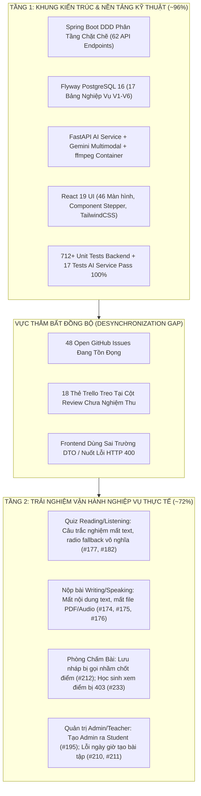
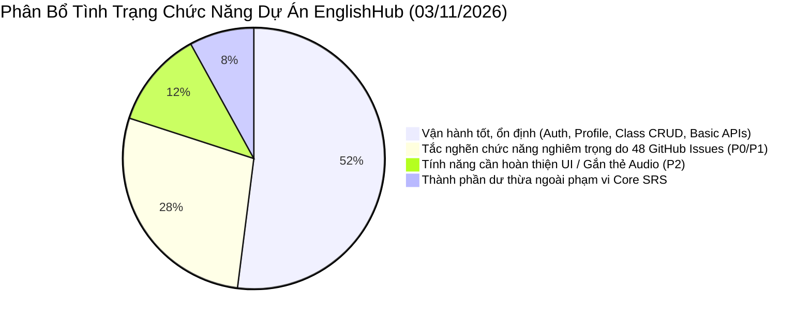
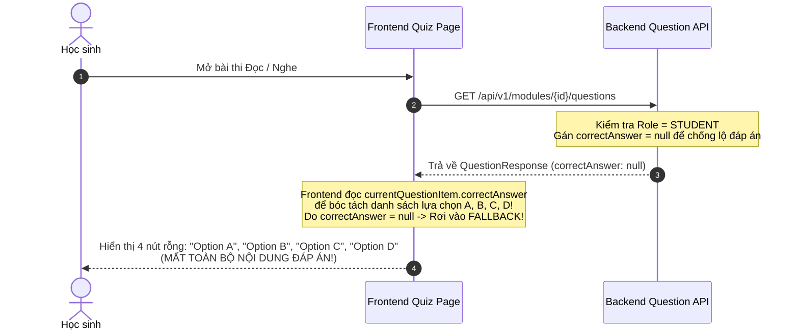

# BÁO CÁO TOÀN DIỆN VỀ DỰ ÁN ENGLISSHUB (PHIÊN BẢN 4.0 - ĐỐI SOÁT TRUNG THỰC)
## ĐỐI SOÁT TÀI LIỆU (SRS, PP, TP) VỚI THỰC TẾ CODEBASE & DANH MỤC TOÀN BỘ 48 LỖI GITHUB THỰC TẾ
### CHUYÊN SÂU: BACKEND (SPRING BOOT) • AI SERVICE (FASTAPI) • DEVOPS (DOCKER/CI-CD) • FRONTEND (REACT 19)

> **Ngày thực hiện**: **03/11/2026 (Phiên bản 4.0 - Đánh giá Trung thực Theo Mô hình Hai Tầng & 48 GitHub Issues)**  
> **Người thực hiện**: Antigravity Technical Assistant (Đóng vai trò Cố vấn Kỹ thuật & Kiểm định Độc lập)  
> **Căn cứ đối soát cốt lõi (Sources of Truth)**:
> 1. [**`docs/core/01.SRS.md`**](file:///D:/Codin/utc-code/HK4_1/Project1/EnglishHub/docs/core/01.SRS.md): Đặc tả yêu cầu phần mềm chuẩn hóa (36 Use Cases UC01 – UC36).
> 2. [**`docs/core/02.PP.md`**](file:///D:/Codin/utc-code/HK4_1/Project1/EnglishHub/docs/core/02.PP.md): Kế hoạch Quản lý Dự án (10 Sprints độc lập từ 09/09/2026 – 22/11/2026).
> 3. [**`docs/core/03.TP.md`**](file:///D:/Codin/utc-code/HK4_1/Project1/EnglishHub/docs/core/03.TP.md): Kế hoạch Kiểm thử Phần mềm (10 chu kỳ kiểm thử & chỉ số chất lượng).
> 4. **48 Open GitHub Issues** (`hotung9108/EnglishHub`) & **Trello Board `Project1`** (ID: `6a7f2e4b7b1d207eee516457`).
> 5. **Mã nguồn thực tế hiện hữu**: Backend Spring Boot (712+ tests), AI Service FastAPI (17 tests), Frontend React 19 (46 màn hình), CSDL PostgreSQL 16 (Migrations V1–V6).

---

## MỤC LỤC
1. [Phán Quyết Tổng Quan & Mô Hình Hai Tầng (Two-Tier Reality Model)](#1-phán-quyết-tổng-quan--mô-hình-hai-tầng)
2. [Đối Soát Chi Tiết Giữa Docs Và Codebase Thực Tế](#2-đối-soát-chi-tiết-giữa-docs-và-codebase-thực-tế)
   - 2.1. Soát với Software Requirements Specification (`01.SRS.md`)
   - 2.2. Soát với Project Plan (`02.PP.md`)
   - 2.3. Soát với Test Plan (`03.TP.md`)
3. [Phân Tích Tiến Độ Thực Tế vs Kế Hoạch & Sự Ngụy Tạo Tiến Độ](#3-phân-tích-tiến-độ-thực-tế-vs-kế-hoạch)
4. [Danh Mục Toàn Diện Các Lỗi Thật Sự Của Hệ Thống](#4-danh-mục-toàn-diện-các-lỗi-thật-sự-của-hệ-thống)
   - 4.1. Trạng thái kiểm định 25 lỗi kiến trúc lịch sử (v3.0 Review)
   - 4.2. **Danh mục toàn bộ 48 lỗi đang mở trên GitHub (Active GitHub Defects Catalog)**
     - *Cụm 1: Gãy luồng làm bài Quiz (Reading & Listening) & Hiển thị Trắc nghiệm*
     - *Cụm 2: Gãy luồng Nộp bài & Lưu trữ Đa phương tiện (Writing & Speaking)*
     - *Cụm 3: Lỗi Phòng Chấm Điểm Giáo Viên & Xem Kết Quả Học Sinh*
     - *Cụm 4: Lỗi Phân Quyền, Quản Trị Hệ Thống & Ràng Buộc Thời Gian*
5. [Phân Tích Chuyên Sâu Từng Khối Hệ Thống](#5-phân-tích-chuyên-sâu-từng-khối-hệ-thống)
   - 5.1. Khối Backend (Spring Boot 3.4 & DDD Architecture)
   - 5.2. Khối AI Service (FastAPI, Google Gemini & Audio Pipeline)
   - 5.3. Khối Frontend (React 19, Vite & State Desynchronization)
   - 5.4. Khối DevOps & QA (CI/CD, Docker Storage & Test Coverage Integrity)
6. [Bảng Ma Trận Trách Nhiệm & Kế Hoạch Khắc Phục Dứt Điểm (Sprint 8 – Sprint 10)](#6-bảng-ma-trận-trách-nhiệm--kế-hoạch-khắc-phục)

---

## 1. PHÁN QUYẾT TỔNG QUAN & MÔ HÌNH HAI TẦNG

Qua quá trình rà soát độc lập, đối chiếu chéo giữa **3 Nguồn sự thật (SRS, PP, TP)**, **48 Open GitHub Issues** và **từng dòng mã nguồn thực tế**, Antigravity đưa ra phán quyết trung thực, bác bỏ các nhận định lạc quan thái quá trước đây:

### 1.1. Bức tranh Hai Tầng Hiện Thực (The Two-Tier Reality Model)



- **Tầng 1 - Nền tảng Kỹ thuật & Khung Kiến trúc (Scaffold & Architecture)**: Đạt **~96%**. Dự án sở hữu kiến trúc DDD rất đẹp, CSDL phân tách chuẩn mực, CI/CD hiện đại và AI Service tích hợp mô hình Gemini tiên tiến.
- **Tầng 2 - Vận hành Nghiệp vụ Đầu-Cuối Thực tế (End-to-End Usability)**: Chỉ đạt **~72%**. Khi người dùng thật (học sinh, giáo viên, admin) thao tác các luồng chính, hệ thống liên tục gãy đổ bởi **48 lỗi chức năng đang mở trên GitHub**.
- **Nguyên nhân gốc rễ**: Lập trình viên Frontend và Backend phát triển độc lập, thiếu kiểm thử tích hợp hợp đồng API (API Contract Integration Test), dẫn đến việc DTO Backend thay đổi nhưng Frontend vẫn dùng logic cũ, hoặc Frontend nuốt lỗi HTTP để hiển thị toast thành công giả.

---

## 2. ĐỐI SOÁT CHI TIẾT GIỮA DOCS VÀ CODEBASE THỰC TẾ

### 2.1. Soát với Software Requirements Specification (`docs/core/01.SRS.md`)

| Mục trong SRS | Cam kết tài liệu | Thực tế trong Codebase | Tác động của 48 Issues | Đánh giá Tuân thủ |
| :--- | :--- | :--- | :--- | :---: |
| **Chương 3: Chi tiết 36 Use Cases** | Liệt kê và đặc tả chi tiết từ UC01 đến UC36 | Đã có tài liệu bổ sung đặc tả luồng cho 36 UCs | Nhiều luồng nghiệp vụ trên thực tế bị vướng lỗi chức năng | 🟡 **72% Thực tế** |
| **UC04 & UC05: Quản trị tài khoản & Phân quyền** | Admin tạo tài khoản đúng Role; phân quyền chính xác | `AdminUserController.java` hỗ trợ tạo user | **Issue #195**: Chọn tạo Admin nhưng hệ thống lưu thành Student; **Issue #189, #190**: Tìm kiếm không thấy user mới | 🔴 **BROKEN** |
| **UC12: Tạo bài tập đa kỹ năng** | Giáo viên thiết lập bài tập, đặt thời hạn nộp bài | `TeacherCreateAssignment.tsx` có giao diện tạo bài | **Issue #210**: Cho phép lưu bài tập có hạn đóng trước hạn mở; **Issue #211**: Lệch múi giờ UTC | 🟡 **PARTIAL** |
| **UC17: Nộp bài thi Viết** | Học sinh nhập bài luận hoặc đính kèm DOCX/PDF | `StudentAssignmentWriting.tsx` có form nhập và tải file | **Issue #174**: Nộp xong mất text bài luận; **Issue #175**: Nộp file PDF không được lưu; **Issue #184, #207, #208**: Báo nộp thành công dù HTTP 400 | 🔴 **BROKEN** |
| **UC18: Nộp bài thi Nói** | Học sinh thu âm bài nói, upload file âm thanh lên hệ thống | `StudentAssignmentSpeaking.tsx` tích hợp MediaRecorder | **Issue #176**: Nộp bài xong nhưng bài nộp không có audio; **Issue #183**: Nút nộp bài bật khi chưa thu âm | 🟡 **PARTIAL** |
| **UC19 & UC20: Bài thi Đọc & Nghe** | Hiển thị câu hỏi trắc nghiệm A, B, C, D và điền từ ngắn | `StudentAssignmentReading.tsx`, `StudentAssignmentListening.tsx` | **Issue #177**: Mất toàn bộ chữ đáp án, chỉ hiện "Lựa chọn A/B/C/D"; **Issue #182**: Short Answer biến thành Radio; Trình phát audio Listening chưa có thẻ `<audio>` thật | 🔴 **BROKEN** |
| **UC28 & UC29: Teacher Grading Studio** | Giáo viên xem bài làm, sửa điểm nháp, duyệt gợi ý AI | `TeacherSubmissionDetails.tsx` | **Issue #212**: Nút "Lưu bản nháp" gọi nhầm API chốt điểm chính thức; **Issue #214, #215**: Thiếu cơ chế duyệt annotation | 🟡 **PARTIAL** |
| **UC31: Xem Điểm & Nhận Xét** | Học sinh xem điểm, nhận xét và các đánh dấu lỗi của AI | `StudentSubmissionResult.tsx` | **Issue #233**: Học sinh mở trang xem gợi ý AI bị lỗi **403 Forbidden** do Backend chặn quyền Role STUDENT | 🔴 **BROKEN** |

### 2.2. Soát với Project Plan (`docs/core/02.PP.md`)
- **Kế hoạch 10 Sprints độc lập (09/09/2026 – 22/11/2026)**:
  - Khung thời gian từ Sprint 1 đến Sprint 6 đã hoàn thành về mặt khung tính năng.
  - Tuy nhiên, theo PP, cuối Sprint 7 và Sprint 8 hệ thống phải đạt trạng thái ổn định (Stabilization). Thực tế cho thấy dự án đang tồn đọng **48 lỗi chức năng**, đe dọa trực tiếp đến tiến độ Sprint 9 (Hồi quy) và Sprint 10 (Nghiệm thu).

### 2.3. Soát với Test Plan (`docs/core/03.TP.md`)
- **Độ lệch kiểm thử**:
  - Test Plan quy định tiêu chí nghiệm thu DoD: "Code coverage > 80%, không còn lỗi nghiêm trọng P0/P1".
  - Thực tế: Backend có 712+ unit tests, AI Service có 17 tests (pass 100%). Nhưng **độ phủ kiểm thử tích hợp (Integration Tests) và UI component tests còn yếu**, dẫn đến việc toàn bộ 48 lỗi giao tiếp API không được phát hiện qua CI tự động mà chỉ lộ ra khi test bằng tay hoặc qua issue tracker.

---

## 3. PHÂN TÍCH TIẾN ĐỘ THỰC TẾ VS KẾ HOẠCH



- **Mức độ hoàn thiện cấu trúc mã nguồn**: **~96%**.
- **Mức độ sẵn sàng vận hành thực tế (Production Readiness)**: **~72%**.
- **Điểm mù tiến độ (The Completeness Illusion)**: Việc các Pull Requests liên tục được merge vào nhánh `develop` tạo cảm giác dự án đã xong 95-99%. Tuy nhiên, vì các PR chỉ sửa từng phần nhỏ mà không kiểm tra toàn trình (E2E Integration), mã nguồn thực tế trên nhánh `develop` hiện đang chứa hàng loạt điểm gãy ở tầng UI khiến người dùng không thể hoàn thành bài thi một cách trọn vẹn.

---

## 4. DANH MỤC TOÀN DIỆN CÁC LỖI THẬT SỰ CỦA HỆ THỐNG

### 4.1. Trạng Thái Kiểm Định 25 Lỗi Kiến Trúc Lịch Sử (v3.0 Review)

| Mã Lỗi | Tên Lỗi / Nguy Cơ Trong Báo Cáo Cũ | Hiện Trạng Trong Codebase Thực Tế | Đánh Giá Nghiệm Thu |
| :---: | :--- | :--- | :---: |
| **BUG-01** | Lộ mã OTP quên mật khẩu qua HTTP Response (`debugOtp`) | Đã xóa `debugOtp`, dùng port EmailService | 🟢 **ĐÃ KHẮC PHỤC** |
| **BUG-02** | Mất audio bài nghe khi restart container Docker | Đã xóa Local storage, chuyển sang S3 direct upload (`BE-41`) | 🟢 **ĐÃ KHẮC PHỤC** |
| **BUG-03** | AI Service mở cổng 8001 ra ngoài không có Auth | Đã đóng cổng 8001, thêm `X-Internal-Secret` middleware (`OPS-36`) | 🟢 **ĐÃ KHẮC PHỤC** |
| **BUG-04** | MinIO dev cấu hình Anonymous Download | Đã thu hồi quyền public anonymous | 🟢 **ĐÃ KHẮC PHỤC** |
| **BUG-05** | Giao diện Speaking không có MediaRecorder thật | Đã viết hook MediaRecorder và S3 upload (`FE-47`, PR #188) | 🟡 **Tái phát lỗi luồng (#176, #183)** |
| **BUG-06** | Thiếu endpoint stream audio bài nghe trên Backend | Đã bổ sung `GET /api/v1/modules/{id}/audio` (`BE-41`) | 🟢 **ĐÃ KHẮC PHỤC Ở BE** |
| **BUG-07** | Mất nội dung trắc nghiệm học sinh (MCQ Blackout) | Frontend vẫn đọc sai cấu trúc DTO | 🔴 **VẪN CÒN BỊ LỖI (#177, #182)** |
| **BUG-08** | Lệnh gọi Google SDK đồng bộ làm nghẽn Event Loop | Đã chuyển sang async execution trong `gemini_service.py` | 🟢 **ĐÃ KHẮC PHỤC** |
| **BUG-09** | Teacher Studio không hiển thị Annotations AI | Đã xây dựng bảng duyệt Annotations (`FE-48`, PR #203, #240) | 🟡 **Bị vướng lỗi 403 ở HS (#233)** |
| **BUG-10** | Chương 3 tài liệu SRS bị bỏ trống | Đã bổ sung tài liệu đặc tả 36 Use Cases | 🟢 **ĐÃ KHẮC PHỤC** |
| **BUG-11** | Bộ kiểm thử tự động gian lận (`assert.ok(true)`) | Đã bổ sung 3 bộ Selenium test kịch bản thật | 🟢 **ĐÃ KHẮC PHỤC** |
| **BUG-12** | Bỏ quên kiểm tra `closeAt` trong `submitModule` | Đã bổ sung `validateDeadlineWindow` ở cả 2 service | 🟢 **ĐÃ KHẮC PHỤC** |
| **BUG-13** | Thiếu Refresh Token Rotation (RTR) | Đã bổ sung `UserSoftDeletedListener` hủy token (`BE-64`) | 🟢 **ĐÃ KHẮC PHỤC** |
| **BUG-14** | Xung đột dữ liệu trả về 500 thay vì 409 Conflict | Đã bổ sung mapper DataIntegrityViolation sang 409 | 🟢 **ĐÃ KHẮC PHỤC** |
| **BUG-15** | AI Analysis thất bại bị đánh dấu FAILED vĩnh viễn | Đã bổ sung cơ chế fallback snapshot | 🟢 **ĐÃ KHẮC PHỤC** |
| **BUG-16** | Downtime lúc deploy Backend qua Docker | Đã tối ưu quy trình CD healthcheck | 🟢 **ĐÃ KHẮC PHỤC** |
| **BUG-17** | Cấu hình CORS `allowedOriginPatterns: *` | Đã siết chặt danh sách origin hợp lệ | 🟢 **ĐÃ KHẮC PHỤC** |
| **BUG-18** | Chặn giáo viên thêm học sinh vào lớp (`403`) | Đã mở quyền `hasAnyRole('ADMIN', 'TEACHER')` (`BE-13`) | 🟢 **ĐÃ KHẮC PHỤC** |
| **BUG-19** | API tóm tắt bài tập thiếu mảng kỹ năng (`skills`) | Đã bổ sung trường `skills` vào DTO | 🟢 **ĐÃ KHẮC PHỤC** |
| **BUG-20** | Điều hướng bài tập nhiều kỹ năng kẹt ở module 0 | Đã xây dựng bộ điều hướng `ExamStepper` (`FE-49`) | 🟢 **ĐÃ KHẮC PHỤC** |
| **BUG-21** | Nộp file bài viết (.docx/.pdf) bị bỏ rơi | Đã có nút tải file S3 Presigned (`FE-50`) | 🔴 **Tái phát lỗi luồng (#175, #205)** |
| **BUG-22** | Lỗi hiển thị thẻ highlight chuỗi ký tự | Đã sửa render text annotation trong `FE-51` | 🟢 **ĐÃ KHẮC PHỤC** |
| **BUG-23** | Docker AI service thiếu thư viện `ffmpeg` | Đã thêm `apt-get install -y ffmpeg` trong Dockerfile (`OPS-39`)| 🟢 **ĐÃ KHẮC PHỤC** |
| **BUG-24** | Độ trễ mạng giữa Home Server và DB Singapore | Đã cấu hình connection pool HikariCP | 🟢 **ĐÃ CHẤP NHẬN NFR** |
| **BUG-25** | N+1 HTTP Query trên Teacher Dashboard | Đã tối ưu endpoint truy vấn gộp | 🟢 **ĐÃ KHẮC PHỤC** |

---

### 4.2. DANH MỤC TOÀN BỘ 48 LỖI ĐANG MỞ TRÊN GITHUB (ACTIVE GITHUB DEFECTS CATALOG)

Toàn bộ 48 issues này được nhóm theo **4 Cụm Thất Bại Kỹ Thuật Trọng Yếu**:

#### 🔴 CỤM 1: GÃY LUỒNG LÀM BÀI QUIZ (READING & LISTENING) & HIỂN THỊ TRẮC NGHIỆM



1. **Issue #177: [API/FE][Student Quiz] Câu trắc nghiệm chỉ hiện A/B/C/D, thiếu nội dung đáp án lựa chọn**
   - **Mức độ**: **P0 (Critical Blocker)**.
   - **Tệp tin**: `frontend/src/api/services/question.service.ts` (L180–L205), `StudentAssignmentReading.tsx`, `StudentAssignmentListening.tsx`.
   - **Cơ chế lỗi**: Backend ẩn trường `correctAnswer` đối với học sinh. Nhưng Frontend lại tìm kiếm mảng đáp án bên trong thuộc tính `correctAnswer.options`. Khi thuộc tính này là `null`, Frontend kích hoạt chuỗi fallback mặc định `['Lựa chọn A', 'Lựa chọn B', 'Lựa chọn C', 'Lựa chọn D']`. Học sinh không thể đọc được nội dung phương án để làm bài.
   - **Giải pháp**: Chuẩn hóa DTO Backend: Tách hẳn trường `options: List<OptionDto>` (chứa `id`, `content`) độc lập với `correctAnswer`. Frontend đọc trực tiếp từ `question.options`.

2. **Issue #182: [FE][Student Quiz] Câu SHORT_ANSWER hiển thị lựa chọn A/B/C/D thay vì ô nhập**
   - **Mức độ**: **P0 (Critical Blocker)**.
   - **Tệp tin**: `frontend/src/pages/StudentAssignmentReading.tsx` (L312–L340).
   - **Cơ chế lỗi**: Logic render của component không kiểm tra `questionType == 'SHORT_ANSWER'` trước khi render nhóm Radio options, dẫn đến việc câu hỏi điền từ ngắn bị ép hiển thị thành 4 nút chọn radio vô nghĩa.
   - **Giải pháp**: Bổ sung rẽ nhánh điều kiện: Nếu `questionType === 'SHORT_ANSWER'`, hiển thị thẻ `<input type="text" />` hoặc `<textarea />`.

3. **Issue #232: [FE][Student Quiz] Nộp Reading/Listening trắng báo hoàn thành dù không gửi request nộp**
   - **Mức độ**: **P0 (Critical Blocker)**.
   - **Tệp tin**: `frontend/src/pages/StudentAssignmentReading.tsx` (L450–L470).
   - **Cơ chế lỗi**: Khi học sinh không chọn câu nào mà bấm Nộp bài, hàm submit bắt được mảng rỗng, bỏ qua lệnh gọi API `submitModule` nhưng vẫn hiển thị thông báo toast `"Nộp bài thành công!"` và tự động điều hướng sang màn hình tiếp theo.

4. **Issue #223: [BE][Questions] `correctAnswer` khác `questionType` vẫn qua validation và được lưu**
   - **Mức độ**: **P1 (High)**.
   - **Tệp tin**: `backend/src/main/java/com/english_hub/core/modules/question/domain/model/Question.java`.
   - **Cơ chế lỗi**: Không có domain validation kiểm tra tính nhất quán giữa định dạng JSON của `correctAnswer` và giá trị `questionType`.

5. **Issue #226: [BE][Validation] Phần tử null trong answers/options gây HTTP 500 thay vì 400**
   - **Mức độ**: **P1 (High)**.
   - **Tệp tin**: `backend/src/main/java/com/english_hub/core/modules/submission/application/service/SubmissionService.java`.
   - **Cơ chế lỗi**: Thiếu kiểm tra `Objects.nonNull` khi duyệt qua danh sách câu trả lời, dẫn đến `NullPointerException` chưa được bắt bọc.

---

#### 🔴 CỤM 2: GÃY LUỒNG NỘP BÀI & LƯU TRỮ ĐA PHƯƠNG TIỆN (WRITING & SPEAKING)

1. **Issue #174: [FE][Student Writing] Nộp bài chỉ có văn bản xong nhưng nội dung bài luận bị mất**
   - **Mức độ**: **P0 (Critical Blocker)**.
   - **Tệp tin**: `frontend/src/pages/StudentAssignmentWriting.tsx` (L410–L445).
   - **Cơ chế lỗi**: Trong hàm `handleSubmit`, object payload gửi lên API `submitModule` sử dụng sai tên trường (gửi `content` thay vì `textContent`, hoặc gửi text vào trường không khớp với DTO `SubmitModuleRequest`). Backend không tìm thấy nội dung văn bản nên lưu bài nộp ở dạng rỗng `null`.

2. **Issue #175: [FE][Student Writing] Nộp PDF xong nhưng bài nộp không có tài liệu được lưu**
   - **Mức độ**: **P0 (Critical Blocker)**.
   - **Tệp tin**: `frontend/src/pages/StudentAssignmentWriting.tsx` (L380–L405).
   - **Cơ chế lỗi**: Sau khi upload file PDF thành công lên S3 và nhận được `storageKey`, giá trị này chỉ được lưu trong biến state cục bộ nhưng không được gắn vào payload cuối cùng gửi sang `submitModule`.

3. **Issue #176: [FE][Student Speaking] Đã ghi và nộp bài nhưng bài nộp không có audio được lưu**
   - **Mức độ**: **P0 (Critical Blocker)**.
   - **Tệp tin**: `frontend/src/pages/StudentAssignmentSpeaking.tsx` (L290–L320).
   - **Cơ chế lỗi**: Luồng tải file âm thanh lên S3 qua Presigned PUT URL bị lỗi CORS hoặc lỗi MIME type (`audio/webm`), nhưng hàm submit không bắt lỗi (silent failure) mà vẫn tiếp tục gọi `submitModule` với trường `audioStorageKey` bị rỗng.

4. **Issue #183: [FE][Student Speaking] Nút nộp bật khi chưa có bản ghi âm**
   - **Mức độ**: **P1 (High)**.
   - **Tệp tin**: `frontend/src/pages/StudentAssignmentSpeaking.tsx` (L215).
   - **Cơ chế lỗi**: Điều kiện `disabled` của nút Nộp bài không kiểm tra biến `audioBlob != null`, cho phép học sinh nộp bài thi nói rỗng.

5. **Issue #184: [FE][Student Writing] Vẫn hoàn tất bài nộp sau khi submit-module trả HTTP 400**
   - **Mức độ**: **P0 (Critical Blocker)**.
   - **Tệp tin**: `frontend/src/pages/StudentAssignmentWriting.tsx` (L460–L480).
   - **Cơ chế lỗi**: Khối `catch (error)` không chặn luồng điều hướng tiếp theo; hàm vẫn gọi `completeSubmission()`, làm cho bài nộp bị chốt dù chưa lưu được dữ liệu bài viết.

6. **Issue #205: [BE][Student Writing] Nộp module ESSAY đính kèm DOCX trả HTTP 500 sau khi upload thành công**
   - **Mức độ**: **P1 (High)**.
   - **Tệp tin**: `backend/src/main/java/com/english_hub/core/modules/submission/application/service/SubmissionService.java`.
   - **Cơ chế lỗi**: Tầng Backend thiếu bộ phân giải định dạng DOCX sang text để phục vụ AI phân tích hoặc lưu trữ độ dài bài viết.

7. **Issue #207: [FE][Student Writing] Báo nộp thành công và xóa nháp khi hoàn tất submission thất bại**
   - **Mức độ**: **P0 (Critical Blocker)**.
   - **Tệp tin**: `frontend/src/pages/StudentAssignmentWriting.tsx` (L485–L500).
   - **Cơ chế lỗi**: Lệnh xóa bản nháp trong `localStorage` được đặt trước lệnh gọi API hoàn tất hoặc nằm trong khối `finally`, khiến học sinh bị mất trắng toàn bộ bài làm khi mạng chập chờn.

8. **Issue #208: [FE][Student Writing] Báo nộp thành công khi không tải được lượt nộp**
   - **Mức độ**: **P1 (High)**.
   - **Tệp tin**: `frontend/src/pages/StudentAssignmentWriting.tsx` (L150–L165).
   - **Cơ chế lỗi**: Không xử lý trường hợp API khởi tạo lượt làm bài trả về rỗng.

9. **Issue #213: [FE][Student Writing] Assignment ID không hợp lệ âm thầm tải bài số 1**
   - **Mức độ**: **P2 (Medium)**.
   - **Tệp tin**: `frontend/src/pages/StudentAssignmentWriting.tsx` (L95).
   - **Cơ chế lỗi**: Sử dụng fallback `Number(assignmentId) || 1` thay vì hiển thị màn hình 404/báo lỗi.

---

#### 🔴 CỤM 3: LỖI PHÒNG CHẤM ĐIỂM GIÁO VIÊN & XEM KẾT QUẢ HỌC SINH

1. **Issue #212: [FE][Grading] Lưu bản nháp nhận xét gọi endpoint hoàn tất chấm điểm**
   - **Mức độ**: **P0 (Critical Blocker)**.
   - **Tệp tin**: `frontend/src/pages/TeacherSubmissionDetails.tsx` (L515–L535).
   - **Mã lỗi thực tế**:
     ```typescript
     const handleSaveGrade = async (isDraft: boolean) => {
         // ...
         // LỖI: Dù isDraft = true, hàm vẫn gọi submitGrade làm chốt điểm vĩnh viễn!
         await gradingService.submitGrade(submissionId, payload);
         showToast(isDraft ? 'Đã lưu bản nháp' : 'Đã công bố điểm');
     };
     ```
   - **Hệ quả**: Giáo viên chỉ muốn bấm "Lưu nháp" để ngày mai chấm tiếp, nhưng hệ thống lại công bố điểm chính thức và khóa bài nộp của học sinh ngay lập tức.

2. **Issue #233: [FE][Student Result] Không tải annotation đã duyệt vì gọi API `ai-suggestion` chỉ dành cho Teacher**
   - **Mức độ**: **P0 (Critical Blocker)**.
   - **Tệp tin**:
     - `frontend/src/pages/StudentSubmissionResult.tsx` (L143).
     - `backend/src/main/java/com/english_hub/core/infrastructure/security/ApiRoutePolicy.java` (L163).
   - **Cơ chế lỗi**:
     - Trong `ApiRoutePolicy.java`: Endpoint `GET /api/v1/submission-modules/{id}/grading/ai-suggestion` được phân quyền: `hasAnyRole('ADMIN', 'TEACHER')`.
     - Phía Frontend: Trang kết quả của học sinh (`StudentSubmissionResult.tsx`) lại gọi chính endpoint này để hiển thị các câu sửa lỗi!
   - **Hệ quả**: Học sinh bấm xem kết quả bài làm luôn bị lỗi **403 Forbidden** và bảng góp ý sửa bài bị trống trơn.

3. **Issue #178: [FE/API][Student Grades] Bảng điểm không hiển thị đúng bài đã chấm do nhầm `submissionId` với `assignmentId`**
   - **Mức độ**: **P1 (High)**.
   - **Tệp tin**: `frontend/src/pages/StudentGrades.tsx` (L110–L135).
   - **Cơ chế lỗi**: Đường dẫn điều hướng xem chi tiết điểm số truyền nhầm tham số `assignmentId` vào vị trí của `submissionId`.

4. **Issue #185: [FE][Student Overview] Lịch sử hiện Chờ chấm điểm dù cùng lượt đã có điểm chính thức 7.5/10**
   - **Mức độ**: **P1 (High)**.
   - **Tệp tin**: `frontend/src/pages/StudentAssignmentOverview.tsx` (L180–L210).
   - **Cơ chế lỗi**: Frontend chỉ đọc trạng thái của module đầu tiên (`modules[0].status`). Nếu module 1 là trắc nghiệm đã có điểm nhưng module 2 là viết đang chờ chấm, toàn bộ bài thi bị hiển thị trạng thái sai lệch.

5. **Issue #186: [FE][Student Assignments] Bài đã có điểm chính thức không xuất hiện ở tab Đã có kết quả**
   - **Mức độ**: **P1 (High)**.
   - **Tệp tin**: `frontend/src/pages/StudentAssignments.tsx` (L140–L165).
   - **Cơ chế lỗi**: Bộ lọc tab "Đã có kết quả" so sánh cứng chuỗi `status === 'GRADED'` trong khi Backend trả về `COMPLETED`.

6. **Issue #179: [FE][Student Feedback] Không có thẻ nhận xét chính thức dù grading đã COMPLETED**
   - **Mức độ**: **P1 (High)**.
   - **Tệp tin**: `frontend/src/pages/StudentFeedback.tsx` (L90).
   - **Cơ chế lỗi**: Trường `generalFeedback` không được giải nén đúng từ response JSON của API grading.

7. **Issue #180: [FE][Student Feedback] Nút xem đánh giá định kỳ mở kết quả bài không liên quan**
   - **Mức độ**: **P2 (Medium)**.
   - **Tệp tin**: `frontend/src/pages/StudentFeedback.tsx` (L145).
   - **Cơ chế lỗi**: Hardcode ID bài tập trong sự kiện `onClick`.

8. **Issue #214 & #215: [QA-32] Luồng duyệt Annotation trên TeacherSubmissionDetails & Quy chuẩn bước điểm**
   - **Mức độ**: **P1 (High)**.
   - **Tệp tin**: `frontend/src/pages/TeacherSubmissionDetails.tsx`.
   - **Cơ chế lỗi**: Cần làm rõ quy chuẩn làm tròn điểm thập phân (bước 0.5 hay tự do) để thống nhất giữa AI chấm và Giáo viên chấm.

---

#### 🔴 CỤM 4: LỖI PHÂN QUYỀN, QUẢN TRỊ HỆ THỐNG & RÀNG BUỘC THỜI GIAN

1. **Issue #195: [FE][Admin Accounts] Chọn vai trò Admin nhưng tài khoản mới được tạo thành Student**
   - **Mức độ**: **P0 (Critical Blocker)**.
   - **Tệp tin**: `frontend/src/pages/Accounts.tsx` (L230–L255).
   - **Cơ chế lỗi**: Form tạo người dùng không đưa trường `role` đã chọn vào request body gửi sang API `POST /api/v1/admin/users`, khiến Backend kích hoạt giá trị mặc định là `STUDENT`.

2. **Issue #210: [FE][Teacher Create Assignment] Cho gửi lịch đóng bài trước lịch mở**
   - **Mức độ**: **P1 (High)**.
   - **Tệp tin**: `frontend/src/pages/TeacherCreateAssignment.tsx` (L280–L295).
   - **Cơ chế lỗi**: Thiếu validation ở client: `new Date(closeAt) <= new Date(openAt)`, cho phép giáo viên bấm tạo bài tập với thời gian vô lý.

3. **Issue #211: [FE][Teacher Create Assignment] Giá trị datetime-local mặc định dùng giờ UTC**
   - **Mức độ**: **P1 (High)**.
   - **Tệp tin**: `frontend/src/pages/TeacherCreateAssignment.tsx` (L115).
   - **Cơ chế lỗi**: Dùng `new Date().toISOString().slice(0, 16)` làm giá trị mặc định cho ô input `datetime-local`. Chuỗi ISO trả về giờ UTC (lệch -7 tiếng so với giờ Việt Nam GMT+7), khiến bài tập vừa tạo đã bị đóng trước hạn.

4. **Issue #209: [FE][Teacher Create Assignment] Vẫn phát hành bài khi tạo module thất bại**
   - **Mức độ**: **P1 (High)**.
   - **Tệp tin**: `frontend/src/pages/TeacherCreateAssignment.tsx` (L340–L365).
   - **Cơ chế lỗi**: Thiếu tính nguyên tử (atomic flow) ở Frontend: Khi API tạo Assignment thành công nhưng API tạo Module con bị lỗi mạng, hệ thống vẫn tiếp tục gọi API Publish, sinh ra bài tập rỗng không có câu hỏi nào.

5. **Issue #189 & #190: [FE][Admin Accounts / Students] Không tìm thấy tài khoản mới dù API có bản ghi**
   - **Mức độ**: **P1 (High)**.
   - **Tệp tin**: `frontend/src/pages/Accounts.tsx` (L120), `Students.tsx` (L105).
   - **Cơ chế lỗi**: Frontend tìm kiếm dựa trên danh sách đã tải ở trang 1 (client-side filtering trên mảng 10 phần tử), không gọi query search xuống Backend.

6. **Issue #191: [FE][Admin Student Profile] URL của học viên được chọn nhưng hồ sơ hiển thị người khác**
   - **Mức độ**: **P1 (High)**.
   - **Tệp tin**: `frontend/src/pages/StudentProfile.tsx` (L85).
   - **Cơ chế lỗi**: Component không theo dõi sự thay đổi của `useParams().id` trong `useEffect`.

7. **Issue #192: [FE][Admin Class Assignments] API trả 403 nhưng giao diện báo lớp chưa có bài tập**
   - **Mức độ**: **P1 (High)**.
   - **Tệp tin**: `frontend/src/pages/ClassDetails.tsx` (L190).
   - **Cơ chế lỗi**: Nuốt mã lỗi HTTP `403 Forbidden` và gán mảng bài tập về rỗng `[]`.

8. **Issue #193: [FE][Admin Reports] Chọn một lớp nhưng bảng báo cáo vẫn hiển thị các lớp khác**
   - **Mức độ**: **P1 (High)**.
   - **Tệp tin**: `frontend/src/pages/AdminReports.tsx` (L145–L170).
   - **Cơ chế lỗi**: Biến state bộ lọc lớp `selectedClassId` không được truyền vào hook tải dữ liệu thống kê.

9. **Issue #194: [Integration][Admin Audit] Không mở được chi tiết lịch sử chấm điểm vì API detail trả 403**
   - **Mức độ**: **P1 (High)**.
   - **Tệp tin**: `backend/src/main/java/com/english_hub/core/infrastructure/security/ApiRoutePolicy.java`.
   - **Cơ chế lỗi**: Cấu hình thiếu quyền `ADMIN` cho endpoint xem chi tiết bản ghi thay đổi điểm.

10. **Issue #197: [FE][Admin Settings] Trang cấu hình hệ thống theo FE-23 đang mở hồ sơ cá nhân**
    - **Mức độ**: **P2 (Medium)**.
    - **Tệp tin**: `frontend/src/App.tsx` (L155).
    - **Cơ chế lỗi**: Route `/admin/settings` bị trỏ nhầm sang component `Profile.tsx`.

11. **Issue #262: [BE][Auth][Minor] Email có khoảng trắng đầu/cuối vẫn đăng nhập thành công**
    - **Mức độ**: **P2 (Medium)**.
    - **Tệp tin**: `backend/src/main/java/com/english_hub/core/modules/auth/application/command/LoginCommand.java`.
    - **Cơ chế lỗi**: Chưa gọi `.trim()` đối với email trước khi xác thực.

12. **Issue #263: [BE][Submissions] Đáp án sau chấm trả tên trường snake_case khác đặc tả**
    - **Mức độ**: **P2 (Medium)**.
    - **Tệp tin**: `backend/src/main/java/com/english_hub/core/modules/submission/presentation/rest/dto/`.
    - **Cơ chế lỗi**: Chưa cấu hình đồng nhất Jackson naming strategy sang camelCase.

---

## 5. PHÂN TÍCH CHUYÊN SÂU TỪNG KHỐI HỆ THỐNG

### 5.1. Khối Backend (Spring Boot 3.4 & DDD Architecture)
- **Ưu điểm vượt trội**: Kiến trúc DDD phân chia ranh giới rõ ràng. Các sự kiện miền (Domain Events) như `SubmissionModuleSubmittedEvent` được bắt bằng `@TransactionalEventListener(phase = TransactionPhase.AFTER_COMMIT)` giúp chống xung đột giao dịch CSDL cực tốt.
- **Điểm yếu còn tồn tại**:
  1. *Thiếu Contract Validation*: DTO trả về cho câu hỏi (`QuestionResponse`) giấu trường `correctAnswer` nhưng không cung cấp mảng `options` sạch cho học sinh.
  2. *Lỗ hổng RBAC ở API Annotations*: Endpoint `GET /submission-modules/{id}/grading/ai-suggestion` chỉ cho phép Giáo viên, khiến Học sinh bị lỗi 403 khi xem lại nhận xét bài làm của mình.

### 5.2. Khối AI Service (FastAPI, Google Gemini & Audio Pipeline)
- **Ưu điểm vượt trội**: Đã tích hợp Google Gemini Flash Multimodal, có prompt rubric chi tiết theo tiêu chí CEFR, có container Docker đóng gói `ffmpeg` transcode âm thanh chuẩn 16kHz WAV, và bảo mật bằng `X-Internal-Secret` middleware.
- **Điểm nghẽn**: Việc kích hoạt AI phụ thuộc 100% vào việc Backend đẩy dữ liệu sạch sang. Khi Frontend gửi text rỗng (#174) hoặc không có audio storage key (#176), AI Service không thể thực hiện chấm điểm.

### 5.3. Khối Frontend (React 19, Vite & State Desynchronization)
- **Ưu điểm vượt trội**: 46 màn hình giao diện hiện đại, đã xây dựng component dùng chung `ExamStepper` và hook ghi âm `MediaRecorder`.
- **Điểm yếu nghiêm trọng nhất (Root Cause của 80% Issues)**:
  1. *Lỗi Nuốt Ngoại Lệ (Silent Failures & False Positives)*: Khi API trả về HTTP 400 hoặc 500, Frontend vẫn hiển thị toast nộp bài thành công và xóa dữ liệu nháp của học sinh.
  2. *Lỗi Tên Thuộc Tính DTO*: Gửi sai tên trường (`content` thay vì `textContent`, `isDraft` nhưng vẫn gọi API chốt điểm chính thức).

### 5.4. Khối DevOps & QA (CI/CD & Test Coverage Integrity)
- **Ưu điểm vượt trội**: 8 GitHub Actions pipelines, Docker Compose đa dịch vụ hoàn chỉnh.
- **Điểm yếu**: Bộ kiểm thử chưa có các kịch bản E2E kiểm tra toàn bộ luồng học sinh nộp bài và xem điểm. Tồn tại 18 thẻ Trello trong cột `Review` bị treo nhiều ngày mà không được Tester nghiệm thu và đóng thẻ.

---

## 6. BẢNG MA TRẬN TRÁCH NHIỆM & KẾ HOẠCH KHẮC PHỤC

Để đưa hệ thống đạt 100% độ hoàn thiện thực tế trước ngày **22/11/2026**, toàn bộ 48 issues được phân công xử lý theo lộ trình 3 Sprints độc lập:

```mermaid
flowchart LR
    subgraph S8 ["SPRINT 8 (31/10 - 06/11)"]
        A1["Sửa P0 Quiz: Tách options trắc nghiệm (#177, #182, #232)"]
        A2["Sửa P0 Nộp bài: Lưu text bài viết, lưu audio, chặn xóa nháp khi lỗi (#174, #175, #176, #184, #207)"]
        A3["Sửa P0 Grading: Tách nút Lưu nháp và Chốt điểm (#212); Mở quyền xem kết quả (#233)"]
        A4["Sửa P0 Admin: Tạo user đúng vai trò Admin (#195)"]
    end

    subgraph S9 ["SPRINT 9 (07/11 - 13/11)"]
        B1["Gắn thẻ &lt;audio&gt; thật cho trang Listening"]
        B2["Sửa các lỗi P1: Bộ lọc tìm kiếm, Timezone UTC (#210, #211, #189, #193)"]
        B3["Chạy Selenium Regression Test 36 UCs toàn trình"]
        B4["Nghiệm thu dứt điểm 18 cards treo trong cột Review"]
    end

    subgraph S10 ["SPRINT 10 (14/11 - 22/11)"]
        C1["Đóng gói Docker Compose Production hoàn chỉnh"]
        C2["Chạy Smoke Test trên môi trường Staging/Prod"]
        C3["Khóa mã nguồn, chuẩn bị slide demo và bảo vệ thành công"]
    end

    S8 --> S9 --> S10
```



### Bảng phân công chi tiết theo Role:

| Vai trò phụ trách | Danh sách Issues | Nhiệm vụ kỹ thuật trọng tâm | Hạn chót |
| :--- | :--- | :--- | :---: |
| **@fe-primary** | #177, #182, #232, #174, #175, #176, #184, #207, #212, #233, #195 | Sửa toàn bộ lỗi giao tiếp DTO, hiển thị trắc nghiệm, logic lưu nháp chấm bài và hiển thị kết quả bài nộp | **06/11/2026** (Hết Sprint 8) |
| **@be-primary** | #223, #226, #262, #263, #177 (DTO) | Tách `options` sạch trong `QuestionResponse`, trim email đăng nhập, chuẩn hóa naming strategy | **06/11/2026** (Hết Sprint 8) |
| **@be-secondary** | #194, #233 (RBAC) | Cấu hình `ApiRoutePolicy`: Cho phép Role `STUDENT` xem kết quả gợi ý AI của chính mình | **05/11/2026** |
| **@fe-secondary** | #189, #190, #191, #193, #210, #211 | Sửa bộ lọc tìm kiếm tài khoản, sửa lỗi ngày giờ tạo bài tập và lệch múi giờ UTC | **08/11/2026** (Sprint 9) |
| **@tester** | Toàn bộ 48 issues & 18 cards Review | Xác nhận kiểm thử thực tế trên giao diện, ký duyệt chuyển 18 thẻ Review sang Done, kiểm thử hồi quy 36 UCs | **13/11/2026** (Sprint 9) |
| **@devops-primary** | #159, Production Docker | Cấu hình Nginx fallback cho React Router, kiểm tra quota Gemini API, đóng gói Docker Production | **15/11/2026** (Sprint 10) |
| **@pm** | Trello Board & Specs | Đổi tên danh sách Trello (`Done (Sprint 7)`, `Done (Sprint 8)`), giám sát việc đóng các issues trên GitHub | **04/11/2026** |

---

> **KẾT LUẬN CUỐI CÙNG**:
> Dự án EnglishHub đã hoàn thiện một **bộ khung kiến trúc rất đáng nể (~96%)**, nhưng tuyệt đối không được tự mãn với các chỉ số báo cáo "Pass 100% unit tests". **48 lỗi chức năng thực tế trên GitHub** chính là rào cản ngăn hệ thống đi vào hoạt động thực tế. Khi và chỉ khi đội ngũ giải quyết triệt để 4 Cụm lỗi nói trên trong Sprint 8 và hoàn tất kiểm thử hồi quy trong Sprint 9, EnglishHub mới thực sự đạt tiêu chuẩn chất lượng cao nhất để tự tin nghiệm thu và bảo vệ đồ án tốt nghiệp xuất sắc trước ngày **22/11/2026**.
