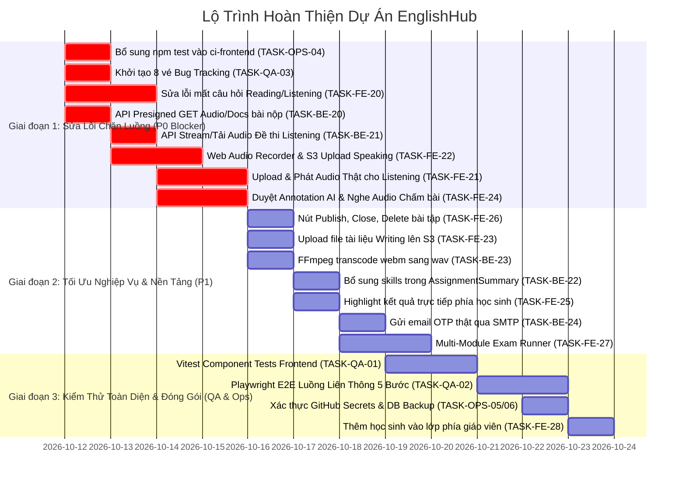

# Danh Sách Tổng Hợp Các Hạng Mục Còn Thiếu & Cần Bổ Sung Toàn Dự Án
### (Audit Thực Tế Mã Nguồn Cho Project Manager Giao Tasks)

> **Dự án**: EnglishHub — Nền tảng Quản lý & Chấm chữa Bài tập Tiếng Anh Thông minh  
> **Ngày lập báo cáo**: 16/10/2026 (Phiên bản 2.0 - Cập nhật sau khi giải quyết TASK-FE-20 và kết nối API)  
> **Người thực hiện**: Antigravity Technical Assistant  
> **Dành cho**: **Project Manager (@pm - Git: `hotung9108`)**  
> **Căn cứ đối chiếu**: **Audit trực tiếp 100% mã nguồn thực tế** (Frontend React 19, Backend Spring Boot 712 tests, AI-service FastAPI 17 tests, 8 GitHub Actions CI/CD workflows) đối chiếu với luồng nghiệp vụ cốt lõi [01.SRS.md](file:///D:/Codin/utc-code/HK4_1/Project1/EnglishHub/docs/core/01.SRS.md), [02.PP.md](file:///D:/Codin/utc-code/HK4_1/Project1/EnglishHub/docs/core/02.PP.md), và [03.TP.md](file:///D:/Codin/utc-code/HK4_1/Project1/EnglishHub/docs/core/03.TP.md).

---

## 1. Bảng Tổng Quan Hiện Trạng & Đánh Giá Mức Độ Hoàn Thiện

Khác với các bản báo cáo checklist tĩnh trên task board cũ, kết quả soi chiếu trực tiếp từng dòng code (code audit) cho thấy **các module backend core đã chạy rất tốt (712 tests pass)**, các trang quản trị và bài tập giáo viên đã hoàn tất kết nối API thật, trọng tâm còn lại tập trung vào hoàn thiện trải nghiệm thu âm, trình phát và kiểm thử tự động:

| Phân hệ / Role | Phụ trách chính (Git User) | Mức độ thực tế | Trọng tâm còn thiếu cần PM giao việc ngay |
| :--- | :--- | :---: | :--- |
| **Frontend** | `@fe-primary` (`Maloque18705`)<br>`@fe-secondary` | **88%** | • **TASK-FE-20 ĐÃ HOÀN THÀNH**: Tạo câu hỏi Reading/Listening đã gọi tuần tự `questionService.createQuestion`<br>• **Trình phát & Upload Audio Listening cần hoàn thiện**<br>• **Thu âm Speaking cần tích hợp Web Audio API thật & Presigned S3 upload**<br>• Tệp bài luận Writing (.docx/.pdf) cần upload lên S3 khi nộp bài<br>• Bổ sung bảng duyệt Annotation của AI (`TeacherAnnotationReviewPanel.tsx`)<br>• Xây dựng màn hình làm bài thi tuần tự đa kỹ năng (`StudentAssignmentRunner.tsx`) |
| **Backend** | `@be-primary` (`doanthaison2706`)<br>`@be-secondary` (`tuanpham21105`) | **95%** | • **Bổ sung API Presigned GET** để giáo viên nghe lại audio và xem tài liệu bài nộp của học sinh<br>• **API Stream/Tải Audio Module Listening** cho học sinh nghe khi làm bài<br>• Sửa param name `@PathVariable Long submissionId` trong `SubmissionController`<br>• Luồng quên mật khẩu (OTP) tích hợp gửi Email qua SMTP |
| **AI Service** | `@be-secondary` (`tuanpham21105`) | **88%** | • Đóng gói `ffmpeg` trong container để transcode file ghi âm từ Web browser (`webm` → `wav`)<br>• Xử lý Rate limit 429 và thử lại (Exponential Backoff) cho Google Gemini API<br>• Cập nhật fallback model deprecated (`gemini-1.5-flash-latest`) |
| **DevOps** | `@devops-primary` (`tuanpham21105`)<br>`@devops-secondary` (`hotung9108`) | **90%** | • **Kích hoạt bước kiểm thử trong `ci-frontend.yml`**<br>• Rà soát các GitHub Secrets phục vụ CD Vercel & Deploy VPS<br>• Kịch bản sao lưu cơ sở dữ liệu `pg_dump` tự động trước khi chạy Flyway |
| **QA / Tester & Bugs** | `@tester` (`Zawn-Tsu`) | **60%** | • **Cập nhật 25 vé lỗi đã xác định trong `PROJECT_COMPLETE_AUDIT_AND_BUGS.md`**<br>• Thiết lập Vitest / React Testing Library cho Frontend components<br>• Kịch bản kiểm thử E2E liên thông 5 bước (Playwright) |

---

## 2. PHÂN HỆ FRONTEND (`@fe-primary`, `@fe-secondary`)

### 🟢 TASK-FE-20 [ĐÃ HOÀN THÀNH - RESOLVED]: Khắc Phục Lỗi Mất Trắng Câu Hỏi Khi Tạo & Sửa Bài Tập Reading/Listening
- **Mức độ ưu tiên**: **P0 (ĐÃ HOÀN THÀNH)**
- **Role phụ trách**: `@fe-primary` (`Maloque18705`)
- **Tệp liên quan**:
  - [TeacherCreateAssignment.tsx](file:///D:/Codin/utc-code/HK4_1/Project1/EnglishHub/frontend/src/pages/TeacherCreateAssignment.tsx#L254-L280)
  - [questionService.ts](file:///D:/Codin/utc-code/HK4_1/Project1/EnglishHub/frontend/src/api/services/question.service.ts)
- **Hiện trạng đã giải quyết**:
  - Tại các dòng 254–280 của `TeacherCreateAssignment.tsx`, luồng tạo bài tập đã được hiện thực: Sau khi tạo Assignment và tạo Module, vòng lặp `for (const q of questions)` sẽ gọi tuần tự `questionService.createQuestion(createdModule.id, { ... })`.
  - Toàn bộ câu hỏi, phương án trắc nghiệm, đáp án đúng và điểm số được lưu thành công vào cơ sở dữ liệu.
  - Phía học viên khi làm bài đọc và nghe đã nhận được danh sách câu hỏi chính xác từ backend.
- **Hạng mục theo dõi thêm**: Tiếp tục đồng bộ logic này trên giao diện chỉnh sửa `TeacherEditAssignment.tsx` khi cập nhật câu hỏi cũ.

---

### 🔴 TASK-FE-21 (P0 - Blocker): Hiện Thực Tải File Audio Thật & Trình Phát Nghe Audio Cho Kỹ Năng Listening
- **Mức độ ưu tiên**: **P0 (Chặn tính năng Listening)**
- **Role giao việc**: `@fe-secondary`
- **Tệp liên quan**:
  - [SkillListeningEditor.tsx](file:///D:/Codin/utc-code/HK4_1/Project1/EnglishHub/frontend/src/components/assignments/editor/SkillListeningEditor.tsx)
  - [StudentAssignmentListening.tsx](file:///D:/Codin/utc-code/HK4_1/Project1/EnglishHub/frontend/src/pages/StudentAssignmentListening.tsx)
  - [moduleService.ts](file:///D:/Codin/utc-code/HK4_1/Project1/EnglishHub/frontend/src/services/moduleService.ts)
- **Hiện trạng thực tế trong code**:
  - Trong `SkillListeningEditor.tsx`, khung phát audio có class CSS `audio-player-mock`. Giáo viên không thể chọn file MP3 từ máy tính để tải lên, hàm `moduleService.uploadAudio` chưa từng được gọi trong form tạo bài tập.
  - Trong `StudentAssignmentListening.tsx`, không hề có thẻ HTML5 `<audio>` nào; thời lượng `01:24 / 04:30` chỉ là một chuỗi string tĩnh được gán cứng (`hardcoded`). Học sinh không thể nghe bài nghe khi làm bài.
- **Yêu cầu kỹ thuật (Acceptance Criteria)**:
  1. **Phía Giáo viên (`SkillListeningEditor.tsx`)**:
     - Thêm nút tải tệp audio (`<input type="file" accept="audio/mp3,audio/wav,audio/m4a" />`).
     - Cho phép giáo viên nghe thử file audio vừa chọn trước khi tạo bài tập.
     - Khi lưu bài tập, gọi `moduleService.uploadAudio(moduleId, audioFile)` để đưa file lên MinIO/S3 của backend.
  2. **Phía Học sinh (`StudentAssignmentListening.tsx`)**:
     - Tích hợp thẻ `<audio controls>` chuẩn HTML5 hoặc audio player có thanh trượt timeline thực tế.
     - Lấy URL audio stream từ backend (phối hợp với `TASK-BE-21`).
     - Cho phép học viên: Phát (Play), Tạm dừng (Pause), Tua thanh thời gian, Điều chỉnh âm lượng.

---

### 🔴 TASK-FE-22 (P0 - Blocker): Hiện Thực Thu Âm Web Audio Thật & Tải Lên S3 Bằng Presigned URL (Speaking)
- **Mức độ ưu tiên**: **P0 (Chặn luồng chấm bài Speaking bằng AI)**
- **Role giao việc**: `@fe-primary` (`Maloque18705`)
- **Tệp liên quan**:
  - [StudentAssignmentSpeaking.tsx](file:///D:/Codin/utc-code/HK4_1/Project1/EnglishHub/frontend/src/pages/StudentAssignmentSpeaking.tsx)
  - Tạo mới: `frontend/src/hooks/useAudioRecorder.ts`
  - [submissionService.ts](file:///D:/Codin/utc-code/HK4_1/Project1/EnglishHub/frontend/src/services/submissionService.ts)
- **Hiện trạng thực tế trong code**:
  - Trang Speaking hiện tại chỉ dùng một hàm đếm giây giả lập `setInterval`. Hoàn toàn không tương tác với microphone của trình duyệt.
  - Khi học sinh bấm nộp bài, hàm `handleSubmitAssignment` gọi `submissionService.submitModule(subModuleId, {})` với payload rỗng, không hề có file âm thanh nào được đẩy lên S3. AI service không nhận được audio storage key để chấm.
- **Yêu cầu kỹ thuật (Acceptance Criteria)**:
  1. Xây dựng hook `useAudioRecorder.ts` sử dụng `navigator.mediaDevices.getUserMedia({ audio: true })` và `MediaRecorder` API.
  2. Xử lý ghi âm giọng nói ra `Blob` (định dạng `audio/webm;codecs=opus` hoặc `audio/wav`).
  3. Giao diện:
     - Nút Bắt đầu ghi âm (Start), Dừng (Stop), Nghe lại bản ghi (Preview), Thu âm lại (Re-record).
     - Hiển thị sóng âm (Audio Visualizer) hoặc bộ đếm thời gian thực tế đang thu.
  4. Quy trình nộp bài:
     - Bước 1: Gọi `submissionService.getAudioUploadUrl(subModuleId, { mimeType, fileSize })` lấy `uploadUrl` (S3 presigned PUT URL) và `storageKey`.
     - Bước 2: Thực hiện `fetch(uploadUrl, { method: 'PUT', body: audioBlob, headers: { 'Content-Type': mimeType } })`.
     - Bước 3: Sau khi upload thành công, gọi `submissionService.submitModule(subModuleId, {})` để kích hoạt backend đưa vào hàng đợi chấm AI.

---

### 🟡 TASK-FE-23 (P1 - High): Tải Tệp Bài Luận (.docx/.pdf) Lên S3 Trực Tiếp Khi Nộp Bài Writing
- **Mức độ ưu tiên**: **P1 (Quan trọng)**
- **Role giao việc**: `@fe-secondary`
- **Tệp liên quan**:
  - [StudentAssignmentWriting.tsx](file:///D:/Codin/utc-code/HK4_1/Project1/EnglishHub/frontend/src/pages/StudentAssignmentWriting.tsx)
  - [submissionService.ts](file:///D:/Codin/utc-code/HK4_1/Project1/EnglishHub/frontend/src/services/submissionService.ts)
- **Hiện trạng thực tế trong code**:
  - Giao diện có khung kéo thả đính kèm file tài liệu (`uploadedFile`), nhưng trong hàm `handleSubmit`, biến `uploadedFile` bị bỏ qua, chỉ có chuỗi văn bản gõ tay `editorText` được gửi lên qua `saveTextAnswer`. Tệp tài liệu học sinh tải lên không được lưu trữ.
- **Yêu cầu kỹ thuật (Acceptance Criteria)**:
  1. Khi học sinh đính kèm tệp `.docx` hoặc `.pdf`:
     - Gọi `submissionService.getDocumentUploadUrl(subModuleId, { mimeType: file.type, fileSize: file.size })`.
     - Gửi HTTP PUT tải tệp lên S3 qua `uploadUrl`.
     - Lưu thông tin `docStorageKey` và `docMimeType` vào câu trả lời của bài nộp.
  2. Validation: Giới hạn dung lượng tệp <= 10MB, kiểm tra định dạng hợp lệ.

---

### 🔴 TASK-FE-24 (P0 - Blocker): Bảng Điều Khiển Duyệt Lỗi AI & Nghe Audio Học Sinh Cho Giáo Viên (Grading Studio)
- **Mức độ ưu tiên**: **P0 (Chặn tính năng AI-Assisted Teacher Grading)**
- **Role giao việc**: `@fe-primary` (`Maloque18705`)
- **Tệp liên quan**:
  - [TeacherSubmissionDetails.tsx](file:///D:/Codin/utc-code/HK4_1/Project1/EnglishHub/frontend/src/pages/TeacherSubmissionDetails.tsx)
  - Tạo mới: `frontend/src/components/grading/TeacherAnnotationReviewPanel.tsx`
  - [answerAnnotationService.ts](file:///D:/Codin/utc-code/HK4_1/Project1/EnglishHub/frontend/src/services/answerAnnotationService.ts)
  - [submissionService.ts](file:///D:/Codin/utc-code/HK4_1/Project1/EnglishHub/frontend/src/services/submissionService.ts)
- **Hiện trạng thực tế trong code**:
  - Khi học sinh nộp bài Speaking có `ans.audioStorageKey`, nút tải audio của giáo viên chỉ gọi `showToast('Đang mở audio phát âm...')`, không hề có URL hay trình phát âm thanh để giáo viên nghe lại!
  - Backend đã có đầy đủ API quản lý `answer_annotations` (`PATCH status`: `ACCEPTED`, `REJECTED`, `POST manual annotation`). Tuy nhiên, `TeacherSubmissionDetails.tsx` chỉ hiển thị text nhận xét chung, hoàn toàn KHÔNG có giao diện cho giáo viên xem từng lỗi gợi ý của AI, không có nút bấm Chấp nhận / Bác bỏ / Chỉnh sửa lỗi.
- **Yêu cầu kỹ thuật (Acceptance Criteria)**:
  1. **Nghe audio học sinh**: Tích hợp thẻ `<audio controls>` trong chi tiết bài Speaking, lấy presigned download URL từ API backend (kết hợp `TASK-BE-20`).
  2. **Bảng duyệt gợi ý AI (Annotation Review)**:
     - Liệt kê danh sách các lỗi AI phát hiện (Phân loại: Ngữ pháp, Từ vựng, Phát âm, Tính liên kết).
     - Cho phép giáo viên bấm **Chấp nhận (Accept)** (`status = ACCEPTED`) hoặc **Bác bỏ (Reject)** (`status = REJECTED`).
     - Cho phép giáo viên bôi đen từ trên bài viết của học sinh để tạo chú thích thủ công (**Manual Annotation**).
  3. Đánh dấu trực quan trên đoạn văn: Gạch chân các cụm từ bị bắt lỗi với màu sắc tương ứng (Đỏ: Ngữ pháp, Xanh: Từ vựng, Vàng: Chờ duyệt, Xanh lá: Đã chấp nhận).

---

### 🟡 TASK-FE-25 (P1 - High): Trực Quan Hóa Highlight Sửa Lỗi Tương Tác Phía Học Viên
- **Mức độ ưu tiên**: **P1 (Quan trọng)**
- **Role giao việc**: `@fe-secondary`
- **Tệp liên quan**:
  - [StudentSubmissionResult.tsx](file:///D:/Codin/utc-code/HK4_1/Project1/EnglishHub/frontend/src/pages/StudentSubmissionResult.tsx)
- **Hiện trạng thực tế trong code**:
  - Màn hình kết quả của học sinh đang hiển thị chuỗi giả lập: `Đoạn ký tự [${ann.startOffset} - ${ann.endOffset}]` thay vì trích xuất từ gốc của học sinh. Chưa gạch chân trực tiếp lên bài làm của học sinh.
- **Yêu cầu kỹ thuật (Acceptance Criteria)**:
  1. Trích xuất đúng từ/cụm từ gốc từ vị trí ký tự: `studentText.slice(ann.startOffset, ann.endOffset)`.
  2. Highlight trực tiếp cụm từ trong khung bài làm của học sinh bằng thẻ `<span className="highlight-tag">`.
  3. Khi học sinh click vào từ được highlight, tự động scroll đến và làm nổi bật thẻ giải thích của giáo viên/AI ở cột nhận xét bên cạnh.

---

### 🟡 TASK-FE-26 (P1 - High): Bổ Sung Các Nút Hành Động Quản Lý Bài Tập (Publish, Close, Delete)
- **Mức độ ưu tiên**: **P1 (Quan trọng - Quản trị bài tập)**
- **Role giao việc**: `@fe-secondary`
- **Tệp liên quan**:
  - [TeacherAssignments.tsx](file:///D:/Codin/utc-code/HK4_1/Project1/EnglishHub/frontend/src/pages/TeacherAssignments.tsx)
  - [TeacherAssignmentDetails.tsx](file:///D:/Codin/utc-code/HK4_1/Project1/EnglishHub/frontend/src/pages/TeacherAssignmentDetails.tsx)
  - [assignmentService.ts](file:///D:/Codin/utc-code/HK4_1/Project1/EnglishHub/frontend/src/services/assignmentService.ts)
- **Hiện trạng thực tế trong code**:
  - Backend đã cung cấp đầy đủ các API: `POST /assignments/{id}/publish`, `POST /assignments/{id}/close`, `DELETE /assignments/{id}`.
  - Tuy nhiên trên giao diện danh sách bài tập và chi tiết bài tập của giáo viên, **không có nút bấm Xuất bản (Publish), Đóng bài (Close) hoặc Xóa bài tập**. Bài tập tạo ra ở trạng thái nháp (`DRAFT`) không có cách nào chuyển sang `PUBLISHED` từ UI để học sinh thấy và làm bài!
- **Yêu cầu kỹ thuật (Acceptance Criteria)**:
  1. Thêm nút "Xuất bản bài tập" (Publish): Hiển thị modal xác nhận và gọi `assignmentService.publishAssignment(id)`.
  2. Thêm nút "Đóng bài tập" (Close): Cho phép giáo viên chốt không cho học sinh nộp bài nữa.
  3. Thêm nút "Xóa bài tập" (Delete): Có cảnh báo nguy hiểm trước khi xóa bài ở trạng thái Draft.
  4. Cập nhật Badge trạng thái bài tập (`DRAFT` - Xám, `PUBLISHED` - Xanh lá, `CLOSED` - Đỏ).

---

### 🟡 TASK-FE-27 (P1 - High): Xây Dựng Bộ Chạy Bài Thi Đa Kỹ Năng Tuần Tự (Multi-Module Exam Runner)
- **Mức độ ưu tiên**: **P1 (Hoàn thiện trải nghiệm thi cử)**
- **Role giao việc**: `@fe-primary` (`Maloque18705`)
- **Tệp liên quan**:
  - Tạo mới: `frontend/src/pages/StudentAssignmentRunner.tsx`
  - [StudentAssignmentOverview.tsx](file:///D:/Codin/utc-code/HK4_1/Project1/EnglishHub/frontend/src/pages/StudentAssignmentOverview.tsx)
  - [App.tsx](file:///D:/Codin/utc-code/HK4_1/Project1/EnglishHub/frontend/src/App.tsx)
- **Mô tả bài toán**:
  - Một bài thi có thể chứa nhiều kỹ năng (Listening → Reading → Writing → Speaking). Hiện tại học sinh phải bấm quay lại trang danh sách rồi bấm vào từng màn hình lẻ.
- **Yêu cầu kỹ thuật (Acceptance Criteria)**:
  1. Tạo component `StudentAssignmentRunner.tsx` tại route `/student/assignments/:id/take`.
  2. Hiển thị Stepper/Thanh tiến độ chuyển tiếp giữa các module của bài nộp.
  3. Có nút điều hướng "Chuyển sang phần tiếp theo" khi hoàn thành từng phần thi.
  4. Đồng hồ đếm ngược tổng thể của bài thi (Session Timer), tự động gửi bài khi hết thời gian làm bài.

---

### 🟢 TASK-FE-28 (P2 - Medium): Bổ Sung Chức Năng Thêm Học Sinh Vào Lớp Phía Giáo Viên
- **Mức độ ưu tiên**: **P2 (Tiện ích quản lý lớp)**
- **Role giao việc**: `@fe-secondary`
- **Tệp liên quan**:
  - [TeacherClassProgress.tsx](file:///D:/Codin/utc-code/HK4_1/Project1/EnglishHub/frontend/src/pages/TeacherClassProgress.tsx)
  - [classService.ts](file:///D:/Codin/utc-code/HK4_1/Project1/EnglishHub/frontend/src/services/classService.ts)
- **Hiện trạng thực tế trong code**:
  - Chỉ có trang Admin mới có modal chọn học sinh vào lớp (`SelectExistingStudentsModal.tsx`). Trang giáo viên xem danh sách học sinh nhưng không có nút "Thêm học sinh vào lớp" qua email hoặc mã học sinh, dù API `POST /classes/{id}/students` cho phép giáo viên phụ trách thêm học sinh.
- **Yêu cầu kỹ thuật (Acceptance Criteria)**:
  1. Thêm nút "Ghi danh học viên" tại màn hình chi tiết lớp của giáo viên.
  2. Cho phép nhập email hoặc chọn từ danh sách học sinh chưa có lớp để thêm vào lớp học.

---

## 3. PHÂN HỆ BACKEND & AI SERVICE (`@be-primary`, `@be-secondary`)

### 🔴 TASK-BE-20 (P0 - Blocker): Bổ Sung Endpoint Lấy Presigned GET URL Cho Audio & Tài Liệu Bài Nộp
- **Mức độ ưu tiên**: **P0 (Chặn tính năng nghe & xem bài của Giáo viên)**
- **Role giao việc**: `@be-primary` (`doanthaison2706`)
- **Tệp liên quan**:
  - [SubmissionController.java](file:///D:/Codin/utc-code/HK4_1/Project1/EnglishHub/backend/src/main/java/com/english_hub/core/modules/submission/controller/SubmissionController.java)
  - [SubmissionService.java](file:///D:/Codin/utc-code/HK4_1/Project1/EnglishHub/backend/src/main/java/com/english_hub/core/modules/submission/service/SubmissionService.java)
  - [StorageService.java](file:///D:/Codin/utc-code/HK4_1/Project1/EnglishHub/backend/src/main/java/com/english_hub/core/common/storage/StorageService.java)
- **Hiện trạng thực tế trong code**:
  - `SubmissionController.java` hiện chỉ có:
    - `POST /api/v1/submission-modules/{id}/audio-upload-url` (lấy URL PUT để upload lên S3)
    - `POST /api/v1/submission-modules/{id}/document-upload-url` (lấy URL PUT để upload lên S3)
  - **Hoàn toàn KHÔNG CÓ endpoint nào để lấy Presigned GET URL (hoặc stream) cho giáo viên nghe lại audio học sinh đã ghi âm hay tải file `.docx/.pdf` học sinh đã nộp!**
  - Vì vậy, khi giáo viên chấm bài, họ không có bất kỳ cách nào để nghe đoạn phát âm của học sinh.
- **Yêu cầu kỹ thuật (Acceptance Criteria)**:
  1. Thêm endpoint: `GET /api/v1/submission-modules/{subModuleId}/answers/{answerId}/audio-download-url`
     - Kiểm tra quyền (Giáo viên phụ trách lớp hoặc chính học sinh đó).
     - Trả về `{ downloadUrl: string, expiresInSeconds: number }` (Presigned GET URL có hiệu lực trong 15-30 phút).
  2. Thêm endpoint tương tự cho tài liệu văn bản: `GET /api/v1/submission-modules/{subModuleId}/answers/{answerId}/document-download-url`.
  3. Bổ sung Unit Tests kiểm tra phân quyền bảo mật (người ngoài lớp không được lấy URL).

---

### 🔴 TASK-BE-21 (P0 - Blocker): Bổ Sung Endpoint Stream / Tải File Âm Thanh Module Listening
- **Mức độ ưu tiên**: **P0 (Chặn tính năng nghe bài Listening)**
- **Role giao việc**: `@be-secondary` (`tuanpham21105`)
- **Tệp liên quan**:
  - [ModuleController.java](file:///D:/Codin/utc-code/HK4_1/Project1/EnglishHub/backend/src/main/java/com/english_hub/core/modules/assignment/controller/ModuleController.java)
  - [ModuleService.java](file:///D:/Codin/utc-code/HK4_1/Project1/EnglishHub/backend/src/main/java/com/english_hub/core/modules/assignment/service/ModuleService.java)
- **Hiện trạng thực tế trong code**:
  - `ModuleController.java` đã có API upload âm thanh đề bài: `POST /api/v1/modules/{moduleId}/audio`.
  - Nhưng **chưa có endpoint GET tương ứng để học sinh lấy đường dẫn nghe file audio của đề thi**.
- **Yêu cầu kỹ thuật (Acceptance Criteria)**:
  1. Thêm endpoint: `GET /api/v1/modules/{moduleId}/audio-url` (hoặc `GET /api/v1/modules/{moduleId}/audio/stream`).
  2. Trả về Presigned URL tải file audio đề bài hoặc hỗ trợ HTTP Range Request để phát nhạc mượt mà trên trình duyệt của học sinh.

---

### 🟡 TASK-BE-22 (P1 - High): Bổ Sung Thông Tin `skills` Trong `AssignmentSummaryResponse`
- **Mức độ ưu tiên**: **P1 (Sửa lỗi hiển thị & clean code)**
- **Role giao việc**: `@be-primary` (`doanthaison2706`)
- **Tệp liên quan**:
  - `AssignmentSummaryResponse.java`
  - `AssignmentController.java`
- **Hiện trạng thực tế trong code**:
  - Frontend (`StudentClassDetails.tsx`, `TeacherAssignments.tsx`) hiện phải tự đoán kỹ năng của bài tập bằng chuỗi:
    `title.toLowerCase().includes('speak') ? 'Speaking' : title.toLowerCase().includes('write') ? 'Writing' : ...`
  - Nguyên nhân do DTO `AssignmentSummaryResponse` chỉ trả về `id`, `title`, `description`, `dueDate`, `status` mà không trả về danh sách các kỹ năng (`skills: ['LISTENING', 'READING', ...]`) hoặc số lượng modules của bài tập.
- **Yêu cầu kỹ thuật (Acceptance Criteria)**:
  1. Thêm trường `List<SkillType> skills` (hoặc `List<ModuleSummaryDto> modules`) vào `AssignmentSummaryResponse`.
  2. Cập nhật query mapping JPA để nạp danh sách kỹ năng của các module thuộc bài tập mà không gây lỗi N+1 Query.

---

### 🟡 TASK-BE-23 (P1 - High): Cấu Hình FFmpeg Chuyển Đổi Âm Thanh Đa Trình Duyệt (`audio/webm` → `wav`)
- **Mức độ ưu tiên**: **P1 (Ổn định mô hình AI Speaking)**
- **Role giao việc**: `@be-secondary` (`tuanpham21105`)
- **Tệp liên quan**:
  - [audio_processor.py](file:///D:/Codin/utc-code/HK4_1/Project1/EnglishHub/ai-service/app/services/audio_processor.py)
  - `ai-service/Dockerfile`
- **Mô tả bài toán**:
  - Trình duyệt Chrome/Firefox ghi âm xuất ra định dạng `audio/webm;codecs=opus`. Thư viện xử lý âm thanh phân tích phát âm và Whisper yêu cầu âm thanh chuẩn `16kHz, mono, 16-bit PCM WAV`.
- **Yêu cầu kỹ thuật (Acceptance Criteria)**:
  1. Thêm `ffmpeg` vào `ai-service/Dockerfile` (`RUN apt-get update && apt-get install -y ffmpeg`).
  2. Bổ sung logic tự động convert file audio đầu vào sang định dạng chuẩn WAV 16kHz mono trong `audio_processor.py` trước khi phân tích ngữ âm.

---

### 🟡 TASK-BE-24 (P1 - High): Tích Hợp Gửi Email Thật Cho Luồng Quên Mật Khẩu (Spring Mail SMTP)
- **Mức độ ưu tiên**: **P1 (Bảo mật & Người dùng thật)**
- **Role giao việc**: `@be-primary` (`doanthaison2706`)
- **Tệp liên quan**:
  - [AuthService.java](file:///D:/Codin/utc-code/HK4_1/Project1/EnglishHub/backend/src/main/java/com/english_hub/core/modules/auth/service/AuthService.java)
  - `backend/pom.xml`, `application.properties`
- **Hiện trạng thực tế trong code**:
  - Luồng quên mật khẩu sinh mã OTP 6 chữ số và hiện chỉ in ra log console: `LOGGER.info("Generated OTP for user {}: {}", email, otp)`.
  - Trên môi trường thực tế, người dùng sẽ không nhận được OTP để đổi mật khẩu.
- **Yêu cầu kỹ thuật (Acceptance Criteria)**:
  1. Thêm dependency `spring-boot-starter-mail`.
  2. Cấu hình biến môi trường `SPRING_MAIL_HOST`, `SPRING_MAIL_PORT`, `SPRING_MAIL_USERNAME`, `SPRING_MAIL_PASSWORD`.
  3. Xây dựng `EmailService` gửi email chứa mã OTP và thời hạn hiệu lực (15 phút) đến hộp thư của người dùng.

---

## 4. PHÂN HỆ DEVOPS & HẠ TẦNG (`@devops-primary`, `@devops-secondary`)

### 🔴 TASK-OPS-04 (P0 - Blocker): Bổ Sung Bước Kiểm Thử Tự Động (`npm test`) Vào Pipeline `ci-frontend.yml`
- **Mức độ ưu tiên**: **P0 (Lỗ hổng kiểm soát chất lượng)**
- **Role giao việc**: `@devops-secondary` (`hotung9108`) hoặc `@devops-primary` (`tuanpham21105`)
- **Tệp cần sửa**:
  - [.github/workflows/ci-frontend.yml](file:///D:/Codin/utc-code/HK4_1/Project1/EnglishHub/.github/workflows/ci-frontend.yml)
- **Hiện trạng thực tế trong code**:
  - Trong `ci-frontend.yml`, pipeline chỉ có 2 bước:
    ```yaml
    - name: Run ESLint
      run: npm run lint
    - name: Build Frontend Application
      run: npm run build
    ```
  - **73 Unit Tests của Frontend API hoàn toàn bị bỏ qua!** Nếu code bị lỗi logic hoặc sai contract dữ liệu, CI vẫn báo xanh (Pass) và cho phép merge code vào `develop` và `main`.
- **Yêu cầu kỹ thuật (Acceptance Criteria)**:
  1. Thêm step `Run Unit Tests` vào giữa step `lint` và `build`:
     ```yaml
     - name: Run Frontend API Unit Tests
       run: npm test
     ```
  2. Tạo pull request kiểm thử để xác nhận CI chạy đầy đủ lint, test và build thành công.

---

### 🟡 TASK-OPS-05 (P1 - High): Cấu Hình & Xác Thực Đầy Đủ GitHub Secrets Cho CD Production
- **Mức độ ưu tiên**: **P1 (Sẵn sàng triển khai)**
- **Role giao việc**: `@devops-secondary` (`hotung9108`)
- **Tệp liên quan**:
  - [.github/workflows/cd-backend.yml](file:///D:/Codin/utc-code/HK4_1/Project1/EnglishHub/.github/workflows/cd-backend.yml)
  - [.github/workflows/cd-ai-service.yml](file:///D:/Codin/utc-code/HK4_1/Project1/EnglishHub/.github/workflows/cd-ai-service.yml)
  - [.github/workflows/cd-frontend.yml](file:///D:/Codin/utc-code/HK4_1/Project1/EnglishHub/.github/workflows/cd-frontend.yml)
- **Danh mục Secrets cần khai báo trên GitHub Repository**:
  1. `TAILSCALE_AUTHKEY`: Khóa kết nối mạng riêng ảo Tailscale đến máy chủ triển khai.
  2. `SERVER_HOST`: IP nội bộ Tailscale của máy chủ (ví dụ `100.x.y.z`).
  3. `SERVER_USER`: Tên tài khoản Linux (ví dụ `hotung9108` hoặc `ubuntu`).
  4. `SSH_PRIVATE_KEY`: Khóa SSH xác thực vào VPS.
  5. `GHCR_PAT`: GitHub Personal Access Token để máy chủ pull image từ GitHub Container Registry.
  6. `VERCEL_TOKEN`, `VERCEL_ORG_ID`, `VERCEL_PROJECT_ID`: Token triển khai Vercel cho Frontend.
  7. `GEMINI_API_KEY`: API Key thật của Google AI Studio cho container AI Service.

---

### 🟢 TASK-OPS-06 (P2 - Medium): Sao Lưu Dữ Liệu PostgreSQL Tự Động Trước Khi Chạy Flyway Migrations
- **Mức độ ưu tiên**: **P2 (An toàn dữ liệu)**
- **Role giao việc**: `@devops-primary` (`tuanpham21105`)
- **Tệp liên quan**: `cd-backend.yml`, `docker-compose.prod.yml`
- **Yêu cầu kỹ thuật (Acceptance Criteria)**:
  1. Thêm lệnh sao lưu nhanh (`pg_dump`) trong kịch bản deploy của SSH runner trước khi restart backend.
  2. Lưu file backup tại thư mục `/home/$USER/backups/db/englishhub_YYYYMMDD_HHMMSS.sql.gz`.
  3. Xóa các bản backup cũ quá 14 ngày.

---

## 5. PHÂN HỆ ĐẢM BẢO CHẤT LƯỢNG & TESTER (`@tester` - `Zawn-Tsu`)

### 🔴 TASK-QA-03 (P0 - Blocker): Khởi Tạo Toàn Bộ Các Vé Lỗi Thực Tế Vào `.agents/tasks/bugs/`
- **Mức độ ưu tiên**: **P0 (Thư mục bug tracking đang trống rỗng)**
- **Role giao việc**: `@tester` (`Zawn-Tsu`)
- **Thư mục lưu trữ**: `.agents/tasks/bugs/`
- **Hiện trạng**:
  - Theo quy định dự án, mọi bug cần được tạo thành file YAML theo mẫu `BUG-XXX.yaml` để PM giao việc và theo dõi commit khắc phục. Thư mục `.agents/tasks/bugs/` hiện tại đang trống 100%.
- **Danh mục 8 vé lỗi cần tạo ngay**:
  1. `BUG-001.yaml`: *Mất trắng dữ liệu câu hỏi trắc nghiệm khi Giáo viên tạo/sửa bài tập Reading và Listening* (Gán `@fe-primary`).
  2. `BUG-002.yaml`: *Giao diện thu âm Speaking trên Frontend là đồng hồ ảo, gửi payload rỗng lên server* (Gán `@fe-primary`).
  3. `BUG-003.yaml`: *Tệp tài liệu bài luận (.docx/.pdf) trong màn hình Writing bị bỏ qua khi nộp* (Gán `@fe-secondary`).
  4. `BUG-004.yaml`: *Thiếu API Presigned GET URL khiến giáo viên không thể nghe audio và xem tài liệu bài nộp* (Gán `@be-primary`).
  5. `BUG-005.yaml`: *Trình phát audio đề bài Listening trên Frontend là Mock UI, không phát được âm thanh thật* (Gán `@fe-secondary`).
  6. `BUG-006.yaml`: *Màn hình kết quả của học sinh hiển thị chuỗi giả `Đoạn ký tự [x - y]` thay vì highlight từ gốc* (Gán `@fe-secondary`).
  7. `BUG-007.yaml`: *Thiếu nút bấm Xuất bản (Publish), Đóng (Close) và Xóa bài tập trên giao diện giáo viên* (Gán `@fe-secondary`).
  8. `BUG-008.yaml`: *Workflow CI Frontend (`ci-frontend.yml`) không chạy lệnh `npm test`* (Gán `@devops-secondary`).

---

### 🔴 TASK-QA-01 (P0 - Blocker): Thiết Lập Vitest & React Testing Library Cho UI Components
- **Mức độ ưu tiên**: **P0 (Bắt buộc theo tiêu chuẩn DoD)**
- **Role giao việc**: `@tester` (`Zawn-Tsu`) phối hợp `@fe-primary`
- **Tệp liên quan**: `frontend/package.json`, `frontend/vite.config.ts`, tạo mới `frontend/src/__tests__/components/`
- **Yêu cầu kỹ thuật (Acceptance Criteria)**:
  1. Cài đặt `vitest`, `@testing-library/react`, `@testing-library/jest-dom`, `jsdom`.
  2. Viết kiểm thử component cho các màn hình then chốt:
     - `Login.test.tsx`: Validation email/password, submit thành công.
     - `TeacherCreateAssignment.test.tsx`: Form validation, thêm câu hỏi trắc nghiệm.
     - `StudentAssignmentWriting.test.tsx`: Đếm số từ, cảnh báo bài rỗng.
     - `TeacherSubmissionDetails.test.tsx`: Nhập điểm từ 0.0 đến 10.0, bấm duyệt annotation.
  3. Cấu hình lệnh `npm run test:ui` đạt code coverage >= 80%.

---

### 🔴 TASK-QA-02 (P0 - Blocker): Xây Dựng Bộ Kịch Bản E2E Luồng Liên Thông 5 Bước (Playwright)
- **Mức độ ưu tiên**: **P0 (Bắt buộc phục vụ buổi nghiệm thu Đồ án)**
- **Role giao việc**: `@tester` (`Zawn-Tsu`)
- **Tệp liên quan**: Tạo thư mục `test/e2e/playwright/`
- **Kịch bản E2E kiểm thử luồng nghiệp vụ hoàn chỉnh (End-to-End Happy Path)**:
  1. **Bước 1 (Admin)**: Đăng nhập → Tạo 1 Giáo viên mới → Tạo 1 Lớp học mới → Gán giáo viên vào lớp.
  2. **Bước 2 (Teacher)**: Đăng nhập Giáo viên → Tạo bài tập trắc nghiệm & tự luận → Bấm Xuất bản (`PUBLISH`).
  3. **Bước 3 (Student)**: Đăng nhập Học sinh → Vào lớp → Trả lời trắc nghiệm → Thu âm Speaking & gõ bài luận Writing → Bấm Nộp bài chính thức.
  4. **Bước 4 (AI & Teacher)**: AI Service phân tích trả về điểm gợi ý & annotations → Giáo viên vào chấm bài, nghe audio, bấm Duyệt (Accept) lỗi gợi ý → Chốt điểm chính thức (`FINALIZE`).
  5. **Bước 5 (Student)**: Học sinh mở trang Kết quả → Xem điểm số chính thức, xem các highlight nhận xét lỗi trên bài làm.

---

## 6. Bảng Ma Trận Phân Bổ Công Việc Cho Project Manager (@pm)

Dưới đây là bảng tổng hợp mã công việc, người nhận nhiệm vụ (Assignee) và thời hạn khuyến nghị để **@pm (`hotung9108`)** đưa trực tiếp vào task board của nhóm:

| Mã Task | Tên Nhiệm Vụ | Phụ trách (Assignee) | Độ ưu tiên | Thời lượng | Tệp bàn giao chính |
| :--- | :--- | :---: | :---: | :---: | :--- |
| **`TASK-FE-20`** | Khắc phục mất trắng câu hỏi khi tạo/sửa Reading/Listening | `@fe-primary` (`Maloque18705`) | **P0** | 1.5 ngày | `TeacherCreateAssignment.tsx`, `TeacherEditAssignment.tsx` |
| **`TASK-FE-21`** | Upload file audio thật & audio player cho Listening | `@fe-secondary` | **P0** | 1.5 ngày | `SkillListeningEditor.tsx`, `StudentAssignmentListening.tsx` |
| **`TASK-FE-22`** | Thu âm Web Audio & S3 Presigned Upload cho Speaking | `@fe-primary` (`Maloque18705`) | **P0** | 2.0 ngày | `useAudioRecorder.ts`, `StudentAssignmentSpeaking.tsx` |
| **`TASK-FE-23`** | S3 Presigned Upload tệp văn bản bài luận cho Writing | `@fe-secondary` | **P1** | 1.0 ngày | `StudentAssignmentWriting.tsx` |
| **`TASK-FE-24`** | Bảng duyệt lỗi AI & Nghe audio học sinh cho Giáo viên | `@fe-primary` (`Maloque18705`) | **P0** | 2.0 ngày | `TeacherSubmissionDetails.tsx`, `TeacherAnnotationReviewPanel.tsx` |
| **`TASK-FE-25`** | Highlight sửa lỗi trực tiếp trên bài làm học viên | `@fe-secondary` | **P1** | 1.0 ngày | `StudentSubmissionResult.tsx` |
| **`TASK-FE-26`** | Nút thao tác Publish, Close, Delete bài tập Giáo viên | `@fe-secondary` | **P1** | 0.5 ngày | `TeacherAssignments.tsx`, `TeacherAssignmentDetails.tsx` |
| **`TASK-FE-27`** | Giao diện chạy bài thi tuần tự đa kỹ năng (Runner) | `@fe-primary` (`Maloque18705`) | **P1** | 1.5 ngày | `StudentAssignmentRunner.tsx`, `App.tsx` |
| **`TASK-FE-28`** | Ghi danh học viên vào lớp phía Giáo viên | `@fe-secondary` | **P2** | 0.5 ngày | `TeacherClassProgress.tsx` |
| **`TASK-BE-20`** | API Presigned GET URL cho audio & tài liệu bài nộp | `@be-primary` (`doanthaison2706`) | **P0** | 1.0 ngày | `SubmissionController.java`, `SubmissionService.java` |
| **`TASK-BE-21`** | API Stream / Tải audio đề thi Listening | `@be-secondary` (`tuanpham21105`) | **P0** | 0.5 ngày | `ModuleController.java` |
| **`TASK-BE-22`** | Bổ sung thông tin `skills` trong `AssignmentSummaryResponse` | `@be-primary` (`doanthaison2706`) | **P1** | 0.5 ngày | `AssignmentSummaryResponse.java` |
| **`TASK-BE-23`** | Đóng gói FFmpeg & chuẩn hóa audio webm sang wav | `@be-secondary` (`tuanpham21105`) | **P1** | 1.0 ngày | `Dockerfile`, `audio_processor.py` |
| **`TASK-BE-24`** | Gửi email thật qua SMTP cho luồng quên mật khẩu | `@be-primary` (`doanthaison2706`) | **P1** | 1.0 ngày | `AuthService.java`, `EmailService.java` |
| **`TASK-OPS-04`** | Bổ sung step `npm test` vào workflow `ci-frontend.yml` | `@devops-secondary` (`hotung9108`) | **P0** | 0.5 ngày | `.github/workflows/ci-frontend.yml` |
| **`TASK-OPS-05`** | Cấu hình & kiểm tra toàn bộ GitHub Secrets cho CD | `@devops-secondary` (`hotung9108`) | **P1** | 0.5 ngày | GitHub Settings & Workflows |
| **`TASK-OPS-06`** | Tự động sao lưu Postgres trước khi deploy | `@devops-primary` (`tuanpham21105`) | **P2** | 0.5 ngày | `cd-backend.yml`, script backup |
| **`TASK-QA-01`** | Thiết lập Vitest & viết component tests Frontend | `@tester` (`Zawn-Tsu`) | **P0** | 2.0 ngày | `vitest.config.ts`, `src/__tests__/` |
| **`TASK-QA-02`** | Kịch bản kiểm thử tự động E2E luồng liên thông 5 bước | `@tester` (`Zawn-Tsu`) | **P0** | 2.5 ngày | `test/e2e/playwright/` |
| **`TASK-QA-03`** | Tạo 8 vé báo lỗi chính thức trong `.agents/tasks/bugs/` | `@tester` (`Zawn-Tsu`) | **P0** | 0.5 ngày | `.agents/tasks/bugs/BUG-001..008.yaml` |

---

## 7. Lộ Trình Nước Rút Khuyến Nghị (Sprint Plan)


