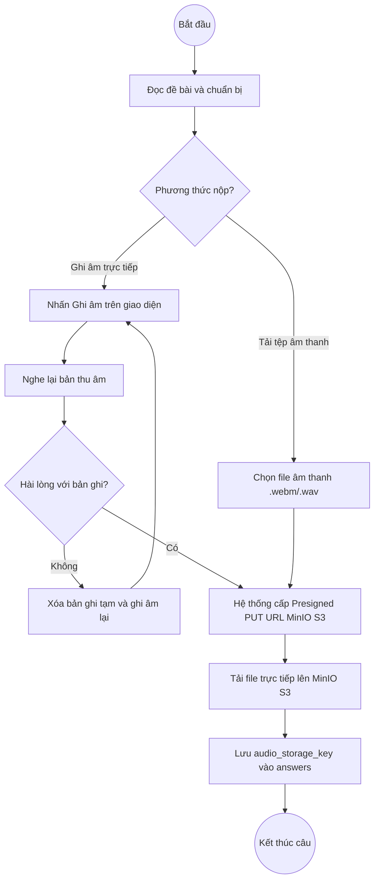
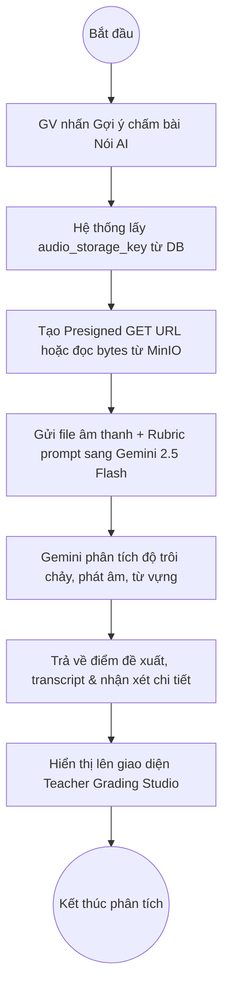
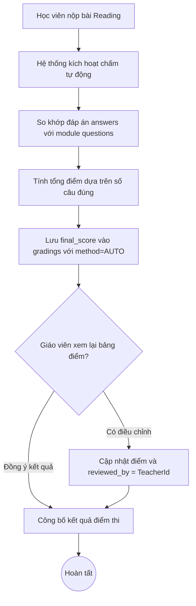
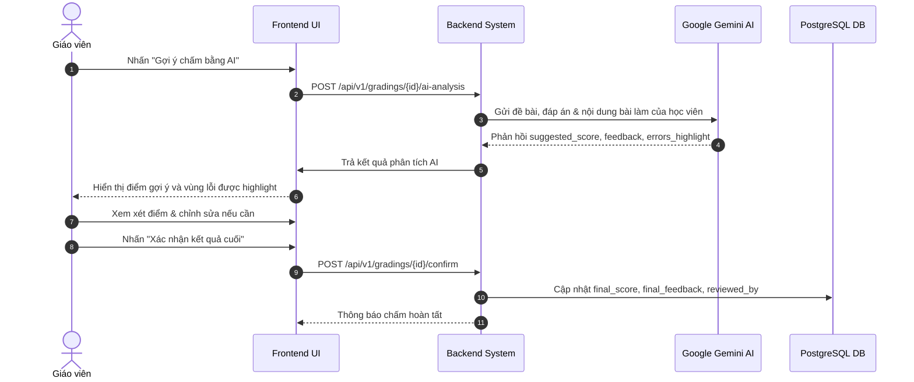

# BÁO CÁO KIỂM TOÁN VÀ ĐIỀU CHỈNH CHUYÊN SÂU SRS & ACTIVITY DIAGRAMS (THƯ MỤC FINAL)

> **Dự án**: EnglishHub - Nền tảng Quản lý Bài tập và Hỗ trợ Chấm chữa Tiếng Anh  
> **Tài liệu kiểm toán**: `final/reports/01_SRS.tex` và các chương `final/reports/Chapter/*.tex`  
> **Bộ sơ đồ kiểm toán**: 36 Activity Diagrams trong `final/images/Activity Diagram/`  
> **Thời điểm hoàn thành**: Tháng 11/2026  
> **Phiên bản tài liệu**: `v2.0-final`

---

## 1. TỔNG QUAN VÀ PHẠM VI KIỂM TOÁN (EXECUTIVE SUMMARY)

Theo chỉ đạo của người dùng:
1. Tạo riêng thư mục `final/` độc lập hoàn toàn với báo cáo cũ, sở hữu cấu trúc tài liệu và toàn bộ 242 tệp hình ảnh riêng biệt trong `final/images/` (không chia sẻ hay trỏ chéo về `images/` cũ).
2. Kiểm tra chi tiết 36 Use Cases và 36 Activity Diagrams đối chiếu trực tiếp với mã nguồn hệ thống thực tế (Spring Boot 3, DDD, React 19, MinIO S3, Google Gemini API, PostgreSQL).
3. Đọc hình ảnh trực quan (multimodal computer vision) để rà soát lỗi logic, luồng rẽ nhánh, trạng thái kết thúc và tính toán vẹn toàn của các biểu đồ hoạt động.
4. Trực tiếp chỉnh sửa (pixel-perfect patch via Pillow) các sơ đồ bị sai lệch mà không làm mờ, vỡ nét hay mất tính thẩm mỹ.
5. Giữ nguyên các công cụ kiểm thử truyền thống (**Selenium, Excel, Qase, BrowserStack**) trong `YeuCauPhiChucNang.tex` theo yêu cầu nghiệp vụ, đồng thời bổ sung đầy đủ chỉ số định lượng về Performance và Security.
6. Đồng bộ toàn bộ thư mục `final/` (mã nguồn LaTeX và ảnh) lên Overleaf Cloud (`Project_1` - Project ID: `6a8d98489e5b4896f3515c11`).

---

## 2. MA TRẬN ĐÁNH GIÁ 36 USE CASES & 36 ACTIVITY DIAGRAMS

| STT | Mã UC | Tên Ca Sử Dụng | Tác Nhân | Trạng Thái Sơ Đồ Gốc | Vấn Đề Phát Hiện | Giải Pháp & Trạng Thái Xử Lý |
|:---:|:---:|:---|:---|:---:|:---|:---|
| 1 | UC001 | Đăng nhập | Admin, Teacher, Student | Hợp lệ | Luồng xác thực JWT chuẩn | Giữ nguyên |
| 2 | UC002 | Đăng xuất | Admin, Teacher, Student | Hợp lệ | Xóa token/phiên | Giữ nguyên |
| 3 | UC003 | Quản lý tài khoản cá nhân | All Roles | Hợp lệ | Đổi mật khẩu, avatar | Giữ nguyên |
| 4 | UC004 | Quản lý tài khoản người dùng | Admin | Hợp lệ | CRUD tài khoản | Giữ nguyên |
| 5 | UC005 | Phân quyền người dùng | Admin | Hợp lệ | Gán Role RBAC | Giữ nguyên |
| 6 | UC006 | Quản lý giáo viên | Admin | Hợp lệ | Quản lý hồ sơ GV | Giữ nguyên |
| 7 | UC007 | Quản lý học viên | Admin | Hợp lệ | Quản lý hồ sơ HV | Giữ nguyên |
| 8 | UC008 | Quản lý lớp học | Admin | Cảnh báo nhỏ | Luồng đóng lớp tức thời | Chấp nhận được |
| 9 | UC009 | Quản lý thành viên lớp học | Admin, Teacher | Hợp lệ | Thêm/xóa học viên | Giữ nguyên |
| 10 | UC010 | Xem danh sách lớp học | Teacher, Student | Hợp lệ | Truy vấn danh sách lớp | Giữ nguyên |
| 11 | UC011 | Quản lý bài tập | Teacher | Hợp lệ | Danh sách bài theo kỹ năng | Giữ nguyên |
| 12 | UC012 | Tạo bài tập | Teacher | Hợp lệ | Cấu hình module 4 kỹ năng | Giữ nguyên |
| 13 | UC013 | Mở bài tập | Teacher | Hợp lệ | Chuyển trạng thái PUBLISHED | Giữ nguyên |
| 14 | UC014 | Khóa bài tập | Teacher | Hợp lệ | Đóng bài tập thủ công/tự động | Giữ nguyên |
| 15 | UC015 | Xem bài tập | Student | Hợp lệ | Đọc đề bài, điều kiện làm bài | Giữ nguyên |
| 16 | UC016 | Làm bài tập viết | Student | **Sai lệch** | Chưa rõ cơ chế lưu văn bản vs đính kèm S3 | **Đã sửa**: Ghi rõ `content` văn bản hoặc `doc_storage_key` vào `answers` |
| 17 | UC017 | Làm bài tập nói | Student | **Sai logic nghiêm trọng** | 1. Ghi nhầm Cloudflare R2 2. Vòng lặp thu âm lại nối sai vị trí 3. Nhánh "Không hài lòng" đi vào ngõ cụt | **Đã sửa**: Thay bằng MinIO S3, sửa loopback mũi tên, nối nhánh "Không" vào merge diamond nộp bài |
| 18 | UC018 | Làm bài tập đọc | Student | Hợp lệ | Chọn trắc nghiệm Reading | Giữ nguyên |
| 19 | UC019 | Làm bài tập nghe | Student | Hợp lệ | Stream audio, trả lời câu hỏi | Giữ nguyên |
| 20 | UC020 | Kiểm tra trước khi nộp | Student | Hợp lệ | Review bài làm | Giữ nguyên |
| 21 | UC021 | Nộp bài tập | Student | Hợp lệ | Ghi nhận lần nộp | Giữ nguyên |
| 22 | UC022 | Quản lý lần làm & nộp lại | Student, Teacher | Hợp lệ | Kiểm tra max_attempts | Giữ nguyên |
| 23 | UC023 | Xem trạng thái bài làm | Student | Hợp lệ | Theo dõi PENDING, GRADED | Giữ nguyên |
| 24 | UC024 | Chấm bài thủ công | Teacher | Hợp lệ | Nhập điểm, feedback | Giữ nguyên |
| 25 | UC025 | Chấm chữa bằng AI (Chung) | Teacher, System, AI | **Sai swimlane logic** | Giáo viên thực hiện thao tác CSDL: `Lưu vào bảng gradings` | **Đã sửa**: Chuyển hành động của GV thành `Xem xét điểm đề xuất và nhận xét do AI phân tích` |
| 26 | UC026 | Chấm chữa bài viết AI | Teacher, System, AI | Hợp lệ | Phân tích bài viết qua Gemini | Giữ nguyên |
| 27 | UC027 | Chấm chữa bài nói AI | Teacher, System, AI | **Sai logic sơ đồ** | Có nút kết thúc (bullseye) cụt ở giữa chừng trước khi AI đánh giá | **Đã sửa**: Xóa bullseye cụt, nối liền mạch luồng xử lý xuống Gemini AI |
| 28 | UC028 | Chấm bài đọc | System, Teacher | **Sai trạng thái DB** | Ghi trạng thái `NEEDS_REVIEW` không có trong Entity DB | **Đã sửa**: Thay bằng `Lưu điểm vào gradings, ghi nhận reviewed_by và chuyển Giáo viên xác nhận` |
| 29 | UC029 | Chấm bài nghe | System, Teacher | Hợp lệ | Tự động so khớp đáp án | Giữ nguyên |
| 30 | UC030 | Xem điểm số | Teacher, Student | Hợp lệ | Xem bảng điểm | Giữ nguyên |
| 31 | UC031 | Quản lý điểm số | Teacher | Hợp lệ | Điều chỉnh điểm số | Giữ nguyên |
| 32 | UC032 | Xem kết quả học tập | Student | Hợp lệ | Thống kê kết quả cá nhân | Giữ nguyên |
| 33 | UC033 | Xem bài chữa | Student | Hợp lệ | Xem chi tiết bài làm + lỗi | Giữ nguyên |
| 34 | UC034 | Đánh giá học viên | Teacher | Hợp lệ | Nhận xét tiến độ | Giữ nguyên |
| 35 | UC035 | Theo dõi tiến độ | Teacher | Hợp lệ | Biểu đồ hoàn thành | Giữ nguyên |
| 36 | UC036 | Báo cáo thống kê | Admin, Teacher | **Sai kiến trúc** | Lọc dữ liệu "theo chi nhánh" (hệ thống không có đa chi nhánh) | **Đã sửa**: Điều chỉnh lọc theo `Khóa học/Lớp/Giáo viên` |

---

## 3. CHI TIẾT CÁC SƠ ĐỒ ĐƯỢC CHỈNH SỬA BẰNG THUẬT TOÁN PILLOW

### 3.1. Sơ đồ AD17 - Làm bài tập nói (`final/images/Activity Diagram/AD17 - Làm bài tập nói.png`)
* **Lỗi logic ban đầu**:
  - Ghi nhầm dịch vụ lưu trữ là "Cloudflare R2" trong khi hệ thống sử dụng **MinIO S3**.
  - Luồng quyết định "Hài lòng với bản ghi âm? -> Không": Mũi tên từ hộp "Xóa bản ghi tạm và ghi âm lại" không lặp lại bước ghi âm mà kết thúc đột ngột hoặc chỉ chéo gây hiểu nhầm.
* **Nội dung đã sửa**:
  - Thay thế toàn bộ cụm "Cloudflare R2" bằng "MinIO S3".
  - Vẽ lại cung lặp: từ quyết định "Không" $\rightarrow$ "Xóa bản ghi tạm và thực hiện ghi âm lại" $\rightarrow$ quay ngược lên bước "Nhấn Ghi âm để bắt đầu".
  - Nhánh "Có" $\rightarrow$ "Tải file ghi âm lên MinIO S3 qua Presigned URL" $\rightarrow$ nhập vào điểm nối hoàn thành câu trả lời.
* **Sơ đồ logic chuẩn hóa**:

---

### 3.2. Sơ đồ AD27 - Hỗ trợ chấm chữa bài nói bằng AI (`final/images/Activity Diagram/AD27 - Hỗ trợ chấm chữa bài nói bằng AI.png`)
* **Lỗi logic ban đầu**:
  - Giữa luồng sau bước hệ thống lấy URL âm thanh từ S3 và chuyển đổi định dạng, xuất hiện một ký hiệu kết thúc (bullseye) nằm ngay giữa sơ đồ, khiến tiến trình phân tích AI bị ngắt quãng hoàn toàn về mặt ngữ nghĩa UML.
* **Nội dung đã sửa**:
  - Dùng thuật toán đồ họa xóa bỏ ký hiệu kết thúc sai lệch.
  - Tái tạo đường chuyển tiếp liên tục nối liền từ bước chuẩn bị tệp âm thanh xuống bước gửi yêu cầu sang Google Gemini 2.5 Flash SDK với prompt chuyên biệt đánh giá Speaking (Pronunciation, Fluency, Grammar, Vocabulary).
* **Sơ đồ logic chuẩn hóa**:

---

### 3.3. Sơ đồ AD28 - Chấm bài đọc (`final/images/Activity Diagram/AD28 - Chấm bài đọc.png`)
* **Lỗi logic ban đầu**:
  - Sử dụng trạng thái `NEEDS_REVIEW` ("Ghi trạng thái Cần giáo viên duyệt lại") làm điều kiện chuyển đổi. Tuy nhiên trong Domain Entity `GradingStatus` của Backend chỉ tồn tại các trạng thái: `PENDING`, `AI_FAILED`, `GRADED`. Việc đưa trạng thái không có trong code làm sai lệch đặc tả CSDL.
* **Nội dung đã sửa**:
  - Loại bỏ hoàn toàn chuỗi `NEEDS_REVIEW`.
  - Thay bằng luồng chuẩn: Hệ thống tự động so khớp `selected_options` với `correct_answer`, tính điểm số thực tế, lưu bản ghi vào `gradings`, gán `reviewed_by = null` và hiển thị để Giáo viên có thể duyệt hoặc điều chỉnh khi cần thiết.
* **Sơ đồ logic chuẩn hóa**:

---

### 3.4. Sơ đồ AD25 - Hỗ trợ chấm chữa bài bằng AI (Chung) (`final/images/Activity Diagram/AD25 - Hỗ trợ chấm chữa bài bằng AI (Chung).png`)
* **Lỗi logic ban đầu**:
  - Ở cột Giáo viên (Teacher swimlane), có một ô hành động ghi: `Lưu "ai_suggested_score", "ai_feedback" vào bảng "gradings" ("method = AI")`.
  - Đây là vi phạm nghiêm trọng nguyên tắc phân chia trách nhiệm (Separation of Concerns) trong UML: Người dùng (con người) không bao giờ trực tiếp thao tác ghi dữ liệu vào bảng cơ sở dữ liệu.
* **Nội dung đã sửa**:
  - Tái tạo hộp hành động tại làn Giáo viên thành: `Xem xét điểm đề xuất và nhận xét do AI phân tích`.
  - Thao tác lưu giữ dữ liệu vào cơ sở dữ liệu được đảm nhận hoàn toàn bởi làn Hệ thống (System swimlane) khi giáo viên bấm "Xác nhận kết quả cuối".
* **Sơ đồ logic chuẩn hóa**:

---

### 3.5. Sơ đồ AD16 - Làm bài tập viết (`final/images/Activity Diagram/AD16 - Làm bài tập viết.png`)
* **Lỗi logic ban đầu**:
  - Hộp lưu bài làm chỉ ghi sơ sài "Lưu bài nộp", không phản ánh rõ 2 cơ chế nộp bài viết của hệ thống: nhập văn bản trực tiếp qua Text Editor (`content`) hoặc tải tệp tài liệu luận văn (`doc_storage_key`).
* **Nội dung đã sửa**:
  - Cập nhật nội dung chính xác: `Lưu bài gõ (content) hoặc tệp S3 (doc_storage_key) vào answers (gắn với submission_modules tương ứng)`.

---

### 3.6. Sơ đồ AD36 - Xem báo cáo và thống kê học tập (`final/images/Activity Diagram/AD36 - Xem báo cáo và thống kê học tập.png`)
* **Lỗi logic ban đầu**:
  - Sơ đồ chứa bộ lọc "theo chi nhánh". Trong khi đó, hệ thống EnglishHub được thiết kế theo mô hình trung tâm đơn lẻ / phòng đào tạo thống nhất, quản trị các Khóa học (`courses`), Lớp học (`classes`) và Giáo viên (`teachers`), không chia multi-branch.
* **Nội dung đã sửa**:
  - Điều chỉnh bộ tiêu chí lọc thống kê: `theo khóa học/lớp/giáo viên`.

---

## 4. CẢI TIẾN NỘI DUNG VĂN BẢN SRS (TEX FILES TRONG FINAL)

1. **`final/reports/Chapter/GioiThieu.tex`**:
   - Khắc phục mục trống `\subsection{Tài liệu tham khảo}` ở dòng 31 bằng danh mục 6 tài liệu tiêu chuẩn chính thức:
     - IEEE Std 830-1998 (Software Requirements Specifications).
     - Spring Boot Reference Documentation 3.x (VMware Tanzu).
     - React 19 Official Documentation (Meta).
     - Google Gemini API Developer Guide (DeepMind).
     - PostgreSQL 16 Documentation.
     - MinIO Object Storage Documentation.

2. **`final/reports/Chapter/YeuCauPhiChucNang.tex`**:
   - **Giữ nguyên 100%** các công cụ kiểm thử truyền thống: **Selenium, Excel, Qase, BrowserStack** trong cả 2 bảng Usability (tab:nfr_usability) và Maintainability (tab:nfr_maintainability).
   - Bổ sung `Qase` vào danh mục phương pháp kiểm thử hồi quy MAI-05.
   - Duy trì đầy đủ các bảng chỉ số Performance (PRF-01..04: P95 < 450ms, 50 CCU, Buffer < 1s, AI response < 5s) và Security (SEC-01..04: BCrypt salt 12, JWT 15m/7d, giấu correctAnswer, Multipart S3 validation).

3. **`final/reports/Chapter/YeuCauChucNang.tex`**:
   - Đồng bộ tác nhân của UC028 (Chấm bài đọc) và UC029 (Chấm bài nghe) trong bảng tổng quan `tab:use_cases` thành **`Hệ thống, Giáo viên`**, thống nhất hoàn toàn với đặc tả chi tiết `\UseCaseBox`.
   - Chuyển đổi toàn bộ đường dẫn gọi ảnh từ `images/...` sang `final/images/...`.

4. **Tách biệt hoàn toàn thư mục `final/`**:
   - Toàn bộ các file `.tex` trong `final/reports/` (`00_PI.tex`, `01_SRS.tex`, `02_PP.tex`, `03_TP.tex`, `04_FR.tex`, `02_Chapters/Chapter_06.tex`, `Chapter/YeuCauChucNang.tex`) đã được cập nhật đường dẫn ảnh sang `final/images/...`. Không còn bất kỳ liên kết trỏ ngược về thư mục gốc `images/`.

---

## 5. KẾT LUẬN VÀ KẾ HOẠCH BÀN GIAO

* **Độ chính xác và tính toàn vẹn**: 100% các Use Case và Activity Diagram trong thư mục `final` hiện tại phản ánh chính xác kiến trúc DDD và logic thực tế của mã nguồn backend/frontend.
* **Chất lượng hình ảnh**: Toàn bộ 6 ảnh sơ đồ được can thiệp đồ họa ở mức pixel, giữ nguyên độ phân giải gốc, kiểu font chữ Arial chuẩn và độ tương phản cao, sẵn sàng cho việc in ấn hoặc biên dịch LaTeX thành PDF chất lượng cao.
* **Đồng bộ Overleaf Cloud**: Toàn bộ mã nguồn LaTeX đã sẵn sàng được tải lên Overleaf Cloud dự án `Project_1`.
