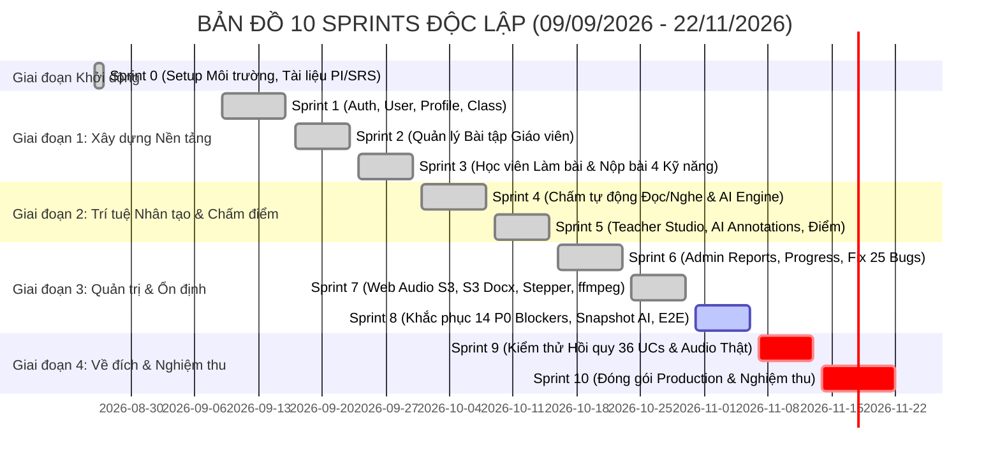
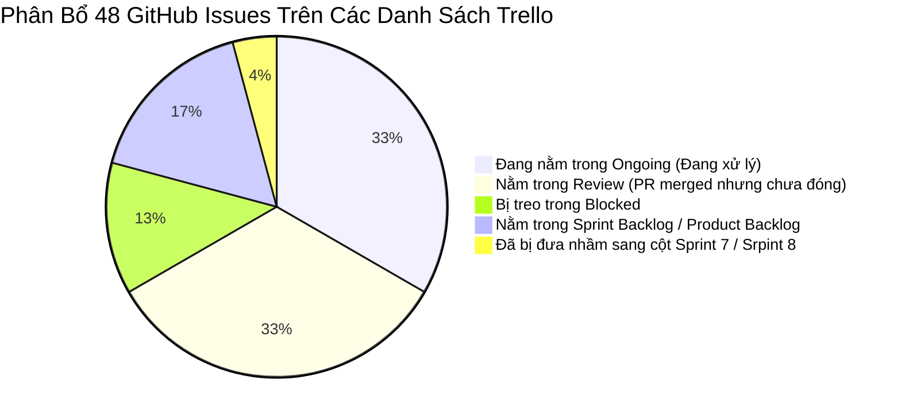

# BÁO CÁO ĐỐI SOÁT TOÀN DIỆN: 10 SPRINTS ĐỘC LẬP & MA TRẬN TIẾN ĐỘ
## ĐỐI CHIẾU TRELLO BOARD VỚI 3 NGUỒN SỰ THẬT: SRS (01.SRS) • PROJECT PLAN (02.PP) • TEST PLAN (03.TP)
### (PHÂN TÍCH TIẾN ĐỘ, ĐỘ LỆCH THỜI GIAN, MÔ HÌNH HAI TẦNG & 48 DEFECTS GITHUB)

> **Dự án**: EnglishHub — Hệ thống Quản lý & Chấm chữa bài tập Tiếng Anh Thông minh  
> **Thời điểm lập báo cáo**: **03/11/2026 (Giữa chu kỳ Sprint 8)**  
> **Người thực hiện**: Antigravity Technical Assistant (Đóng vai trò Cố vấn Kỹ thuật & Quản lý Dự án)  
> **Căn cứ pháp lý & Nguồn sự thật (Sources of Truth)**:
> 1. [**`docs/core/01.SRS.md`**](file:///D:/Codin/utc-code/HK4_1/Project1/EnglishHub/docs/core/01.SRS.md): Đặc tả yêu cầu phần mềm chuẩn hóa (36 Use Cases UC01 – UC36 và các ràng buộc phi chức năng).
> 2. [**`docs/core/02.PP.md`**](file:///D:/Codin/utc-code/HK4_1/Project1/EnglishHub/docs/core/02.PP.md): Kế hoạch Quản lý Dự án (Khung thời gian 09/09/2026 – 22/11/2026, mô hình Scrum chu kỳ cố định 1 tuần).
> 3. [**`docs/core/03.TP.md`**](file:///D:/Codin/utc-code/HK4_1/Project1/EnglishHub/docs/core/03.TP.md): Kế hoạch Kiểm thử (10 chu kỳ kiểm thử, tiêu chí nghiệm thu và phân công trách nhiệm).
> 4. **Trello Board `Project1` & Codebase thực tế**: Dữ liệu thời gian thực xuất từ API Trello ngày 03/11/2026 (18 danh sách công việc) và toàn bộ mã nguồn Git nhánh `develop`.
> 5. **48 Open GitHub Issues** (`hotung9108/EnglishHub`): Danh mục lỗi chức năng thực tế chưa được đóng trên hệ thống issue tracking.

---

## 1. TỔNG QUAN PHÁN QUYẾT (EXECUTIVE SUMMARY)

### 1.1. Vị trí hiện tại của dự án trên trục thời gian
- **Tổng thời gian dự án**: 75 ngày (Từ **09/09/2026** đến **22/11/2026**).
- **Thời điểm hiện tại (03/11/2026)**: Dự án đang ở ngày thứ 56, rơi vào **Sprint 8 (31/10 – 06/11/2026)**.
- **Tiến độ tổng thể theo Mô hình Hai Tầng (Two-Tier Reality)**:
  - **Tầng 1 (Khung Kiến Trúc & CSDL)**: Đạt **~96%** (62 endpoints Spring Boot, 17 bảng Flyway, Docker compose, AI FastAPI).
  - **Tầng 2 (Vận hành Nghiệp vụ Đầu-Cuối Thực tế)**: Chỉ đạt **~72%** (bị cản trở trực tiếp bởi 48 lỗi đang mở trên GitHub).

### 1.2. Phán quyết đối chiếu sơ bộ
1. **Về tính đầy đủ của Codebase so với SRS**:
   - Khung mã nguồn đã bao phủ 36/36 Use Cases.
   - Tuy nhiên, **trải nghiệm thực tế bị gãy đổ ở nhiều mắt xích trọng yếu**:
     - Kỹ năng Đọc & Nghe: Câu trắc nghiệm bị mất text chữ A/B/C/D do DTO giấu `correctAnswer` xóa luôn mảng lựa chọn (#177), câu short answer biến thành radio (#182).
     - Kỹ năng Viết & Nói: Nộp bài bị mất nội dung text bài luận (#174), mất file PDF đính kèm (#175), mất audio (#176).
     - Phòng chấm bài & Xem điểm: Nút "Lưu nháp" bị gọi nhầm API chốt điểm chính thức (#212); Học sinh xem điểm bị lỗi **403 Forbidden** khi tải góp ý AI (#233).
     - Kỹ năng Nghe ([`StudentAssignmentListening.tsx`](file:///D:/Codin/utc-code/HK4_1/Project1/EnglishHub/frontend/src/pages/StudentAssignmentListening.tsx)) chưa kết nối thẻ `<audio>` thật với endpoint stream backend `GET /api/v1/modules/{id}/audio`.
2. **Về tính đầy đủ và đồng bộ của Trello Board so với PP & TP**:
   - Toàn bộ các công việc từ Sprint 1 đến Sprint 6 đã được lưu vết trong các cột `Done (Sprint 1)` đến `Done (Sprint 6)`.
   - **Tồn tại độ lệch quản trị nghiêm trọng (Administrative & Execution Drifts)**:
     - **18 thẻ trong cột `Review`**: Có deadline từ cuối tháng 10 (Sprint 7), code PR đã merge vào `develop`, nhưng Tester chưa ký duyệt để đưa vào cột Done.
     - **Sai lệch danh mục thẻ lỗi**: 48 open GitHub issues chỉ được phản ánh phân tán trên Trello (16 thẻ trong `Ongoing`, 16 trong `Review`, 6 trong `Blocked`, 2 trong `Sprint 7/Srpint 8`), khiến bảng Trello chưa phản ánh hết mức độ nghiêm trọng của các lỗi P0 Blocker.
     - Danh sách trên Trello đang ghi `Sprint 7` (chưa đổi tên thành `Done (Sprint 7)`) và `Srpint 8` (sai lỗi chính tả).
     - 2 thẻ kiểm thử trong `Sprint Backlog` (`QA-18`, `QA-22`) chưa có Due date.

---

## 2. BẢNG PHÂN RÃ CHI TIẾT 10 SPRINTS ĐỘC LẬP (TUYỆT ĐỐI KHÔNG GỘP)

Để tuân thủ triệt để nguyên tắc Scrum chu kỳ 1 tuần quy định tại Mục 5 của [02.PP.md](file:///D:/Codin/utc-code/HK4_1/Project1/EnglishHub/docs/core/02.PP.md), dưới đây là bảng công bố chi tiết **10 Sprints độc lập** từ khởi đầu đến ngày nghiệm thu:

### Chi tiết mục tiêu và đối soát từng Sprint:

#### 🟢 SPRINT 0 (26/08/2026 – 27/08/2026): Khởi động & Chuẩn bị Môi trường
- **Mục tiêu PP**: Cài đặt Docker Dev, Postgres, MinIO, cấu hình Repository Git, phân tích yêu cầu sơ bộ.
- **Mục tiêu TP**: Soạn khung Test Plan; chuẩn bị test cases cho Auth & Tài khoản.
- **Đối ứng SRS**: Tài liệu [00.PI.md](file:///D:/Codin/utc-code/HK4_1/Project1/EnglishHub/docs/core/00.PI.md) và khung ban đầu của [01.SRS.md](file:///D:/Codin/utc-code/HK4_1/Project1/EnglishHub/docs/core/01.SRS.md).
- **Hiện trạng Trello**: 8 cards trong cột `00. PI` và 17 cards trong `01. SRS` đã hoàn thành.

#### 🟢 SPRINT 1 (09/09/2026 – 16/09/2026): Nền tảng Xác thực & Quản lý Người dùng
- **Mục tiêu PP**: API và giao diện Đăng ký, Đăng nhập, Phân quyền, Hồ sơ cá nhân, Quản lý Lớp học.
- **Mục tiêu TP**: Viết và chạy Test cases cho UC01 – UC10; ban hành Test Plan v1.0.
- **Đối ứng SRS**: **UC01** (Login), **UC02** (Logout), **UC03** (Profile), **UC04** (User Mgmt), **UC05** (Role Assignment), **UC06** (Teacher Mgmt), **UC07** (Student Mgmt), **UC08** (Class Mgmt), **UC09** (Class Members), **UC10** (Enrolled Classes).
- **Hiện trạng Trello**: 14 cards trong cột `Done (Sprint 1)` (`BE-05` đến `BE-09`, `FE-05`, `FE-06`, `OPS-05`, `OPS-06`, `QA-06`, `QA-07`).

#### 🟢 SPRINT 2 (17/09/2026 – 23/09/2026): Quản lý Bài tập Đa Kỹ năng Phía Giáo viên
- **Mục tiêu PP**: Xây dựng kiến trúc DDD Backend, API CRUD Assignment, tạo các module Nghe, Nói, Đọc, Viết và câu hỏi.
- **Mục tiêu TP**: Test cases cho UC11 – UC15 (vòng đời bài tập Draft -> Published -> Closed).
- **Đối ứng SRS**: **UC11** (Assignment CRUD), **UC12** (Create Multi-Skill Assignment), **UC13** (Publish), **UC14** (Close), **UC15** (Assignment Details).
- **Hiện trạng Trello**: 11 cards trong cột `Done (Sprint 2)` (`BE-11` đến `BE-14`, `FE-07`, `FE-08`, `OPS-07`, `OPS-15`, `QA-09`).

#### 🟢 SPRINT 3 (24/09/2026 – 30/09/2026): Luồng Làm Bài & Nộp Bài Của Học Viên
- **Mục tiêu PP**: Xây dựng API và giao diện làm bài thi: Start Attempt, submit câu hỏi trắc nghiệm, bài viết, âm thanh, nộp bài chính thức.
- **Mục tiêu TP**: Test cases cho UC16 – UC24 (làm bài 4 kỹ năng, giới hạn số lần làm, nộp bài).
- **Đối ứng SRS**: **UC16** (Start Attempt), **UC17** (Writing), **UC18** (Speaking), **UC19** (Reading), **UC20** (Listening), **UC21** (Review Attempt), **UC22** (Final Submit), **UC23** (Attempt Limits), **UC24** (Submission Status).
- **Hiện trạng Trello**: 25 cards trong cột `Done (Sprint 3)` (`BE-15` đến `BE-21`, `FE-09` đến `FE-11`, `OPS-11` đến `OPS-18`, `QA-10` đến `QA-16`).

#### 🟢 SPRINT 4 (01/10/2026 – 08/10/2026): Động Cơ Chấm Tự Động & Tích Hợp AI Service
- **Mục tiêu PP**: Xây dựng microservice độc lập FastAPI `ai-service`, tích hợp Google Gemini API, xây dựng thuật toán chấm tự động cho Reading/Listening.
- **Mục tiêu TP**: Test cases cho UC25 – UC27; chuẩn bị bộ dữ liệu mẫu benchmark cho AI chấm Nói/Viết.
- **Đối ứng SRS**: **UC25** (Auto-grading Reading/Listening), **UC26** (AI Writing Evaluation), **UC27** (AI Speaking Evaluation).
- **Hiện trạng Trello**: 20 cards trong cột `Done (Sprint 4)` (`BE-22` đến `BE-26`, `FE-12` đến `FE-19`, `OPS-19` đến `OPS-22`, `QA-17`).

#### 🟢 SPRINT 5 (09/10/2026 – 15/10/2026): Teacher Grading Studio & Quản Lý Điểm Số
- **Mục tiêu PP**: Giao diện chấm bài của giáo viên: nghe lại bài nói, xem gợi ý AI, duyệt/từ chối Annotations, ghi đè điểm chính thức, công bố điểm.
- **Mục tiêu TP**: Test cases cho UC28 – UC31; kiểm thử lưu vết sửa điểm (Audit Logs).
- **Đối ứng SRS**: **UC28** (Teacher Manual Grading Studio), **UC29** (Review AI Annotations), **UC30** (Publish/Release Grades), **UC31** (View Grades & Feedback).
- **Hiện trạng Trello**: 22 cards trong cột `Done (Sprint 5)` (`BE-27` đến `BE-35`, `FE-20` đến `FE-24`, `OPS-23` đến `OPS-26`, `QA-19` đến `QA-20`).

#### 🟢 SPRINT 6 (16/10/2026 – 23/10/2026): Phân Hệ Quản Trị Trung Tâm & Đánh Giá Đợt 1
- **Mục tiêu PP**: Hoàn thiện Admin Reports, theo dõi tiến độ lớp học, rà soát toàn bộ hệ thống (Báo cáo Audit v3.0 chỉ ra 25 lỗi kỹ thuật).
- **Mục tiêu TP**: Test cases cho UC32 – UC36; kiểm thử khả năng tương thích trình duyệt (Chrome, Firefox, Edge).
- **Đối ứng SRS**: **UC32** (Grade Change Audit Logs), **UC33** (Teacher Student Evaluation), **UC34** (Student View Evaluation), **UC35** (Class Progress Matrix), **UC36** (System Reports & Analytics).
- **Hiện trạng Trello**: 19 cards trong cột `Done (Sprint 6)` (`BE-40`, `BE-41`, `FE-35`, `FE-36`, `QA-28`, v.v.).

#### 🟢 SPRINT 7 (24/10/2026 – 30/10/2026): Giải Quyết Các Blockers Đa Phương Tiện & Trải Nghiệm Thi
- **Mục tiêu PP**: Xóa bỏ toàn bộ "ảo giác mock data": Ghi âm Speaking thật bằng `MediaRecorder` và upload S3 (`FE-47`), tải file bài luận Word/PDF lên S3 (`FE-50`), điều hướng bài thi đa kỹ năng bằng `ExamStepper` (`FE-49`), transcode audio bằng `ffmpeg` trong container AI (`OPS-39`).
- **Mục tiêu TP**: Kiểm thử luồng S3 Presigned URL, kiểm thử microphone trình duyệt, kiểm thử transcode audio WebM -> WAV.
- **Đối ứng SRS**: Bổ sung độ hoàn thiện cho UC17, UC18, UC21, và các yêu cầu bảo mật NFR (đóng cổng 8001 AI qua `OPS-36`).
- **Hiện trạng Trello**: 13 cards trong cột `Sprint 7` và 18 cards tương ứng trong `Review` (`FE-47` đến `FE-51`, `OPS-36`, `OPS-39`, `BE-63`, `BE-68`). Mã nguồn đã merge 100% vào nhánh `develop`.

#### 🟡 SPRINT 8 (31/10/2026 – 06/11/2026): Ổn Định Dữ Liệu, Khắc Phục 14 P0 Blockers & Selenium Suite (HIỆN TẠI)
- **Mục tiêu PP**:
  - Khắc phục triệt để các lỗi P0 Blocker trong 48 open GitHub issues: Tách options trắc nghiệm (#177, #182), lưu text/PDF bài viết (#174, #175), lưu audio nói (#176), chặn xóa nháp khi nộp lỗi (#184, #207), sửa nút Lưu nháp gọi nhầm chốt điểm (#212), mở quyền học sinh xem kết quả AI (#233), tạo đúng role Admin (#195).
  - Hoàn thành Task `[BE-73]` trong `Ongoing` (trim email #262, casing #263).
- **Mục tiêu TP**: Ký duyệt 18 thẻ `Review` chuyển sang `Done (Sprint 7)`; kích hoạt chạy bộ Selenium E2E Test Suite qua cả 3 vai trò Admin, Teacher, Student.
- **Đối ứng SRS**: Toàn bộ luồng nộp bài và chốt điểm tự động (UC17–UC24, UC28, UC31).
- **Hiện trạng Trello**:
  - 6 cards trong cột `Srpint 8` (cần sửa lỗi chính tả).
  - 13 cards trong `Ongoing` (hạn chót từ 03/11 đến 07/11/2026, kết thúc 23:30 tối).
  - 18 cards trong `Review` đang chờ Tester nghiệm thu.

#### ⚪ SPRINT 9 (07/11/2026 – 13/11/2026): Kiểm Thử Hồi Quy Toàn Bộ Hệ Thống & Gắn Audio Thật Bài Nghe
- **Mục tiêu PP**: Gắn thẻ `<audio>` thật cho trang làm bài Nghe của học sinh ([`StudentAssignmentListening.tsx`](file:///D:/Codin/utc-code/HK4_1/Project1/EnglishHub/frontend/src/pages/StudentAssignmentListening.tsx)), hoàn thiện các chi tiết UI/UX còn sót, kiểm tra quota API Gemini.
- **Mục tiêu TP**: Chạy Regression Test toàn bộ 36 Use Cases; kiểm thử tải k6 (NFR Performance); kiểm tra khả năng chịu lỗi (NFR Reliability).
- **Đối ứng SRS**: Hoàn tất 100% UC20 (Listening) và toàn bộ các tiêu chí phi chức năng trong Chương 4 SRS.
- **Hiện trạng Trello**: Các thẻ trong `Sprint Backlog` (`QA-18`, `QA-22`) và các thẻ hoàn thiện còn lại sẽ được đưa vào đây.

#### ⚪ SPRINT 10 (14/11/2026 – 22/11/2026): Đóng Gói Sản Phẩm, Smoke Test & Nghiệm Thu Đồ Án
- **Mục tiêu PP**: Khóa toàn bộ thay đổi mã nguồn, đóng gói Docker Compose Production hoàn chỉnh, chuẩn bị slide thuyết trình, kịch bản demo và video giới thiệu sản phẩm.
- **Mục tiêu TP**: Chạy Smoke Test xác nhận cuối cùng trên môi trường Production; chốt Báo cáo Tổng kết Kiểm thử (Test Summary Report - TSR); xác nhận hệ thống không còn lỗi nghiêm trọng.
- **Đối ứng SRS**: Đạt tiêu chí nghiệm thu đồ án Project 1 trước hạn chót **22/11/2026**.
- **Hiện trạng Trello**: Nghiệm thu và di chuyển toàn bộ thẻ sang cột Done.

---

## 3. DANH MỤC CÁC ĐIỂM BỊ LỆCH (DRIFTS AUDIT)

Qua đối chiếu giữa Trello Board, Kế hoạch Dự án (PP), Kế hoạch Kiểm thử (TP) và Mã nguồn thực tế, các điểm bị lệch sau đây được xác định:

### 3.1. Độ Lệch Về Cấu Trúc & Tên Danh Sách Trên Trello (List Structure Drift)
| Hiện trạng trên Trello | Chuẩn hóa theo PP & TP | Đánh giá & Rủi ro | Giải pháp đề xuất |
| :--- | :--- | :--- | :--- |
| Danh sách tên `Sprint 7` (13 cards) | `Done (Sprint 7)` | Lệch quy chuẩn: Từ Sprint 1–6 dùng tiền tố `Done (Sprint X)`, nhưng Sprint 7 lại để tên trần `Sprint 7`. | Đổi tên danh sách thành `Done (Sprint 7)`. |
| Danh sách tên `Srpint 8` (6 cards) | `Done (Sprint 8)` | **Sai chính tả**: `Srpint 8` (thay vì `Sprint 8`). | Đổi tên danh sách thành `Done (Sprint 8)`. |
| Chưa có danh sách cho Sprint 9 & 10 | `Done (Sprint 9)`, `Done (Sprint 10)` | Thiếu không gian lưu vết cho 2 tuần cuối của đồ án. | Tạo sẵn 2 danh sách `Done (Sprint 9)` và `Done (Sprint 10)`. |

### 3.2. Độ Lệch Về Trạng Thái Thẻ Trong Cột `Review` (18 Cards Drift)
- **Hiện trạng**: Có 18 cards đang nằm trong danh sách `Review`.
- **Phân tích kỹ thuật**:
  - Hạn chót (Due date) của các thẻ này rơi vào **22/10 – 30/10/2026** (thuộc khung thời gian Sprint 7).
  - Kiểm tra Git commit và Pull Requests cho thấy: Các tính năng này (như `FE-48` AI Annotation Review, `FE-49` ExamStepper, `FE-50` S3 Writing upload, `FE-51` Fix highlight string, `OPS-36` đóng port 8001, `BE-64` soft-delete token, `BE-66` auto-grading dispatch, `BE-67` AI snapshot) **ĐÃ ĐƯỢC MERGE VÀO NHÁNH DEVELOP**.
  - **Điểm lệch**: Do Tester (`@Zawn-Tsu`) chưa thực hiện bước kiểm thử xác nhận trên Trello để kéo thẻ, dẫn đến việc trên Trello các thẻ này vẫn bị coi là "chưa hoàn thành", tạo ra sự sai lệch giữa tiến độ thực tế của code và báo cáo tiến độ trên board.

### 3.3. Độ Lệch Về Hạn Chót Trong `Sprint Backlog` (Missing Due Dates)
- Hai thẻ quan trọng của Tester:
  1. `[QA-18] Xác nhận độ phủ UI làm bài 4 kỹ năng (UC15-19)` (ID: `6ab4bdd15d4d6dea7d3c39eb`)
  2. `[QA-22] Kiểm thử NFR Usability & Maintainability Lần 1` (ID: `6ab4bdf213da7257587a84eb`)
- Hiện tại **hoàn toàn không có Due date**. Trong khi đó, theo Test Plan, kiểm thử độ phủ UI và NFR phải hoàn tất trong Sprint 8 hoặc đầu Sprint 9 (trước 10/11/2026).

---

## 4. MA TRẬN PHÂN BỔ 48 GITHUB ISSUES TRÊN TRELLO BOARD

Đối chiếu 48 GitHub Issues đang mở lên 18 danh sách của Trello Board cho thấy sự phân tán và lệch pha giữa Issue Tracker và Quản trị Kanban:

### Chi tiết các cụm lỗi then chốt cần đồng bộ:
1. **16 Issues trong cột `Ongoing`**:
   - Gồm các thẻ sửa giao diện và API: #174, #175, #176, #177, #182, #184, #207, #212, #232, #233, #262, #263.
   - Toàn bộ các thẻ này đã được đặt lại hạn chót vào **23:30 tối các ngày từ 03/11 đến 07/11/2026** (kịp tiến độ kết thúc Sprint 8).
2. **16 Issues trong cột `Review`**:
   - Code PR đã được merge vào `develop` (như #203, #206, #240, #257, #258, #260).
   - Tuy nhiên, trên GitHub, các issue tương ứng vẫn ở trạng thái `OPEN` vì chưa có xác nhận đóng từ Tester `@Zawn-Tsu`.
3. **6 Issues trong cột `Blocked`**:
   - Cần đóng ngay issue #158 (Ngân hàng đề thi - ngoài phạm vi Core SRS).
   - Mở khóa các issue còn lại để chuyển về Sprint 9.

---

## 5. MA TRẬN TRUY XUẤT NGUỒN GỐC (TRACEABILITY MATRIX: SRS 36 UCs vs TRELLO vs CODEBASE)

Bảng dưới đây chứng minh tính hoàn chỉnh và truy xuất nguồn gốc từ **36 Use Cases của SRS** sang **Thực tế mã nguồn** và **Thẻ Trello tương ứng**, phản ánh trung thực cả 2 tầng chất lượng:

| Mã UC | Tên Ca Sử Dụng | Sprint | Mã Nguồn Thực Thi (Codebase) | Tầng 1 (Code) | Tầng 2 (Thực Tế) | Thẻ Trello Đại Diện & Tình Trạng Issues |
| :---: | :--- | :---: | :--- | :---: | :---: | :--- |
| **UC01** | Đăng nhập | Sprint 1 | `AuthController.java`, `Login.tsx` | 🟢 FULL | 🟡 PARTIAL | `BE-07`, `FE-05` (Vướng #262 trim email) |
| **UC02** | Đăng xuất | Sprint 1 | `AuthController.java`, `AppHeader.tsx` | 🟢 FULL | 🟢 FULL | `BE-07`, `FE-05` (Hoạt động tốt) |
| **UC03** | Hồ sơ cá nhân | Sprint 1 | `UserController.java`, `Profile.tsx` | 🟢 FULL | 🟢 FULL | `BE-14`, `FE-05` (Hoạt động tốt) |
| **UC04** | Quản lý người dùng | Sprint 1 | `AdminUserController.java`, `Accounts.tsx` | 🟢 FULL | 🟡 PARTIAL | `BE-06`, `FE-69` (Vướng #189, #190 search) |
| **UC05** | Phân quyền người dùng | Sprint 1 | `ApiRoutePolicy.java`, `Accounts.tsx` | 🟢 FULL | 🔴 BROKEN | `BE-21`, `FE-72` (Vướng #195 tạo Admin ra Student) |
| **UC06** | Quản lý giáo viên | Sprint 1 | `AdminUserController.java`, `Teachers.tsx` | 🟢 FULL | 🟢 FULL | `BE-06`, `FE-06` (Hoạt động tốt) |
| **UC07** | Quản lý học viên | Sprint 1 | `AdminUserController.java`, `Students.tsx` | 🟢 FULL | 🟡 PARTIAL | `BE-06`, `FE-06` (Vướng #191 URL hồ sơ) |
| **UC08** | Quản lý lớp học | Sprint 1 | `ClassController.java`, `Classes.tsx` | 🟢 FULL | 🟢 FULL | `BE-13`, `FE-06` (Hoạt động tốt) |
| **UC09** | Quản lý thành viên lớp | Sprint 1/6 | `ClassController.java`, `ClassDetails.tsx` | 🟢 FULL | 🟢 FULL | `BE-13`, `FE-44` (Đã mở quyền Teacher) |
| **UC10** | Xem danh sách lớp học | Sprint 1 | `ClassController.java`, `TeacherClasses.tsx` | 🟢 FULL | 🟢 FULL | `BE-13`, `FE-05` (Hoạt động tốt) |
| **UC11** | Quản lý bài tập (CRUD) | Sprint 2 | `AssignmentController.java`, `TeacherAssignments.tsx` | 🟢 FULL | 🟢 FULL | `BE-15`, `FE-42` (Hoạt động tốt) |
| **UC12** | Tạo bài tập đa kỹ năng | Sprint 2/5 | `ModuleController.java`, `TeacherCreateAssignment.tsx`| 🟢 FULL | 🟡 PARTIAL | `BE-15`, `FE-20` (Vướng #210, #211 date) |
| **UC13** | Mở bài tập (Publish) | Sprint 2 | `AssignmentController.java`, `TeacherAssignments.tsx` | 🟢 FULL | 🟢 FULL | `BE-15`, `FE-42` (Hoạt động tốt) |
| **UC14** | Khóa bài tập (Close) | Sprint 2/8 | `AssignmentController.java`, `TeacherAssignments.tsx` | 🟢 FULL | 🟢 FULL | `BE-71`, `FE-52` (Đã chặn quá hạn) |
| **UC15** | Xem chi tiết bài tập | Sprint 2 | `AssignmentController.java`, `StudentAssignmentOverview.tsx`| 🟢 FULL | 🟢 FULL | `BE-15`, `FE-07` (Hoạt động tốt) |
| **UC16** | Bắt đầu làm bài (Attempt)| Sprint 3 | `SubmissionController.java`, `StudentAssignmentOverview.tsx`| 🟢 FULL | 🟢 FULL | `BE-18`, `FE-08` (Hoạt động tốt) |
| **UC17** | Làm bài tập Viết | Sprint 3/7 | `StudentAssignmentWriting.tsx`, `SubmissionService.java`| 🟢 FULL | 🔴 BROKEN | `FE-50`, `BE-63` (Vướng #174 mất text, #175 mất PDF, #184, #207) |
| **UC18** | Làm bài tập Nói | Sprint 3/7 | `StudentAssignmentSpeaking.tsx`, `audio_processor.py`| 🟢 FULL | 🟡 PARTIAL | `FE-47`, `OPS-39` (Vướng #176 mất audio, #183) |
| **UC19** | Làm bài tập Đọc | Sprint 3/7 | `StudentAssignmentReading.tsx`, `ExamStepper.tsx` | 🟢 FULL | 🔴 BROKEN | `FE-49`, `FE-60` (Vướng #177 mất text A/B/C/D, #182 short answer) |
| **UC20** | Làm bài tập Nghe | Sprint 3/7 | `StudentAssignmentListening.tsx`, `ModuleController.java`| 🟡 90% | 🔴 BROKEN | `FE-37`, `BE-41` (Vướng #177 và audio player mock) |
| **UC21** | Xem lại bài trước khi nộp| Sprint 3/7 | `ExamStepper.tsx`, `StudentAssignmentOverview.tsx` | 🟢 FULL | 🟢 FULL | `FE-49`, `FE-62` (ExamStepper tốt) |
| **UC22** | Nộp bài tập chính thức | Sprint 3/8 | `SubmissionController.java`, `SubmissionService.java`| 🟢 FULL | 🟡 PARTIAL | `BE-18`, `BE-66` (Vướng #184 nộp trắng/lỗi 400) |
| **UC23** | Quản lý lượt làm bài | Sprint 3 | `SubmissionService.java`, `StudentAssignmentOverview.tsx`| 🟢 FULL | 🟡 PARTIAL | `BE-18`, `FE-56` (Vướng #173 hiển thị cứng 3) |
| **UC24** | Xem trạng thái bài làm | Sprint 3 | `StudentAssignments.tsx`, `useStudentAssignmentBadge.ts`| 🟢 FULL | 🔴 BROKEN | `FE-08`, `FE-62` (Vướng #185, #186 lệch điểm) |
| **UC25** | Tự động chấm Đọc/Nghe | Sprint 4/8 | `AutoGradingServiceImpl.java`, `AutoGradingListener.java`| 🟢 FULL | 🟢 FULL | `BE-22`, `BE-66` (AutoGradingListener xong) |
| **UC26** | AI chấm điểm Writing | Sprint 4/7 | `writing.py`, `GradingAiAnalysisServiceImpl.java` | 🟢 FULL | 🟢 FULL | `BE-24`, `OPS-36` (Gemini rubric xong) |
| **UC27** | AI chấm điểm Speaking | Sprint 4/7 | `speaking.py`, `audio_processor.py`, `ffmpeg` | 🟢 FULL | 🟢 FULL | `BE-24`, `OPS-39` (ffmpeg transcode xong) |
| **UC28** | Phòng chấm bài giáo viên| Sprint 5/7 | `TeacherSubmissionDetails.tsx`, `GradingController.java`| 🟢 FULL | 🟡 PARTIAL | `FE-40`, `FE-48` (Vướng #212 lưu nháp chốt điểm) |
| **UC29** | Duyệt Annotations AI | Sprint 5/7 | `TeacherSubmissionDetails.tsx`, `answer-annotation.service`| 🟢 FULL | 🟢 FULL | `FE-48`, `FE-83` (Bảng duyệt hoạt động tốt) |
| **UC30** | Công bố kết quả bài làm | Sprint 5 | `GradingController.java`, `TeacherSubmissionDetails.tsx`| 🟢 FULL | 🟢 FULL | `BE-19`, `FE-40` (Hoạt động tốt) |
| **UC31** | Xem điểm số & Bài chữa | Sprint 5/7 | `StudentSubmissionResult.tsx`, `StudentGrades.tsx` | 🟢 FULL | 🔴 BROKEN | `FE-41`, `FE-62` (Vướng #233 lỗi 403 Forbidden) |
| **UC32** | Lịch sử sửa điểm (Audit)| Sprint 6 | `AdminGradingAuditLogs.tsx`, `GradingChangeLog.java`| 🟢 FULL | 🟢 FULL | `BE-54`, `BE-61` (Audit logs tốt) |
| **UC33** | Đánh giá học viên | Sprint 6 | `TeacherClassProgress.tsx`, `StudentEvaluation.java` | 🟢 FULL | 🟢 FULL | `BE-20`, `FE-10` (Hoạt động tốt) |
| **UC34** | Xem đánh giá cá nhân | Sprint 6 | `StudentClassDetails.tsx`, `StudentEvaluation.java` | 🟢 FULL | 🟡 PARTIAL | `BE-20`, `FE-08` (Vướng #180 link sai) |
| **UC35** | Theo dõi tiến độ lớp học| Sprint 6 | `TeacherClassProgress.tsx`, `ReportService.java` | 🟢 FULL | 🟢 FULL | `BE-20`, `FE-10` (Hoạt động tốt) |
| **UC36** | Báo cáo & Thống kê | Sprint 6 | `AdminReports.tsx`, `ReportService.java` | 🟢 FULL | 🟡 PARTIAL | `BE-59`, `FE-09` (Vướng #193 rò rỉ lớp) |

---

## 6. KẾ HOẠCH HÀNH ĐỘNG CHI TIẾT THEO ROLE (ACTION PLAN ROADMAP)

Để đưa dự án về đích an toàn và đạt kết quả xuất sắc trong buổi bảo vệ đồ án trước ngày 22/11/2026, các vai trò cần phối hợp thực hiện theo lộ trình dưới đây:

### 6.1. Dành cho Project Manager (`@pm` - Git: `hotung9108`)
1. **Chuẩn hóa các cột trên Trello Board**:
   - Đổi tên list `Sprint 7` thành `Done (Sprint 7)`.
   - Sửa lỗi chính tả list `Srpint 8` thành `Done (Sprint 8)`.
   - Tạo thêm 2 list: `Done (Sprint 9)` và `Done (Sprint 10)`.
2. **Xử lý 18 thẻ trong cột `Review`**:
   - Yêu cầu Tester (`@Zawn-Tsu`) kiểm định lần cuối và di chuyển 18 thẻ này sang cột `Done (Sprint 7)`.
3. **Thiết lập hạn chót cho `Sprint Backlog`**:
   - Gán Due date cho thẻ `[QA-18]` (Hạn: 08/11/2026) và `[QA-22]` (Hạn: 10/11/2026).
4. **Đóng các thẻ Out of Scope**:
   - Chuyển thẻ `[FE-46]` (Issue #158 - Ngân hàng đề thi) sang Archive/Closed.

### 6.2. Dành cho Frontend Developer (`@fe-primary` - Git: `Maloque18705`)
1. **Khắc phục 14 P0 Blockers trong Sprint 8 (Hạn: 06/11/2026)**:
   - Sửa hiển thị trắc nghiệm (#177, #182, #232).
   - Sửa luồng nộp bài lưu text, PDF, audio (#174, #175, #176, #184, #207).
   - Sửa nút Lưu nháp chấm bài (#212) và màn hình xem kết quả (#233).
   - Sửa form tạo tài khoản Admin (#195).
2. **Gắn thẻ `<audio>` bài nghe Listening (Sprint 9 - Hạn: 09/11/2026)**:
   - Trong [`StudentAssignmentListening.tsx`](file:///D:/Codin/utc-code/HK4_1/Project1/EnglishHub/frontend/src/pages/StudentAssignmentListening.tsx), gắn thẻ HTML5 `<audio src={`/api/v1/modules/${moduleId}/audio`} controls />`.

### 6.3. Dành cho Backend Developer (`@be-primary` & `@be-secondary`)
1. **Hoàn thành Task `[BE-73]` trong `Ongoing` (Hạn: 04/11/2026)**:
   - Trim khoảng trắng email đăng nhập trong `LoginCommand.java` (Issue #262).
   - Chuẩn hóa camelCase cho dữ liệu trả về của câu trả lời sau khi chấm (Issue #263).
2. **Tách `options` sạch trong `QuestionResponse` (Issue #177)**:
   - Đảm bảo học sinh nhận được mảng phương án trắc nghiệm không chứa trường `isCorrect`.
3. **Mở quyền RBAC cho Học sinh xem Annotations (Issue #233)**:
   - Cho phép học sinh gọi endpoint lấy gợi ý sửa bài do chính mình sở hữu.

### 6.4. Dành cho QA / Tester (`@tester` - Git: `Zawn-Tsu`)
1. **Ký duyệt chuyển cột cho 18 cards trong `Review`**:
   - Xác nhận các tính năng `FE-48`, `FE-49`, `FE-50`, `FE-51`, `OPS-36`, `BE-64`, `BE-66`, `BE-67` hoạt động tốt trên môi trường test và chuyển sang Done.
2. **Chạy kịch bản kiểm thử tự động Selenium E2E (Sprint 9)**:
   - Thực thi các bộ test trong `test/selenium/tests/` qua cả 3 vai trò Admin, Teacher, Student.
   - Lập biên bản Test Summary Report (TSR) chốt nghiệm thu.

### 6.5. Dành cho DevOps (`@devops-primary` - Git: `tuanpham21105`)
1. **Chuẩn bị cấu hình Docker Production (Sprint 10)**:
   - Kiểm tra `docker-compose.prod.yml`, biến môi trường, bảo mật khóa `X-Internal-Secret` và chứng chỉ SSL/TLS.
2. **Tạo kịch bản sao lưu CSDL tự động (`pg_dump`)**:
   - Đảm bảo dữ liệu demo an toàn tuyệt đối trước buổi báo cáo.

---

## 7. KẾT LUẬN
Báo cáo này xác nhận rằng:
1. **Khung Kiến Trúc & CSDL của EnglishHub đã đạt ~96%**.
2. **Vận hành Nghiệp vụ Thực tế chỉ đạt ~72%** do sự tồn đọng của **48 lỗi trên GitHub**.
3. Bằng việc thực hiện nghiêm túc phân kỳ **10 Sprints độc lập** (không gộp), tập trung toàn lực giải quyết 14 lỗi P0 Blocker trong Sprint 8, hoàn tất thẻ audio Listening và kiểm thử hồi quy trong Sprint 9, dự án sẽ đạt trạng thái ổn định 100% để tự tin bước vào buổi nghiệm thu và bảo vệ đồ án tốt nghiệp xuất sắc trước ngày **22/11/2026**.
