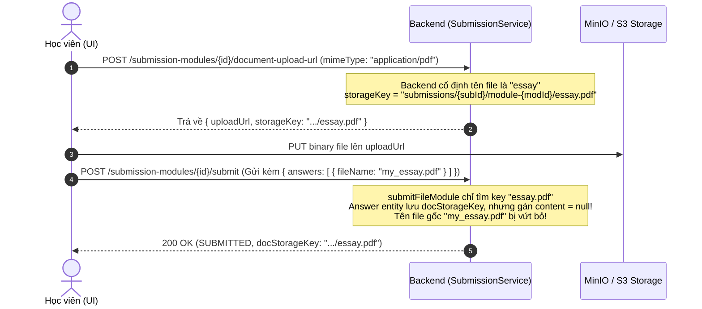
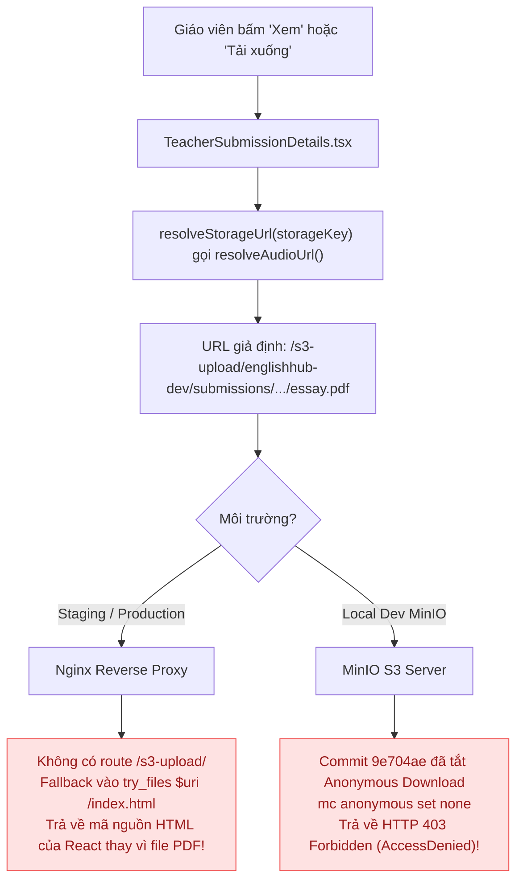

# [Báo Cáo Kỹ Thuật] Phân Tích & Giải Pháp Triệt Để: Lưu Trữ Tài Liệu Writing (essay.pdf) và Luồng Tải Tệp Phía Giáo Viên

> **Mã lỗi liên quan**: `[FE-58] [ISSUE #175]`  
> **Nguồn phát hiện**: QA-30 Selenium Suite (Luồng Học viên & Giáo viên - Testcase `QA30-012`)  
> **Phạm vi tác động**: Học viên nộp bài Writing đính kèm tài liệu PDF/Word & Giáo viên chấm bài/tải tài liệu  
> **Quy chuẩn tuân thủ**: `convention-fe.md` (React 19 / TypeScript) & `.agents/private/frontend-ui-standards` (Theme Royal Academic, Zero-Bloat, 8px Grid)

---

## 1. Tóm Tắt Hiện Trạng & Vấn Đề Thực Tế

Trong bài tập kỹ năng Writing dạng tự luận (**ESSAY**), hệ thống cho phép học viên tải lên tài liệu làm bài (PDF hoặc Word `.docx`). Tuy nhiên, quá trình kiểm thử tự động và vận hành thực tế đã bộc lộ hai vấn đề nghiêm trọng:

1. **Tên file lưu trữ bị cố định thành `essay.pdf` / `essay.docx`**: Dù học viên nộp file có tên cụ thể (ví dụ: `bai_tap_writing_nguyen_van_a.pdf`), tên file trên kho lưu trữ S3/MinIO và tên hiển thị cho giáo viên luôn luôn bị biến thành `essay.pdf`. Toàn bộ tên file gốc và ngữ cảnh nộp bài của học viên bị xóa bỏ.
2. **Giáo viên hoàn toàn KHÔNG THỂ xem hoặc tải file này về**:
   - Khi giáo viên vào trang chấm bài chi tiết ([`TeacherSubmissionDetails.tsx`](file:///d:/Coding/EnglishHub/frontend/src/pages/TeacherSubmissionDetails.tsx)) và bấm nút **"Xem"** hoặc **"Tải xuống"**:
     - **Trên môi trường Staging/Production**: Trình duyệt mở ra một tab mới hiển thị lại chính trang web ứng dụng Single Page App (SPA), hoặc tải về một file `essay.pdf` bị hỏng (bên trong thực chất chứa mã nguồn HTML `index.html`).
     - **Trên môi trường Local Development (MinIO)**: Trình duyệt bị MinIO từ chối với mã lỗi `HTTP 403 Forbidden` (`AccessDenied: Anonymous users does not have storage.objects.get access`).

---

## 2. Phân Tích Nguyên Nhân Kỹ Thuật Chi Tiết (Root Cause Analysis)

### 2.1. Tại sao file lưu trữ luôn có tên là `essay.pdf`?

Nguyên nhân đến từ kiến trúc đặt tên cố định và cơ chế kiểm tra ngầm (Storage Probe Pattern) ở tầng Backend:



1. **Quy ước đặt tên cứng ở Backend**:
   - Trong [`SubmissionService.java`](file:///d:/Coding/EnglishHub/backend/src/main/java/com/english_hub/core/modules/submission/application/service/SubmissionService.java#L486-L500), phương thức `getDocumentUploadUrl` chỉ nhận tham số `mimeType`, hoàn toàn không nhận `fileName` gốc từ client.
   - Hàm `storageKey` ([`SubmissionService.java#L552`](file:///d:/Coding/EnglishHub/backend/src/main/java/com/english_hub/core/modules/submission/application/service/SubmissionService.java#L552)) ghép cứng tiền tố file:
     ```java
     return "submissions/" + submissionId + "/module-" + submissionModuleId + "/" + filename + "." + extension;
     ```
     với `filename = "essay"`. Do đó, key lưu trữ luôn là `.../essay.pdf` (hoặc `.../essay.docx`).
2. **Cơ chế thăm dò (Storage Probe Pattern)**:
   - Trong `submitFileModule` ([`SubmissionService.java#L319-L325`](file:///d:/Coding/EnglishHub/backend/src/main/java/com/english_hub/core/modules/submission/application/service/SubmissionService.java#L319-L325)), Backend kiểm tra sự tồn tại của tệp trên S3 bằng cách quét danh sách `documentCandidates()` với tên cố định `essay.pdf` hoặc `essay.docx`. Nếu đổi sang tên khác, Backend sẽ coi là chưa có file và hạ trạng thái về `UPLOADING`.
3. **Bỏ quên tên file gốc trong Entity**:
   - Mặc dù Frontend có gửi `fileName` trong `content` của `answers` khi submit, Backend `submitFileModule` lại khởi tạo Answer với `content = null` ([`SubmissionService.java#L337`](file:///d:/Coding/EnglishHub/backend/src/main/java/com/english_hub/core/modules/submission/application/service/SubmissionService.java#L337)). Tên file ban đầu của học viên hoàn toàn biến mất khỏi cơ sở dữ liệu.
4. **Hàm trích xuất tên file phía Frontend**:
   - Tại [`TeacherSubmissionDetails.tsx#L35-L38`](file:///d:/Coding/EnglishHub/frontend/src/pages/TeacherSubmissionDetails.tsx#L35-L38), hàm `getFileNameFromKey` chỉ cắt chuỗi `docStorageKey` sau dấu `/` cuối cùng:
     ```typescript
     const getFileNameFromKey = (storageKey: string): string => {
       const baseName = storageKey.split('/').pop();
       return baseName || storageKey;
     };
     ```
     Do đó, giao diện giáo viên chỉ nhận được duy nhất chuỗi `essay.pdf`.

---

### 2.2. Tại sao giáo viên KHÔNG THỂ tải file này về?

Sự cố tải file bắt nguồn từ sự đứt gãy trên cả 3 tầng: **Backend thiếu API**, **Frontend ghép nối URL sai lệch** và **Hạ tầng bảo mật S3/Nginx**.



1. **Backend thiếu API cấp quyền tải tệp (Feature Gap)**:
   - Backend `StorageService` có hàm `generatePresignedGetUrl(storageKey)`, nhưng **chỉ được dùng nội bộ** cho `GradingAiAnalysisServiceImpl` (đưa URL cho worker AI chấm điểm).
   - Trong [`SubmissionController.java`](file:///d:/Coding/EnglishHub/backend/src/main/java/com/english_hub/core/modules/submission/presentation/rest/SubmissionController.java), Backend **chưa cung cấp bất kỳ API nào** để Giáo viên hay Học viên xin Presigned GET URL hoặc stream tải file đã nộp. DTO `AnswerDetailResponse` chỉ trả về string key thô: `docStorageKey: "submissions/.../essay.pdf"`.
2. **Frontend ghép nối URL giả định (`resolveAudioUrl`)**:
   - Tại [`TeacherSubmissionDetails.tsx#L33`](file:///d:/Coding/EnglishHub/frontend/src/pages/TeacherSubmissionDetails.tsx#L33):
     ```typescript
     const resolveStorageUrl = resolveAudioUrl;
     ```
   - Hàm [`resolveAudioUrl`](file:///d:/Coding/EnglishHub/frontend/src/utils/audioUrl.utils.ts#L28-L30) tự tiện tiền tố hoá key thành:
     ```typescript
     return `/s3-upload/${bucketPrefix}${normalizedKey}`; // /s3-upload/englishhub-dev/submissions/.../essay.pdf
     ```
   - Chính trong file test [`TeacherSubmissionDetails.test.tsx#L55`](file:///d:/Coding/EnglishHub/frontend/src/__tests__/components/TeacherSubmissionDetails.test.tsx#L55), tác giả test đã thừa nhận đây chỉ là UI giả định:
     > *"shows English grading controls and **attachment placeholders (not real downloads)**"*
3. **Chính sách bảo mật MinIO (Private Bucket)**:
   - Theo commit `9e704ae` (`feat(OPS-37): disable anonymous download on MinIO dev bucket`), kho lưu trữ MinIO đã thực thi lệnh `mc anonymous set none`. Toàn bộ bucket là **Private**.
   - Mọi request `GET` trực tiếp không có chữ ký bảo mật (`X-Amz-Signature`, `X-Amz-Credential`) đều bị MinIO từ chối với mã lỗi `HTTP 403 Forbidden`.
4. **Nginx không hỗ trợ route `/s3-upload`**:
   - Trong [`frontend/nginx.conf`](file:///d:/Coding/EnglishHub/frontend/nginx.conf#L20-L40), Nginx chỉ proxy `/api/`, không có proxy `/s3-upload/`.
   - Khi request gửi lên domain `https://staging.hotung9108.me/s3-upload/...`, Nginx fallback về `index.html`. Trình duyệt tải về mã HTML và đổi tên thành `.pdf`, dẫn đến file bị hỏng không thể mở.
5. **Hardcode tên bucket**:
   - `audioUrl.utils.ts` hardcode `englishhub-dev/`. Trên staging/production, tên bucket được cấu hình qua biến môi trường `STORAGE_S3_BUCKET`, khiến đường dẫn URL luôn sai.

---

## 3. Đề Xuất Giải Pháp Triệt Để & Chuẩn Mực

Giải pháp triệt để đòi hỏi sự phối hợp đồng bộ giữa Backend (cung cấp API có xác thực) và Frontend (tuân thủ nghiêm ngặt `convention-fe.md` và `frontend-ui-standards`).

### 3.1. Phía Backend (API & Data Model)

1. **Lưu trữ Tên File Gốc Của Học Viên**:
   - Trong bảng `answers`, lưu thêm tên file gốc của học sinh. 
   - Giải pháp không cần thay đổi schema: Cho phép lưu JSON vào trường `content` của `Answer` đối với module ESSAY:
     ```json
     {
       "originalFileName": "bai_tap_writing_nguyen_van_a.pdf",
       "fileSizeBytes": 1048576,
       "textSnippet": "..."
     }
     ```
   - Trả `originalFileName` về trong `AnswerDetailResponse`.
2. **Cung cấp API cấp Presigned GET URL (Download / Preview)**:
   - Bổ sung endpoint có kiểm tra quyền (RBAC):
     `GET /api/v1/submission-modules/{id}/document-download-url`
   - **Xác thực quyền**: Chỉ cho phép:
     - Giáo viên phụ trách lớp học hoặc bài tập đó.
     - Học viên là chủ sở hữu bài nộp đó.
     - Quản trị viên (Admin).
   - **Xử lý**: Gọi `storageService.generatePresignedGetUrl(answer.getDocStorageKey())` với thời hạn hợp lệ (15 phút), trả về:
     ```json
     {
       "downloadUrl": "https://s3.hotung9108.me/bucket/submissions/.../essay.pdf?X-Amz-Signature=...",
       "fileName": "bai_tap_writing_nguyen_van_a.pdf",
       "expiresAt": "2026-10-30T17:30:00Z"
     }
     ```

---

### 3.2. Phía Frontend (Tuân Thủ convention-fe & frontend-ui-standards)

Áp dụng đầy đủ các tiêu chuẩn từ `@convention-fe.md` và `.agents/private/frontend-ui-standards`:

#### A. Kiến trúc Tầng API (`src/api/services/submission.service.ts`)
- **Nguyên tắc**: Không viết `fetch` trực tiếp trong Component view. Gom vào Service chuẩn mực với TypeScript interface rõ ràng:
```typescript
export interface DocumentDownloadResponse {
  downloadUrl: string;
  fileName: string;
  expiresAt: string;
}

// Bổ sung vào SubmissionService:
async getDocumentDownloadUrl(
  submissionModuleId: number,
  options?: ApiRequestOptions
): Promise<DocumentDownloadResponse> {
  return this.http.get<DocumentDownloadResponse>(
    `/submission-modules/${submissionModuleId}/document-download-url`,
    undefined,
    options
  );
}
```

#### B. Xử lý Logic Tải Tệp An Toàn & Trải Nghiệm Người Dùng
Trong [`TeacherSubmissionDetails.tsx`](file:///d:/Coding/EnglishHub/frontend/src/pages/TeacherSubmissionDetails.tsx):
- Xóa bỏ việc sử dụng `resolveAudioUrl` cho tài liệu văn bản.
- Tạo hàm xử lý tải và xem tài liệu độc lập với đầy đủ quản lý trạng thái (`isDownloading`, Toast thông báo, Error handling):

```typescript
const [downloadingDocId, setDownloadingDocId] = useState<number | null>(null);

const handleViewDocument = async (subModuleId: number) => {
  try {
    setDownloadingDocId(subModuleId);
    const { downloadUrl } = await submissionService.getDocumentDownloadUrl(subModuleId);
    if (!downloadUrl) throw new Error('Không nhận được liên kết tài liệu từ máy chủ.');
    window.open(downloadUrl, '_blank', 'noopener,noreferrer');
  } catch (err) {
    const apiErr = parseApiError(err);
    showToast(apiErr.message || 'Không thể mở tài liệu. Vui lòng thử lại.');
  } finally {
    setDownloadingDocId(null);
  }
};

const handleDownloadDocument = async (subModuleId: number, preferredFileName?: string) => {
  try {
    setDownloadingDocId(subModuleId);
    showToast(isVi ? 'Đang chuẩn bị tệp tải xuống...' : 'Preparing download...');
    
    const { downloadUrl, fileName } = await submissionService.getDocumentDownloadUrl(subModuleId);
    if (!downloadUrl) throw new Error('Không nhận được liên kết tài liệu.');

    // Kích hoạt tải tệp an toàn qua anchor element
    const link = document.createElement('a');
    link.href = downloadUrl;
    link.download = preferredFileName || fileName || 'submission-document.pdf';
    link.target = '_blank';
    link.rel = 'noopener noreferrer';
    document.body.appendChild(link);
    link.click();
    document.body.removeChild(link);
  } catch (err) {
    const apiErr = parseApiError(err);
    showToast(apiErr.message || 'Tải tài liệu thất bại. Vui lòng thử lại.');
  } finally {
    setDownloadingDocId(null);
  }
};
```

#### C. Thiết Kế Giao Diện Tuân Thủ `frontend-ui-standards`
1. **Zero-Bloat (Không Thêm Yếu Tố Thừa)**:
   - Không tự ý thêm banner cảnh báo, icon trang trí thừa thãi hay tagline hoa mỹ.
   - Thẻ hiển thị file đính kèm hiển thị rõ ràng: Icon loại file (`FileText` cho Word/PDF), tên file gốc của học sinh, dung lượng (nếu có), và 2 nút hành động trực diện: **"Xem"** và **"Tải xuống"**.
2. **Hệ Thống Khoảng Cách & Căn Chỉnh 8px Grid**:
   - Sử dụng CSS Flexbox chuẩn mực với `align-items: center` cho Icon + Văn bản.
   - Khoảng cách giữa các phần tử sử dụng biến Design Tokens: `gap: var(--spacing-sm, 8px)`.
3. **Đồng Bộ Màu Sắc (Theme Royal Academic)**:
   - Nền container file: `--surface` (`#ffffff`) với viền `--border-subtle` (`#f0ebe2`).
   - Tên file: `--text-primary` (`#262320`), phông Plus Jakarta Sans (`--font-sans`).
   - Nút hành động: Dùng component `Button` chuẩn với biến thể `outline` và `sm`, màu nhấn thương hiệu `--primary` (`#1b4d3e`).
4. **Không Sử Dụng Inline Styles**:
   - Chuyển toàn bộ style sang file CSS chuyên trách (`teacher.css`).
   - Xử lý text truncation bằng CSS ellipsis để đảm bảo an toàn khi tên file học sinh quá dài, không gây vỡ lưới giao diện.

---

## 4. Kế Hoạch Kiểm Thử & Nghiệm Thu (Acceptance Criteria)

| STT | Kịch bản kiểm thử | Hành vi kỳ vọng |
| :---: | :--- | :--- |
| **1** | Học viên nộp bài Writing kèm file PDF có tên tùy ý (`bai_tap.pdf`) | - File được upload thành công lên MinIO/S3.<br>- Tên file gốc `bai_tap.pdf` được lưu vào hệ thống.<br>- Trạng thái nộp bài đạt `READY`. |
| **2** | Giáo viên mở bài nộp học viên tại `TeacherSubmissionDetails` | - Giao diện hiển thị đúng tên file gốc `bai_tap.pdf` thay vì `essay.pdf`.<br>- Hiển thị đúng biểu tượng PDF hoặc Word tương ứng. |
| **3** | Giáo viên bấm nút "Xem" | - Hệ thống gọi API xin Presigned GET URL hợp lệ có chữ ký AWS.<br>- Trình duyệt mở tab mới hiển thị trực tiếp nội dung PDF, không bị 403 và không tải lại trang SPA. |
| **4** | Giáo viên bấm nút "Tải xuống" | - Trình duyệt tải về đúng tệp PDF gốc, nội dung nguyên vẹn, tên file được tải về khớp với tên học viên đã nộp. |
| **5** | Kiểm tra quyền truy cập trái phép (Security Test) | - Nếu học viên khác hoặc người chưa đăng nhập gọi API tải tệp $\rightarrow$ Backend trả về `HTTP 403 Forbidden`. |

---

> [!NOTE]
> Tài liệu này đóng vai trò phân tích kỹ thuật và định hướng giải pháp cho team Backend và Frontend. Không có mã nguồn nào bị thay đổi hoặc commit trực tiếp trong phiên làm việc này theo đúng yêu cầu của người dùng.
