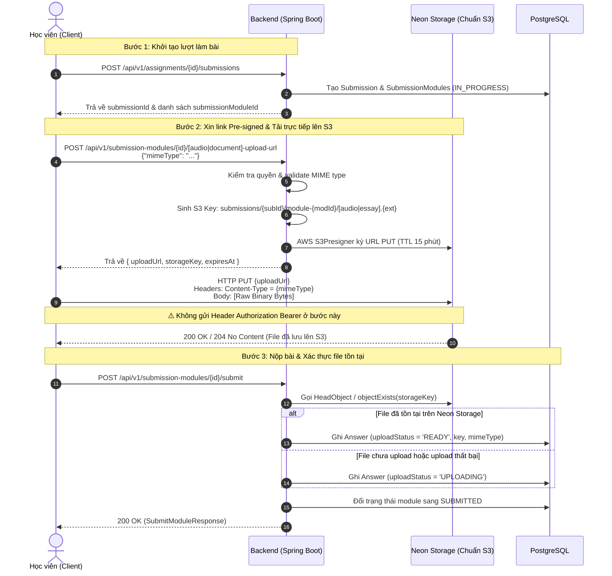
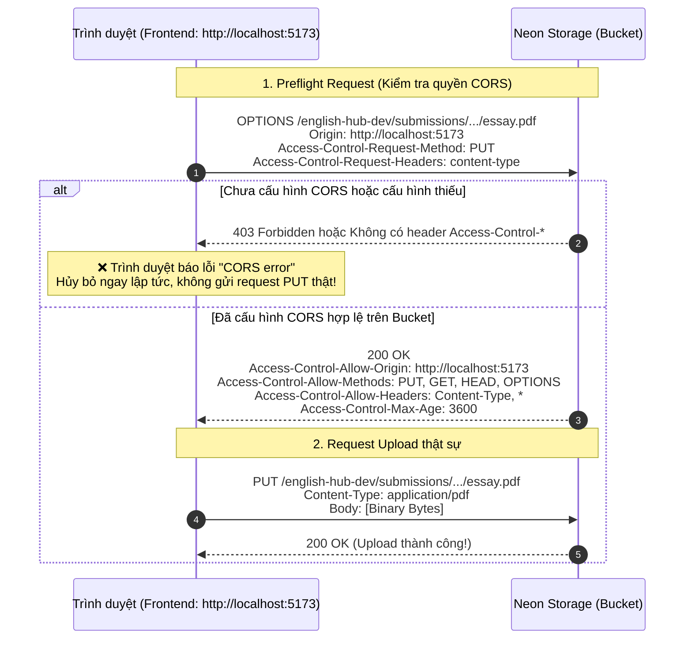

# Hướng Dẫn Kỹ Thuật: Upload File Bài Tập Lên Neon Storage (Chuẩn AWS S3) Trong Module Submission

> **Phạm vi áp dụng**: Module Submission (`backend/src/main/java/com/english_hub/core/modules/submission`).  
> **Đối tượng người đọc**: Frontend Developer, Backend Developer, QA/Tester, DevOps.  
> **Kho lưu trữ (Object Storage)**: **Neon Storage** (hoặc bất kỳ dịch vụ lưu trữ nào tuân thủ chuẩn **AWS S3 API** như Cloudflare R2, MinIO, AWS S3).  
> **Cơ chế cốt lõi**: **Pre-signed Direct Upload (Ký trước URL và tải trực tiếp từ Client)**.

---

## 1. Tổng Quan Kiến Trúc & Cơ Chế Hoạt Động

### 1.1. Tại sao sử dụng Direct-to-Storage với Pre-signed URL?
Trong mô hình truyền thống (multipart upload qua backend), máy chủ backend phải gánh toàn bộ tải I/O mạng, xử lý byte và giữ kết nối trong suốt thời gian client tải file dung lượng lớn (video, file âm thanh ghi âm chất lượng cao, tài liệu PDF/Word dài).

Hệ thống EnglishHub áp dụng mô hình **Pre-signed Direct Upload theo chuẩn S3**:
1. **Client** (trình duyệt web/mobile) gửi yêu cầu xin cấp quyền upload cho một phần làm bài cụ thể tới **Backend Spring Boot**.
2. **Backend** tạo một URL đặc biệt (**Pre-signed PUT URL**) có hạn dùng ngắn (**15 phút**), được ký bằng chữ ký điện tử HMAC-SHA256 (AWS Signature Version 4) chứa các thông tin giới hạn (Bucket, S3 Key, Content-Type, Expiration).
3. **Client** tải trực tiếp nội dung nhị phân (binary bytes) của file lên **Neon Storage** thông qua phương thức HTTP `PUT` vào URL đã cấp. Dữ liệu file hoàn toàn **không đi qua máy chủ Backend**, giải phóng 100% tài nguyên mạng và CPU cho backend.
4. **Backend** kiểm tra sự tồn tại của file trên S3 (`storageService.objectExists(...)`) khi học sinh nhấn nộp bài (`submitModule`), sau đó cập nhật bản ghi vào cơ sở dữ liệu.



---

## 2. Quy Định Định Dạng File, MIME Types & Storage Key

Mỗi bài làm được hệ thống tự động gán một `storageKey` duy nhất theo chuẩn cấu trúc phân cấp thư mục S3. Client **không được tự tạo** hoặc sửa đổi `storageKey`.

### 2.1. File ghi âm bài nói (Speaking / Recording Audio)
- **Áp dụng cho**: Module có `taskType = RECORDING` hoặc `skill = SPEAKING`.
- **Cấu trúc Storage Key**:
  ```text
  submissions/{submissionId}/module-{submissionModuleId}/audio.{extension}
  ```
- **Bảng ánh xạ MIME Type hợp lệ**:
  | MIME Type khai báo | Đuôi mở rộng (`extension`) | Ghi chú |
  | :--- | :--- | :--- |
  | `audio/webm` | `.webm` | Mặc định khuyên dùng khi ghi âm trên trình duyệt (MediaRecorder API) |
  | `audio/mpeg` | `.mp3` | Định dạng âm thanh nén phổ biến |
  | `audio/wav` | `.wav` | Âm thanh không nén (Waveform) |

### 2.2. File bài tập viết (Writing / Essay Document)
- **Áp dụng cho**: Module có `taskType = ESSAY`. *(Lưu ý: Task `REWRITE` trả lời câu hỏi trực tiếp như Quiz, không dùng file upload)*.
- **Cấu trúc Storage Key**:
  ```text
  submissions/{submissionId}/module-{submissionModuleId}/essay.{extension}
  ```
- **Bảng ánh xạ MIME Type hợp lệ**:
  | MIME Type khai báo | Đuôi mở rộng (`extension`) | Ghi chú |
  | :--- | :--- | :--- |
  | `application/pdf` | `.pdf` | Tài liệu chuẩn Adobe PDF |
  | `application/vnd.openxmlformats-officedocument.wordprocessingml.document` | `.docx` | Tài liệu Microsoft Word hiện đại |

---

## 3. Đặc Tả Chi Tiết Các API

Tất cả các API của Backend EnglishHub đều sử dụng tiền tố `/api/v1`.

### 3.1. Bước 1: Khởi tạo lượt nộp bài (Start Attempt)
Trước khi upload file, học sinh cần có một bài nộp đang ở trạng thái `IN_PROGRESS`.

- **Endpoint**: `POST /api/v1/assignments/{assignmentId}/submissions`
- **Headers**:
  ```http
  Authorization: Bearer <STUDENT_ACCESS_TOKEN>
  Content-Type: application/json
  ```
- **Phản hồi mẫu (`201 Created`)**:
  ```json
  {
    "id": 259,
    "assignmentId": 12,
    "studentId": 45,
    "attemptNumber": 1,
    "status": "IN_PROGRESS",
    "startedAt": "2026-11-03T13:40:00Z",
    "submittedAt": null,
    "modules": [
      {
        "id": 918,
        "moduleId": 101,
        "skill": "WRITING",
        "taskType": "ESSAY",
        "status": "IN_PROGRESS"
      },
      {
        "id": 919,
        "moduleId": 102,
        "skill": "SPEAKING",
        "taskType": "RECORDING",
        "status": "IN_PROGRESS"
      }
    ]
  }
  ```
  *(Lấy giá trị `submissionModule.id` — ví dụ: `918` hoặc `919` — để thực hiện các bước tiếp theo).*

---

### 3.2. Bước 2: Lấy Pre-signed Upload URL từ Backend

#### Trường hợp A: Dành cho bài thi Nói (Audio Upload URL)
- **Endpoint**: `POST /api/v1/submission-modules/{submissionModuleId}/audio-upload-url`
- **Headers**:
  ```http
  Authorization: Bearer <STUDENT_ACCESS_TOKEN>
  Content-Type: application/json
  ```
- **Request Body**:
  ```json
  {
    "mimeType": "audio/webm"
  }
  ```
- **Phản hồi thành công (`200 OK`)**:
  ```json
  {
    "uploadUrl": "https://br-blue-tree-b3ldfn4i.storage.c-4.ap-southeast-1.aws.neon.tech/english-hub-dev/submissions/259/module-919/audio.webm?X-Amz-Algorithm=AWS4-HMAC-SHA256&X-Amz-Date=20261103T134500Z&X-Amz-SignedHeaders=content-type%3Bhost&X-Amz-Expires=900&X-Amz-Credential=...&X-Amz-Signature=...",
    "storageKey": "submissions/259/module-919/audio.webm",
    "expiresAt": "2026-11-03T14:00:00Z"
  }
  ```

#### Trường hợp B: Dành cho bài thi Viết (Document Upload URL)
- **Endpoint**: `POST /api/v1/submission-modules/{submissionModuleId}/document-upload-url`
- **Headers**:
  ```http
  Authorization: Bearer <STUDENT_ACCESS_TOKEN>
  Content-Type: application/json
  ```
- **Request Body**:
  ```json
  {
    "mimeType": "application/pdf"
  }
  ```
- **Phản hồi thành công (`200 OK`)**:
  ```json
  {
    "uploadUrl": "https://br-blue-tree-b3ldfn4i.storage.c-4.ap-southeast-1.aws.neon.tech/english-hub-dev/submissions/259/module-918/essay.pdf?X-Amz-Algorithm=AWS4-HMAC-SHA256&X-Amz-Date=20261103T134500Z&X-Amz-SignedHeaders=content-type%3Bhost&X-Amz-Expires=900&X-Amz-Credential=...&X-Amz-Signature=...",
    "storageKey": "submissions/259/module-918/essay.pdf",
    "expiresAt": "2026-11-03T14:00:00Z"
  }
  ```

---

### 3.3. Bước 3: Tải Trực Tiếp File Lên Neon Storage (Chuẩn AWS S3 PUT)

Client gọi trực tiếp HTTP request tới địa chỉ `uploadUrl` nhận được từ Bước 2.

- **HTTP Method**: `PUT`
- **Request URL**: Giá trị của trường `uploadUrl`.
- **Headers Bắt Buộc**:
  ```http
  Content-Type: application/pdf
  ```
  *(Giá trị này **PHẢI CHÍNH XÁC 100%** so với `mimeType` gửi lên ở Bước 2).*
- **Headers Cấm Mang Theo**:
  - `Authorization`: **TUYỆT ĐỐI KHÔNG** gửi header `Authorization: Bearer ...` của backend sang S3. S3 sẽ coi đây là thông tin xác thực AWS không hợp lệ và từ chối request.
- **Request Body**: Toàn bộ dữ liệu nhị phân (Binary raw data / Blob / Buffer / File).
- **Phản hồi thành công từ Neon Storage/S3**:
  - HTTP Status: `200 OK` hoặc `204 No Content`.
  - Body rỗng.

---

### 3.4. Bước 4: Nộp Module và Kích Hoạt Kiểm Tra Tệp (Submit Module)

Sau khi quá trình `PUT` file lên S3 hoàn tất với mã `200/204`, client gọi API nộp module để báo cho backend xác thực.

- **Endpoint**: `POST /api/v1/submission-modules/{submissionModuleId}/submit`
- **Headers**:
  ```http
  Authorization: Bearer <STUDENT_ACCESS_TOKEN>
  Content-Type: application/json
  ```
- **Request Body** (tùy chọn với module file):
  - Với module `ESSAY`, client có thể đính kèm nội dung text hoặc tên file gốc vào content câu trả lời (nếu có):
    ```json
    {
      "answers": [
        {
          "questionId": 105,
          "content": {
            "questionType": "SHORT_ANSWER",
            "text": "Nội dung bài viết bổ sung...",
            "fileName": "IELTS_Writing_Task_2.pdf"
          }
        }
      ]
    }
    ```
  - Hoặc gửi body rỗng `{}` / `null` nếu chỉ upload file thuần túy.
- **Cơ chế kiểm tra ngầm tại Backend**:
  Backend sẽ tự động rà soát sự tồn tại của file trên S3 theo danh sách ứng viên (candidate priority):
  - Audio: kiểm tra lần lượt `audio.webm`, `audio.mp3`, `audio.wav`.
  - Document: kiểm tra lần lượt `essay.pdf`, `essay.docx`.
  - Nếu file tồn tại trên S3: trường `docUploadStatus` hoặc `audioUploadStatus` được lưu là `READY`.
  - Nếu file không tồn tại: trạng thái được lưu là `UPLOADING`.
- **Phản hồi thành công (`200 OK`)**:
  ```json
  {
    "message": "Nộp bài thành công.",
    "submissionModuleId": 918,
    "status": "SUBMITTED",
    "answers": [
      {
        "id": 432,
        "questionId": null,
        "docStorageKey": "submissions/259/module-918/essay.pdf",
        "docMimeType": "application/pdf",
        "docUploadStatus": "READY",
        "audioStorageKey": null,
        "audioMimeType": null,
        "audioUploadStatus": null
      }
    ]
  }
  ```

---

## 4. Bảng Tra Cứu Mã Lỗi & Cách Xử Lý (Troubleshooting)

| Mã lỗi HTTP | Nguồn phát sinh | Thông điệp lỗi / Chi tiết | Nguyên nhân & Hướng giải quyết |
| :--- | :--- | :--- | :--- |
| **`400 Bad Request`** | Backend | `"Định dạng file không được hỗ trợ."` | `mimeType` gửi lên không nằm trong danh sách cho phép (chỉ hỗ trợ `audio/webm`, `audio/mpeg`, `audio/wav`, `application/pdf`, `application/vnd.openxmlformats-officedocument.wordprocessingml.document`). |
| **`400 Bad Request`** | Backend | `"Không thể upload ghi âm cho phần làm bài này."` | Module này không phải task `RECORDING` hoặc skill `SPEAKING`, hoặc bài nộp không ở trạng thái `IN_PROGRESS`. |
| **`400 Bad Request`** | Backend | `"Không thể upload tài liệu cho phần làm bài này."` | Module này không phải task `ESSAY`, hoặc bài nộp không ở trạng thái `IN_PROGRESS`. |
| **`403 Forbidden`** | Backend | `"Bạn không có quyền thực hiện thao tác này."` | Token của người dùng không phải role `STUDENT`, hoặc bài nộp này thuộc về một học sinh khác. |
| **`403 Forbidden`** (`AccessDenied` / `SignatureDoesNotMatch`) | Neon Storage (S3) | `<Code>SignatureDoesNotMatch</Code>` hoặc `<Code>AccessDenied</Code>` | 1. **Sai lệch Content-Type**: Header `Content-Type` khi gửi `PUT` lên S3 khác với `mimeType` lúc gọi backend xin URL.<br/>2. **Gửi nhầm Header Authorization**: Đã đính kèm header JWT `Authorization: Bearer` vào request gửi tới S3.<br/>3. **Hết hạn URL**: Quá 15 phút kể từ lúc sinh link. |
| **`404 Not Found`** | Backend | `"Không tìm thấy phần làm bài."` | `submissionModuleId` không tồn tại trong hệ thống. |
| **`409 Conflict`** | Backend | `"Bài tập đã kết thúc hoặc quá hạn nộp."` | Hạn chót bài tập (`closeAt`) đã qua, không thể nộp file tiếp. |
| **`500 Internal Server Error`** | Backend | `"Lưu trữ chưa được cấu hình."` | Tham số cấu hình `app.storage.s3.enabled` đang là `false` hoặc thiếu biến môi trường AWS/Neon credentials trên backend. |

---

## 5. Hướng Dẫn Cài Đặt Cấu Hình & Chi Tiết Về CORS Cho Neon Storage / S3

### 5.1. Cấu hình Backend (`application-dev.properties` / Environment Variables)
Để module `S3StorageService` hoạt động, backend cần các tham số cấu hình sau:

```properties
app.storage.s3.enabled=true
app.storage.s3.endpoint=https://br-blue-tree-b3ldfn4i.storage.c-4.ap-southeast-1.aws.neon.tech
app.storage.s3.region=ap-southeast-1
app.storage.s3.access-key-id=${STORAGE_S3_ACCESS_KEY_ID}
app.storage.s3.secret-access-key=${STORAGE_S3_SECRET_ACCESS_KEY}
app.storage.s3.bucket=english-hub-dev
app.storage.s3.path-style=true
```

---

### 5.2. Bản Chất CORS & Cơ Chế Preflight Request Khi Direct Upload

#### 5.2.1. Tại sao bắt buộc phải cấu hình CORS trên S3/Neon Storage?
Trong kiến trúc thông thường:
- Ứng dụng Web Frontend chạy tại: `http://localhost:5173` (hoặc `https://app.englishhub.edu.vn`).
- Máy chủ lưu trữ Neon Storage nằm tại: `https://br-blue-tree-b3ldfn4i.storage.c-4.ap-southeast-1.aws.neon.tech`.

Do **Origin của Frontend khác hoàn toàn Origin của S3**, trình duyệt áp dụng cơ chế bảo mật nghiêm ngặt **Same-Origin Policy**. Khi code Frontend JavaScript thực hiện lệnh:
```typescript
fetch(uploadUrl, {
  method: 'PUT',
  headers: { 'Content-Type': 'application/pdf' },
  body: file
})
```
Phương thức `PUT` và header `Content-Type: application/pdf` **không phải là Simple Request** theo chuẩn W3C CORS. Trình duyệt bắt buộc phải tự động phát sinh một request tiền trạm gọi là **Preflight Request (`OPTIONS`)** gửi tới S3 trước:



#### 5.2.2. Phân tích chi tiết từng trường trong tệp cấu hình CORS JSON

```json
[
  {
    "AllowedOrigins": [
      "http://localhost:5173",
      "http://localhost:3000",
      "https://*.englishhub.edu.vn"
    ],
    "AllowedMethods": [
      "GET",
      "PUT",
      "HEAD",
      "OPTIONS"
    ],
    "AllowedHeaders": [
      "*"
    ],
    "ExposeHeaders": [
      "ETag"
    ],
    "MaxAgeSeconds": 3600
  }
]
```

1. **`AllowedOrigins`**:
   - Chỉ định danh sách tên miền nguồn (Origin) được phép gửi request đến bucket.
   - Khi dev: Cần khai báo port của Vite/React (`http://localhost:5173`).
   - Khi deploy: Khai báo domain production (`https://app.englishhub.edu.vn` hoặc dùng wildcard subdomain `https://*.englishhub.edu.vn`).
   - ⚠️ *Tránh dùng `"*"` trên môi trường production nếu lưu trữ dữ liệu nhạy cảm.*
2. **`AllowedMethods`**:
   - **`PUT`**: Tối quan trọng! Nếu thiếu `PUT`, trình duyệt sẽ chặn request upload file.
   - **`GET`, `HEAD`**: Cho phép frontend tải hoặc kiểm tra trạng thái tệp (nếu cần xem trước hoặc phát audio).
   - **`OPTIONS`**: Cho phép trình duyệt thăm dò tiền trạm preflight.
3. **`AllowedHeaders`**:
   - Chỉ định các header mà client được phép gửi kèm trong request.
   - Trong luồng này, client gửi header `Content-Type: application/pdf` hoặc `Content-Type: audio/webm`.
   - Nếu để thiếu hoặc không có `"Content-Type"` (hoặc `"*"`), preflight `OPTIONS` sẽ bị từ chối ngay. Khuyến nghị đặt `["*"]` để linh hoạt với các header do trình duyệt/S3 sinh ra (ví dụ: `x-amz-*`).
4. **`ExposeHeaders`**:
   - Theo mặc định, JavaScript trong trình duyệt chỉ đọc được các safe response headers.
   - Khai báo `"ETag"` cho phép JavaScript client đọc mã băm MD5/ETag mà S3 trả về sau khi tải lên thành công, phục vụ kiểm tra tính toàn vẹn của file.
5. **`MaxAgeSeconds`**:
   - Thời gian (tính bằng giây) mà trình duyệt được phép lưu tạm (cache) kết quả của request `OPTIONS` preflight.
   - Đặt `3600` (1 tiếng) giúp trình duyệt không phải gửi liên tục request `OPTIONS` mỗi khi upload một đoạn audio nhỏ, giảm độ trễ và tiết kiệm request count tới S3.

---

### 5.3. Các Phương Pháp Thiết Lập CORS Lên Neon Storage / S3 Bucket

Kho lưu trữ Neon Storage tương thích hoàn toàn với AWS S3 API. Bạn có thể áp dụng chính sách CORS theo một trong các cách sau:

#### Cách 1: Sử dụng AWS CLI (`aws s3api put-bucket-cors`)
Đây là cách phổ biến và tiện lợi nhất cho đội ngũ DevOps:

1. **Tạo file `cors.json`**:
   ```json
   {
     "CORSRules": [
       {
         "AllowedOrigins": ["http://localhost:5173", "https://*.englishhub.edu.vn"],
         "AllowedMethods": ["GET", "PUT", "HEAD", "OPTIONS"],
         "AllowedHeaders": ["*"],
         "ExposeHeaders": ["ETag"],
         "MaxAgeSeconds": 3600
       }
     ]
   }
   ```
2. **Chạy lệnh áp dụng CORS (trỏ endpoint sang Neon Storage)**:
   ```bash
   AWS_ACCESS_KEY_ID="nak_live_37435fb4d87b4e3da9e56ec39444b145" \
   AWS_SECRET_ACCESS_KEY="nsk_live_3d8367b11ec7f6f1862c28d40c56bf5a5613af23a3fcd4772661f119bfae4e8d" \
   aws s3api put-bucket-cors \
     --endpoint-url "https://br-blue-tree-b3ldfn4i.storage.c-4.ap-southeast-1.aws.neon.tech" \
     --bucket "english-hub-dev" \
     --cors-configuration file://cors.json
   ```
3. **Kiểm tra lại cấu hình CORS đã lưu**:
   ```bash
   AWS_ACCESS_KEY_ID="nak_live_37435fb4d87b4e3da9e56ec39444b145" \
   AWS_SECRET_ACCESS_KEY="nsk_live_3d8367b11ec7f6f1862c28d40c56bf5a5613af23a3fcd4772661f119bfae4e8d" \
   aws s3api get-bucket-cors \
     --endpoint-url "https://br-blue-tree-b3ldfn4i.storage.c-4.ap-southeast-1.aws.neon.tech" \
     --bucket "english-hub-dev"
   ```

#### Cách 2: Sử dụng Script Python (Boto3)
Nếu máy bạn có Python, bạn có thể chạy script độc lập không cần cài đặt AWS CLI:

```python
import boto3

s3 = boto3.client(
    "s3",
    endpoint_url="https://br-blue-tree-b3ldfn4i.storage.c-4.ap-southeast-1.aws.neon.tech",
    aws_access_key_id="nak_live_37435fb4d87b4e3da9e56ec39444b145",
    aws_secret_access_key="nsk_live_3d8367b11ec7f6f1862c28d40c56bf5a5613af23a3fcd4772661f119bfae4e8d",
    region_name="ap-southeast-1"
)

cors_configuration = {
    'CORSRules': [{
        'AllowedHeaders': ['*'],
        'AllowedMethods': ['GET', 'PUT', 'HEAD', 'OPTIONS'],
        'AllowedOrigins': ['http://localhost:5173', 'https://*.englishhub.edu.vn'],
        'ExposeHeaders': ['ETag'],
        'MaxAgeSeconds': 3600
    }]
}

s3.put_bucket_cors(Bucket='english-hub-dev', CORSConfiguration=cors_configuration)
print("✅ Cấu hình CORS thành công cho bucket english-hub-dev!")
```

#### Cách 3: Đối Với Môi Trường Local Chạy MinIO (Docker Compose)
Nếu dev chạy MinIO local qua Docker Compose, MinIO hỗ trợ mở CORS trực tiếp thông qua biến môi trường của container mà không cần chạy lệnh phụ:

```yaml
services:
  minio:
    image: minio/minio
    environment:
      MINIO_ROOT_USER: minioadmin
      MINIO_ROOT_PASSWORD: minioadmin
      # Cho phép mọi domain gửi request đến MinIO (hoặc chỉ định rõ http://localhost:5173)
      MINIO_API_CORS_ALLOW_ORIGINS: "http://localhost:5173,http://localhost:3000,*"
    command: server /data --console-address ":9001"
```

---

### 5.4. Kiểm Tra Xác Nhận CORS (CORS Verification Command)

Để đảm bảo cấu hình CORS đã có hiệu lực trước khi test giao diện người dùng, bạn có thể dùng lệnh `curl` giả lập đúng request `OPTIONS` mà trình duyệt Chrome/Firefox sẽ gửi:

```bash
curl -i -X OPTIONS "https://br-blue-tree-b3ldfn4i.storage.c-4.ap-southeast-1.aws.neon.tech/english-hub-dev/test.pdf" \
  -H "Origin: http://localhost:5173" \
  -H "Access-Control-Request-Method: PUT" \
  -H "Access-Control-Request-Headers: content-type"
```

**Dấu hiệu thành công**: Phản hồi HTTP trả về `HTTP/1.1 200 OK` (hoặc `204`) kèm các header phản hồi:
```http
Access-Control-Allow-Origin: http://localhost:5173
Access-Control-Allow-Methods: GET, PUT, HEAD, OPTIONS
Access-Control-Allow-Headers: *
Access-Control-Max-Age: 3600
```
Khi xuất hiện các header trên, việc upload file trực tiếp từ trình duyệt qua lệnh `fetch` hay `axios` sẽ diễn ra trơn tru mà không bị chặn bởi bất kỳ lỗi CORS nào.

---

## 6. Code Examples (Ví Dụ Mã Nguồn Hoàn Chỉnh)

### 6.1. Kịch Bản Hoàn Chỉnh Bằng cURL (Bash Script)

```bash
#!/usr/bin/env bash
set -e

BACKEND_URL="http://localhost:8080/api/v1"
STUDENT_TOKEN="eyJhbGciOiJIUzI1NiIsIn..."
SUBMISSION_MODULE_ID=918
FILE_PATH="./my_essay.pdf"
MIME_TYPE="application/pdf"

echo "=== 1. Xin Pre-signed Upload URL từ Backend ==="
RES=$(curl -s -X POST "${BACKEND_URL}/submission-modules/${SUBMISSION_MODULE_ID}/document-upload-url" \
  -H "Authorization: Bearer ${STUDENT_TOKEN}" \
  -H "Content-Type: application/json" \
  -d "{\"mimeType\": \"${MIME_TYPE}\"}")

UPLOAD_URL=$(echo "$RES" | jq -r '.uploadUrl')
STORAGE_KEY=$(echo "$RES" | jq -r '.storageKey')

echo "Storage Key được cấp: $STORAGE_KEY"
echo "Upload URL: $UPLOAD_URL"

echo "=== 2. Tải trực tiếp file lên Neon Storage (S3) ==="
# Lưu ý: Không dùng header Authorization của backend ở bước này!
HTTP_CODE=$(curl -s -o /dev/null -w "%{http_code}" -X PUT "$UPLOAD_URL" \
  -H "Content-Type: ${MIME_TYPE}" \
  --data-binary @"${FILE_PATH}")

if [ "$HTTP_CODE" -ne 200 ] && [ "$HTTP_CODE" -ne 204 ]; then
  echo "❌ Upload lên S3 thất bại với HTTP status: $HTTP_CODE"
  exit 1
fi
echo "✅ Upload lên S3 thành công (HTTP $HTTP_CODE)"

echo "=== 3. Nộp bài module để Backend xác nhận ==="
SUBMIT_RES=$(curl -s -X POST "${BACKEND_URL}/submission-modules/${SUBMISSION_MODULE_ID}/submit" \
  -H "Authorization: Bearer ${STUDENT_TOKEN}" \
  -H "Content-Type: application/json" \
  -d '{}')

echo "Kết quả nộp bài:"
echo "$SUBMIT_RES" | jq .
```

---

### 6.2. Mã Nguồn TypeScript / React (Sử dụng Fetch API chuẩn)

Đoạn code tích hợp hoàn chỉnh chuẩn cho Frontend React, xử lý tải file tài liệu hoặc file ghi âm:

```typescript
import axios from 'axios';

interface UploadUrlResponse {
  uploadUrl: string;
  storageKey: string;
  expiresAt: string;
}

interface SubmitModuleResponse {
  message: string;
  submissionModuleId: number;
  status: string;
  answers: Array<{
    id: number;
    docStorageKey?: string;
    docUploadStatus?: string;
    audioStorageKey?: string;
    audioUploadStatus?: string;
  }>;
}

/**
 * Service xử lý tải file bài tập lên Neon Storage (chuẩn S3)
 */
export class SubmissionUploadService {
  private static backendApi = axios.create({
    baseURL: '/api/v1',
  });

  /**
   * Upload bài thi Viết (PDF hoặc DOCX)
   */
  static async uploadEssaySubmission(
    submissionModuleId: number,
    file: File,
    token: string
  ): Promise<SubmitModuleResponse> {
    // 1. Lấy Pre-signed URL từ Backend
    const presignResponse = await this.backendApi.post<UploadUrlResponse>(
      `/submission-modules/${submissionModuleId}/document-upload-url`,
      { mimeType: file.type },
      {
        headers: { Authorization: `Bearer ${token}` },
      }
    );

    const { uploadUrl, storageKey } = presignResponse.data;

    // 2. Tải trực tiếp file lên Neon Storage (S3) qua HTTP PUT
    // CHÚ Ý: Dùng Fetch hoặc Axios riêng KHÔNG đính kèm Authorization header
    await this.uploadDirectToS3(uploadUrl, file, file.type);

    // 3. Gọi nộp bài để Backend probe và chốt trạng thái
    const submitResponse = await this.backendApi.post<SubmitModuleResponse>(
      `/submission-modules/${submissionModuleId}/submit`,
      {},
      {
        headers: { Authorization: `Bearer ${token}` },
      }
    );

    return submitResponse.data;
  }

  /**
   * Upload bài thi Nói (Ghi âm Blob: audio/webm, audio/mp3, audio/wav)
   */
  static async uploadSpeakingSubmission(
    submissionModuleId: number,
    audioBlob: Blob,
    mimeType: string,
    token: string
  ): Promise<SubmitModuleResponse> {
    // 1. Lấy Pre-signed URL cho audio
    const presignResponse = await this.backendApi.post<UploadUrlResponse>(
      `/submission-modules/${submissionModuleId}/audio-upload-url`,
      { mimeType },
      {
        headers: { Authorization: `Bearer ${token}` },
      }
    );

    const { uploadUrl } = presignResponse.data;

    // 2. Tải trực tiếp lên S3
    await this.uploadDirectToS3(uploadUrl, audioBlob, mimeType);

    // 3. Nộp bài module
    const submitResponse = await this.backendApi.post<SubmitModuleResponse>(
      `/submission-modules/${submissionModuleId}/submit`,
      {},
      {
        headers: { Authorization: `Bearer ${token}` },
      }
    );

    return submitResponse.data;
  }

  /**
   * Phương thức tải raw bytes lên S3
   */
  private static async uploadDirectToS3(
    uploadUrl: string,
    data: Blob | File,
    mimeType: string
  ): Promise<void> {
    const res = await fetch(uploadUrl, {
      method: 'PUT',
      headers: {
        'Content-Type': mimeType, // BẮT BUỘC TRÙNG KHỚP
      },
      body: data,
    });

    if (!res.ok) {
      throw new Error(`Tải tệp lên Neon Storage thất bại với mã lỗi HTTP: ${res.status}`);
    }
  }
}
```

---

### 6.3. Mã Nguồn Python (Tự động hóa kiểm thử Integration Tests)

```python
import requests

BACKEND_BASE_URL = "http://localhost:8080/api/v1"
STUDENT_TOKEN = "eyJhbGciOiJIUzI1NiIsIn..."
SUBMISSION_MODULE_ID = 918
FILE_PATH = "sample_test.pdf"
MIME_TYPE = "application/pdf"

headers_backend = {
    "Authorization": f"Bearer {STUDENT_TOKEN}",
    "Content-Type": "application/json"
}

# 1. Xin Presigned Upload URL
url_req = f"{BACKEND_BASE_URL}/submission-modules/{SUBMISSION_MODULE_ID}/document-upload-url"
resp = requests.post(url_req, json={"mimeType": MIME_TYPE}, headers=headers_backend)
resp.raise_for_status()
data = resp.json()

upload_url = data["uploadUrl"]
storage_key = data["storageKey"]
print(f"[*] Nhận S3 Key: {storage_key}")

# 2. Upload file trực tiếp lên Neon Storage (S3)
with open(FILE_PATH, "rb") as f:
    file_bytes = f.read()

s3_resp = requests.put(
    upload_url,
    data=file_bytes,
    headers={"Content-Type": MIME_TYPE} # Không gửi headers_backend!
)

if s3_resp.status_code not in (200, 204):
    raise RuntimeError(f"Upload lên S3 thất bại: HTTP {s3_resp.status_code}")
print("[+] Đã tải file lên Neon Storage thành công.")

# 3. Nộp bài module
submit_url = f"{BACKEND_BASE_URL}/submission-modules/{SUBMISSION_MODULE_ID}/submit"
submit_resp = requests.post(submit_url, json={}, headers=headers_backend)
submit_resp.raise_for_status()

result = submit_resp.json()
print("[+] Kết quả nộp bài thành công:", result)
```

---

## 7. Tổng Kết Các Điểm Lưu Ý Sống Còn (Key Takeaways)

1. **Khớp MIME Type Tuyệt Đối**: `Content-Type` của request `PUT` lên S3 phải giống từng ký tự với `mimeType` lúc yêu cầu URL ở Backend. Sai một ký tự sẽ nhận lỗi HTTP `403 SignatureDoesNotMatch`.
2. **Không Đính Kèm JWT Token Khi PUT Lên S3**: Trình duyệt hoặc thư viện HTTP client (như Axios interceptor) không được tự động gán header `Authorization: Bearer ...` vào request `PUT` lên URL của S3.
3. **Thời Hạn URL**: URL được ký có hạn sử dụng **15 phút**. Client nên yêu cầu URL ngay trước khi bắt đầu tải file.
4. **Không Có Endpoint `/confirm` Thủ Công Cho Bài Nộp**: Việc kiểm tra file trên S3 được backend tự động thực hiện thông qua `storageService.objectExists(...)` ngay khi học sinh gọi `POST /api/v1/submission-modules/{id}/submit`. Trạng thái `READY` chứng minh file đã tồn tại an toàn trong bucket.
