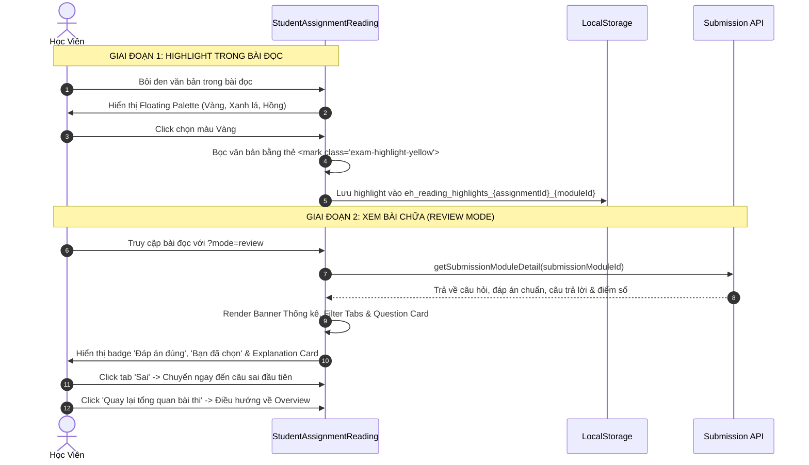

# Tính Năng: Highlight Văn Bản Bài Đọc & Tab Xem Bài Chữa Đối Chiếu Đáp Án (FE-95)

- **Mã Thẻ Trello**: `[FE-95] Hoàn Thiện Tab Xem Bài Chữa & Đối Chiếu Đáp Án Chi Tiết (UC020, UC032)`
- **Thành viên phụ trách**: Trần Tiến Sơn (`Maloque18705` / `@tinsntrn`)
- **Vai trò**: Frontend Developer
- **Các use cases giải quyết**: UC020 (Làm bài tập kỹ năng Đọc), UC032 (Xem lại bài làm và đối chiếu đáp án chi tiết)
- **Trạng thái**: Hoàn thành, 100% Quality Gates Passed

---

## 1. Tổng Quan & Mục Tiêu

Nhằm nâng cao trải nghiệm làm bài và tự học của học viên trên nền tảng EnglishHub, tính năng `FE-95` bổ sung hai năng lực chính cho trang thi Reading (`StudentAssignmentReading.tsx`):
1. **Bộ công cụ Bút dạ quang (Highlighter Tool)**:
   - Cho phép học viên bôi đen bất kỳ đoạn văn bản nào trong bài đọc để mở Bảng màu nổi (Floating Palette).
   - Hỗ trợ 3 màu sắc chuẩn mực:
     - **Vàng (#fef08a)**: Dành cho ý chính, từ khóa quan trọng.
     - **Xanh lá (#bbf7d0)**: Dành cho dẫn chứng đáp án câu hỏi.
     - **Hồng (#fbcfe8)**: Dành cho từ vựng mới, cấu trúc ngữ pháp cần ghi nhớ.
   - Thao tác gỡ highlight: Click trực tiếp vào đoạn văn bản đã highlight để xóa vùng chọn đó, hoặc dùng nút "Xóa tất cả" trên thanh công cụ Header bài đọc.
   - Lưu trữ bền vững (`localStorage`): Các đoạn highlight được lưu tự động theo `assignmentId` và `moduleId`, giữ nguyên trạng thái khi chuyển câu hỏi hoặc tải lại trang.
2. **Chế Độ Xem Bài Chữa & Đối Chiếu Đáp Án Chi Tiết (Review Mode - UC020, UC032)**:
   - Tự động kích hoạt khi URL có tham số `?mode=review` hoặc khi học viên truy cập lại module Reading đã hoàn thành.
   - **Thanh Banner Thống Kê & Điểm Số**:
     - Hiển thị tỷ lệ câu đúng/tổng số câu (ví dụ `✓ Đúng: 8 / 10`), số câu sai và tỷ lệ điểm phần trăm (`Điểm: 80%`).
   - **Thanh Tab Bộ Lọc Câu Hỏi Nhanh**:
     - Cho phép lọc và chuyển câu nhanh theo: `Tất cả`, `Đúng`, `Sai`, `Chưa làm`.
   - **Đối Chiếu Đáp Án Chuẩn & Học Sinh Đã Chọn**:
     - Trắc nghiệm (`MULTIPLE_CHOICE`):
       - Đáp án chuẩn có viền xanh lá, icon Check, và badge `Đáp án đúng`.
       - Lựa chọn của học sinh có badge `Bạn đã chọn` (viền đỏ nếu sai, viền xanh nếu đúng).
       - Các đáp án không liên quan được làm mờ nhẹ (`is-dimmed`) để tối ưu thị giác.
     - Trả lời ngắn (`SHORT_ANSWER`):
       - Hiển thị text học sinh đã điền, trạng thái Đúng/Sai, cùng hộp `Đáp án chuẩn`.
   - **Khối Lời Giải Thích Chi Tiết & Dẫn Chứng (Explanation Card)**:
     - Hiển thị giải thích chi tiết vì sao đáp án đó đúng kèm dẫn chứng trích xuất từ bài đọc.
   - **Điều Hướng & Route Guard**:
     - Khóa chức năng sửa đáp án và nút nộp bài trong review mode.
     - Thay thế nút nộp bài bằng nút `Quay lại tổng quan bài thi`.

---

## 2. Kiến Trúc Kỹ Thuật & Cấu Trúc File

```
frontend/src/
├── utils/
│   └── readingHighlight.utils.tsx          # Utility quản lý highlight & trích xuất đáp án review
├── pages/
│   └── StudentAssignmentReading.tsx        # Trang làm bài & xem bài chữa Reading
├── styles/
│   └── student-exam.css                    # CSS highlight, floating palette, review banner, badges
└── __tests__/components/
    └── StudentAssignmentReadingReview.test.tsx  # 9 test cases bao phủ toàn diện tính năng
```

---

## 3. Quy Trình Trải Nghiệm Người Dùng (UX Flow)



---

## 4. Kiểm Thử & Tiêu Chí Chất Lượng (DoD)

- Đạt 9/9 unit tests mới trong `StudentAssignmentReadingReview.test.tsx`.
- Tương thích 100% với toàn bộ 292 test cases bài thi trong `StudentAssignmentQuiz.test.tsx`.
- 0 lỗi TypeScript (`tsc -b`).
- 0 lỗi Vite build (`vite build`).
