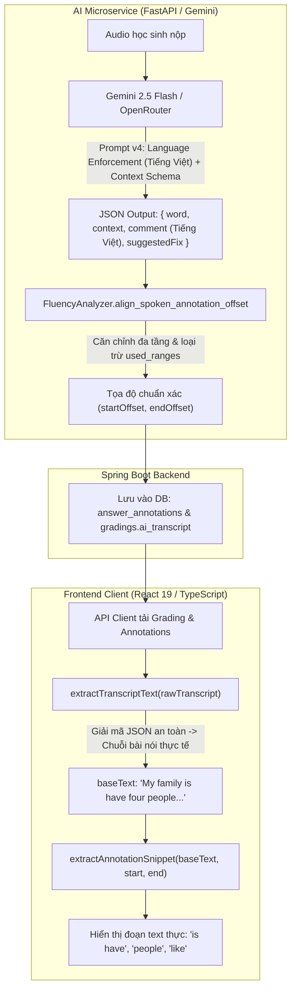

# FE-51: Sửa Lỗi Hiển Thị Chuỗi Thô Highlight Chấm Điểm & Căn Chỉnh Annotation Đa Tầng

## 1. Tổng quan
- **Mã tính năng / Task**: `[FE-51]` (Khắc phục BUG-22).
- **Phạm vi**: 
  - Frontend: `StudentSubmissionResult.tsx`, `TeacherSubmissionDetails.tsx`, `annotationSnippet.utils.ts`, `student.ts`.
  - AI Service: `speaking_prompts.py`, `writing_prompts.py`, `speaking.py`, `fluency_analyzer.py`, `gemini_service.py`.
  - Database: Cập nhật bản ghi annotation lệch trong bảng `answer_annotations`.
- **Phụ trách**: `@fe-primary` (`Maloque18705`) phối hợp `@ai-engineer` / `@be-primary`.

---

## 2. Các Vấn Đề Được Giải Quyết

1. **Sửa lỗi hiển thị chuỗi thô kỹ thuật [start-end] trên giao diện học sinh**:
   - Trước đây: `StudentSubmissionResult.tsx` hiển thị chuỗi kỹ thuật `"Đoạn ký tự [10 - 12]"` thay vì đoạn text thực trích từ bài làm của học sinh.
   - Giải pháp: Sử dụng hàm `extractAnnotationSnippet` để cắt đúng đoạn text gốc theo `startOffset` và `endOffset`. Khi không khả dụng, hiển thị `"Không xác định được đoạn văn bản"` (`t('studentResult.segmentUnavailable')`).

2. **Khắc phục lỗi cắt nhầm vào chuỗi JSON serialized `aiTranscript` (Hiển thị `d":"goo` và `mini-2`)**:
   - Trước đây: Backend trả về `aiTranscript` là một chuỗi JSON serialize. Cả giao diện giáo viên và học sinh dùng `typeof rawTranscript === 'string'` nên đã cắt lát substring trực tiếp vào chuỗi JSON, gây ra các đoạn text vô nghĩa như `d":"goo`, `mini-2`.
   - Giải pháp: Xây dựng hàm `extractTranscriptText` tự động parse an toàn JSON, bóc tách mảng `WordTimestamp` và ghép lại thành bài nói thực tế trước khi tính toán offset.

3. **Căn chỉnh chính xác từ trùng lặp bằng Context Schema (Giải pháp 1 & 2)**:
   - Trước đây: Khi bài nói có các từ lặp lại (ví dụ `"is"` xuất hiện ở câu 1 và câu 3), AI Service lưu trùng tọa độ `[10 - 12]` cho cả hai lỗi.
   - Giải pháp:
     - Nâng cấp Prompt (version v4): Thêm trường `"context"` chứa câu hoặc cụm 5-12 từ xung quanh từ bị lỗi.
     - Cải tiến Aligner đa tầng trong `fluency_analyzer.py`: Ưu tiên tìm trong `context` -> tìm mỏ neo trong `comment` -> duyệt tuần tự `word_offsets` loại trừ các khoảng trong `used_ranges`.

4. **Cưỡng chế 100% Tiếng Việt cho Prompt Nhận xét AI**:
   - Bổ sung khối quy định `LANGUAGE ENFORCEMENT RULE (BẮT BUỘC - 100% TIẾNG VIỆT)` trong `speaking_prompts.py` và `writing_prompts.py`.
   - Đảm bảo toàn bộ nhận xét, giải thích lý do sai trong `comment` và đánh giá tổng quan `feedbackMarkdown` đều viết bằng tiếng Việt.

---

## 3. Kiến Trúc Xử Lý & Dòng Chảy Dữ Liệu (Data Flow)

---

## 4. Tài Liệu Liên Quan & Nghiệm Thu
- Task Tracker: [.agents/tasks/fe-primary/done/TASK-FE-51-FIX-HIGHLIGHT-RAW-STRING.md](file:///d:/Coding/EnglishHub/.agents/tasks/fe-primary/done/TASK-FE-51-FIX-HIGHLIGHT-RAW-STRING.md)
- Bug Tracker: [.agents/tasks/bugs/BUG-22.yaml](file:///d:/Coding/EnglishHub/.agents/tasks/bugs/BUG-22.yaml)
- Hướng dẫn kiểm thử cho Tester: [production_artifacts/fe_to_tester/FE-51-TEST-GUIDE.md](file:///d:/Coding/EnglishHub/production_artifacts/fe_to_tester/FE-51-TEST-GUIDE.md)
- Unit Tests Frontend: `frontend/src/api/__tests__/annotationSnippet.test.ts` (182/182 passed).
- Unit Tests AI Service: `ai-service/tests/test_speaking_api.py` (8/8 passed).
