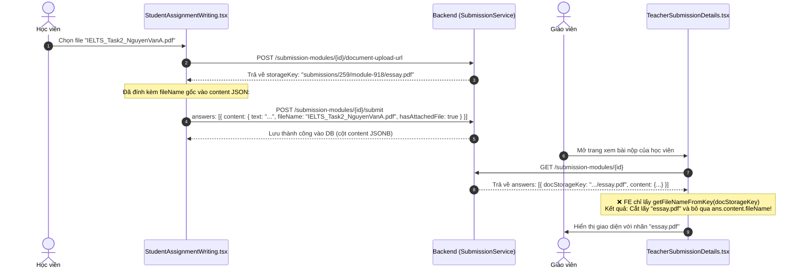
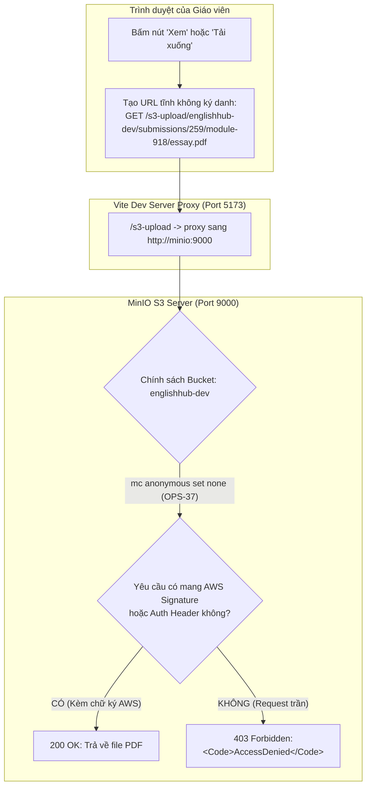

# BÁO CÁO RÀ SOÁT MÃ NGUỒN & PHÂN TÍCH CHUYÊN SÂU LỖI FILE BÀI NỘP VIẾT (WRITING)

> **Mã công việc liên quan**: `[FE-50]`, `[BUG-21]`, `[OPS-37]`, `[BUG-DOCX-MIME-OVERFLOW]`  
> **Phạm vi tác động**: Giao diện Giáo viên (`TeacherSubmissionDetails.tsx`), Giao diện Học viên (`StudentSubmissionResult.tsx`), Dịch vụ API (`submission.service.ts`), Backend (`SubmissionController`, `SubmissionService`, `S3StorageService`, `Answer`), Cơ sở dữ liệu PostgreSQL (`answers.doc_mime_type`), Hạ tầng Docker MinIO (`docker-compose.dev.yml`).  
> **Quy chuẩn đối chiếu**: [convention-fe.md](file:///d:/Coding/EnglishHub/.agents/rules/convention-fe.md), [frontend-ui-standards](file:///d:/Coding/EnglishHub/.agents/private/frontend-ui-standards/SKILL.md).

---

## 1. TỔNG QUAN CÁC VẤN ĐỀ LIÊN QUAN ĐẾN TỆP BÀI NỘP

Trong luồng làm bài, nộp bài phần thi Viết (Writing) và chấm bài của Giáo viên, hệ thống phát sinh 3 lỗi liên quan đến tệp bài làm đính kèm:

1. **Lỗi 1 - Sai lệch tên tệp hiển thị**: Trên giao diện xem bài làm của Giáo viên (`TeacherSubmissionDetails.tsx`), mục *"Tệp bài làm của học viên"* luôn hiển thị cố định là `essay.pdf` (hoặc `essay.docx`), hoàn toàn không hiển thị tên tệp thực tế mà học viên đã tải lên (ví dụ: `IELTS_Writing_Task_2_Nguyen_Van_A.pdf`). Tương tự, trên trang kết quả của học viên (`StudentSubmissionResult.tsx`), hệ thống in trực tiếp chuỗi S3 key dài ngoằng `submissions/259/module-918/essay.pdf`.
2. **Lỗi 2 - Lỗi tải xuống / xem tệp (`AccessDenied` 403 từ MinIO)**: Khi giáo viên bấm nút *"Xem"* hoặc *"Tải xuống"*:
   - Bấm *"Xem"*: Trình duyệt mở tab mới và nhận về thông báo lỗi XML từ MinIO (`<Code>AccessDenied</Code>`).
   - Bấm *"Tải xuống"*: Trình duyệt báo lỗi `"File wasn't available on site"` và hủy tải tệp.
3. **Lỗi 3 - Lỗi máy chủ HTTP 500 khi nộp file Word (.docx)**: Khi học sinh nộp bài viết có đính kèm file Word `.docx`, yêu cầu `POST /api/v1/submission-modules/{id}/submit` bị máy chủ từ chối và phản hồi `HTTP 500 Internal Server Error` do chuỗi MIME type của file Word dài 71 ký tự, vượt quá giới hạn `VARCHAR(50)` của cột `doc_mime_type` trong bảng `answers` ở cơ sở dữ liệu PostgreSQL.

---

## 2. PHÂN TÍCH CHI TIẾT LỖI 1: TÊN TỆP HIỂN THỊ `essay.pdf` THAY VÌ TÊN GỐC CỦA HỌC VIÊN

### 2.1. Phân tích luồng dữ liệu (Data Flow Analysis)



### 2.2. Vị trí mã nguồn gây lỗi
- Tại [TeacherSubmissionDetails.tsx#L36-L39](file:///d:/Coding/EnglishHub/frontend/src/pages/TeacherSubmissionDetails.tsx#L36-L39): Hàm `getFileNameFromKey(storageKey)` cắt chuỗi lấy phần tử sau dấu `/` cuối cùng (`essay.pdf`).
- Tại [TeacherSubmissionDetails.tsx#L830-L845](file:///d:/Coding/EnglishHub/frontend/src/pages/TeacherSubmissionDetails.tsx#L830-L845): Truyền `name={fileName}` vào component `FileItem`.
- Tại [StudentSubmissionResult.tsx#L889-L895](file:///d:/Coding/EnglishHub/frontend/src/pages/StudentSubmissionResult.tsx#L889-L895): In trực tiếp `attachedDocKey` lên giao diện người dùng.

### 2.3. Giải pháp khắc phục
Tạo helper trích xuất tên file từ `ans.content`:
```typescript
export function getStudentAnswerOriginalFileName(
  content: unknown,
  fallbackStorageKey?: string | null
): string {
  if (typeof content === 'object' && content !== null) {
    const obj = content as Record<string, unknown>;
    if (typeof obj.fileName === 'string' && obj.fileName.trim().length > 0) {
      return obj.fileName.trim();
    }
  }
  if (!fallbackStorageKey) return 'bai-lam.pdf';
  const baseName = fallbackStorageKey.split('/').pop();
  return baseName || fallbackStorageKey;
}
```

---

## 3. PHÂN TÍCH CHI TIẾT LỖI 2: LỖI TẢI XUỐNG / XEM FILE (`AccessDenied` TỪ MINIO)

### 3.1. Phân tích nguyên nhân an ninh & cơ chế S3 Private Bucket



### 3.2. Đối chiếu cơ chế Upload và Download
1. **Upload thành công (Presigned PUT)**: Backend sử dụng AWS SDK `S3Presigner` ký sẵn HMAC-SHA256 URL với query parameters `?X-Amz-Signature=...`. MinIO xác thực chữ ký hợp lệ và cho phép ghi.
2. **Download/View thất bại (Raw GET)**: Frontend tự ghép URL tĩnh trần qua `/s3-upload/...`. Vì bucket ở chế độ private (`mc anonymous set none` theo OPS-37), MinIO từ chối yêu cầu không chữ ký và trả về HTTP 403 `AccessDenied`.

---

## 4. PHÂN TÍCH CHI TIẾT LỖI 3: LỖI HTTP 500 KHI NỘP FILE WORD (.DOCX) DO CỘT `doc_mime_type VARCHAR(50)`

### 4.1. Bản chất kỹ thuật & Vị trí mã nguồn gây lỗi
1. **Trong Database PostgreSQL (`V1__init_schema.sql` dòng 377)**:
   ```sql
   doc_mime_type VARCHAR(50),
   ```
2. **Trong JPA Entity `Answer.java` (dòng 69)**:
   ```java
   @Column(name = "doc_mime_type", length = 50)
   private String docMimeType;
   ```
3. **Trong Business Logic `SubmissionService.java` (dòng 371)**:
   ```java
   private List<FileCandidate> documentCandidates() {
       return List.of(
           new FileCandidate("pdf", "application/pdf"),
           new FileCandidate("docx", "application/vnd.openxmlformats-officedocument.wordprocessingml.document"));
   }
   ```
4. **Đối chiếu độ dài chuỗi**:
   - Chuỗi MIME type: `application/vnd.openxmlformats-officedocument.wordprocessingml.document`
   - Độ dài thực tế: **71 ký tự**
   - Giới hạn cột: **50 ký tự**
   - $71 > 50 \rightarrow$ Vi phạm ràng buộc độ dài cột PostgreSQL (`SQLState: 22001`).

### 4.2. Nhật ký lỗi thực tế
```text
ERROR: value too long for type character varying(50)
STATEMENT: insert into answers (..., doc_mime_type, doc_storage_key, ...) values (..., 'application/vnd.openxmlformats-officedocument.wordprocessingml.document', ...)
org.springframework.dao.DataIntegrityViolationException: could not execute statement
Completed 500 INTERNAL_SERVER_ERROR
```

### 4.3. Tại sao Unit Test Backend không phát hiện được lỗi này?
Trong bài kiểm thử `SubmissionServiceTest.java` (dòng 1209-1225):
```java
when(answerRepository.bulkCreate(eq(102L), anyList())).thenAnswer(savedAnswers(1001L));
```
Vì tầng Repository bị mock bằng Mockito, câu lệnh SQL không thực sự chạy qua database PostgreSQL trong bài test đó, dẫn đến việc unit test vượt qua nhưng môi trường thật với database PostgreSQL thì ném lỗi 500.

---

## 5. MA TRẬN GIẢI PHÁP SO SÁNH (SOLUTION COMPARISON MATRIX)

| Tiêu chí | Phương án A: Presigned GET URL (Chuẩn Production) | Phương án B: Backend Proxy Stream Endpoint | Phương án C: Mở Anonymous Download MinIO Dev |
| :--- | :--- | :--- | :--- |
| **Bản chất kỹ thuật** | Backend sinh URL có kèm query signature AWS (`generatePresignedGetUrl`), frontend tải trực tiếp từ S3. | Backend tạo endpoint `GET /submission-modules/{id}/document`, đọc bytes từ S3 và stream về client. | Đổi cấu hình `docker-compose.dev.yml` thành `mc anonymous set download`. |
| **Tính bảo mật** | **Rất cao**: Bucket hoàn toàn private. Link có thời hạn (TTL 15-30 phút). Chỉ người có quyền xem bài mới nhận được link. | **Rất cao**: Bảo vệ bởi Bearer JWT token của hệ thống và kiểm tra quyền RBAC của giáo viên/học viên. | **Kém**: Bất kỳ ai biết URL đều có thể truy cập file mà không cần đăng nhập. Vi phạm ticket OPS-37. |
| **Tải trọng Backend (Load)** | **Cực nhẹ (0 MB I/O)**: Server chỉ sinh chuỗi URL ký; toàn bộ băng thông truyền tải file do S3/MinIO chịu tải. | **Nặng (High I/O)**: Backend phải buffer và stream toàn bộ dữ liệu file PDF/Audio qua bộ nhớ RAM của Spring Boot. | **Cực nhẹ**: MinIO phục vụ trực tiếp. |
| **Phù hợp môi trường** | **Production & Staging & Dev** (Tương thích 100% với AWS S3, Cloudflare R2, MinIO). | Phù hợp khi file nhỏ và cần ẩn hoàn toàn hạ tầng S3 sau một domain backend. | **Chỉ dùng tạm cho Local Dev**, không thể đưa lên Production. |

---

## 6. HƯỚNG DẪN XỬ LÝ CHO CÁC ROLE

### 6.1. Dành cho Frontend (`@fe-primary`)
1. **Lỗi 1 (Tên tệp gốc)**: Đọc `ans.content.fileName` trong `TeacherSubmissionDetails.tsx` và `StudentSubmissionResult.tsx`.
2. **Lỗi 2 (Tải/Xem S3)**: Sử dụng URL ký danh (`ans.docDownloadUrl`) từ Backend thay vì ghép URL tĩnh trần.
3. **Lỗi 3 (Nộp bài DOCX)**: Frontend đã chuẩn hóa MIME type qua `getBackendDocumentMimeType` và gửi đúng chuẩn.

### 6.2. Dành cho Backend (`@be-primary`)
1. **Khắc phục Lỗi 2**: Trong `SubmissionService.getModuleDetail()`, gọi `storageService.generatePresignedGetUrl(key)` để trả về `docDownloadUrl` và `audioDownloadUrl` trong `AnswerDetailResponse`.
2. **Khắc phục Lỗi 3**: 
   - Thêm migration Flyway `backend/src/main/resources/db/migration/V5__increase_doc_mime_type_length.sql`:
     ```sql
     ALTER TABLE answers ALTER COLUMN doc_mime_type TYPE VARCHAR(100);
     ```
   - Cập nhật entity `Answer.java`: `@Column(name = "doc_mime_type", length = 100)`.
