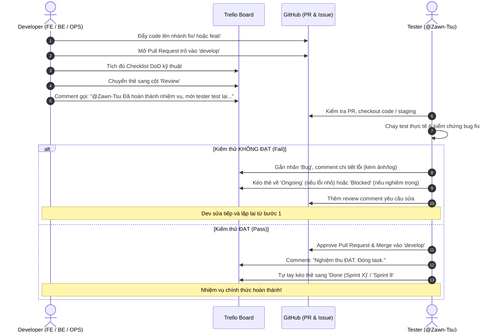

# EnglishHub - Quy Chuẩn Đồng Bộ Trello & GitHub (Reusable Conventions)

Tài liệu này quy định toàn diện bộ tiêu chuẩn làm việc, quản lý tiến độ, phân công nhiệm vụ và đồng bộ mã nguồn giữa **Trello Board (`Project1`)** và **GitHub Repository (`hotung9108/EnglishHub`)**. 

Mục tiêu là xây dựng quy trình làm việc chuyên nghiệp, loại bỏ xung đột, xác định rõ trách nhiệm của từng vai trò và tạo điều kiện cho các lập trình viên cùng các AI Agents phối hợp nhịp nhàng, có thể tái sử dụng lâu dài cho các dự án và giai đoạn phát triển tiếp theo.

---

## MỤC LỤC
1. [Nguyên Lý Cốt Lõi (Core Principles)](#1-nguyên-lý-cốt-lõi-core-principles)
2. [Quy Chuẩn Một Thẻ Task Trello (Single Task Specification)](#2-quy-chuẩn-một-thẻ-task-trello-single-task-specification)
3. [Quy Trình Hoàn Thành Nhiệm Vụ & Nghiệm Thu (Strict Completion & QA Protocol)](#3-quy-trình-hoàn-thành-nhiệm-vụ--nghiệm-thu-strict-completion--qa-protocol)
4. [Quy Chuẩn Giao Việc & Bàn Giao Task (Task Delegation & Handoff Standard)](#4-quy-chuẩn-giao-việc--bàn-giao-task-task-delegation--handoff-standard)
5. [Kiến Trúc Trello Board `Project1`](#5-kiến-trúc-trello-board-project1)
6. [Quy Chuẩn GitHub & Git Flow](#6-quy-chuẩn-github--git-flow)
7. [Bộ Mẫu Template Chuẩn Dùng Ngay (Ready-to-use Templates)](#7-bộ-mẫu-template-chuẩn-dùng-ngay-ready-to-use-templates)

---

## 1. Nguyên Lý Cốt Lõi (Core Principles)

1. **Nguyên tắc Atomic Task (Tác vụ nguyên tử)**:
   - Mỗi thẻ Trello phải là một đầu việc độc lập, cụ thể, có phạm vi rõ ràng, hoàn thành trong khoảng **0.5 đến 2 ngày làm việc**.
   - **Cấm tuyệt đối thẻ gộp bất thường (`[GOM]`)**: Mọi task phải được bóc tách riêng lẻ mang mã vai trò cụ thể (`[FE-xx]`, `[BE-xx]`,...). Các thẻ tiền tố `[GOM]` trong quá khứ là lỗi phát sinh, không được phép lặp lại.
2. **Single Source of Truth (Nguồn chân lý duy nhất)**:
   - **Trello**: Quản lý tiến độ tổng thể, trạng thái luân chuyển của task, backlog và kế hoạch sprint.
   - **GitHub**: Quản lý lịch sử mã nguồn, review code, thảo luận kỹ thuật sâu trên Issues/PRs, và tự động hóa CI/CD.
3. **Traceability (Khả năng truy vết 2 chiều)**:
   - Mỗi commit và Pull Request trên GitHub phải trích dẫn mã thẻ Trello (`FE-xx`, `BE-xx`,...).
   - Mỗi thẻ Trello phải đính kèm liên kết tới PR / Issue GitHub tương ứng.

---

## 2. Quy Chuẩn Một Thẻ Task Trello (Single Task Specification)

Một thẻ task Trello chuẩn mực bắt buộc phải bao gồm đầy đủ 7 yếu tố cấu thành dưới đây:

### 2.1. Cú pháp Tiêu đề (Card Title)
- **Đối với Tính năng / Nhiệm vụ thông thường**:
  $$\text{\texttt{[<ROLE>-<NUMBER>] <Động từ> <Đối tượng> - <Mô tả ngắn> (Độ ưu tiên nếu có)}}$$
  - *Ví dụ*: `[FE-40] Xây dựng bảng điều khiển duyệt lỗi AI cho Giáo viên (P0)`
  - *Ví dụ*: `[BE-36] Bổ sung Endpoint Presigned GET URL cho audio & bài nộp (P0)`
  - *Ví dụ*: `[OPS-36] Đóng port 8001 AI Service ra Internet + thêm xác thực nội bộ`
  - *Ví dụ*: `[QA-35] Viết lại test suite tích hợp cho luồng chấm điểm`

- **Đối với Sửa lỗi / Issue đã tạo trên GitHub**:
  $$\text{\texttt{[<ROLE>-<NUMBER>][ISSUE #<NUM>] <Mô tả ngắn về lỗi>}}$$
  - *Ví dụ*: `[FE-57][ISSUE #174] Nộp bài chỉ có văn bản xong nhưng nội dung bài luận bị mất`
  - *Ví dụ*: `[BE-64][ISSUE #222] Kiểm chứng cấp token sau khi xóa mềm tài khoản`

- **Mã tiền tố vai trò hợp lệ**:
  | Tiền tố | Vai trò chuyên trách | Thành viên chính |
  | :--- | :--- | :--- |
  | **`FE`** | Frontend Developer | `Maloque18705` |
  | **`BE`** | Backend Developer | `doanthaison2706`, `tuanpham21105` |
  | **`OPS`**| DevOps / Infrastructure | `tuanpham21105`, `hotung9108` |
  | **`QA`** | Quality Assurance / Tester | `Zawn-Tsu` |
  | **`DOC`**| Documentation / Architecture | Cả team (`hotung9108` phụ trách chính) |

### 2.2. Hệ thống Nhãn (Labels Taxonomy)
Mỗi thẻ **bắt buộc có ít nhất 1 nhãn vai trò** và thêm nhãn `Bug` nếu là lỗi:
- 🟡 **`Frontend`** (Màu Vàng): Công việc liên quan đến React, TypeScript, UI/UX, CSS.
- 🟢 **`Backend`** (Màu Xanh lá): Công việc liên quan đến Spring Boot, Java, JPA, Database, AI pipeline backend.
- 🌸 **`Devops`** (Màu Hồng nhạt): Docker, CI/CD GitHub Actions, Deploy server, Nginx, VPN.
- 🟣 **`Tester`** (Màu Tím): Kịch bản kiểm thử, Selenium, API Postman, Test Plan, Test Case.
- 🔵 **`Docs`** (Màu Xanh dương): Tài liệu kiến trúc, SRS, PP, API contract.
- 🟠 **`Bug`** (Màu Cam): Bắt buộc gắn cho mọi thẻ sửa lỗi hoặc fix issue.
- 🔴 **`Project Manager`** (Màu Đỏ): Thẻ điều phối, milestone, phân tích nghiệp vụ của PM.

### 2.3. Phân công Thành viên (Member Assignment)
- **Trong `Product Backlog`**: Có thể chưa gán hoặc gán PM (`hotung9108`).
- **Khi đưa vào `Sprint Backlog` / `Ongoing`**: Bắt buộc gán chính xác người thực hiện (theo bảng phân vai Roster).
- **Khi đưa vào `Review`**: Thêm Tester (`Zawn-Tsu`) vào thẻ để nhận thông báo nghiệm thu.

### 2.4. Cấu trúc Mô tả Thẻ chuẩn (Description Standard)
Phần Description của mọi thẻ Trello bắt buộc viết theo Markdown với 5 mục cố định:

```markdown
**Mục tiêu:**
[Giải thích ngắn gọn: Task này giải quyết bài toán gì? Mang lại giá trị gì cho hệ thống hoặc người dùng?]

**Phạm vi thực hiện:**
[Nêu rõ các module, trang giao diện, endpoint hoặc tệp mã nguồn sẽ thay đổi]

**Phụ trách:**
[Tên thành viên] (Git username: @username)

**Tiêu chí nghiệm thu (Acceptance Criteria):**
- [ ] Tiêu chí chức năng 1
- [ ] Tiêu chí chức năng 2
- [ ] Xử lý ngoại lệ / validate dữ liệu đầu vào đúng chuẩn

**Tài liệu & Liên kết liên quan:**
- Spec: [Link tài liệu trong docs/features/...]
- Issue GitHub: [Link GitHub Issue #...]
- PR GitHub: [Link GitHub PR #...]
```

### 2.5. Subtasks là Checklist DoD Bắt Buộc (Definition of Done)
Ngay bên trong thẻ Trello, người tạo hoặc người thực hiện phải tạo một **Trello Checklist** mang tên `Definition of Done (DoD)` với các mục tiêu chuẩn:
- [ ] `Chạy Project Doctor (/doctor) đạt 100% Quality Gates`
- [ ] `Code compile & build thành công, không phát sinh lỗi`
- [ ] `Unit tests viết đủ và pass toàn bộ (Coverage > 80%)`
- [ ] `Code đã format và lint sạch sẽ`
- [ ] `Đã mở Pull Request trỏ vào nhánh develop`
- [ ] `Đã cập nhật docs / API contract liên quan`

---

## 3. Quy Trình Hoàn Thành Nhiệm Vụ & Nghiệm Thu (Strict Completion & QA Protocol)

Để bảo đảm chất lượng phần mềm, dự án áp dụng quy tắc nghiệm thu nghiêm ngặt: **Lập trình viên KHÔNG ĐƯỢC tự ý kéo thẻ sang `Done`**.



### 3.1. Hành động của Lập trình viên khi làm xong code:
1. Chạy **Project Doctor** (`/doctor`) đảm bảo 100% Quality Gates đạt trạng thái `READY FOR PULL REQUEST`.
2. Tích hoàn tất các mục trong Checklist DoD trên thẻ.
3. Mở Pull Request trên GitHub trỏ vào `develop` theo đúng cú pháp tiêu đề `feat(ROLE-NUM): mô tả` (ví dụ `feat(FE-84): implement audio player studio`).
4. **Cơ chế Tự động hóa Zero-MCP**: GitHub Actions (`.github/workflows/trello-sync.yml`) sẽ tự động phát hiện mã thẻ `[FE-84]`, di chuyển thẻ sang cột **`Review`**, đính kèm link PR và tự động gắn thẻ `@zawntsu`. (Nếu thực hiện thủ công, dev vẫn có thể tự tay chuyển thẻ và comment gọi Tester).
5. Bàn giao kịch bản kiểm thử vào `production_artifacts/fe_to_tester/` hoặc `production_artifacts/be_to_tester/`.

### 3.2. Quyền hạn và Trách nhiệm của Tester (`@Zawn-Tsu`):
- Tester là **người duy nhất** có quyền xác nhận một task đã hoàn thành và kéo thẻ sang cột **`Done (Sprint X)`** hoặc **`Srpint 8`**.
- Nếu phát hiện lỗi: Tester comment rõ lỗi kèm hình ảnh/log, gắn nhãn màu cam `Bug`, và kéo thẻ về `Ongoing` hoặc `Blocked`.

---

## 4. Quy Chuẩn Giao Việc & Bàn Giao Task (Task Delegation & Handoff Standard)

### 4.1. Tiêu chuẩn sẵn sàng giao việc (Definition of Ready - DoR)
Một task chỉ được phép đưa vào `Sprint Backlog` và phân công khi:
1. Đã có mã định danh vai trò `[<ROLE>-<NUMBER>]`.
2. Đã gắn nhãn chuyên môn (Frontend / Backend / Devops / Tester).
3. Đã có đầy đủ mục tiêu, phạm vi và tiêu chí nghiệm thu rõ ràng trong mô tả.
4. Đã có người phụ trách cụ thể (không giao task "vô chủ").

### 4.2. Giới hạn tác vụ đang xử lý (WIP Limit)
- **Tối đa 1 - 2 task/người** tại cột `Ongoing` trong cùng một thời điểm.
- Khi đang có 2 task `Ongoing`, lập trình viên phải hoàn thành hoặc bàn giao bớt trước khi nhận task mới từ `Sprint Backlog`.

### 4.3. Ma trận Bàn giao 4 chặng:
1. **PM $\rightarrow$ Developer (`@pm` $\rightarrow$ `@fe-*` / `@be-*`)**:
   - PM viết spec trong `docs/features/` và tạo task tương ứng trên Trello.
   - Gán người làm và chuyển thẻ sang `Sprint Backlog`.
2. **Backend $\rightarrow$ Frontend (`@be-*` $\rightarrow$ `@fe-*`)**:
   - Khi API hoàn thành và có Swagger/DTO sẵn sàng, BE comment thông báo trên card của FE:  
     *"API đã sẵn sàng tại `/api/v1/...`, tài liệu contract tại `docs/api/...`, có thể bắt đầu ghép giao diện"*.
3. **Developer $\rightarrow$ Tester (`@fe-*` / `@be-*` $\rightarrow$ `@tester`)**:
   - Thực hiện theo quy trình tại [Chương 3](#3-quy-trình-hoàn-thành-nhiệm-vụ--nghiệm-thu-strict-completion--qa-protocol).
4. **Tester $\rightarrow$ DevOps (`@tester` $\rightarrow$ `@devops-*`)**:
   - Sau khi các PR được nghiệm thu và merge vào `develop`, Tester bàn giao phiên bản đã kiểm định để DevOps chạy build staging/production.

---

## 5. Kiến Trúc Trello Board `Project1`

Bảng Trello `Project1` được cấu trúc thành các nhóm cột logic theo luồng công việc:

| Nhóm danh sách | Tên danh sách (List Name) | Mục đích & Quy tắc luân chuyển |
| :--- | :--- | :--- |
| **Tài liệu** | `Docs` | Lưu trữ các card chứa link tài liệu tổng quan, GitHub repo, sơ đồ kiến trúc, link Figma. |
| **Kế hoạch** | `Product Backlog` | Kho chứa toàn bộ User Stories, tính năng tương lai chưa xếp vào sprint cụ thể. |
| **Kế hoạch** | `Sprint Backlog` | Toàn bộ các task đã được duyệt cho Sprint hiện tại (đã đủ điều kiện DoR). |
| **Trở ngại** | `Blocked` | Chứa các task bị nghẽn (chờ PM chốt spec, chờ API backend, lỗi hạ tầng). Bắt buộc comment rõ lý do blocked. |
| **Thực hiện** | `Ongoing` | Các task đang được dev code trực tiếp (tuân thủ WIP Limit $\le 2$). |
| **Kiểm thử** | `Review` | Code đã xong, PR đã mở, đang chờ Tester (`@Zawn-Tsu`) nghiệm thu. |
| **Hoàn thành** | `Srpint 8` *(hoặc Sprint hiện tại)* | Các task đã được Tester nghiệm thu ĐẠT trong Sprint 8. |
| **Lưu trữ** | `Sprint 7`, `Done (Sprint 6)` $\dots$ `Done (Sprint 1)` | Lưu trữ các task đã hoàn thành ở các Sprint trước đó để phục vụ báo cáo. |
| **Milestones** | `00. PI`, `01. SRS`, `02. PP`, `03. TP` | Các giai đoạn đồ án lớn (Khởi động, Đặc tả yêu cầu, Kế hoạch dự án, Kế hoạch kiểm thử). |

---

## 6. Quy Chuẩn GitHub & Git Flow

### 6.1. Mô hình Phân nhánh 3 tầng (Git Flow)
```text
  main (Production Release)
   ▲
   │ (Merge khi kết thúc Sprint / Đã kiểm thử Staging)
  staging (Pre-production / Testing Environment)
   ▲
   │ (Merge sau khi tích hợp ổn định)
  develop (Primary Integration Branch)
   ▲
   ├── feat/<ROLE>-<NUMBER>-<slug>      (Tính năng mới, tương thích feature/...)
   ├── fix/<ROLE>-<NUMBER>-<slug>       (Sửa lỗi theo task Trello)
   └── docs/<slug>                      (Cập nhật tài liệu)
```

- **`main`**: Nhánh ổn định cao nhất, dùng để deploy môi trường Production.
- **`staging`**: Nhánh kiểm thử tích hợp toàn diện trên môi trường VPS/Server thật.
- **`develop`**: Nhánh tích hợp chính. Mọi Pull Request tính năng và bugfix **bắt buộc phải target vào `develop`**.

### 6.2. Quy tắc đặt tên Nhánh (Branch Naming)
- **Tính năng mới**: `feat/<ROLE>-<NUMBER>-<kebab-case-desc>` (chuẩn chính) hoặc `feature/...` (tương thích ngược)
  - *Ví dụ*: `feat/FE-40-teacher-grading-studio`
  - *Ví dụ*: `feat/OPS-39-ci-ffmpeg-validation`
- **Sửa lỗi**: `fix/<ROLE>-<NUMBER>-<kebab-case-desc>`
  - *Ví dụ*: `fix/BE-64-soft-deleted-account-token-issuance`
  - *Ví dụ*: `fix/FE-57-student-writing-lost-text`
- **Tài liệu**: `docs/<kebab-case-desc>`
  - *Ví dụ*: `docs/trello-github-convention`

### 6.3. Quy tắc Conventional Commits
Mỗi commit message phải tuân thủ định dạng:
$$\text{\texttt{<type>(<scope/ROLE-ID>): <mô tả bằng tiếng Anh hoặc tiếng Việt rõ ràng>}}$$

- **Các types chuẩn**:
  - `feat`: Tính năng mới (ví dụ: `feat(FE-40): build teacher AI grading studio layout`)
  - `fix`: Sửa lỗi (ví dụ: `fix(BE-64): reject tokens for soft-deleted accounts`)
  - `docs`: Cập nhật tài liệu (ví dụ: `docs(guidelines): add trello github sync conventions`)
  - `ci`: Thay đổi cấu hình CI/CD (ví dụ: `ci(OPS-39): add ffmpeg build-time verification`)
  - `test`: Viết thêm hoặc sửa unit test (ví dụ: `test(QA-35): add integration tests for submission api`)
  - `refactor`: Tái cấu trúc mã nguồn không làm đổi logic nghiệp vụ

### 6.4. Quy chuẩn Pull Request (PR)
- **Tiêu đề PR**: `<type>(<ROLE>-<NUM>): <Mô tả ngắn>`
  - *Ví dụ*: `fix(BE-64): Reject tokens for soft deleted account`
  - *Ví dụ*: `fix(FE-57): Fix student essay text loss upon submission`
- **Base Branch**: `develop`
- **Bắt buộc liên kết Issue**: Sử dụng từ khóa `Closes #<ID>` hoặc `Fixes #<ID>` trong mô tả để GitHub tự động đóng Issue khi merge.
- **Bắt buộc đính kèm Link Trello Card** vào phần tham chiếu.

### 6.5. Quy chuẩn GitHub Issue
- **Tiêu đề Issue**: `[<ROLE>][<Module/Area>] <Mô tả lỗi hoặc yêu cầu>`
  - *Ví dụ*: `[BE][Submissions] Đáp án sau chấm trả tên trường snake_case khác đặc tả`
  - *Ví dụ*: `[FE][Student Writing] Nộp bài không lưu được file PDF đính kèm`
- **Gán nhãn Issue (Labels)**:
  - `bug`: Báo cáo lỗi
  - `enhancement`: Yêu cầu cải tiến
  - `documentation`: Cập nhật tài liệu

---

## 7. Bộ Mẫu Template Chuẩn Dùng Ngay (Ready-to-use Templates)

### Template 1: Thẻ Trello - Tính năng mới (Feature Card)
```markdown
**Mục tiêu:**
Xây dựng giao diện hiển thị danh sách bài tập của học sinh kèm trạng thái chấm điểm chi tiết.

**Phạm vi thực hiện:**
- Frontend: `src/pages/student/AssignmentsPage.tsx`
- Component: `SubmissionStatusBadge.tsx`

**Phụ trách:**
Maloque18705 (@Maloque18705)

**Tiêu chí nghiệm thu (Acceptance Criteria):**
- [ ] Hiển thị đầy đủ danh sách bài tập đã nộp và chưa nộp
- [ ] Hiển thị đúng badge trạng thái: Chưa chấm / Đang chấm / Đã chấm
- [ ] Không lỗi vỡ layout trên màn hình mobile

**Tài liệu & Liên kết liên quan:**
- Spec: docs/features/FE_STUDENT_ASSIGNMENTS.md
- PR: (Sẽ cập nhật khi mở PR)
```

---

### Template 2: Thẻ Trello - Sửa lỗi (Bug Card)
```markdown
**Mục tiêu:**
Sửa lỗi mất nội dung bài luận khi học sinh nộp bài dạng văn bản không đính kèm file.

**Phạm vi thực hiện:**
- Frontend: `src/services/submissionService.ts`
- Component: `WritingSubmissionForm.tsx`

**Phụ trách:**
doanthaison2706 (@doanthaison2706)

**Tiêu chí nghiệm thu (Acceptance Criteria):**
- [ ] Nội dung textarea được giữ nguyên và gửi đúng trong payload JSON
- [ ] Backend nhận được trường `content` với giá trị hợp lệ
- [ ] Test lại trường hợp nộp cả file lẫn text vẫn hoạt động bình thường

**Tài liệu & Liên kết liên quan:**
- Issue GitHub: https://github.com/hotung9108/EnglishHub/issues/174
- PR: (Sẽ cập nhật khi mở PR)
```

---

### Template 3: Comment Báo Hoàn Thành Nhiệm Vụ (Gửi Tester)
```markdown
@Zawn-Tsu Đã hoàn thành nhiệm vụ, mời tester test lại!

- **Pull Request:** https://github.com/hotung9108/EnglishHub/pull/264
- **Branch:** `fix/FE-57-student-writing-lost-text`
- **Các điểm đã hoàn thành:**
  - Đã tích đủ toàn bộ checklist DoD kỹ thuật trên thẻ.
  - Sửa lỗi mất nội dung text khi nộp bài luận module ESSAY.
  - Đã chạy pass toàn bộ test case liên quan.
- **Hướng dẫn test nhanh:**
  1. Đăng nhập tài khoản học sinh (`student1@test.com` / `123456`).
  2. Vào bài tập Writing Task 1, nhập văn bản vào ô bài làm (không đính kèm file).
  3. Bấm Nộp bài -> Vào trang kết quả kiểm tra xem bài làm có hiển thị đầy đủ văn bản vừa nộp hay không.
```

---

### Template 4: Comment Nghiệm Thu của Tester
```markdown
<!-- Trường hợp ĐẠT (Pass) -->
@doanthaison2706 Đã kiểm thử lại và nghiệm thu ĐẠT!
- Kịch bản kiểm thử: Đã test nộp bài text-only trên trình duyệt Chrome & Firefox.
- Kết quả: Dữ liệu bài làm lưu đầy đủ, API trả về 200 OK.
- Đã approve PR #264 trên GitHub và chuyển thẻ sang Done (Sprint 8).

<!-- Trường hợp CHƯA ĐẠT (Fail) -->
@doanthaison2706 Kiểm thử CHƯA ĐẠT. Vẫn còn phát sinh lỗi:
- Hiện tượng: Khi nhập văn bản chứa ký tự đặc biệt (&, <, >), trang kết quả bị crash trắng trang.
- Log lỗi / Ảnh chụp: [Đính kèm ảnh lỗi hoặc copy mã lỗi console]
- Hành động: Gắn lại nhãn Bug và chuyển thẻ về Ongoing để tiếp tục khắc phục.
```

---

### Template 5: GitHub Pull Request
```markdown
## Summary of Changes
- Fix(FE-57): Retain essay text content when submitted without an attachment.
- Prevent payload dropping `textContent` field in `submissionService.ts`.

## Related Links
- Closes #174
- Trello Card: https://trello.com/c/ABC123xyz/57-fe-57-nop-bai-chu-co-van-ban

## Checklist
- [x] Code compiles without errors
- [x] Unit tests passing
- [x] Linting passed
- [x] Tested locally with mock API
```
