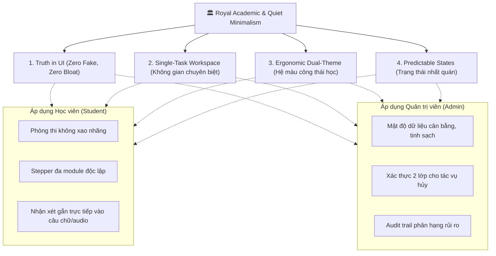

# EnglishHub UI/UX Design Philosophy & System Guide
*Bản Quy Chuẩn Triết Lý Thiết Kế & Hệ Thống Tương Tác Đồng Bộ (Student & Admin)*

---

## 1. Triết Lý Cốt Lõi: *Royal Academic & Quiet Minimalism*
*(Học Thuật Hoàng Gia & Tối Giản Tĩnh Lặng)*

Hệ thống **EnglishHub** là một nền tảng học thuật chuyên sâu phục vụ việc luyện thi, quản lý lớp học, làm bài tập và chấm thi tiếng Anh chuẩn quốc tế (IELTS, CEFR, TOEIC). Người dùng (Giáo viên, Học sinh, Quản trị viên) thường xuyên làm việc trên hệ thống liên tục từ 4 đến 8 tiếng mỗi ngày.

> [!IMPORTANT]
> **Nguyên Tắc Tối Thượng:** 
> **"Giao diện người dùng là phông nền tĩnh lặng nâng đỡ tư duy, không phải sân khấu trình diễn hiệu ứng."**  
> Mọi thành phần hiển thị phải phục vụ trực tiếp cho quá trình tiếp nhận tri thức, giảm thiểu tối đa sự phân tâm và tình trạng mỏi mắt (Visual Fatigue).

---

## 2. Bốn Trụ Cột Thiết Kế Bất Biến (4 Invariant Pillars)

---

### Trụ Cột 1: *Truth in UI — Zero Fake, Zero Bloat* (Chân thực & Tối giản dữ liệu)
- **Tuyệt đối bài trừ Mock/Nút giả**: Mọi nút bấm, trường nhập dữ liệu, hoặc thông báo trên giao diện phải có API Backend thực sự xử lý. Không giữ lại các nút bấm "trang trí" (như nút gửi nhắc nhở khi backend chưa có push notification/email).
- **Tinh giản thông tin tóm tắt**: Không nhồi nhét văn bản hướng dẫn thừa thãi vào các thẻ tóm tắt. Chỉ hiển thị định danh cốt lõi và số liệu cần thiết (Ví dụ: `#1 Đọc (Reading) • 10 điểm`).
- **Trung thực về trạng thái**: Dữ liệu chỉ hiển thị khi máy chủ xác nhận thành công. Tránh hiển thị trạng thái lạc quan (optimistic) nếu nghiệp vụ yêu cầu kiểm duyệt nghiêm ngặt (như nộp bài thi hoặc chấm điểm).

---

### Trụ Cột 2: *Single-Task Workspace* (Phân tách không gian chuyên biệt)
- **Một trang — Một mô hình tư duy**: Không gộp các tác vụ có mục tiêu khác nhau vào cùng một màn hình (ví dụ: Tách bạch hoàn toàn giữa *Soạn đề/Quản lý đề bài* và *Phòng chấm thi/Theo dõi nộp bài*).
- **Loại bỏ trùng lặp điều hướng**: Sử dụng thanh Sidebar hợp nhất làm trục điều hướng chính, loại bỏ Navbar trùng lặp ở đỉnh để tối đa hóa diện tích làm việc theo chiều dọc.
- **Thanh công cụ dính đáy (Sticky Action Bar)**: Mọi biểu mẫu hoặc phòng làm bài dài đều có thanh hành động neo ở chân màn hình:
  - *Cụm trái*: Hành động phụ (Quay lại, Hủy bỏ, Xem trước giao diện học viên).
  - *Cụm phải*: Hành động chính (Lưu thay đổi, Xuất bản, Nộp bài).

---

### Trụ Cột 3: *Ergonomic Dual-Theme & Functional Palette* (Hệ màu công thái học)
Hệ thống sử dụng bảng màu định nghĩa tại [`frontend/src/styles/design-tokens.css`](file:///D:/Codin/utc-code/HK4_1/Project1/EnglishHub/frontend/src/styles/design-tokens.css), hỗ trợ chuyển đổi mượt mà giữa **Light** và **Dark**:

| Vai trò thị giác | Light Theme (*Quiet Academic*) | Dark Theme (*Obsidian Atelier*) | Ứng dụng nghiệp vụ |
| :--- | :--- | :--- | :--- |
| **Nền Canvas** | `#f8f9fa` (Alabaster tinh khiết, chống mỏi mắt) | `#0b0e0d` (Obsidian sâu, không dùng `#000` AMOLED) | Nền tổng thể toàn trang |
| **Bề mặt thẻ (Surface)** | `#ffffff` (Khối viền `#e5e8eb` siêu mỏng 1px) | `#121715` (Khối viền `rgba(255,255,255,0.06)`) | Thẻ nội dung, bảng, container |
| **Màu thương hiệu (Primary)**| `#164e3e` (Deep Sovereign Emerald) | `#236f5a` / `#2f8f74` | Nút chính, badge tích cực, điểm nhấn học thuật |
| **Màu nhấn sang trọng (Gold)**| `#9a7e56` (Champagne trầm tinh tế) | `#c4a47c` | Điểm cao (Band 8.0+), chứng chỉ, danh hiệu |
| **Chữ chính (Text Primary)** | `#161b19` (Charcoal Slate không lóa) | `#e6ece9` (Off-white dịu mắt) | Tiêu đề, nội dung bài đọc, câu hỏi |

#### 4 Màu Kỹ Năng Tiếng Anh Chuẩn Hóa:
Dùng đồng bộ trên toàn bộ giao diện từ Student đến Admin:
* 📖 **Reading**: `--eh-skill-reading: #16533d` (Xanh lục bảo rừng già — tượng trưng cho sự điềm tĩnh và phân tích văn bản).
* 🎧 **Listening**: `--eh-skill-listening: #1e3a8a` (Xanh thẫm Navy — tượng trưng cho sự sâu lắng và tập trung âm học).
* ✍️ **Writing**: `--eh-skill-writing: #8c5e14` (Vàng hổ phách đồng — tượng trưng cho kiến tạo câu từ và bố cục).
* 🎙️ **Speaking**: `--eh-skill-speaking: #5b21b6` (Tím hoàng gia — tượng trưng cho sự tự tin và diễn đạt ngữ điệu).

---

### Trụ Cột 4: *Predictable States & Structural Rhythm* (Trạng thái và nhịp điệu cấu trúc)
Mọi trang dữ liệu đều phải phản hồi chính xác 3 trạng thái chuẩn:
1. **Loading State**: Sử dụng [`LoadingState`](file:///D:/Codin/utc-code/HK4_1/Project1/EnglishHub/frontend/src/components/common/LoadingState.tsx) với biểu tượng thanh nhã và thông điệp giải thích hệ thống đang chuẩn bị gì.
2. **Empty State**: Khi danh sách rỗng hoặc không khớp bộ lọc, hiển thị [`EmptyState`](file:///D:/Codin/utc-code/HK4_1/Project1/EnglishHub/frontend/src/components/common/EmptyState.tsx) kèm hành động gợi ý cụ thể (ví dụ: *"Tạo tài khoản đầu tiên"* hoặc *"Đặt lại bộ lọc"*).
3. **Error State**: Báo lỗi thân thiện, chỉ ra nguyên nhân và cung cấp nút *"Thử lại"* (Retry) mà không cần người dùng phải bấm F5 tải lại toàn bộ trang.

---

## 3. Quy Chuẩn Giao Diện Cho Học Viên (Student Ecosystem)

### 3.1. Phòng Thi & Làm Bài (Distraction-Free Exam Runner)
* **Thanh tiến độ (Stepper)**: Phản ánh cấu trúc đa module thực tế theo URL query (`?moduleId=...`). Mỗi bước hiển thị rõ:
  - Tên kỹ năng và thứ tự phần thi (ví dụ: `Đọc (Reading) (Phần 1)`, `Đọc (Reading) (Phần 2)`).
  - Trạng thái trực quan: `Đang làm` (viền Emerald), `Đã hoàn thành` (tick xanh), hoặc `Bị khóa` (icon khóa đối với bài thi tuần tự).
* **Không gian làm bài Reading & Listening**: Tách 2 cột độc lập (Split-pane) với thanh cuộn riêng biệt; đề bài bên trái, câu hỏi trắc nghiệm/điền từ bên phải.
* **Không gian làm bài Writing & Speaking**:
  - Writing: Khung soạn thảo với bộ đếm từ tự động (Word count vs Minimum requirement) và nút tải tệp minh bạch.
  - Speaking: Máy thu âm tích hợp bộ đếm ngược thời gian chuẩn bị (Preparation time) và thời gian nói (Speaking time), nút nghe lại và đo sóng âm thanh.

### 3.2. Không Gian Tra Cứu Kết Quả (Submission Result Studio)
* **Bảng điểm chuẩn CEFR / IELTS**: Điểm tổng quan (Overall Band) đặt ở vị trí danh dự với viền Champagne Gold.
* **Inline Annotations (Chú thích trực tiếp)**:
  - Nhận xét của AI và Giáo viên được gắn trực tiếp (highlight) lên từng từ/câu trong bài luận hoặc từng mốc thời gian trong audio.
  - Phân loại lỗi bằng badge chuyên biệt: Phát âm (Pronunciation), Ngữ pháp (Grammar), Từ vựng (Vocabulary), Mạch lạc (Fluency/Coherence).

---

## 4. Quy Chuẩn Giao Diện Cho Quản Trị Viên (Admin Ecosystem)

### 4.1. Mật Độ Bảng Dữ Liệu Tinh Sạch (Clean Table Density)
* **Chiều cao hàng (Row Height)**: 48px – 54px, phân định bằng đường hairline viền siêu mỏng (`--eh-border-subtle`).
* **Hệ thống nhãn trạng thái (Status Badges)**:
  - `ACTIVE` / `PUBLISHED`: Nền xanh lục nhạt (`--eh-success-bg`), chữ Emerald đậm.
  - `PENDING` / `DRAFT`: Nền vàng trầm nhạt (`--eh-warning-bg`), chữ nâu đất.
  - `CLOSED` / `BANNED`: Nền đỏ nhạt dịu (`--eh-danger-bg`), chữ đỏ bordeaux.
* **Cột thao tác (Action Column)**: Luôn căn phải (`text-right`), hiển thị các nút thao tác nhanh rõ nghĩa, các thao tác nhạy cảm phải tách biệt với thao tác xem.

### 4.2. An Toàn Tác Vụ Quản Trị (Two-Step Destructive Action)
* Các hành động có tính rủi ro cao (Khóa tài khoản, Xóa lớp học, Đổi vai trò đặc quyền) bắt buộc phải mở **Confirmation Modal** 2 lớp:
  - Hiển thị rõ danh tính đối tượng bị tác động.
  - Cảnh báo các hệ quả liên quan (ví dụ: *"Khi khóa tài khoản, học viên sẽ không thể đăng nhập và làm bài tập hiện tại"*).
  - Nút xác nhận sử dụng màu đỏ cảnh báo (`--eh-danger`), không dùng màu đỏ tươi chói.

---

## 5. Bảng Kiểm Tra Dành Cho Lập Trình Viên (Developer Acceptance Checklist)

Khi triển khai bất kỳ màn hình hoặc tính năng mới nào, lập trình viên và AI Agent bắt buộc phải đối chiếu:

- [ ] **Màu sắc**: Có đang hardcode mã hex `#...` không? (Bắt buộc dùng biến CSS `--eh-*`).
- [ ] **Chân thực**: Các nút bấm trên trang có kết nối với endpoint thực tế của Backend không? (Tuyệt đối không để lại nút bấm mock/giả lập).
- [ ] **Dual-Theme**: Đã bật thử cả chế độ Sáng (Light) và Tối (Dark) để kiểm tra độ tương phản văn bản chưa?
- [ ] **Đa module**: Nếu trang liên quan đến bài tập, đã hỗ trợ danh sách module tùy biến số lượng chưa?
- [ ] **Trạng thái**: Đã xử lý đủ cả 3 trạng thái `Loading`, `Empty`, và `Error` chưa?
- [ ] **Hành động dài**: Các trang form dài có `StickyActionBar` cố định ở chân trang để người dùng không phải cuộn tìm nút lưu không?
- [ ] **Quality Gates**: Đã chạy `npm run lint` (0 error, 0 warning) và `npm run test` (100% passing) chưa?
