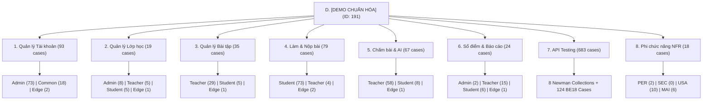
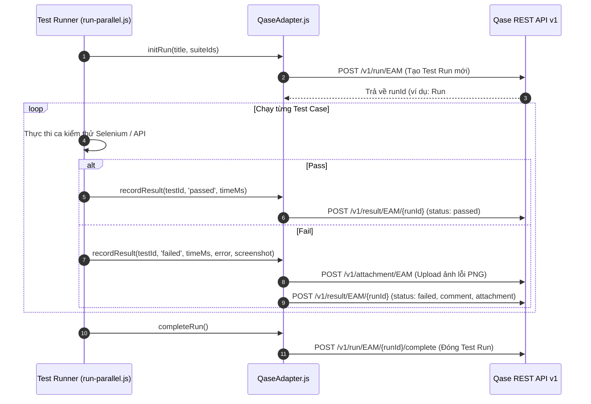

# Hướng Dẫn Tích Hợp & Đồng Bộ Qase TMS (Qase Integration Guide)

Tài liệu này đặc tả cơ chế tích hợp hai chiều giữa bộ kiểm thử tự động [`test_reborn`](file:///D:/ki7/prj1/BTL_PRJ1/EnglishHub/test_reborn) và hệ thống Quản lý Kiểm thử **Qase TMS** (Project Code: **`EAM`**).

---

## 1. Thông Tin Kết Nối Trọng Yếu

- **Nền tảng TMS**: Qase.io REST API v1 (`https://api.qase.io/v1`).
- **Mã dự án (Project Code)**: `EAM`
- **Mã Root Suite Chuẩn Hóa**: `191` (`D. [DEMO CHUẨN HÓA] Phân Hệ Nghiệp Vụ, Vai Trò & E2E Selenium`).
- **Tổng số test cases được quản lý**: **1.018 test cases**.
- **Mã Token Xác thực**: Được cấu hình tại biến môi trường `QASE_API_TOKEN` trong [`common/config/.env`](file:///D:/ki7/prj1/BTL_PRJ1/EnglishHub/test_reborn/common/config/.env).

---

## 2. Kiến Trúc Cấu Trúc Suite Trên Qase

Dự án được cấu trúc hóa theo 8 phân hệ lớn:



---

## 3. Cơ Chế Hoạt Động Của `QaseAdapter`

Mô-đun [`common/support/qase-adapter.js`](file:///D:/ki7/prj1/BTL_PRJ1/EnglishHub/test_reborn/common/support/qase-adapter.js) chịu trách nhiệm tự động hóa giao tiếp với Qase qua các bước:



---

## 4. Ánh Xạ Test Case Code Với Qase TMS (Case ID Mapping)

Các test case trong mã nguồn tự động được ánh xạ với Qase theo mã định danh duy nhất:

### 4.1. Bộ Kiểm Thử E2E UI:
- **Admin**: Các test ID `ADM-001` đến `ADM-050` tương ứng trực tiếp với tiêu đề case `[ADM-xxx]` trên Qase.
- **Teacher**: Các test ID `TEA-001` đến `TEA-051` tương ứng với `[TEA-xxx]`.
- **Student**: Các test ID `STU-001` đến `STU-045` tương ứng với `[STU-xxx]`.

### 4.2. Bộ Kiểm Thử API:
- Tệp [`catalog.json`](file:///D:/ki7/prj1/BTL_PRJ1/EnglishHub/test_reborn/black-box/api/catalog.json) quy định mã suite tương ứng trên Qase:
  - `common-auth` $\to$ Suite `219` (7.1)
  - `common-profile` $\to$ Suite `220` (7.2)
  - `admin-account` $\to$ Suite `221` (7.3)
  - `admin-class` $\to$ Suite `222` (7.4)
  - `teacher-assignment` $\to$ Suite `223` (7.5)
  - `teacher-grading` $\to$ Suite `224` (7.6)
  - `student-submission` $\to$ Suite `225` (7.7)
  - `student-evaluation` $\to$ Suite `226` (7.8)

---

## 5. Hướng Dẫn Vận Hành Đồng Bộ Trực Tiếp

### 5.1. Khởi Chạy Test Run Đồng Bộ Qase Tự Động:
Chỉ cần thực thi file lệnh sau:
```powershell
scripts\Run-Parallel-Qase.cmd
```
Lệnh này sẽ:
1. Tự động kiểm tra kết nối với Qase.
2. Tạo mới một Test Run có tên `[Parallel-E2E-Automated] <timestamp>`.
3. Bật 3 luồng Chrome song song cho Admin, Teacher, Student.
4. Tự động đẩy kết quả `passed` / `failed` lên Qase theo thời gian thực (real-time).
5. Khi gặp ca kiểm thử thất bại, tự động chụp màn hình và đính kèm trực tiếp vào ca test trên Qase.
6. Tự động đóng Test Run khi cả 3 luồng hoàn tất và in đường dẫn Test Run ra màn hình console.

### 5.2. Cách Tra Cứu Kết Quả Trên Qase:
1. Đăng nhập vào trang quản trị Qase tại `https://app.qase.io`.
2. Mở dự án **`EAM`**.
3. Vào tab **Test Runs**: Bạn sẽ thấy danh sách các Test Run với thanh trạng thái xanh/đỏ trực quan.
4. Bấm vào bất kỳ ca thất bại nào để xem:
   - Call stack lỗi chi tiết.
   - Thời gian thực thi.
   - Ảnh chụp giao diện màn hình tại thời điểm bị lỗi.
