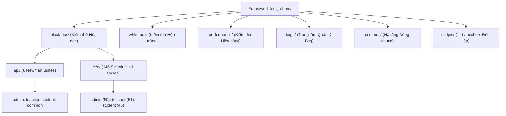

# Kế hoạch Kiểm thử Tổng thể (Master Test Plan) — EnglishHub `test_reborn/`

Tài liệu này xác lập kế hoạch, mục tiêu, kiến trúc thực thi và tiêu chuẩn nghiệm thu cho toàn bộ framework kiểm thử [`test_reborn/`](file:///D:/ki7/prj1/BTL_PRJ1/EnglishHub/test_reborn), căn cứ trên **Source of Truth** tối cao của dự án:
- [`docs/core/01.SRS.md`](file:///D:/ki7/prj1/BTL_PRJ1/EnglishHub/docs/core/01.SRS.md) — Đặc tả Yêu cầu Phần mềm (SRS v1.0).
- [`docs/core/03.TP.md`](file:///D:/ki7/prj1/BTL_PRJ1/EnglishHub/docs/core/03.TP.md) — Kế hoạch Kiểm thử (Test Plan v1.0).
- **Qase TMS Project `EAM`** (845 test cases, 78 suites).

---

## 1. Mục tiêu & Tiêu chuẩn NFR Cốt lõi

1. **Khả năng sử dụng (Usability USA-01 đến USA-06 $\ge 80\%$)**:
   - Trình duyệt Chrome không chặn tải hình ảnh (`imagesEnabled=true`), bảo lưu đầy đủ icon, avatar, bài thi minh họa.
   - Không vô hiệu hóa hiệu ứng chuyển cảnh (transitions/animations) để kiểm tra tính mượt mà của modal, toast, thanh tiến trình bài thi.
   - Ảnh chụp màn hình bằng chứng (evidence) phản ánh 100% giao diện thực tế.
2. **Khả năng bảo trì (Maintainability MAI-01 đến MAI-06 $\ge 80\%$)**:
   - Module hóa cao, chia theo tầng phương pháp kiểm thử, sau đó phân rã theo 4 vai trò (`admin`, `teacher`, `student`, `common`).
   - Tách biệt rõ ràng giữa Data Fixtures, Page Objects, Scenarios, Runners và Launchers.
3. **Hiệu năng Thực thi (Fast Parallel Execution)**:
   - Áp dụng động cơ chạy song song 3 vai trò ([`run-parallel.js`](../black-box/e2e/run-parallel.js)) giúp giảm ~65% tổng thời gian thực thi.
   - Kết hợp khởi tạo dữ liệu nhanh bằng API (API Pre-seeding) và Dynamic DOM polling (50ms).

---

## 2. Phạm vi & Kiến trúc Phân tầng (Test Scope & Levels)

### 2.1. Black-box API (`black-box/api/`)
- Bao phủ 8 bộ sưu tập Postman/Newman chính thức tương ứng 36 Use Cases:
  - `common-auth` (UC01, UC02)
  - `common-profile` (UC03)
  - `admin-account` (UC04, UC05, UC06, UC07)
  - `admin-class` (UC08, UC09)
  - `teacher-assignment` (UC11, UC12, UC13, UC14)
  - `teacher-grading` (UC24, UC25, UC26, UC27, UC31)
  - `student-submission` (UC15 đến UC23)
  - `student-evaluation` (UC34, UC35)

### 2.2. Black-box E2E (`black-box/e2e/`)
- Gồm 146 ca kiểm thử giao diện thực tế tự động hóa bằng Selenium WebDriver:
  - **Admin** (`ADM-001` .. `ADM-050`): Tạo tài khoản, tìm kiếm phân quyền, duyệt lớp học, cấu hình hệ thống, lịch sử sửa điểm.
  - **Teacher** (`TEA-001` .. `TEA-051`): Giao bài 4 kỹ năng (Writing, Speaking, Reading, Listening), xem trước, chấm điểm, tích hợp AI chấm bài, xuất báo cáo.
  - **Student** (`STU-001` .. `STU-045`): Ghi danh, làm bài trắc nghiệm, nộp bài luận, ghi âm Speaking, tra cứu bảng điểm, xem nhận xét.

### 2.3. White-box Testing (`white-box/`)
- Ranh giới kiểm thử cấu trúc mã nguồn:
  - Backend: JUnit 5, Mockito, Testcontainers (`backend/src/test/java`).
  - Frontend: Vitest, React Testing Library (`frontend/src/__tests__`).
  - AI Service: Pytest, pytest-asyncio (`ai-service/tests`).
  - Tài liệu đặc tả: `backend/whitebox-test-cases.md`, `whitebox-strategy.md`, `traceability-matrix.md`.

### 2.4. Performance Testing (`performance/`)
- Công cụ: k6 scenarios mô phỏng tải cao:
  - `scenarios/auth-login-load.js`: Kiểm thử áp lực luồng đăng nhập (NFR PER-01 đến PER-04).
  - `scenarios/submission-burst-load.js`: Kiểm thử cao điểm nộp bài đồng thời cuối giờ thi.

### 2.5. Trung tâm Quản lý Bug (`bugs/`)
- Lưu trữ bằng chứng lỗi, payload mạng, ảnh chụp màn hình và script tái hiện:
  - `active/`: Các lỗi đang mở (`BUG-210-teacher-date-order`, `BUG-205-docx-mime-overflow`).
  - `resolved/`: Các lỗi đã được nghiệm thu đóng.
  - `references/`: Bảng tổng hợp lịch sử lỗi `Bug_List_DB_Review.xlsx`.

---

## 3. Tích hợp Quản lý Kiểm thử Đám mây (Qase TMS)

- Mã kiểm thử thực thi tại máy cục bộ hoặc môi trường CI/CD, kết nối với Qase qua [`QaseAdapter`](../common/support/qase-adapter.js):
  - Project code: `EAM`.
  - Tự động tạo Test Run: `POST /v1/run/EAM`.
  - Ghi nhận trạng thái Passed/Failed/Blocked: `POST /v1/result/EAM/{runId}`.
  - Tải ảnh chụp màn hình lỗi tự động: `POST /v1/attachment/EAM`.
  - Đóng Test Run và sinh liên kết báo cáo trực quan: `POST /v1/run/EAM/{runId}/complete`.
